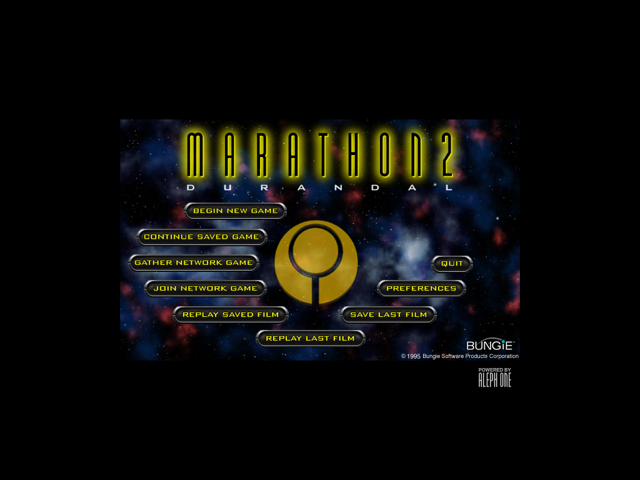
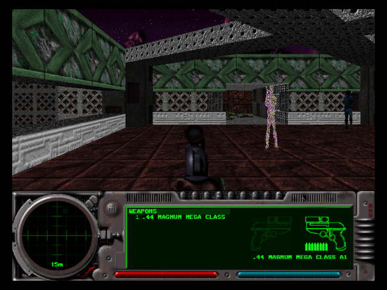

# Aleph One 3DS port: stage 1 host baseline and source audit

Recorded 2026-10-10. Source: tag `release-20260930` (`fc4c274 version 1.11.1`)
on branch `3ds-port`. No engine source has been changed. Every `file:line`
below refers to that tree.

## Contents

- [0. Host baseline](#0-host-baseline): build, configure summary, smoke test
- [Key findings for the port](#key-findings-for-the-port)
- [a) OpenAL and SDL audio](#a-openal-and-sdl-audio)
- [b) Threads and busy-waits](#b-threads-and-busy-waits)
- [c) boost::filesystem and linked boost libraries](#c-boostfilesystem-and-linked-boost-libraries)
- [d) Network code reachable from single-player](#d-network-code-reachable-from-single-player)
- [e) Software renderer framebuffer and screen mode](#e-software-renderer-framebuffer-and-screen-mode)
- [f) Paths: preferences, saves, logs, scenario data](#f-paths-preferences-saves-logs-scenario-data)
- [g) StreamDecoder and audio formats](#g-streamdecoder-and-audio-formats)
- [UNKNOWN items](#unknown-items)

---

## 0. Host baseline

### Build

The development host is macOS (arm64), so the Linux build runs in Docker:
Ubuntu 24.04, aarch64. The package list matches upstream CI
(`.github/actions/configure-linux/action.yml`, non-vcpkg path), plus Xvfb,
xdotool, ImageMagick and gdb for the smoke test.

```sh
docker build -t aleph-host-baseline scripts/3ds/host-baseline
docker run --rm -v "$PWD":/src:ro -v aleph-host-build:/build \
    aleph-host-baseline bash /src/scripts/3ds/host-baseline/build.sh
```

`build.sh` copies the checkout into a Docker volume and runs exactly
`autoreconf -i && ./configure && make -j$(nproc)` there, so no build output
lands in the checkout.

| | |
| --- | --- |
| Result | **OK.** `Source_Files/alephone`, 104 MB, unstripped, `-g -O2` |
| Warnings | 6, all `-Wformat` in `Source_Files/Videos/Movie.cpp:530,602,890` (`%lld` used with `int64_t`, which is `long` on LP64) |
| Toolchain | gcc/g++ 13 (Ubuntu 24.04) |
| Key library versions | SDL2 2.30.0, OpenAL Soft 1.23.1, libsndfile 1.2.2, Boost 1.83.0, asio 1.28.1 (standalone, `libasio-dev`) |

The `configure` output, verbatim:

```
Summary of optional features:

    Enabled: OpenGL rendering
    Enabled: SDL2_image support
    Enabled: cURL for HTTP communication
    Enabled: zziplib support
    Enabled: libpng PNG screenshot support
    Enabled: miniupnpc support
    Enabled: libvpx support for film export
    Enabled: libmatroska support for film export
    Enabled: libebml support for film export
    Enabled: vorbis support for film export
    Enabled: vorbisenc support for film export
    Enabled: libyuv support for film export and video playback
   Disabled: Catch2 replay and unit tests support
  Not found: Native file dialog support
```

```
LIBS: -lyuv -lvorbisenc -lvorbis -lebml -lvpx -lm -lmatroska -lminiupnpc -lpng16
      -lzzip -lz -lcurl -lSDL2_image -lSDL2 -lopenal -lsndfile -lz -lSDL2_ttf
      -lSDL2 -lSDL2 -lboost_filesystem -lGL -lpthread -lGLU
```

Required (non-optional) dependencies, from `configure.ac:100-209`: Boost
>= 1.69 including the compiled `boost_filesystem` library, standalone
`asio.hpp` (`configure.ac:103`, fatal if missing), SDL2 >= 2.0.16, SDL2_ttf,
zlib, sndfile, openal >= 1.14.0. Nothing in `configure.ac` defines
`DISABLE_NETWORKING`, even though the source checks it 92 times.

### Smoke test (software renderer, Marathon 2)

**Data used:** no data path had been provided, so the test uses the official
Marathon 2 data at the commit the tag pins: submodule `data/Scenarios/Marathon 2`
(`data-marathon-2@794167c`, 49 MB). If you want a different data set tested,
pass its path to `smoke.sh`.

```sh
docker run --rm --cap-add=SYS_PTRACE -v "$PWD":/src:ro -v aleph-host-build:/build \
    -v "$PWD/build/host-smoke":/out aleph-host-baseline \
    bash /src/scripts/3ds/host-baseline/smoke.sh "/src/data/Scenarios/Marathon 2"
```

The script launches `alephone -w -g <data>` under Xvfb (1024x768) with
`SDL_AUDIODRIVER=dummy` and a fresh `$HOME`. It then presses **n** (New Game)
and **w** (move forward), takes screenshots, and records `/proc/<pid>/task`
and gdb backtraces at each step.

| Check | Result |
| --- | --- |
| Software renderer active | Yes. `-g` sets `screen_mode.acceleration = _no_acceleration` (`shell.cpp:539-540`); the written prefs show `scmode_accel="0"` |
| Reaches main menu | **Yes**: `docs/3ds/img/host-01-main-menu.png` |
| Starts a level | **Yes**: `docs/3ds/img/host-03-level-moved.png` (first M2 level, HUD drawn, player moved) |
| Process still alive in level | Yes |
| stdout/stderr | empty |

| Main menu | In level |
| --- | --- |
|  |  |

Note that even with `-g` the process loads Mesa and runs 8 `llvmpipe` threads
plus a shader-disk-cache thread. The software renderer presents its frame
through an `SDL_Renderer`, and SDL's default renderer driver on X11 is OpenGL.
See [e)](#e-software-renderer-framebuffer-and-screen-mode).

---

## Key findings for the port

1. **Audio:** OpenAL Soft is used only as a *mixer*. It opens a loopback
   device (`alcLoopbackOpenDeviceSOFT`), and SDL's legacy `SDL_OpenAudio`
   callback pulls samples with `alcRenderSamplesSOFT`. All mixing, source
   updates **and music file decoding** run on the SDL audio thread. On the 3DS
   this means OpenAL Soft (or a replacement mixer) runs inside SDL2's N3DS
   audio callback, with no OpenAL backend needed.
2. **Single-player runs on one main thread** (game timer polled in the main
   loop), plus the SDL audio thread, plus one OpenAL-internal thread. The other
   engine threads are network, update-check, stats upload and film export. One
   exception: the stats thread starts on the first `leaving_map()`, even in
   single-player.
3. **`boost::filesystem` appears in 4 files**, almost all of it in
   `FileHandler.cpp`. `boost_filesystem` is the only compiled boost library
   linked. Uses that `std::filesystem` doesn't have directly:
   `fs::unique_path` (`FileHandler.cpp:805`), and `last_write_time`, which
   returns a `time_t` in boost.
4. **asio is pulled into 43 objects** through `network.h` → `Pinger.h` →
   `NetworkInterface.h:22`. That chain includes `sdl_widgets.h`, so nearly
   every dialog TU gets it. Single-player never constructs an `io_context`
   (that only happens in `NetEnter`). Startup does call `curl_global_init`.
5. **The renderer enforces a 640x480 minimum:** `std::max(mode->width, 640)`
   at `screen.cpp:1168,1189`. Menus are hard-coded to 640x480. The 400x240
   top screen therefore needs a scaled present or code changes.
6. **All user paths derive from `$HOME`** (`cspaths_sdl.cpp:179`). With
   `HOME` unset, `local_data_dir` is `""` and the save directories become
   `/Saved Games` and so on. The 3DS needs its own `get_data_path()` branch.
7. **libsndfile is the only StreamDecoder** and must decode Ogg Vorbis
   (M2 `Music.ogg`). The 3DS portlibs inventory has no `libsndfile`, and the
   only Vorbis package is `libvorbisidec`/Tremor (integer); libsndfile needs
   float `libvorbis`.

---

## a) OpenAL and SDL audio

### Direct uses

| File:line | Code | Notes |
| --- | --- | --- |
| `Source_Files/Sound/AudioPlayer.h:22` | `#include <AL/al.h>` | **The only direct include of `AL/al.h`** |
| `Source_Files/Sound/AudioPlayer.h:23` | `#include <AL/alext.h>` | `alext.h` itself includes `alc.h` and `al.h` (`/usr/include/AL/alext.h:21-22`). **No file includes `<AL/alc.h>` directly** |
| `Source_Files/Sound/OpenALManager.h:22-24` | `#include "MusicPlayer.h"` … `"StreamPlayer.h"` | Gets AL through `AudioPlayer.h` |
| `Source_Files/Sound/OpenALManager.h:121-123` | `static LPALCLOOPBACKOPENDEVICESOFT alcLoopbackOpenDeviceSOFT;` … `static LPALCRENDERSAMPLESSOFT alcRenderSamplesSOFT;` | Function pointers, not linked symbols |
| `Source_Files/Sound/OpenALManager.h:137` | `SDL_AudioSpec sdl_audio_specs_obtained;` | |
| `Source_Files/Sound/OpenALManager.cpp:22,24` | definitions of the static pointers | |
| `Source_Files/Sound/OpenALManager.cpp:46-56` | `if (alcIsExtensionPresent(NULL, "ALC_SOFT_loopback")) { LOAD_PROC(...alcLoopbackOpenDeviceSOFT); ... alcRenderSamplesSOFT ...` | Loaded with `alGetProcAddress`. Fails hard if the extension is missing (`:58`) |
| `Source_Files/Sound/OpenALManager.cpp:275` | `p_ALCDevice = alcLoopbackOpenDeviceSOFT(nullptr);` | `OpenDevice()` |
| `Source_Files/Sound/OpenALManager.cpp:435` | `auto device = p_ALCDevice ? p_ALCDevice : alcLoopbackOpenDeviceSOFT(nullptr);` | Temporary device opened to probe formats in `GetBestOpenALSupportedFormat()` |
| `Source_Files/Sound/OpenALManager.cpp:248` | `alcRenderSamplesSOFT(p_ALCDevice, data, length);` | In `GetPlayBackAudio()` |
| `Source_Files/Sound/OpenALManager.cpp:400` | `if (SDL_OpenAudio(&desired, &sdl_audio_specs_obtained) < 0) {` | **The only `SDL_OpenAudio*` call.** Legacy API (device id 1); `SDL_OpenAudioDevice` is never used |
| `Source_Files/Sound/OpenALManager.cpp:144,154,221,234` | `SDL_LockAudio()` / `SDL_UnlockAudio()` | Legacy-API locking around `audio_players_queue` |
| `Source_Files/Sound/OpenALManager.cpp:158,166,171,178` | `SDL_PauseAudio(...)` | start/pause/stop/record-mode |
| `Source_Files/Sound/OpenALManager.cpp:479` | `SDL_CloseAudio();` | destructor |
| `Source_Files/shell.cpp:237` | `(shell_options.nosound ? 0 : SDL_INIT_AUDIO)` | `-s` skips SDL audio init entirely |

### Uses of `OpenALManager` outside `Sound/OpenALManager.*`

| File:line | What |
| --- | --- |
| `Source_Files/Sound/SoundManager.cpp:31` | include |
| `Source_Files/Sound/SoundManager.cpp:757-763` | `if (!OpenALManager::Init(audio_parameters)) return; OpenALManager::Get()->Start();` (else `Stop()`); this is the only `Init` call site. `:744` returns early if `shell_options.nosound` |
| `Source_Files/Sound/SoundManager.cpp:144` | `OpenALManager::Shutdown();` |
| `Source_Files/Sound/SoundManager.cpp:218,234,357,370,436,476,481,805` | volume, paused-time, listener, `PlaySound` |
| `Source_Files/Sound/Music.cpp:25,111,188-189` | include; `IsPaused`; `PlayMusic(...)` |
| `Source_Files/Sound/AudioPlayer.cpp:20,35,151,170,175` | `PickAvailableSource`, volume, extension queries |
| `Source_Files/Sound/SoundPlayer.cpp:20,47,76,189,244,249,262,333,363` | listener, rewind, volume, HRTF, low-pass filter |
| `Source_Files/Sound/MusicPlayer.cpp:20,37` | music volume |
| `Source_Files/Misc/interface.cpp:154` | include |
| `Source_Files/Misc/interface.cpp:971,984` | `pause_game`/`resume_game` → `Pause(true/false)` |
| `Source_Files/Misc/interface.cpp:3608-3701` | intro/movie playback (pl_mpeg): `Start()`, `PlayStream(audio_player_callback, ...)`, `Stop()` |
| `Source_Files/Misc/preferences.cpp:103,1561,1575-1577,1615-1628,1743-1746` | sound prefs dialog: volume, HRTF support |
| `Source_Files/Videos/Movie.cpp:26,252-258,272,394,418,423,459,464,548,830-833,925-927` | film export: `ToggleDeviceMode(true)`, then `GetPlayBackAudio()` called from the main thread |

### How far AL headers spread

`SoundManager.h:29` includes `SoundPlayer.h` → `AudioPlayer.h:22` →
`<AL/al.h>`, and `preferences.h:59` includes `SoundManager.h` (47 files
include `preferences.h`). As a result, **80 compiled objects include
`AL/al.h` and `AL/alc.h`**, measured from the build's `.deps/*.Po` files.
That includes most of `GameWorld/`, `RenderMain/`, `RenderOther/`, `Lua/` and
`Network/`. A 3DS build needs OpenAL headers (or a shim) on the include path
even if the mixer is replaced.

### How the device is opened and who drives mixing

1. `SoundManager::SetParameters` → `OpenALManager::Init(params)`
   (`SoundManager.cpp:757`).
2. `Init` checks `ALC_SOFT_loopback` and loads the extension function
   pointers (`OpenALManager.cpp:46-56`), then runs `new OpenALManager(params)`.
3. The constructor (`OpenALManager.cpp:386-407`) picks the best loopback
   render format (`ALC_SHORT_SOFT` first, `:146-151`) and calls
   **`SDL_OpenAudio`** with `desired.callback = MixerCallback`, `freq =
   params.rate` (default 44100), `samples = params.sample_frame_size`
   (default 1024), `channels` from prefs (default 2). It then adopts whatever
   SDL actually obtained (`:403-405`).
4. `OpenDevice()` (`:272-309`) calls `alcLoopbackOpenDeviceSOFT(nullptr)` and
   `alcCreateContext` with `ALC_FORMAT_TYPE_SOFT`/`ALC_FORMAT_CHANNELS_SOFT`/
   `ALC_FREQUENCY`/`ALC_HRTF_SOFT` matching the SDL spec, then
   `alcMakeContextCurrent`.
5. `GenerateSources()` (`:347-384`) creates **every** source the device
   allows (`ALC_MONO_SOURCES + ALC_STEREO_SOURCES`), each with
   `num_buffers = 4` AL buffers (`AudioPlayer.h:72`).
6. `Start()` → `SDL_PauseAudio(0)`.

**Mixing is driven by the SDL audio callback (pull model).** SDL's audio
thread calls `MixerCallback` (`OpenALManager.cpp:409-413`) →
`GetPlayBackAudio` (`:246-249`):

```cpp
void OpenALManager::GetPlayBackAudio(uint8* data, int length) {
	ProcessAudioQueue();
	alcRenderSamplesSOFT(p_ALCDevice, data, length);
}
```

`ProcessAudioQueue()` (`:75-97`) runs **on the audio thread**. It pops new
players from a lock-free SPSC queue
(`boost::lockfree::spsc_queue<..., capacity<256>> audio_players_shared`,
`OpenALManager.h:116`, commented "pipeline main => audio thread"). Then, for
each player, it calls `AssignSource()`, `Update()` and `Play()`. Those call
`FillBuffers()` → `GetNextData()` → `alBufferData` (`AudioPlayer.cpp:69-99`).
For music, `GetNextData` is `MusicPlayer::GetNextData` → `decoder->Decode()`
(`MusicPlayer.cpp:43-44`), i.e. `sf_read_float` plus file reads through
`SDL_RWops`, **all on the SDL audio thread**.

OpenAL Soft never opens a real output device. During film export
(`Movie.cpp:256-258,832`) SDL output is paused and the main thread calls
`GetPlayBackAudio()` itself.

Threads observed at runtime (details in [b)](#b-threads-and-busy-waits)):
`SDLAudioP1` (SDL audio thread running `MixerCallback`) and one unnamed
thread started from `libopenal.so.1` via `std::thread`. Both disappear with
`-s`. A PulseAudio `threaded-ml` thread also appears; it comes from OpenAL
Soft probing its PulseAudio backend at library init and disappears with
`ALSOFT_DRIVERS=null`, so it is a host-only artifact.

---

## b) Threads and busy-waits

### Search results

`std::thread`, `std::async`, `boost::thread`, `std::jthread`,
`pthread_create`: **no thread creation anywhere in `Source_Files/`**.
`std::thread::id` is used only as a map key in `Misc/Logging.cpp:126`.
`asio::io_context::run()` is never called; the only run call is
`run_for(timeout)`, listed below. Every engine thread is created with
`SDL_CreateThread`.

| File:line | Thread name / mechanism | What it does | Runs in single-player? |
| --- | --- | --- | --- |
| `CSeries/mytm_sdl.cpp:218` | `myXTMSetup_taskThread` | Periodic timer thread (`thread_loop`, `:127-200`); sleeps with `sleep_for_machine_ticks`, calls the callback under `sTMTaskMutex`. Priority raised with `BoostThreadPriority` (`:221`) | **No.** Only callers: `network_star_hub.cpp:515` (`hub_tick`) and `network_star_spoke.cpp:229` (`spoke_tick`). The single-player input timer is **not** a thread: `install_timer_task` (`Misc/vbl.cpp:1438-1446`) only stores a function pointer, and `execute_timer_tasks` (`vbl.cpp:1453-1480`) is called from the main loop (`shell.cpp:790`) |
| `Network/network_udp.cpp:95` | `NetDDPOpenSocket_ReceivingThread` | UDP receive loop: `while (sKeepListening) { receive_result = sSocket->receive_async(1000); ...}` (`:58-74`), which goes through `UDPsocket::receive_async` → `_io_context.run_for(1000 ms)` (`NetworkInterface.cpp:114-116`) | **No.** Started by `NetDDPOpenSocket` ← `network.cpp:1231` (network game setup) |
| `Network/ConnectPool.cpp:54` | `NonblockingConnect_thread` | DNS resolve + TCP connect (`:68-…`) | **No.** Network join (`network.cpp:1643,2467`) |
| `Network/Update.cpp:67` | `Update_checkThread` | HTTP GET of the update URL via curl (`:74-110`) | **No.** `Update::instance()` (lazy singleton, `Update.h:34-38`, constructor starts the check at `Update.cpp:34`) is only reached from `setupAndConnectClient` (`Metaserver/metaserver_dialogs.cpp:74-83`), i.e. metaserver gather/join |
| `Misc/Statistics.cpp:51` | `StatsManager_uploadThread` | Loop `while (sm->run_)`: pops a stats entry and `client.Post(A1_STATSERVER_ADD_URL, ...)`, otherwise `sleep_for_machine_ticks(MACHINE_TICKS_PER_SECOND / 5)` (`:116-159`) | **Yes, lazily.** `StatsManager::instance()` (`Statistics.h:38-42`) constructs on first use. `leaving_map()` calls it for `_single_player` (`GameWorld/marathon2.cpp:624-627`), so the thread starts on the first quit/revert/load-from-game and then polls every 200 ms. It only uploads if the stats Lua plugin is allowed (`network_preferences->allow_stats`, default `false` in `default_network_preferences`, `preferences.cpp:4200`). `interface.cpp:2311,2986` (`Finish()`) also create and join it on quit |
| `Videos/Movie.cpp:471` | `MovieSetup_encodeThread` | Film-export encoder, synced with `SDL_SemWait`/`SDL_SemPost` (`:615-636,781`) | Only while exporting a film (user action, `vbl.cpp:593`) |
| (implicit) `OpenALManager.cpp:400` | SDL audio thread `SDLAudioP1` | Runs `MixerCallback` → all AL mixing and music decoding (see [a)](#a-openal-and-sdl-audio)) | **Yes**, unless `-s` |
| (implicit) `libopenal.so.1` | unnamed thread created via `std::thread` | OpenAL Soft internal, not a mixer (the device is loopback). Exact role: UNKNOWN, see [UNKNOWN items](#unknown-items) | **Yes**, unless `-s` |

### Threads seen at runtime (single-player, in level)

From `/proc/<pid>/task` plus `gdb thread apply all bt`:

| Thread | Origin |
| --- | --- |
| `alephone` (main) | `main` → `main_event_loop` → `sleep_for_machine_ticks(1)` (`shell.cpp:806`) |
| `SDLAudioP1` | SDL audio thread (`libSDL2`) |
| `alephone` | `libopenal.so.1` via `libstdc++` `std::thread` |
| `threaded-ml` | `libpulse` mainloop, from OpenAL Soft's PulseAudio backend probe. Gone with `ALSOFT_DRIVERS=null` |
| `llvmpipe-0..7`, 8× `alephone`, `alephon:disk$0` | Mesa (`libgallium`): the SDL_Renderer's OpenGL backend used to present the software framebuffer |

Comparison of short runs at the main menu, Mesa threads excluded:

| Configuration | Threads |
| --- | --- |
| default | main, `SDLAudioP1`, OpenAL thread, `threaded-ml` |
| `ALSOFT_DRIVERS=null` | main, `SDLAudioP1`, OpenAL thread |
| `-s` (nosound) | main only |

No network, timer, update or stats threads were running in either the menu or
the level.

### Busy-wait and polling loops

| File:line | Code | Sleeps? | Single-player? |
| --- | --- | --- | --- |
| `Misc/interface.cpp:1705-1709` | `do { Music::instance()->Idle(); } while (machine_tick_count()-ticks<10);` | **No: a true busy-wait** (10 ms) | Yes: `display_epilogue()` at game end |
| `Network/Metaserver/metaserver_dialogs.cpp:74` | `while (Update::instance()->GetStatus() == Update::CheckingForUpdate && machine_tick_count() - ticks < 500);` | **No: busy-wait** up to 0.5 s | No (metaserver) |
| `Network/Metaserver/metaserver_dialogs.cpp:78` | same, `< 2500` | **No: busy-wait** up to 2.5 s, with a progress dialog open | No (metaserver) |
| `shell.cpp:799-808` | in-game frame pacing: `if (desired - elapsed > desired / 3) sleep_for_machine_ticks(1);` | Partly. It sleeps 1 ms per iteration while more than 1/3 of a frame remains, and spins (no sleep) for the last third. With `fps_target == 0` (unlimited) it **never sleeps** while a game is in progress | Yes. Default prefs `fps_target="30"` |
| `shell.cpp:754-771` | menus: `SDL_WaitEventTimeout(&event, 30)` | Yes (blocks up to 30 ms) | Yes |
| `Misc/sdl_dialogs.cpp:2238-2259` (`dialog::run`) | `process_events()` → `SDL_WaitEventTimeout(&e, 30)` (`:2330`), then `yield()` | Yes (blocks up to 30 ms; `yield()` is `std::this_thread::yield`, `csmisc_sdl.cpp:71-74`) | Yes (all dialogs) |
| `CSeries/csmisc_sdl.cpp:84-92` (`wait_for_click_or_keypress`) | `while (...) { SDL_WaitEventTimeout(&event, ticks); ...}` | Yes | Yes |
| `Misc/interface.cpp:3692,3698` | movie playback loop: `sleep_for_machine_ticks(1)` / `(MACHINE_TICKS_PER_SECOND / 100)` | Yes | Yes (intro movies, if present; M2 data has none) |
| `Misc/interface.cpp:997` | `sleep_for_machine_ticks(MACHINE_TICKS_PER_SECOND / 12)` | Yes | Yes |
| `Network/Pinger.cpp:89-109` | `while (!timeout_ms \|\| ...) { ... sleep_for_machine_ticks(1); }` | Yes (1 ms) | No |
| `TCPMess/CommunicationsChannel.cpp:454-460` | `sleep_for_machine_ticks(kSSRPumpInterval); pump();` | Yes | No |
| `TCPMess/CommunicationsChannel.cpp:487-510` | loops on `receiveMessage(...)`, which sleeps internally | Yes, indirectly | No |
| `TCPMess/CommunicationsChannel.cpp:549-562` | `sleep_for_machine_ticks(kFlushPumpInterval)` | Yes | No |
| `Network/StandaloneHub/StandaloneHub.cpp:125-129` | `sleep_for_machine_ticks(1)` | Yes | No (separate binary) |
| `shell.cpp:315-322,484-491` | Steam shim pump, `sleep_for_machine_ticks(30)` | Yes | Only with `HAVE_STEAM` |

The other empty-bodied `do … while` loops matched by the search
(`RenderMain/*`, `GameWorld/*`, `flood_map.cpp`, and so on) are bounded
algorithmic loops, not waits.

---

## c) boost::filesystem and linked boost libraries

### Uses (count = matching lines)

| File | Count | Lines | What |
| --- | --- | --- | --- |
| `Source_Files/Files/FileHandler.cpp` | 16 | `80` include; `89` `namespace fs = boost::filesystem;`; `111-115` `utf8_to_path`/`path_to_utf8`; `392` `fs::create_directory`; `520` `fs::is_directory`; `529` `fs::last_write_time`; `695` `fs::remove`; `703` `fs::rename`; `805` **`fs::unique_path("%%%%%%")`**; `885-900` `fs::directory_iterator`, `fs::directory_file`, `fs::regular_file`, `fs::last_write_time` | Core of `FileSpecifier`/`DirectorySpecifier`. Every call uses the `error_code` overloads |
| `Source_Files/XML/Plugins.h` | 3 | `33` include; `100-101` `bool disable/enable(const boost::filesystem::path&)` | 12 files include `Plugins.h` |
| `Source_Files/XML/Plugins.cpp` | 2 | `133`, `145` (definitions). Comment: *"std path is not supported before mac os 10.15 so we are using boost path instead"* | |
| `Source_Files/Misc/preferences.cpp` | 2 | `135-136` `static std::vector<boost::filesystem::path> orphan_disabled_plugins / orphan_enabled_plugins;` | |
| `Steam/steamshim_parent.cpp` | 8 | `22,25,51,212,242,246,247,259` | **Not built** without `--enable-steam` |

19 compiled objects include `boost/filesystem.hpp`, per `.deps`.

What a move to `std::filesystem` (which the 3DS toolchain probe confirmed
works) would have to handle:

- `fs::unique_path` (`FileHandler.cpp:805`) has no `std::` equivalent.
- `fs::last_write_time` returns `std::time_t` in boost but
  `std::filesystem::file_time_type` in `std::` (`FileHandler.cpp:529,900`).
- `path.native()` on Windows is `std::wstring` (`:111-112`); this doesn't
  affect the 3DS.

### Compiled boost libraries linked

- `configure.ac:100-106`: `AX_BOOST_BASE([1.69.0])` + `AX_BOOST_FILESYSTEM`,
  which adds `$BOOST_FILESYSTEM_LIB` to `LIBS`.
- `LIBS` contains only `-lboost_filesystem`.
- `ldd alephone`: `libboost_filesystem.so.1.83.0`, and no other
  `libboost_*`.
- Boost.System is header-only since 1.69. The header-only boost libraries
  used are `algorithm/string`, `iostreams` (`stream_buffer`, `device/array`),
  `property_tree` (xml/ini), `tokenizer`, `unordered_map`, `uuid`,
  `lockfree/spsc_queue`, `container/small_vector`, `range`.

---

## d) Network code reachable from single-player

The whole network stack is always linked: `Network/libnetwork.a`,
`Network/Metaserver/libmetaserver.a` and `TCPMess/libtcpmess.a`
(`Source_Files/Makefile.am:23-33`). `network_dummy.cpp` (17 stub functions,
`NetExit`, `NetSync`, …) exists but is only listed under
`EXTRA_libnetwork_a_SOURCES` (`Network/Makefile.am:20`), so it is never
built.

### asio

`asio.hpp` is included directly only at `Network/NetworkInterface.h:22`. It
reaches **43 compiled objects** through `network.h:33` → `Pinger.h:24` →
`NetworkInterface.h`, including `shell.cpp`, `Misc/sdl_widgets.h` (so most
dialog code), `RenderOther/screen.cpp`, `screen_shared.h`,
`GameWorld/marathon2.cpp`, `player.cpp` and `Files/game_wad.cpp`. The only
`asio::io_context` lives in `NetworkInterface` (`NetworkInterface.h:113`). It
is created only in `NetEnter` (`Network/network.cpp:1218`) and driven only
by `run_for` (`NetworkInterface.cpp:114-116`).

### Entry points and their reachability

| Entry point | File:line | Reached in single-player? |
| --- | --- | --- |
| `HTTPClient::Init()` → `curl_global_init(CURL_GLOBAL_ALL)` | `shell.cpp:563` → `Network/HTTP.cpp:37-40` | **Yes, on every startup.** No network I/O, but it initializes curl and its TLS backend (GnuTLS here). A no-op without `HAVE_CURL` (`HTTP.cpp:135-138`) |
| `StarGameProtocol::ParsePreferencesTree` | `Misc/preferences.cpp:5073` | **Yes, on every prefs load.** Pure XML parsing of `<star_protocol>`, no I/O |
| `StatsManager` thread + `HTTPClient::Post` | `GameWorld/marathon2.cpp:627` → `Misc/Statistics.cpp:51,114,152` | **Thread: yes** (first `leaving_map()`). **HTTP: only if** the stats plugin is allowed (`XML/Plugins.cpp:71-76`, `allow_stats` default false) and its Lua returns stats (`Lua/lua_script.cpp:2107-2123`). M2 data ships `Plugins/Marathon 2 Stats` (`stats_lua="stats.lua"`) |
| `NetAllowCrosshair/TunnelVision/Behindview/CarnageMessages/SavingLevel/OverlayMap` | callers `RenderOther/screen.cpp:166,659,1476`, `RenderOther/ChaseCam.cpp:58,64`, `Misc/Console.cpp:354,412`, `Lua/lua_hud_objects.cpp:2565`; definitions `Network/network.cpp:2737-2755` | **Yes, every frame.** Pure functions of `dynamic_world->player_count`/`cheat_flags`, no I/O |
| `NetSetChatCallbacks` | `GameWorld/marathon2.cpp:633,705` | **Yes, on every level load/leave.** Pointer setter (`network.cpp:1151-1153`) |
| `NetProcessMessagesInGame`, `NetCheckWorldUpdate`, `NetGetNetTime`, unconfirmed action flags | `GameWorld/marathon2.cpp:470-479,495,561-580` | No: guarded by `if (game_is_networked)` / `#ifndef DISABLE_NETWORKING` |
| `NetGetGameData`, `NetGetLocalPlayerIndex`, `NetChangeMap`, `NetSync` | `Files/game_wad.cpp:481,796,809`, `marathon2.cpp:685`, `Lua/lua_map.cpp:3634-3635`, `lua_hud_objects.cpp:2988-2989`, `Misc/interface.cpp:633-647` | No: each guarded by `game_is_networked` (`NetGetGameData` asserts `netState != netUninitialized`, `network.cpp:1754`) |
| `exit_networking()` → `NetExit()` | `Misc/interface.cpp:2851,2903` → `:3493-3497` | No: only for `_network_player` / `inNetgame`. `NetExit` is also registered with `atexit` inside `NetEnter` (`network.cpp:1225`) |
| Main menu **Gather Network Game** → `network_gather` → `NetEnter` (creates `NetworkInterface`/`io_context`), SSLP LAN discovery, UPnP `PortForward` | `Misc/interface.cpp:2933` → `Network/network_dialogs.cpp:236,251,126` → `network.cpp:1215-1218,1487` | Only by user action from the main menu; changes state to `_network_player` (`interface.cpp:2928`) |
| Main menu **Join Network Game** → `network_join` → `NetEnter`, SSLP locate, `ConnectPool` thread | `interface.cpp:2936` → `network_dialogs.cpp:602,609,144` | Only by user action |
| Metaserver UI, `setupAndConnectClient` (busy-waits + `Update` thread), `Pinger` | `network_dialogs.cpp:266` → `Metaserver/metaserver_dialogs.cpp:46-83`; `network.cpp:1426-1435` | Only within gather/join |
| Preferences → online account link / sign-up (`HTTPClient` GET/POST) | `Misc/preferences.cpp:641-660,666-700` | Only by user action in the prefs dialog |
| Console command `latency tolerance` → `hub_set_minimum_send_period` | `Misc/preferences.cpp:3412-3427` | Only if typed in the console; sets a variable |
| `StandaloneHub` | `Network/StandaloneHub/*`, `standalone_hub_main.cpp` | **Never.** Separate `standalone_hub` binary (`--enable-standalone-hub`) |
| `TCPMess/CommunicationsChannel` | `TCPMess/*` | Only through network gather/join/metaserver |

---

## e) Software renderer framebuffer and screen mode

### Surfaces (all `SDL_CreateRGBSurface(SDL_SWSURFACE, ...)`)

| Surface | File:line | Size / format |
| --- | --- | --- |
| `world_pixels` (the 3D view target) | `RenderOther/screen.cpp:589-622` (`reallocate_world_pixels`) | `BufferRect` size (see below). Depth from `bit_depth` = prefs `scmode_bitdepth`: 8-bit paletted (`:603`), 16-bit RGB565 (`:606`), or 32-bit ARGB8888 (`:609`, the default) |
| `world_pixels_corrected` | `screen.cpp:621` | same, for gamma correction (`apply_gamma` in `update_screen`, `:1714-1716`) |
| `main_surface` (whole logical screen) | `screen.cpp:1076-1078` | `vmode_width × vmode_height`, **always 32-bit ARGB8888** |
| `main_texture` | `screen.cpp:1066-1074` | `SDL_CreateTexture(main_render, ARGB8888, SDL_TEXTUREACCESS_STREAMING, vmode_w, vmode_h)` |
| `Intro_Buffer`, `Intro_Buffer_corrected` | `screen.cpp:188-189` | fixed **640×480** 32-bit (menus, chapter screens) |
| `Map_Buffer` | `screen.cpp:624-637` | map rect, `main_surface` format |
| `Term_Buffer` | `screen.cpp:1097-1098` | terminal rect, 32-bit with alpha |
| `HUD_Buffer` | `RenderOther/game_window.cpp:470-476` (freed at `screen.cpp:1088-1091`) | fixed **640×480** 32-bit (classic HUD is drawn at 640×480 and scaled) |

The software rasterizer does not write to the SDL surface directly. It
renders into a `bitmap_definition` view of `world_pixels`:
`software_render_dest = bitmap_definition_of_sdl_surface(world_pixels)`
(`screen.cpp:1441`), then `render_view(world_view, software_render_dest.get())`
(`:1444`).

### Buffer size

In `render_screen` (`screen.cpp:1375-1385`):

```cpp
SDL_Rect BufferRect = {0, 0, ViewRect.w, ViewRect.h};
if (!HighResolution && screen_mode.acceleration == _no_acceleration) {
	BufferRect.w >>= 1;
	BufferRect.h >>= 1;
}
world_view->screen_width = BufferRect.w;
world_view->screen_height = BufferRect.h;
world_view->standard_screen_width = 2 * BufferRect.h;
```

`ViewRect` is the 3D-view area inside the logical screen (the HUD layout).
`HighResolution` is prefs `scmode_highres` (`:1354`). The buffer is
reallocated only when the view size, depth, hi-res or every-other-line
setting changes (`:1389-1401`).

### Presentation path

`update_screen` (`screen.cpp:1711-1721`) blits `world_pixels` to
`main_surface`, either straight (`hi_rez`) or 2× pixel-doubled / every
other line. `MainScreenUpdateRects` (`screen.cpp:2289-2298`) does:

```cpp
SDL_UpdateTexture(main_texture, NULL, main_surface->pixels, main_surface->pitch);
SDL_RenderClear(main_render);
SDL_RenderCopy(main_render, main_texture, NULL, NULL);
SDL_RenderPresent(main_render);
```

The renderer is created with `SDL_CreateRenderer(main_screen, -1, 0)`,
`SDL_HINT_RENDER_SCALE_QUALITY "linear"` and
`SDL_RenderSetLogicalSize(main_render, vmode_width, vmode_height)`
(`screen.cpp:1067-1071`). The driver hint comes from
`graphics_preferences->software_sdl_driver` (`:870-886`): `software`,
`opengl`, `direct3d`, or `""` (SDL's choice, the default `0`). This is why
llvmpipe/Mesa threads show up in the smoke test.

### Choosing the resolution and screen mode

- **Candidate modes** (`screen.cpp:215-262`):
  `SDL_GetDesktopDisplayMode(0)`, if at least 640×480, becomes `m_modes[0]`
  (fallback 1600×900). Then a fixed list (1920×1080 … 640×480, 480×240,
  320×160) is filtered to sizes no larger than the desktop, and the custom
  prefs size is inserted.
- **Auto resolution** (`get_auto_resolution_size`, `:1133-1159`): if
  `scmode_auto_resolution` (default `true`), the size is `m_modes[0]` in
  fullscreen, or `m_modes[1]` ("one step down") in a window.
- **640×480 floor and fixed menu size** (`:1161-1205`):
  ```cpp
  short w = std::max(mode->width, static_cast<short>(640));
  short h = std::max(mode->height, static_cast<short>(480));
  if (screentype == _screentype_menu) { w = 640; h = 480; }
  ...
  bool force_menu_size = (screentype == _screentype_menu || screentype == _screentype_chapter);
  ```
  `change_screen_mode(int w,int h,...)` (`:831-853`) sets
  `vmode_width/height = 640/480` when `force_menu`.
- **Window** (`:843-848,929-933`): `SDL_WINDOW_FULLSCREEN_DESKTOP` if
  `scmode_fullscreen` (window size 0×0), and `SDL_WINDOW_ALLOW_HIGHDPI` if
  `scmode_high_dpi`. `SDL_WINDOW_OPENGL` is only set when not `nogl` and
  acceleration is on (`:890-907`). Fallbacks at `:937-1058` retry without
  multisampling, with 16-bit depth/colour, windowed, then software, and
  finally `vhalt("Cannot find a working video mode.")`.
- **Mode changes without re-creating the window** (`need_mode_change`,
  `:739-818`): `SDL_SetWindowFullscreen`, `SDL_SetWindowSize`,
  `SDL_RenderSetLogicalSize`, and rebuilding `main_surface`/`main_texture`
  when the logical size changes.
- Prefs written by the smoke run: `scmode_width="640" scmode_height="480"
  scmode_auto_resolution="true" scmode_high_dpi="true" scmode_highres="true"
  scmode_bitdepth="32" scmode_accel="0" software_sdl_driver="0"
  fps_target="30"`.

---

## f) Paths: preferences, saves, logs, scenario data

### Resolution code

`get_data_path(CSPathType)` exists in three versions:
`CSeries/cspaths_sdl.cpp:165-236` (Linux and "compatible"; a 3DS build would
land here today), `:39-163` (Windows), and `CSeries/cspaths.mm` (macOS).

Linux (`cspaths_sdl.cpp:174-223`):

```cpp
const char *home = getenv("HOME");
if (home)
	local_dir = std::string(home) + "/.alephone";
```

| `CSPathType` | Linux result | Set into (`shell.cpp`) |
| --- | --- | --- |
| `kPathLogs` | `$HOME/.alephone` | `log_dir` (`:278`) |
| `kPathLocalData` | `$HOME/.alephone` | `local_data_dir` (`:377`) |
| `kPathPreferences` | `$HOME/.alephone` | `preferences_dir` (`:378`) |
| `kPathSavedGames` | `$HOME/.alephone/Saved Games` | `saved_games_dir` (`:379`) |
| `kPathQuickSaves` | `$HOME/.alephone/Quick Saves` (+ `/<scenario name>`, `:521-529`) | `quick_saves_dir` (`:380`) |
| `kPathImageCache` | `$HOME/.alephone/Image Cache` | `image_cache_dir` (`:392`) |
| `kPathRecordings` | `$HOME/.alephone/Recordings` | `recordings_dir` (`:393`) |
| `kPathScreenshots` | `$HOME/.alephone/Screenshots` | `screenshots_dir` (`:394`) |
| `kPathDefaultData` | `PKGDATADIR` (compile-time, from `confpaths.h`) | `default_data_dir` (`:374`) |
| `kPathLegacyData`, `kPathBundleData`, `kPathLegacyPreferences` | `""` (not applicable) | |

If `HOME` is unset, `local_dir` stays `""` and the derived paths become
`/Saved Games`, `/Quick Saves` and so on (root-relative).

The directories are created at `shell.cpp:511-532` (`MakeDirectory()` for
prefs, local data, saves, quick saves, image cache, recordings,
screenshots).

### Specific files

| Item | Where | Name |
| --- | --- | --- |
| Preferences | `SetToPreferencesDir()` + `getcstr(..., strFILENAMES, filenamePREFERENCES)` (`Misc/preferences.cpp:3502-3509`). Default string `"$appName$ Preferences"` (`Misc/DefaultStringSets.cpp:91`); with `-e`, `" Editor"` is appended. Fallbacks: `Scripts/Default Preferences.xml` from the data search path (`:3523-3527`), then the legacy name (`:3530-3533`) | Smoke run: `$HOME/.alephone/Marathon 2 Preferences` (XML) |
| Log | `Misc/Logging.cpp:241-251`: `log_dir + get_application_name() + " Log.txt"`, opened in append mode **lazily** on the first `GetCurrentLogger()` call (`:58-61`) | `Aleph One Log.txt`. **Not created in the smoke run** (nothing was logged) |
| Last film | local data dir, `"$appName$ Recording"` (`DefaultStringSets.cpp:95`) | Smoke run: `$HOME/.alephone/Aleph One Recording` |
| Saved games | `saved_games_dir` used by the file dialogs (`Files/FileHandler.cpp:93,723`) | |
| Quick saves | `quick_saves_dir/<scenario>` (`shell.cpp:521-529`, `XML/QuickSave.cpp`) | |
| Image cache | `WadImageCache::instance()->initialize_cache()` (`shell.cpp:534`), saved at shutdown (`:586`) | |

### Scenario data

- **Scenario chooser** (`shell.cpp:281-368`, unless `SCENARIO_IS_BUNDLED`):
  the primary scenario dir is the command-line directory, else
  `$ALEPHONE_DEFAULT_DATA`, else `PKGDATADIR`. Subdirectories (`Scenarios/`)
  are offered when there is more than one. Skipped with `--no-chooser`/`-e`.
- **`data_search_path`** (`shell.cpp:396-445`), in order:
  1. `kPathBundleData` (macOS only)
  2. the command-line directory or `$ALEPHONE_DEFAULT_DATA`
  3. the entries of `$ALEPHONE_DATA` (colon-separated; replaces items 4-5
     when set)
  4. otherwise `default_data_dir`, `kPathLegacyData`, `local_data_dir`

  Data files (`Map`, `Shapes`, `Sounds`, `Images`, `Music`, `Scripts/`,
  `Plugins/`, MML) are found by searching this list
  (`FileSpecifier::SetNameWithPath`).
- If the required files are missing, `alert_choose_scenario` gives a last
  chance to pick a directory (`shell.cpp:464-479`).
- In the smoke run, the data dir was the command-line argument
  `/src/data/Scenarios/Marathon 2`.

---

## g) StreamDecoder and audio formats

### Implementations

`Sound/Decoder.h:31-62` defines `StreamDecoder` (streaming:
`Open/Decode/Rewind/Close`, format queries) and `Decoder : StreamDecoder`
(adds `Frames()`).

**There is exactly one implementation:**
`class SndfileDecoder : public Decoder` (`Sound/SndfileDecoder.h:30`). Both
factories try only it (`Sound/Decoder.cpp:30-46`):

```cpp
unique_ptr<SndfileDecoder> sndfileDecoder(std::make_unique<SndfileDecoder>());
if (sndfileDecoder->Open(File))
	return sndfileDecoder;
```

`SndfileDecoder` (`Sound/SndfileDecoder.cpp`):

- Opens through `sf_open_virtual` with `SF_VIRTUAL_IO` callbacks over
  `SDL_RWops` (`:29-65,77-90`), so it reads through the engine's `OpenedFile`
  abstraction.
- Always decodes to **32-bit float**: `sf_read_float(sndfile, (float*)
  buffer, max_length / 4) * 4` (`:96`); `GetAudioFormat()` returns
  `AudioFormat::_32_float`, `BytesPerFrame() = 4 * channels`
  (`SndfileDecoder.h:38-42`). AL buffers are therefore
  `AL_FORMAT_*_FLOAT32` (`AudioPlayer.h:85-92`), which needs OpenAL's
  `AL_EXT_float32`.
- Mono or stereo only (`IsStereo() = channels == 2`).

### Callers

| File:line | Purpose | Thread |
| --- | --- | --- |
| `Sound/Music.cpp:194` | `StreamDecoder::Get(*file)` for intro music and Lua/MML dynamic music tracks; decoded incrementally by `MusicPlayer::GetNextData` (`MusicPlayer.cpp:43-61`) | **SDL audio thread** (see [a)](#a-openal-and-sdl-audio)) |
| `Sound/ReplacementSounds.cpp:29` | `Decoder::Get(File)`: MML `<sound>` replacement files, fully decoded at load | main thread |
| `Lua/lua_music.cpp:174` | `StreamDecoder::Get(path)` as an "is this file playable" check | main thread |

### Formats needed

| Content | Format | Decoded by |
| --- | --- | --- |
| M2 intro/menu music: `Music.ogg` in the data dir | **Ogg Vorbis**, stereo, 22050 Hz (`file`: "Ogg data, Vorbis audio, stereo, 22050 Hz, ~66666 bps") | libsndfile (needs libvorbis + libogg) |
| Level music | none in this data set: `Music.ogg` is the only audio file in the data dir. Scenarios can add level/dynamic music via MML (`XML/XML_LevelScript.cpp`) or Lua (`Lua/lua_music.cpp`) | libsndfile |
| Lua/MML music tracks, replacement sounds (third-party scenarios/plugins) | anything libsndfile opens. Ubuntu's libsndfile 1.2.2 links `libvorbis`, `libogg`, `libFLAC`, `libopus`, `libmpg123`, `libmp3lame`, so WAV/AIFF/FLAC/Ogg Vorbis/Opus/MP3 | libsndfile |
| Game sound effects: `Sounds.sndA` | Mac `snd ` resources: uncompressed big-endian 8/16-bit PCM. Standard (`stdSH`) and extended/compressed (`extSH`/`cmpSH`) headers, but `cmpSH` is accepted only for the `'twos'` format with `comp_id == -1` (`Sound/SoundFile.cpp:63-111,113-139`) | Aleph One's own parser (`SoundFile.cpp`), not libsndfile |
| Intro/cutscene movies | MPEG-1 video + MP2 audio | bundled `Videos/pl_mpeg.h` (`Misc/interface.cpp:157,3505-3666`), audio output as `AudioFormat::_32_float` through `PlayStream`. M2 data has no movies |
| Film export | Matroska/WebM, VP8 + Vorbis (encode only) | libvpx/libvorbisenc/libmatroska (`Videos/Movie.cpp`), not needed for playback |

For the port: the 3DS portlibs inventory (`docs/3ds/portlibs-inventory.txt`)
has **no `3ds-libsndfile`**. Its Vorbis package is `3ds-libvorbisidec`
(Tremor, integer-only decoder), which libsndfile cannot use. `3ds-libogg`,
`3ds-flac`, `3ds-opusfile` and `3ds-mpg123` exist. Playing M2 `Music.ogg`
needs either libsndfile cross-built with float libvorbis, or a second
`StreamDecoder` (for example over Tremor) added to `Decoder.cpp`.

---

## UNKNOWN items

| Item | Why it is unknown |
| --- | --- |
| Exact role of the unnamed thread started from `libopenal.so.1` | Ubuntu's libopenal has no debug symbols, so the gdb backtrace shows only `libopenal.so.1` → `libstdc++` (`std::thread`). It is tied to OpenAL init (absent with `-s`). It is not a mixer thread, since the device is loopback and mixing happens in `alcRenderSamplesSOFT`. Most likely OpenAL Soft's per-context event thread, but this is not confirmed |
| Whether a `DISABLE_NETWORKING` build compiles and links | No build-system switch defines it, `network_dummy.cpp` is not in the build, and this stage did not try it |
| `StatsManager_uploadThread` at runtime | Established from source only. The smoke test was killed in-level, before any `leaving_map()` |
| Behaviour with real audio hardware | The smoke test used `SDL_AUDIODRIVER=dummy`; the SDL callback thread ran, but output wasn't heard |
| Whether anything logs during a normal start | No `Aleph One Log.txt` was created in the smoke run, so nothing logged there; other code paths were not exercised |

---

## Reproducing

| File | Purpose |
| --- | --- |
| `scripts/3ds/host-baseline/Dockerfile` | Ubuntu 24.04 build image |
| `scripts/3ds/host-baseline/build.sh` | `autoreconf -i && ./configure && make -j$(nproc)` in a volume |
| `scripts/3ds/host-baseline/smoke.sh` | headless menu → level test, screenshots, thread dumps |
| `build/host-build.log`, `build/host-smoke/` | logs and raw outputs from this run (git-ignored via `.git/info/exclude`) |
