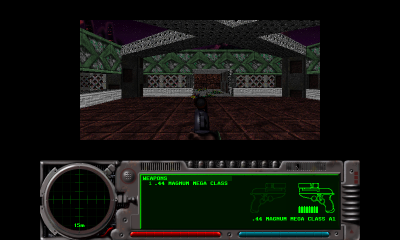
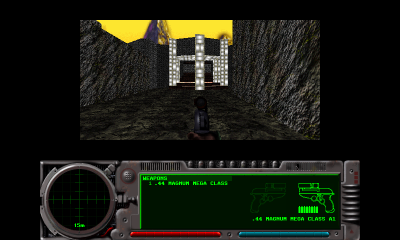
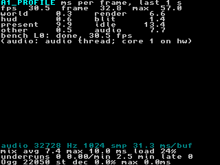
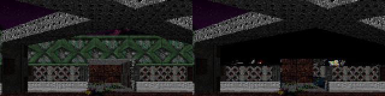
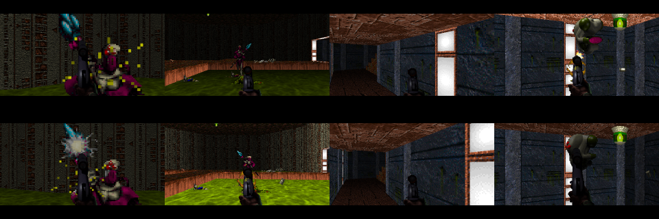
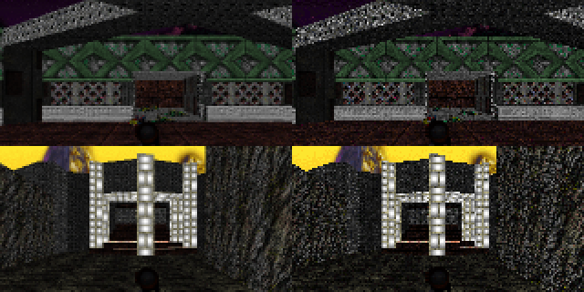
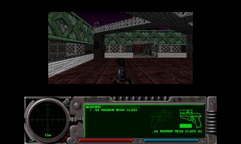
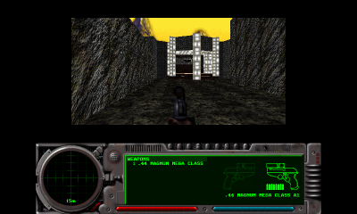
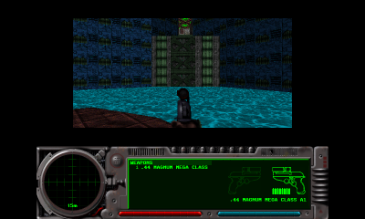
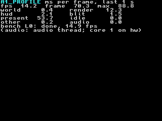

# Aleph One 3DS port: performance

Recorded 2026-10-11 on branch `3ds-port`, on top of stage 6 (`d19dae0`).
Goal: measure first, then optimise; keep only changes with a measured gain
and no visual regression. Engine changes are listed in
[`PATCHES.md`](PATCHES.md) (entries 34 onwards).

## Status (2026-10-11)

**Kept: the direct framebuffer present (a, a').** In Azahar the game goes
from **~15 fps to the 30 fps cap** on all three test spots, with 11-14 ms
of every 33 ms frame left idle (busy 66.9 → 21.5 ms on level 0, −68%); the picture is the same as before (within
1 per colour channel). No compiler flag change, no default resolution
change, no forced frame cap: each was measured and either gained nothing,
broke the picture, or took something visible away (details per
experiment below).

**Measured on a New 3DS** ("Hardware results" below): the default
settings hold the **30 fps cap on all three spots with 14.5-15.2 ms idle
per frame** (busy 17.6-18.3 ms). The console splits the time differently
from Azahar: the rasteriser takes **37-46% less**, the present **39-47%
more** (memory traffic), so `present` (8.7-8.8 ms) is now the largest
zone. With a 60 target the console shows **53 fps**, so experiment d stays
as it is (no clamp). Resolution: Low is not needed. The session also found
and fixed a boot failure on hardware (`PATCHES.md` 25: the heap must fit
the 96 MiB heap area).

**Stage 7 on the New 3DS (2026-10-12):** Classic within 0.14 ms of these
figures, the HUD and Map bottom-screen modes 5.4-6.5 ms busy below it, 30 fps
everywhere: [`STAGE7.md`](STAGE7.md), "Hardware results".

## Results

Every figure is ms per frame in Azahar (see "How to read these numbers").
**busy** = frame − idle: the work per frame. Once the game reaches the 30 fps
cap the frame time stays 33 ms and the gain shows as idle time instead.

| Step | Change | busy, L0 / L6 / L20 | fps | Picture | Kept |
| --- | --- | --- | --- | --- | --- |
| baseline | stage 6 build (re-run with a fixed seed, `bc7fc46`) | 66.9 / 63.8 / 63.7 | 15.0-15.7 | | |
| a | direct framebuffer present | **23.1 / 21.0 / 20.7** (−66%) | **30.3** (capped) | identical to SDL's within ±1 per channel | **yes** |
| a' | present loop fitted to registers (found through b) | **21.5 / 19.5 / 19.3** (−7% vs a) | 30.4 | byte-identical to a | **yes** |
| b | `-O3` / `-ffast-math` / LTO / LTO + `-fno-strict-aliasing` | −0.3…−0.7% / ±0.3% / −3.5…−12% / −4.5% | 30.3 | LTO: **walls missing**; LTO + no-strict-aliasing: identical | no (none of them) |
| c | half-resolution rendering, 2x upscale (the engine's Resolution: Low) | 16.7 / 16.1 / 15.8 (−24 to −28% vs a) | 30.3 | **visibly coarser**: loses the 2x2 supersampling | no (stays an option) |
| d | force the 30 fps cap, no interpolation | (30 is already the default, without interpolation) | 60 / Unlimited: **42.8 / 48.0 / 48.2** | forcing 30 shows fewer frames to anyone who chose 60 | no (decide on hardware) |

## Hardware results (New 3DS, 2026-10-11)

**Setup.** New 3DS, Luma3DS, Homebrew Launcher, 3dslink. The profiler
build (`-DA1_PROFILE=ON`, Release `-O2`) at `2603d0d` (experiment a' plus
the heap fix, `PATCHES.md` 25). DSP firmware present (sound on, 32728 Hz,
the audio thread on core 1), `debug-audio` on. Each benchmark is one
`debug-perf` run (`settle 8`, `measure 20`, `quit 1`) started by pressing
A twice; default preferences unless noted. Logs and captures:
`build-3ds/hw/` (not in git).

**Same spots as Azahar.** Level 20's capture shows the same view as
Azahar's; levels 0 and 6 show the same spot with the view turned by a few
degrees (the fixed seed makes the level identical; the difference is in
the input; in the 30-minute play-through the player saw no stick
drift). The 1 102 differing HUD pixels per capture are the same on all three levels
(the Azahar captures are from the baseline, through SDL's present).

|  |  |  |
| --- | --- | --- |
| level 0 | level 6 | level 20 |

**BENCH lines** (ms per frame; busy = frame − idle):

| Run | fps | frame | max | busy | world | render | hud | blit | present | idle | other | audio (core 1) |
| --- | --- | --- | --- | --- | --- | --- | --- | --- | --- | --- | --- | --- |
| L0 | 30.52 | 32.77 | 57.72 | **18.25** | 0.34 | **6.67** | 0.55 | 1.39 | **8.82** | 14.52 | 0.48 | 8.00 |
| L6 | 30.53 | 32.76 | 58.04 | **17.70** | 0.32 | **6.32** | 0.55 | 1.37 | **8.68** | 15.06 | 0.47 | 8.14 |
| L20 | 30.52 | 32.76 | 58.82 | **17.57** | 0.43 | **5.98** | 0.57 | 1.36 | **8.68** | 15.19 | 0.55 | 8.09 |
| L0, Resolution: Low | 30.54 | 32.74 | 58.33 | 14.46 | 0.33 | 3.17 | 0.55 | 1.63 | 8.26 | 18.28 | 0.53 | 7.88 |
| L0, Framerate Target 60 | **53.16** | 18.81 | 42.16 | 17.80 | 1.46 | 6.71 | 0.31 | 1.40 | 7.25 | 1.01 | 0.67 | 5.01 |

`gaps=0` in every run; 622-624 frames per 20 s window at 30 fps, 1 078 at
60. The bottom screen at the end of the level 0 run (profiler rows, then
the `debug-audio` rows):



The level load (A on BEGIN NEW GAME to the first frame, chapter
screen included) took 76-97 s per run.

**Console against Azahar** (experiment a'; `render`, `hud`, `blit` from
experiment a's run, which a' did not change):

| Zone | Azahar L0 / L6 / L20 | New 3DS L0 / L6 / L20 | change |
| --- | --- | --- | --- |
| busy | 21.52 / 19.48 / 19.27 | 18.25 / 17.70 / 17.57 | −15% / −9% / −9% |
| render | 12.37 / 10.08 / 9.65 | 6.67 / 6.32 / 5.98 | **−46% / −37% / −38%** |
| present | 6.02 / 6.20 / 6.24 | 8.82 / 8.68 / 8.68 | **+47% / +40% / +39%** |
| blit | 1.44 / 1.44 / 1.44 | 1.39 / 1.37 / 1.36 | −3% / −5% / −6% |
| hud | 0.90 / 0.89 / 0.89 | 0.55 / 0.55 / 0.57 | −39% / −38% / −36% |
| world | 0.36 (L0, experiment d) | 0.34 / 0.32 / 0.43 | about the same |
| Low: render, L0 | 5.41 (44% of high) | 3.17 (48% of high) | |
| 60 target: fps, L0 | 42.77 | **53.16** | +24% |

- **The rasteriser is ~40% faster than Azahar says**, the
  **present ~40-47% slower**. As "How to read these numbers" expected:
  the console runs the game at 804 MHz with the L2 cache (SDL2main calls
  `osSetSpeedupEnable`, `STAGE5-PREREQS.md`), which Azahar's fixed cost
  per instruction does not model, nor memory traffic, which dominates the
  present's pass over the 1.2 MB screen surface and the framebuffer.
  Computation (`render`, `hud`) gains, the copy loses. `blit` (also a
  copy, 0.8 MB) lands near Azahar's figure.
- **On the console `present` is the largest zone** (8.7-8.8 ms), ahead of
  `render` (6.0-6.7 ms). In Azahar it was the other way round.
- **max**: the longest frame of every 30 fps window is 57.7-58.8 ms, Low
  included; 42.2 ms at 60. Not investigated.
- **Low resolution** saves 3.5 ms of `render` (busy −21%, Azahar −28%) and
  `present` stays 8.3 ms: as in Azahar, its doubling and averaging are
  wasted work. Not needed at these frame times.

**Experiment d's decision: keep the option (no clamp).** With Framerate
Target 60 the console shows **53.16 fps** on level 0, well above the ~40
threshold; interpolation costs 1.1 ms (`world` 0.34 → 1.46), as in
Azahar, and the main thread hardly sleeps (idle 1.0 ms). The default stays
30. Level 6 was not repeated: the margin over the threshold is 13 fps.

**Play-through** (Marathon 2 level 1 to the exit and on into level 2,
30.4 min from boot to exit, default settings, sound at 32728 Hz, the Level
Music Test plugin, `debug-audio`). The overlay figures were not noted
during play; the player reports a steady frame rate with no slowdown over
the 30 minutes, and:

- **Hitches when entering areas not seen before.** Not measured (the
  profiler logs per window only with `log 1` in `debug-perf`, which also
  fixes the level and seed). Open.
- **Level change and save terminals look frozen.** After level 1's exit
  the screen looks frozen and broken until level 2 has loaded (a level load is
  76-97 s, above); saving at a pattern buffer takes long enough to look
  like a hang. Not timed. Open.
- Audio: 0 underruns in 28.6 min played (`STAGE6.md`).

**For the UI stage's view resolution** (the view gets the whole 400x240
top screen). **Correction (stage 7, `STAGE7.md`):** the view measured here
is 480x240 (115 200 pixels), not 640x320: the port's 400x240 screen mode
is also the engine's legacy "75%" view size (`Screen::seventyfive_percent()`),
and Low renders 240x120 (28 800). Through those points the rasteriser costs
about **2.0 ms + 4.05 ms per 100 000 pixels**, twice the slope below, so
800x480 would be ~17.6 ms of `render` (and ~34 ms busy, below 30 fps).
Stage 7 renders the view at 400x240 1:1 instead. The original estimate: The two Resolution settings give two points of the
rasteriser's cost on this console, level 0: 6.67 ms for 640x320 (204 800
pixels) and 3.17 ms for 320x160 (51 200). A straight line through them is
about **2.0 ms + 2.28 ms per 100 000 pixels**. Extrapolated (estimates,
not measurements; a 5:3 view also shows more of the level than today's 2:1
one):

| View rendered at | pixels | render (est.) | present (est.) |
| --- | ---: | --- | --- |
| 640x320 (today) | 204 800 | 6.67 (measured) | 8.82 (measured; reads 640x480, writes 320x240) |
| **800x480, 2x2-averaged to 400x240** | 384 000 | **~10.8** | ~11 (1.25x today's reads and writes) |
| 400x240 native | 96 000 | ~4.2 | under a third of today's reads, no averaging; not measured |

At 800x480 the frame would be roughly 0.3 world + 10.8 render + 11 present
+ 0.5 other ≈ 22.6 ms, plus ~2.6 blit if the view still goes through the
screen surface and the bottom screen's HUD (0.55 today, plus its own
present): **about 23-26 ms of the 33.3 ms**, so 30 fps with ~7-10 ms to
spare; with a 60 target the interpolated rate would drop from 53 to about
40. Native 400x240 would leave more than half the frame
idle, but loses the 2x2 supersampling (experiment c: visibly coarser).
`present` is the larger lever on this hardware.

## Experiment a: direct framebuffer present

**Change** (`ports/3ds/source/video_3ds.cpp`, `PATCHES.md` 35).
`MainScreenUpdateRects()` hands the 640x480 screen surface to
`a1_3ds::present_screen()`, which writes the top framebuffer itself:

- **One pass.** For each output pixel, the 2x2 block of the surface is
  averaged, converted XRGB8888 → RGBA8 (`<< 8`; the LCD ignores alpha) and
  stored at its rotated place (the LCD scans 240-pixel columns, so screen
  pixel (x, y) is `fb[x * 240 + 239 - y]`). The 40-pixel bars left and
  right are cleared once per framebuffer, not every frame.
- **Same picture as SDL.** The engine asks SDL for *linear* scaling
  (`SDL_HINT_RENDER_SCALE_QUALITY`, `screen.cpp`), and SDL's bilinear
  filter centres output pixel x on source 2x + 0.5: at exactly 2:1 that is
  the 2x2 average. `UHADD8` (ARMv6 SIMD halving add, `__uhadd8`) averages
  four channels in one instruction; it rounds down, so a channel can be 1
  below SDL's. A first version sampled single pixels (nearest neighbour):
  3.6 ms instead of 7.7, but **half the HUD's pixels differed** from SDL's
  output (aliasing), so it was rejected.
- **Cache-friendly order.** 4 output rows per pass: the 8 source rows are
  read left to right, and every framebuffer column receives one 16-byte run
  (half a cache line). Azahar cannot show the effect (no cache model). (The
  first version did 8 rows per pass; see "a'" below.)
- **VBlank sync.** `gfxScreenSwapBuffers(GFX_TOP, false)` takes effect at
  the next VBlank. Before writing, if that swap is still pending
  (`gspIsPresentPending`), it waits for the VBlank (`gspWaitForVBlank`):
  otherwise it would draw into the buffer still on screen and tear. At 30
  fps on a 60 Hz LCD it rarely waits. Then `GSPGPU_FlushDataCache` on the
  framebuffer and the swap, as SDL's driver did.
- SDL's path stays as the fallback for any other surface size or format
  (logged once: `[3ds] video: direct present ...`).

**Numbers** (`perf-bench.sh exp-a2`, against `baseline2`; ms per frame):

| Level | | fps | frame | busy | render | hud | blit | **present** | idle |
| --- | --- | --- | --- | --- | --- | --- | --- | --- | --- |
| 0 | before | 14.95 | 66.90 | 66.88 | 12.37 | 1.77 | 1.44 | 50.40 | 0.01 |
| 0 | after | 30.32 | 32.97 | **23.10** | 12.37 | 0.90 | 1.44 | **7.65** | 9.88 |
| 6 | before | 15.68 | 63.80 | 63.80 | 10.09 | 1.69 | 1.44 | 49.73 | 0.01 |
| 6 | after | 30.36 | 32.94 | **20.95** | 10.08 | 0.89 | 1.44 | **7.74** | 11.98 |
| 20 | before | 15.69 | 63.73 | 63.72 | 9.65 | 1.70 | 1.44 | 49.80 | 0.01 |
| 20 | after | 30.36 | 32.95 | **20.70** | 9.65 | 0.89 | 1.44 | **7.73** | 12.25 |

`present` −85% (50 → 7.7 ms); the game reaches the 30 fps cap and has
10-12 ms to spare per frame. `hud` halved too: it is counted per frame, and
the HUD is redrawn per game tick (30 Hz), so at 30 fps it is spread over
twice as many frames. Nearest-neighbour variant (rejected): present 3.6 ms.

**a' (follow-up, found through experiment b).** With 8 output rows per
pass, GCC kept the 16 source-row pointers on the stack and reloaded them
for every pixel (`objdump` of `video_3ds.o`); LTO's code generation
happened to avoid that, which is where its present gain came from. Now 4
rows per pass, 8 row pointers advanced in place (they stay in registers),
and each horizontal pixel pair is one 64-bit load: about 11 instructions
per output pixel instead of ~18. Same arithmetic, so the output is
byte-identical (0 differing pixels on all three levels):

| Level | busy (a) | busy (a') | present (a) | present (a') |
| --- | --- | --- | --- | --- |
| 0 | 23.10 | **21.52** | 7.65 | **6.02** |
| 6 | 20.95 | **19.48** | 7.74 | **6.20** |
| 20 | 20.70 | **19.27** | 7.73 | **6.24** |

**Picture** (top screens at the end of the run, fixed seed, compared with
the baseline's pixel by pixel): levels 0 and 6 differ in 7.5k / 7.9k of
96k pixels, **by at most 1** per channel (the rounding above); the bars are
identical. Level 20 differs more in the view (animated water, captured at
a different moment) and by at most 1 in the HUD.


## Experiment b: compiler flags

**Builds.** The experiment a code at `-O2` (devkitPro's Release flags,
`-g -O2 -DNDEBUG`, with `-march=armv6k -mtune=mpcore -mfloat-abi=hard`)
against `-O3`, `-O2 -ffast-math`, `CMAKE_INTERPROCEDURAL_OPTIMIZATION=ON`
(GCC `-flto`, engine only: SDL, OpenAL and the codecs are prebuilt
archives) and LTO with `-fno-strict-aliasing`. Each in its own build
directory, `perf-bench.sh exp-b-<variant>`.

| Level | build | busy | vs -O2 | render | present | `.text` |
| --- | --- | --- | --- | --- | --- | --- |
| 0 | -O2 (a) | 23.10 | | 12.37 | 7.65 | 7.15 MB |
| 0 | -O3 | 23.02 | −0.3% | 12.27 | 7.70 | 7.57 MB |
| 0 | -ffast-math | 23.18 | +0.3% | 12.38 | 7.68 | 7.16 MB |
| 0 | LTO | 20.30 | −12.1% | 11.15 | 6.02 | 7.01 MB |
| 0 | LTO, no strict aliasing | 22.03 | −4.6% | **12.97** | 5.97 | |
| 6 | -O2 (a) | 20.95 | | 10.08 | 7.74 | |
| 6 | -O3 | 20.89 | −0.3% | 10.00 | 7.81 | |
| 6 | -ffast-math | 20.89 | −0.3% | 10.08 | 7.68 | |
| 6 | LTO | 18.58 | −11.3% | 9.22 | 6.21 | |
| 6 | LTO, no strict aliasing | 19.98 | −4.7% | **10.80** | 6.03 | |
| 20 | -O2 (a) | 20.70 | | 9.65 | 7.73 | |
| 20 | -O3 | 20.56 | −0.7% | 9.58 | 7.71 | |
| 20 | -ffast-math | 20.69 | −0.1% | 9.65 | 7.72 | |
| 20 | LTO | 19.97 | −3.5% | 10.53 | 6.14 | |
| 20 | LTO, no strict aliasing | 19.78 | −4.4% | **10.38** | 6.09 | |

- **`-O3`**: −0.3 to −0.7%, about the run-to-run spread, for 414 KB
  more code (+6% `.text`). Azahar charges nothing for instruction-cache
  misses; with the ARM11 MPCore's 16 KB L1 instruction cache the larger
  code can cost more than it gains. **Not kept.**
- **`-ffast-math`**: no change (the rasteriser and world are fixed-point;
  float is in sound and a few setup paths). The demo replay
  (`12-sprite-check.txt`) is pixel-identical to `-O2` wherever a capture
  lands on the same frame (3 of 10; the rest differ by capture timing
  only), monsters included. Only risk, no gain. **Not kept.**
- **LTO**: the largest number (−12% on level 0), but **it renders wrong**.
  With the fixed seed the `-O2` build matches the baseline to ±1 per
  channel at every spot, while the LTO build drops a whole wall of the
  room seen through the opening on level 0 (black) and draws stray pixels
  near the floor; level 6's building interior differs as well. Part of the
  "gain" is polygons not drawn. Level 0, `-O2` left, LTO right (zoomed):

  

  The brief's warning was invisible *enemies* (an upstream report). The
  main menu's demo replay (`tests/input/12-sprite-check.txt`) shows
  monsters under LTO here (top `-O2`, bottom LTO, captured at slightly
  different moments of the replay), so that exact symptom did not
  reproduce, but the missing wall is the same kind of failure:

  

- **LTO + `-fno-strict-aliasing`**: the picture is **byte-identical** to
  `-O2` at levels 0 and 6 (0 differing pixels; level 20's water is at a
  different animation phase). So the LTO breakage is strict-aliasing
  undefined behaviour in the engine that whole-program inlining exposes.
  But without strict aliasing the rasteriser is **5-8% slower**; the net
  −4.5% comes entirely from `present` (7.7 → 6.0 ms). **Not kept**: the
  present gain is available without LTO (below), and the renderer's
  aliasing bug stays a trap for any future LTO attempt.

**What LTO pointed at.** At `-O2` the present loop kept its 16 source-row
pointers on the stack (ARM has 13 general registers), reloading them for
every pixel; LTO's code generation happened to do better. Rewriting the
loop to fit in registers is a code change to experiment a (next section).

## Experiment c: half-resolution rendering

**Change: none needed.** The engine already has it: Preferences >
Graphics > Rendering Options > Resolution: **Low** (`scmode_highres="false"`)
renders the world view at half width and height (320x160 instead of
640x320) and `quadruple_surface()` doubles it into the screen surface.
Measured with `PREFS="scmode_highres=false" perf-bench.sh exp-c` on the
experiment a build:

| Level | | busy | render | blit | present | idle |
| --- | --- | --- | --- | --- | --- | --- |
| 0 | high (a) | 23.10 | 12.37 | 1.44 | 7.65 | 9.88 |
| 0 | **low** | **16.73** | **5.41** | 1.30 | 8.16 | 16.23 |
| 6 | high (a) | 20.95 | 10.08 | 1.44 | 7.74 | 11.98 |
| 6 | **low** | **16.14** | **4.79** | 1.30 | 8.22 | 16.80 |
| 20 | high (a) | 20.70 | 9.65 | 1.44 | 7.73 | 12.25 |
| 20 | **low** | **15.77** | **4.31** | 1.30 | 8.12 | 17.15 |

The rasteriser takes 44-56% of its high-resolution time (a quarter of the
pixels, plus per-column and per-polygon costs that do not shrink); busy
time falls 24-28%.

**Picture.** The top screen shows the 640x320 view at 320x160. At high
resolution each screen pixel is the average of 4 rendered pixels (the
2x2 average of experiment a): 4x supersampling. At low resolution each
screen pixel is one rendered pixel. Half the view's pixels differ, by up to
148-228 of 255: textures are grainier, the fence mesh and distant detail
alias, and edges step more (left high, right low; zoomed 2x):



**Decision: not the default.** It is a visible loss on the console's
screen, and with experiment a the default already reaches 30 fps in
Azahar. It stays available as the existing Resolution: Low option (no code
change), the first thing to try if the hardware turns out slower than
30 fps. In low resolution the doubling to 640x480 followed by the 2x2
average in the present is wasted work (blit + present ~9.5 ms); a present
straight from the half-size buffer would save most of it, if Low becomes
important.

## Experiment d: 30 fps cap, no interpolation

**What the engine already does.** The default Framerate Target is 30, the
world's tick rate, and at exactly 30 the engine does no interpolation
(`init_interpolated_world()`, `get_heartbeat_fraction()` return early).
The experiment was to *force* that on the 3DS: clamp `fps_target` to 30 in
`validate_graphics_preferences()` and hide the option. So it can only
change things for players who pick 60, 120 or Unlimited. Measured with
`PREFS="fps_target=60"` and `"fps_target=0"` on the experiment a build:

| Level | target | fps | busy / frame | world | present | idle |
| --- | --- | --- | --- | --- | --- | --- |
| 0 | 30 | 30.32 | 23.10 | 0.36 | 7.65 | 9.88 |
| 0 | 60 | **42.77** | 23.38 | **1.57** | 6.67 | 0.01 |
| 0 | Unlimited | 42.78 | 23.37 | 1.57 | 6.67 | 0.00 |
| 6 | 30 | 30.36 | 20.95 | 0.36 | 7.74 | 11.98 |
| 6 | 60 | **48.02** | 20.82 | **1.41** | 6.61 | 0.01 |
| 20 | 30 | 30.36 | 20.70 | 0.48 | 7.73 | 12.25 |
| 20 | 60 | **48.17** | 20.76 | **1.48** | 6.86 | 0.01 |

- Interpolation costs ~1.1 ms per frame (`world` 0.4 → 1.5: the
  interpolated object and camera positions), so forcing 30 saves that much
  per frame, plus all the idle time: at 60/Unlimited the main thread never
  sleeps (idle 0), as with upstream's Unlimited (`STAGE6.md`, loop audit).
- But in Azahar the game is now fast enough to show **43-48 interpolated
  frames per second** instead of 30. Forcing 30 would take that away from
  anyone who chose it: fewer frames on screen, i.e. a visible regression
  for them, and no change at all for the default.
- 60 and Unlimited behave the same here (neither reaches 60).

**Hardware (2026-10-11): 53.16 fps with a 60 target on a New 3DS, so the
option stays and the clamp below is not applied** ("Hardware results").

**Decision: not kept for now** (no commit of the clamp). Whether 60 is
worth offering depends on the console's real frame time, which Azahar
does not give (no cache model): if a New 3DS cannot get clearly above ~40
fps with a 60 target (hardware checklist), the 43-48 fps advantage is
gone, uneven pacing on the 60 Hz LCD and a CPU that never sleeps remain,
and the clamp should go in. It is six lines:

```diff
 	// Misc/preferences.cpp, graphics dialog
+#ifndef A1_PLATFORM_3DS
 	table->dual_add(fps_target_w->label("Framerate Target"), d);
 	table->dual_add(fps_target_w, d);
+#endif
 	// validate_graphics_preferences(), in the A1_PLATFORM_3DS block
+	clamp(preferences->fps_target, static_cast<int16>(30));
```

## Baseline (stage 6 build + profiler, `3d2a6ca`)

**Where.** Three Marathon 2 levels, at the level's start position, facing
its start direction, standing still (monsters and liquids still move).
`perf-bench.sh baseline`: 8 s settle, 20 s measured, 2 runs per level,
Azahar 2126.2 in New 3DS mode, no DSP firmware (below).

| Level | Name | The spot |
| --- | --- | --- |
| 0 | Waterloo Waterpark | indoor room, textured walls and floor |
| 6 | Ex Cathedra | outdoor canyon, open sky, lit building ahead |
| 20 | My Own Private Thermopylae | animated water (liquid surface) |

|  |  |  |
| --- | --- | --- |
| level 0 | level 6 | level 20 |

**Baseline, ms per frame** (Release `-O2`, 32-bit colour, high resolution,
30 fps target; the default preferences):

| Level | fps | frame | max | world | render | hud | blit | present | other |
| --- | --- | --- | --- | --- | --- | --- | --- | --- | --- |
| 0 | 14.96 | 66.88 | 122.4 | 0.70 | 12.31 | 1.77 | 1.44 | **50.44** | 0.23 |
| 6 | 15.64 | 63.95 | 118.8 | 0.56 | 10.26 | 1.69 | 1.44 | **49.78** | 0.21 |
| 20 | 15.71 | 63.64 | 115.2 | 0.83 | 9.71 | 1.69 | 1.44 | **49.70** | 0.26 |

Re-run with a fixed seed (`bc7fc46`, `baseline2`; the reference for the
experiments): 66.90 / 63.80 / 63.73, within 0.3% of these.

Run-to-run spread of the frame time: 0.1-0.9 ms (66.81-66.95, 63.49-64.41,
63.56-63.71). `idle` is 0.01: the frame never finishes early, so the 30 fps
cap never sleeps.

**What it says.** About **15 fps, and three-quarters of every frame is
`present`**: SDL copying the 640x480 screen surface into a texture,
scaling it into its 400x240 window surface, and its N3DS driver copying
that into the framebuffer one rotated pixel at a time. The rasteriser
(`render`, 10-12 ms) is the only other large item; world simulation is
under 1 ms at these spots.

### How to read these numbers (Azahar, not hardware)

- Azahar's `svcGetSystemTick()` counts **emulated** time: the guest's
  instruction stream at a fixed cost per instruction, and the emulator's
  own speed or the host's load does not change it (a run made during a
  full rebuild and one made idle differ by 0.2%). That is what makes runs
  repeatable to under 1%.
- It does **not** model caches, memory latency or VFP timing. Copy loops
  (present, blit) are dominated by memory traffic on a console; here they
  cost what their instructions cost. Relative changes in instruction count
  are measured well; cache effects (tiling, `-O3` unrolling vs code size)
  are not measured at all.
- **The figures are therefore relative**: they rank changes, and show
  where the time goes; the console's absolute frame times will differ.
  The hardware checklist at the end measures the kept build on a New 3DS.
- **Without sound.** Benchmarks run without `dspfirm.cdc`
  (`--no-dspfirm`). With sound, level 0 measured 67.60 ms/frame against
  66.92 without (audio callback 19.7 ms per frame on the audio thread), so
  the audio thread barely touches the main thread's time in Azahar; on a
  console it runs on core 1. Without it the runs are simpler (no music
  start-up in the window).


## The profiler (`A1_PROFILE`)

A compile-time option of the 3DS build, off by default:

```
cmake -S ports/3ds -B build-3ds-prof -DA1_PROFILE=ON
cmake --build build-3ds-prof
```

`ports/3ds/source/profile_3ds.cpp` times zones of the main thread with
`svcGetSystemTick()` (the 268 MHz ARM11 clock). Times are **exclusive**: a
zone nested in another is subtracted from it. Each figure is milliseconds
per displayed game frame (one `render_screen()` call).

| Zone | Covers | Where |
| --- | --- | --- |
| world | `update_world()`: the 30 Hz game ticks (physics, monsters, projectiles), minus the HUD | `Misc/interface.cpp` `idle_game_state()` |
| render | `render_view()`: the software rasteriser into the world-view buffer | `RenderOther/screen.cpp` |
| hud | the HUD buffer update (`update_interface()`, nested in world) and its blit to the screen surface | `GameWorld/marathon2.cpp`, `screen.cpp` |
| blit | world-view buffer → screen surface (`update_screen()`) | `screen.cpp` |
| present | screen surface → display (`MainScreenUpdateRects()`) | `screen.cpp` |
| idle | the in-game frame pacing sleep (30 fps cap) | `shell.cpp` `main_event_loop()` |
| other | frame time not in any zone: event polling, crosshair, messages, ... | |
| audio | the audio callback (OpenAL mixing + music decoding), on the audio thread: on a console core 1, so not part of the frame | `audio_3ds.cpp` |
| overlay | drawing the profiler's own overlay, once a second; excluded from the frame times | |

**Overlay.** In a profile build the bottom screen shows, once a second, the
figures above for the last second in place of the controls legend:



**Benchmark mode.** If `sdmc:/3ds/alephone/debug-perf` exists:

```
level 6       # level index; BEGIN NEW GAME starts it instead of level 0
settle 8      # seconds of play before measuring
measure 20    # seconds measured
quit 1        # quit after the result (as HOME > Close)
log 1         # also log every 1-second window
```

The profiler waits for the level's first frames, lets `settle` seconds
pass, averages `measure` seconds, logs one line and saves both screens
(`screen-perf-L<level>-*.bmp`):

```
[prof] BENCH level=0 seconds=20.8 gaps=0 frames=312 fps=14.97 frame=66.81 max=118.92 world=0.65 render=12.29 hud=1.77 blit=1.44 present=50.43 idle=0.01 overlay=0.11 other=0.23 audio=0.00
```

`gaps` counts stalls over 0.5 s inside the measured window (should be 0).

**Reading `fps`, `frame` and `frames`** (worked out 2026-10-12,
`NEXT-SPRINT.md` B5). The overlay's time is left out of the wall clock
(`seconds`, `frame`, `fps`), so a run that draws the overlay reports a
slightly shorter frame and higher fps than it ran at, and counts more
frames in its 20 measured seconds. Add `overlay` back to `frame` to compare
runs: stage 7's console runs, Classic 32.76 + 0.22 = 32.98 ms against
HUD 32.98 + 0.01 = 32.99 ms (the overlay is not drawn in game when the
bottom screen is the game's), are the same frame time; the 30.52 against
30.32 fps and 622-624 against 619-620 frames were this, not a slower
present. The real rate is **30.30 fps** in every mode: the engine's 30 Hz
timer runs every `1000 / 30` = 33 ms (integer division, `Misc/vbl.cpp`
`install_timer_task()`, upstream code), and with the 30 fps cap one frame is
drawn per tick.

**Running it.**

| Command | Does |
| --- | --- |
| `scripts/3ds/run-azahar.sh --perf LEVEL [build-3ds-prof/alephone.3dsx]` | one benchmark in Azahar (input script `tests/input/11-perf-bench.txt` presses A to start the game; Azahar is stopped when the game quits) |
| `scripts/3ds/tests/perf-bench.sh LABEL [3dsx]` | the series: `LEVELS` (default `0 6 20`) × `RUNS` (default 2), results in `build/perf/LABEL.txt` and the end-of-run screens in `build/perf/LABEL-L<n>-*.png`. `PREFS="attr=value ..."` overrides `<graphics>` preferences for the series |
| `python3 -I scripts/3ds/tests/perf-table.py build/perf/A.txt [B.txt ...]` | Markdown tables: means per level, and each file against the first |

## Load times (2026-10-12, `NEXT-SPRINT.md` B1, B3, B6)

On the console a level took 76-97 s to load, a save at a pattern buffer
looked like a hang, boot took 41.8 s and HOME > Close during the menu demo
14.4 s. To see where the time goes, the slow paths now log timed steps
(`PATCHES.md` 41): `[3ds] +T ms: what (+D ms)`, D being the time since the
previous mark. Azahar's timings are not the console's (its SD card is a host
folder, and its CPU and file system costs differ: boot's "fonts and
plugins" is 10.9 s there and 2.9 s on the console). The console figures
below are from the New 3DS session of 2026-10-13 (`NEXT-SPRINT.md` stage 2;
logs in `build-3ds/hw/sprint8/`), with `PATCHES.md` 42 and before 43.

**Test:** `run-azahar.sh --load-test --script scripts/3ds/tests/input/15-load-test.txt
--timeout 200`. The Load Test plugin (solo Lua) saves 5 s into level 0
(`Game.save()`), teleports to level 1 at 10 s
(`Players[0]:teleport_to_level(1)`) and saves again 5 s into level 1; logs in
`build-3ds/hw/sprint8/azahar/load-test-*.log` (not in git).

**Level loads** (seconds; Azahar "before" is the code at `063edfd`, "after"
adds `PATCHES.md` 42; the console ran the "after" code):

| Step (mark) | new game, level 0: Azahar before | after | **console** | level change, level 1: Azahar before | after | **console** (1 → 2) |
| --- | --- | --- | --- | --- | --- | --- |
| `goto_level`: level script (MML) | 0.38 | 0.34 | 0.20 | 0.37 | 0.37 | 0.19 |
| map read | 0.13 | 0.15 | 0.08 | 0.13 | 0.14 | 0.08 |
| Lua loaded | 0.10 | 0.12 | 0.01 | 0.10 | 0.10 | 0.01 |
| **`load_collections`: read and decoded** | **28.41** | **0.73** | **0.49** | **28.02** | **0.72** | **0.49** |
| shading tables (`update_color_environment`) | 1.33 | 1.33 | 0.54 | 1.17 | 1.17 | 0.48 |
| **`entering_map`: sounds** | 0.90 | 0.90 | **3.96** | 0.32 | 0.32 | **1.44** |
| `start_game` | 0.24 | 0.24 | 0.17 | 0.15 | 0.14 | 0.09 |
| **whole load** | **31.5** | **3.8** | **5.5** | **30.3** | **3.0** | **3.0** |

On the console, new games on levels 6 and 20 took 2.9 s and 6.2 s (sounds
1.39 s and 4.61 s), and a second level 0 5.5 s (sounds 4.00 s). Before
`PATCHES.md` 42 a level took **76-97 s** there.

(Whole load: from the chapter screen's mark to `start_game`'s for a new
game, from "level change: movie" for a level change.)

- **The shapes were 90% of a load.** Upstream parses a collection straight
  from the file, a few bytes per read and a seek for every bitmap row (RLE
  bitmaps twice: once to size, once to copy), so a level's collections were
  hundreds of thousands of small file reads. Reading each collection with
  one read and parsing it from memory (`PATCHES.md` 42) takes the step from
  28 s to 0.7 s and a level load from ~31 s to 3-4 s in Azahar.
- **Same game:** the benchmark's end-of-run captures (`perf-bench.sh`,
  HUD + Map, levels 0, 6, 20, both screens) are pixel-identical before and
  after, and busy time is unchanged (17.85 / 15.53 / 15.21 ms against
  17.85 / 15.55 / 15.23).
- **On the console** each small read is an IPC call to the file system,
  so the gain is expected to be at least as large; to be measured with the
  same marks (the 76-97 s were never split).
- **On the console** the shapes take 0.49 s (Azahar 0.73), and a level load
  is **2.9-6.2 s**. The largest step is now the **sounds**, 1.4-4.6 s
  (Azahar 0.3-0.9 s): each sound is read 4 KB at a time (`PATCHES.md` 43,
  below).
- The level change still shows the last game frame while it loads (no
  chapter screen on most levels). On the console (level 1 → 2, 3.0 s) the
  user found it **"fine as is"**: no progress screen.

**Saves** (Azahar): metadata 0.4 ms, map preview 100 ms, file written
126-147 ms, surplus check 0.1 ms: about 0.25 s. **On the console**: metadata
8 ms, map preview 76 ms, **file written 69 162 ms**, surplus check 8 ms. The
SD card is not the cause: a test program (`scripts/3ds/tests/sdwrite-test/`)
writes 2.98 MB the way `save_game_file()` does (`"wb+"`, a seek and one
`fwrite()` per piece) in **0.66 s** on the same console, 4.5 MB/s
(fixed 8 KB `fwrite()`s: 0.76 MB/s growing the file, 1.4 MB/s preallocated;
one `FSFILE_Write()` of the whole buffer: 1.6 MB/s). `save_game_file()` now
marks each of its steps (`PATCHES.md` 41) to find the 69 s on the console;
in Azahar they add up to 0.13 s. Each save is **2.98 MB**, 2.76 MB of it
the preview: the overhead map rendered at 1280x720 and stored as a 24-bit
BMP (without SDL2_image there is no PNG, `QuickSave.cpp`
`build_map_preview()`). A smaller preview (320x180 at map scale 2 shows the
same area in 1/16 of the bytes; the load dialog shows it at 128x72) would
save at most ~0.6 s of real writing, so it waits for the split. If the
69 s cannot be removed, the user asked for a small "Saving..." message
on screen during the save.

**Boot** after "preferences loaded" (ms; Azahar from the same logs, the
console from two boots on 2026-10-13, which agree to 1.5%):

| Step | Azahar | **console** |
| --- | --- | --- |
| directories | 375 | 107 |
| image cache | 74 | 20-25 |
| preferences written, plugin MML | 103 | 97-103 |
| SDL_ttf, HTTP, timers | 0.2 | 8 |
| **sound initialized** | 2 707 | **9 350-9 420** |
| intro music, keyboard, gamma | 262 | 198-201 |
| screen initialized | 346 | 215-218 |
| `initialize_marathon` | 26 | 74-75 |
| screen drawing | 114 | 63-67 |
| **dialogs (theme)** | 1 180 | **5 239-5 268** |
| terminals, shape handler | 834 | 1 727-1 728 |
| fades, images | 155 | 184-190 |
| **environment (scenario files), game state** | 4 131 | **12 137** |
| **time to main menu** (from `main()`) | | **41 835-41 946** |

Three steps are 26.7 s of the console's 41.8 s boot: the scenario files
(12.1 s), sound (9.4 s) and the dialog theme (5.2 s). Both of the first two
open the Sounds file, which reads every sound header (975) 4 KB at a time;
`PATCHES.md` 43 takes that from 2.59 s to 0.51 s in Azahar (below).

**Leaving a game** (`finish_game()`, B6): every step is marked. HOME >
Close from a game (the load test's `quit`, which skips the fades and the
scenario reload, `PATCHES.md` 22) takes 26 ms in Azahar. **On the
console** (ms):

| Step | quit to the menu (HUD + Map) | quit to the menu (Classic) | **HOME > Close during the demo** | benchmark's quit (`quit 1`) |
| --- | --- | --- | --- | --- |
| replay stopped | 25 | 29 | 10 | 1 276 |
| fades, `leaving_map` | 517 | 516 | 522 | 9 |
| **environment reloaded** | **12 015** | **12 016** | **12 473** | 13 (skipped) |
| main menu | 313 | 315 | 359 | 8 |
| whole `finish_game()` | 12.9 s | 12.9 s | **13.4 s** | 1.3 s |

The demo close's time is the **scenario reload**
(`load_environment_from_preferences()`), the same 12 s as boot's
"environment" step and as every quit to the menu. `PATCHES.md` 22 skips it
when the system asked the application to close, but that log line
("the system asked the application to close", the APT exit hook) is
missing from the demo run, so the reload ran: when HOME > Close ends the
demo, the hook has not been called yet. The reload is now split
(`PATCHES.md` 41: map file, physics, shapes file, sounds file, external
resources); in Azahar its sounds file step goes from 2.60 s to 0.52 s with
`PATCHES.md` 43.

**Sounds read with one read** (`PATCHES.md` 43, 2026-10-15). The Sounds
file was read through a boost `stream_buffer`, 4 KB per file read: a 4 KB
read for each of the 975 sound headers whenever the file is opened (boot,
twice, and every return to the menu), and a sound's samples 4 KB at a
time, also for the sounds first played during the game, inside
`update_world()` (8 sounds, 595 KB, in level 0's first seconds in Azahar:
the likely cause of the start-of-level hitches, `NEXT-SPRINT.md` B2). Now
each header and each sound is one read. Azahar, load test, before → after:

| Step | before | after |
| --- | --- | --- |
| boot: sounds file opened (`SoundManager::Initialize()`) | 2 593 | **508** |
| boot: environment: sounds file | 2 605 | **518** |
| level 0 (new game): monster sounds (all of a level's sounds) | 961 | **496** |
| level 1 (level change): monster sounds | 335 | **177** |

The headers and sounds are byte-identical (a temporary CRC log of every
header and load: the same 975 headers in order, the same 107 sounds,
3.3 MB). Benchmark captures and every zone but `bottom` (the map's content
at that moment) are unchanged.

**Console, New 3DS (2026-10-18, catch-up runs A and B, profile build,
`3dslink`, HUD + Map @30):** against the 2026-10-13 runs (`hm-L0`, `hm-L20`):

| Step / measure | 2026-10-13 | 2026-10-18 |
| --- | --- | --- |
| boot: environment (scenario files), game state | 12 137 ms | **139 ms** (sounds file opened: 1 004-1 023 ms) |
| time to main menu (from `main()`) | 41.8 s (L0), 44.5 s (L20) | **25.0 s, 21.9 s** |
| level load: sounds (`entering_map`) | 3 965 ms (L0), 4 610 ms (L20) | **750 / 790 ms** ("monster sounds" now; one read per sound) |
| windows with a frame over 60 ms (27-28 per run) | L0: 4 (112, 81, 92, 105 ms); L20: 1 (314 ms) | **L0: 1 (134 ms, the first window); L20: 0** |
| steady state (L0 / L20 last window): frame, render, idle | 32.6, 5.8, ~18.7 / 32.76, -, 19.06 | 32.7, 5.8, ~18.3 / 32.88, -, 19.34 |

The early-level hitches are gone (the user also noticed none playing), the
reload that dominated boot and every quit to the menu is 0.14 s at boot and
**3.2 s** on a quit (map 0.5, shapes 1.7, sounds 1.1 s; was ~12 s), and the
steady state did not move. A normal-build run (Run C): quit to the menu 3.2 s,
HOME > Close during the menu's demo ~4.8 s from the request (the APT exit hook
still does not run, so the reload is not skipped; was 13.4 s). The save is a
separate story: `NEXT-SPRINT.md` backlog item 1, `PATCHES.md` 51-52.

## Menus and dialogs

Every present goes through the new path, not only the game: the main
menu captured through it (`run-azahar.sh --screens`, normal build)
matches stage 4's capture through SDL except for the highlighted BEGIN NEW
GAME (`PATCHES.md` 23, added after that capture); the credits screen and
the in-game HUD render as before. `log.txt` says which path is in use:

```
[3ds] video: direct present (640x480 SDL_PIXELFORMAT_RGB888 -> 320x240 RGBA8 framebuffer)
```

## Hardware checklist (New 3DS)

About 25 minutes. Azahar gave the ranking; the console gives the real
frame times. **Carried out 2026-10-11**: results in "Hardware results".

1. Build the profiler build: `cmake -S ports/3ds -B build-3ds-prof
   -DA1_PROFILE=ON && cmake --build build-3ds-prof`.
2. Upload a `debug-perf` file to `sdmc:/3ds/alephone/` (`scripts/3ds/sd-ftp.sh
   IP put debug-perf /3ds/alephone`):
   ```
   level 0
   settle 8
   measure 20
   quit 1
   ```
   (Without `quit 1` the game keeps running afterwards.)
3. `cmake --build build-3ds-prof --target run-3dslink`, press A twice (BEGIN
   NEW GAME, chapter screen). Wait for the game to quit (~2 min with the
   level load). Fetch `log.txt` (one `[prof] BENCH level=0 ...` line) and
   `screen-perf-L0-top.bmp` / `-bottom.bmp`. Repeat with `level 6` and
   `level 20`. Sound may stay on (the audio thread runs on core 1).
4. Compare with the Azahar table (experiment a'): busy 21.5 / 19.5 / 19.3,
   present 6.0-6.2, render 12.4 / 10.1 / 9.7 ms. Copy loops (present, blit)
   will cost more on the console (memory traffic); if the frame no longer
   fits in 33 ms (`idle` near 0, fps below 30), try Resolution: Low
   (Preferences > Graphics > Rendering Options) and repeat level 0.
5. **Experiment d's decision:** set Framerate Target 60 (Preferences >
   Graphics) and repeat level 0. Above ~40 fps: keep the option. Near 30
   or below: apply the six-line clamp in "Experiment d".
6. Play a minute of level 0 normally (moving, turning, firing) and watch
   the overlay: `fps` near 30, `max` (the longest frame) and any tearing on
   the top screen while turning (there should be none: the swap waits for
   VBlank).

## Stage 10 P0: software baseline at 30 and 60 (Azahar — non-authoritative)

Recorded 2026-10-16 on branch `stage10-c3d` (`1e51162`, no code change),
the reference for stage 10's GPU present
([`CITRO3D_DESIGN.md`](CITRO3D_DESIGN.md), 0.5 and P0). Profiler build
(`-DA1_PROFILE=ON`, Release), Azahar 2126.2, no DSP firmware, one run per
level:
`PREFS="fps_target=30|60 bottom_screen=0|2" RUNS=1 perf-bench.sh p0-<mode><fps>`.
Logs in `build/perf/p0-*` (not in git). busy = frame − idle.

| Series | fps L0 / L6 / L20 | busy L0 / L6 / L20 | render | present | blit | bottom |
| --- | --- | --- | --- | --- | --- | --- |
| HUD + Map @30 | 30.31 / 30.32 / 30.36 | 17.35 / 15.54 / 15.20 | 11.20 / 8.98 / 8.63 | 1.41 | 1.20 | 2.44 / 2.85 / 2.69 |
| HUD + Map @60 | **52.62 / 58.07 / 57.09** | 18.35 / 15.93 / 16.10 | 11.20 / 8.98 / 8.63 | 1.47-1.49 | 1.20 | 2.43 / 2.30 / 2.68 |
| Classic @30 | 30.36 / 30.36 / 30.36 | 21.55 / 19.44 / 19.30 | 12.37 / 10.08 / 9.65 | 6.04-6.24 | 1.44 | — |
| Classic @60 | **47.40 / 52.91 / 52.74** | 21.09 / 18.64 / 18.37 | 12.38 / 10.08 / 9.66 | 4.59-4.62 | 1.44-1.46 | — |

- **Repeatable:** Classic @30 is within 0.04 ms busy of experiment a'
  (21.52 / 19.48 / 19.27, "Results"), seven builds later.
- **HUD + Map @60 is the stage 10 target's first data point** (≥ 55 fps,
  design 0.5): in Azahar L6 and L20 pass, L0 does not (52.62). `gaps=0`
  and `max` 43.9-48.2 ms in every run.
- **Azahar puts the HUD + Map time in `render`, not in `present`:** 1.41 ms
  here against 4.33 ms on the console (`STAGE7.md`:220), and `render`
  11.20 against 5.78 (the ~40% skew of "Hardware results", both ways). The
  GPU present (P1) removes `present` work, so in Azahar it can show at most
  ~1.4 ms per frame in HUD + Map; whether it reaches the target is a
  console question (G0-b, design section 10).
- Console runs (design section 10, item 3): all four series done 2026-10-19
  ("Console G0-b, first session" and "second session" below). On the console the
  software build runs HUD + Map @60 at 59.97 / 60.30 / 59.97.

## Stage 10 P1: GPU present (Azahar — non-authoritative)

Recorded 2026-10-16 on branch `stage10-c3d`. `-DA1_RENDER_C3D=ON -DA1_PROFILE=ON`
build, `debug-c3d` `present gpu`, the same four series as P0
(`PREFS=... C3D=scripts/3ds/tests/c3d/p1-gpu.cfg RUNS=1 perf-bench.sh p1-<mode><fps>`),
Azahar 2126.2, no DSP firmware. Logs in `build/perf/p1-*` (not in git).
Design: `CITRO3D_DESIGN.md` 5.1; the code is `ports/3ds/render_c3d/`.

| Series | fps L0 / L6 / L20 (P0 in brackets) | present, P0 -> P1 | idle L0 / L6 / L20, P0 -> P1 |
| --- | --- | --- | --- |
| HUD + Map @30 | 30.32 / 30.32 / 30.35 (30.31 / 30.32 / 30.36) | 1.41 -> **1.74** | 15.65 / 17.44 / 17.73 -> 14.84 / 17.10 / 17.42 |
| HUD + Map @60 | 51.93 / 57.30 / 56.50 (52.62 / 58.07 / 57.09) | 1.47-1.49 -> **1.75-1.77** | 0.65 / 1.29 / 1.42 -> 0.57 / 1.21 / 1.34 |
| Classic @30 | 30.36 / 30.34 / 30.36 (30.36 / 30.36 / 30.36) | 6.04-6.24 -> 6.14-6.25 | 11.39 / 13.49 / 13.63 -> 11.25 / 13.52 / 13.63 |
| Classic @60 | 44.64 / 52.66 / 52.90 (47.40 / 52.91 / 52.74) | 4.59-4.62 -> 4.94-5.77 | 0.01 / 0.26 / 0.59 -> 0.01 / 0.01 / 0.03 |

`c3d_wait` (`C3D_FrameBegin(0)`) is 0.00 in every run: Azahar finishes a GPU
frame synchronously, so it says nothing about the console.

**G0-a verdict: not met, on the `present` criterion.**

| G0-a item | Result |
| --- | --- |
| scripts 07, 08, 13, 14 pass (13 and 14 in both Bottom Screen settings) | **pass**: run to the end, captures as before, 0 `present_screen()` false returns, HOME > Close logs release before `gfxExit` |
| frame-indexed test @30 and @60 with `alt_load` | **pass**: 24 captures (6 each after presents 120 and 600, per rate), every one uniform and showing frame N (Azahar completes the GPU frame before `C3D_FrameEnd` returns, so N-1 and a mixed image cannot show; console only) |
| captures <= 1/channel, Classic byte-identical | **mostly**: scripts 07 menus/dialog: top and bottom byte-identical to `present cpu` (3 captures x 2 runs). perf-bench end-of-run captures vs P0: 9 of 12 byte-identical (HUD + Map @30 L0/L6/L20, and L0/L6 of the other three series); 3 differ (L20 of HUD + Map @60, Classic @30, Classic @60): the differing pixels are all inside the animated liquid area of L20 (Classic @30: x 80-319, y 94-139, R identical, G/B up to 51) and `present cpu` of the same build matches P0 byte for byte, so the CPU path is deterministic and the GPU run differs. Not explained by the present (every non-water pixel is identical, the 640x480 halving is byte-identical elsewhere); probably the liquid's tick differs at the capture instant because the frame timing differs. **Open**: confirm with a capture at a fixed tick |
| `present` zone drops >= 50% in HUD + Map | **FAIL: +23% (1.41 -> 1.74)**. Breakdown (temporary per-step timers, HUD + Map @30 L0, ms per present): staging fill 1.34, `C3D_FrameEnd` 0.31, flush 0.06, transfer + draw 0.02. The CPU present's rotate-copy costs 1.41 in total. Azahar counts instructions, not cache misses, so a row-major copy is no cheaper than the rotated one; the console saving (design 9.3: 4.33 -> ~1.2) comes from the rotated stores' cache behaviour, which Azahar does not model. The 2x2 UHADD8 halving (Classic) costs the same either way. The fill loop is unrolled by 8 (2.17 -> 1.34 ms); no further instruction-level saving is available while the CPU converts XRGB to RGBA |

The criterion cannot be met by this design in Azahar; G0-b (console) is the real
test. The user decides whether G0-a stands as failed or is waived for that reason.

Other P1 measurements (Azahar, deterministic): `[c3d] init ok: command buffer 512 KiB;
linear free 17800 -> 16775 KiB, VRAM free 0 -> 5257 KiB` (`vramSpaceFree()` is 0
before the first VRAM allocation; 6144 - 5257 = 887 KiB as in 9.1); GX high-water
3 queue entries per frame (limit 4), 0 refused; command buffer use 0.09%; after
release: linear 17800 KiB, VRAM 6144 KiB free again. `odd_surface 1`: a 300x200
RGB565 picture, converted and letterboxed by the GPU present, correct picture and
orientation, 0 false returns. `test_vhalt 1`: one `[c3d] release` (from `SDL_Quit`'s
`gfxExit`), `gfxExit` #1 (up, released) and #2 (down) logged in order, the error
screen is reached and left; the error screen captures are black with and without
citro3d (identical), so Azahar cannot show them.

### Needs console verification (P1)

Status after the two console sessions (2026-10-19, "Console G0-b, first session"
and "second session" below) in brackets.

1. citro3d + SDL N3DS + the bottom-screen console: HOME, sleep, HOME > Close, the
   error screen, `C3D_Fini` before `gfxExit` (normal exit, `vhalt`, `abort`) (design 10, 1).
   [HOME and back, sleep, HOME > Close in a dialog: pass. **HOME > Close in a game:
   hangs** when a present runs after the suspend (2 of 2 in the second session; the
   release never returns). Release before `gfxExit` on `vhalt` (main thread and
   second thread): pass; the error screen shows on the main thread, not from a
   second thread; leaving it faults in `hidScanInput` (backlog item 14).]
2. No tearing and frame N or N-1 only (the frame-indexed test with `alt_load`) @30 and
   @60; the VBlank guard before `C3D_FrameEnd`; ordering margin (design 10, 2).
   [Pass @30 and @60: every capture frame N.]
3. The four series on the console (design 10, 3); G0-b: `present` -2 ms in HUD + Map.
   [All four done. HUD + Map: −2.24 to −2.30 ms @30, −1.54 to −1.89 @60. Classic:
   −2.21 to −2.43 @30, −1.26 to −1.28 @60.]
4. Orientation and transfer flags (`FLIP_VERT(1)` upload, full 512x256 transfer,
   `OUT_FORMAT(RGBA8)` target; design 10, 8): Azahar needed the whole-texture transfer
   (a 512x240 transfer shifted the picture 16 rows).
   [Pass: `present_diff` 153 checks, 0 with RGB differences.]
5. Linear heap and VRAM free on the console (the 512 KiB command buffer and 512 KiB
   staging cost ~1 MiB of the linear heap; design 10, 12).
   [As in Azahar: linear 17800 -> 16775 KiB, VRAM 0 -> 5257 KiB free; all back after release.]
6. Whether the L20 liquid difference above also shows there. [No: by eye the GPU
   runs' L20 water was indistinguishable from the software runs'.]

### P1 follow-ups (critic P1 minors 4, 5, 1; 2026-10-17)

Fixed on `stage10-c3d` after G0 (no milestone tag). The critic's wording is in its P1
review; the summary is `NEXT-SPRINT.md` G0-b item 7. Azahar — non-authoritative.

- **Minor 4: `error_screen()` / `gfxExit()` off the main thread.** The critic: "an
  assert on the audio thread would then make citro3d calls while the main thread may
  be inside a frame ... record the main thread's id at init; from any other thread,
  skip the citro3d calls". `back/context.cpp` records the kernel thread id
  (`svcGetThreadId(CUR_THREAD_HANDLE)`, `svc.h`:913) when citro3d comes up (always in
  a present, so on the main thread). `a1_c3d_release_top()` and the `gfxExit` wrapper
  go through `release_from_any_thread()`: on the main thread, unchanged; on another
  thread, no citro3d call: it sets a request that the main thread's next present
  serves, and sleeps up to 2 s for it (an assumption: whether the main thread presents
  during a 3-4 s level load is not established). Serving it, the main thread releases
  and then **leaves the top screen alone** for the rest of the run (`a1_c3d_present()`
  returns true without drawing), so neither a GPU nor a CPU present touches the
  framebuffers the requester's `gfxExit()` frees. If the main thread never presents
  again (blocked), citro3d is left up; `error_screen()` then keeps off the top screen
  (no `gfxInitDefault()`, no top swap) and `__wrap_gfxExit` skips the real `gfxExit()`
  (freeing the framebuffers under live GPU frames is worse than leaving them to the
  process exit that follows). A request made before citro3d is up stops it from
  starting later. The releasing thread clears `s_up` last, after its log lines, so the
  requester does not take the console over while it is still printing. A plain "skip"
  (the critic's minimum) would have let `SDL_Quit`'s `gfxExit()` on that thread free
  the framebuffers under the main thread's frames. Revised after the critic's review of
  the three commits (round 1, APPROVE with 7 minors, all addressed).
  Callers checked: `main.cpp`:84/97 (main), `csalerts_sdl.cpp`:181 `alert_user` (any
  thread, via `vhalt`), `on_abort`/`on_terminate` (the failing thread), the two boot
  errors in `a1_3ds_platform.cpp` (main, before citro3d). New `debug-c3d` values
  `test_vhalt 2` (`abort()` on a second thread, `p1-vhalt-thread.cfg`) and
  `test_vhalt 3` (`vhalt()` on a second thread, `p1-vhalt-thread-sdl.cfg`) and
  `test_vhalt 4` (`error_screen()` itself on a second thread, `p1-vhalt-thread-screen.cfg`;
  test threads have 64 KiB stacks). Results after round 1, script `17-c3d-vhalt.txt`:
  - `p1-vhalt.cfg` (main thread): as in P1: `gfxExit call #1 (citro3d up: release
    first)`, `release #1`, the error screen, `tap A`, `gfxExit call #2 (citro3d down)`.
  - `test_vhalt 3`: `gfxExit on a thread other than main (thread 8, main 1): asking the
    main thread to release`, `release requested by another thread: releasing on the main
    thread; the top screen is left alone from now on`, `release #1`, `gfxExit: released
    by the main thread`; then the real `gfxExit()` on thread 8.
  - `test_vhalt 4`: `release_top on a thread other than main (thread 8, main 1)`, the
    main thread releases, `release_top: released by the main thread`, the error screen
    is drawn (captured on the bottom screen). The script's A does not dismiss it: script
    input reaches the main thread, not the error screen's own `hidScanInput` on thread 8.
  - The `vhalt()`/`abort()` paths do not end cleanly, **with or without citro3d**
    (`present cpu`: the same): `test_vhalt 3` faults in a loop in `hidScanInput` after
    `SDL_Quit`, `test_vhalt 2` dies in newlib's `_write_r` before `error_screen()`, and
    even the main-thread `test_vhalt 1` (`present cpu` too) logs ~8200 null reads in
    `hidScanInput` in `abort()`'s second error screen after the first is left. A
    pre-existing port problem, now `NEXT-SPRINT.md` backlog item 14.
  - Linear heap: 19912 -> 19908 KiB at boot (the larger program image; the heap is what
    remains; 19904 after round 1); free after release equals free at boot.
- **Minor 5: the staging flush covers what is written.** `back/present.cpp`:
  `kStagingWrittenBytes` = `kStagingPitchPx * kScreenH * 4` (512x240, 480 KiB) for the
  per-present `GSPGPU_FlushDataCache` and for the two layout-change clears in
  `fill_half`/`fill_other` (so every CPU write after init lies inside the flushed range).
  Allocation, the init clear and its flush, and the 512x256 transfer stay whole-texture
  (rows 240-255 are cleared once at init and read by every transfer). Expected effect:
  1/16 less flushed per present; **not measured** (Azahar does not model the cache; the
  P1 flush step was 0.06 ms there). Azahar: script 07 with `p1-gpu.cfg` (6 captures) and
  `p1-odd.cfg` (7 captures, the letterbox clear path) byte-identical to P1's.
- **Minor 1: `present_diff N`, the GPU present checked against the CPU present.** As
  the critic specified: every N-th present, `video_3ds.cpp`'s own code builds the
  picture the CPU present would show into a malloc'd 240x400 buffer
  (`a1_3ds::present_reference()`, A1_RENDER_C3D builds only; the 640x480 loop became
  `half_rotate()`, forced inline, so `video_3ds.o` of the OFF build disassembles
  identically to before); `gfxGetFramebuffer(GFX_TOP, GFX_LEFT)` is noted just before
  `C3D_FrameEnd` (the transfer's destination, design 0.3); after the next
  `C3D_FrameBegin(0)` (that frame, transfer included, has retired) the framebuffer is
  invalidated (`GSPGPU_InvalidateDataCache`, `gspgpu.h`:246) and compared word for word.
  Log: per check (every mismatch, the first 3 matches; 30 lines at most) the number of
  pixels differing in RGB, those differing only in A, the per-channel maximum and the
  first differing screen pixel; `present_diff final` at release. Surfaces the CPU
  present does not take (odd_surface's RGB565) and an unexpected framebuffer size are
  counted separately as not checkable; ignored
  with `calibrate`. Off: one test per present. `scripts/3ds/tests/c3d/p1-diff.cfg`
  (N = 30). Results:
  - script 07 (menus, dialog, HOME; the 640x480 path): every check 0 pixels differ.
  - HUD + Map @30 L0 / L6 / L20 (`perf-bench.sh`, the 400x240 path): 32 / 32 / 31
    checks, **0 with RGB differences**, max |diff| 0 on every channel.
  - Negative control (a temporary build, not committed, setting B bit 0 of staging pixel
    (7, 5)): `1 of 96000 pixels differ in RGB ... B 1 ... first at screen (7, 5): gpu
    0x00000100 cpu 0x00000000` at every check, so the check, its coordinates and the
    orientation are right. (A first attempt toggled the bit each present: every check,
    at even presents, saw it cleared, i.e. the checked frame is frame N, not N-1.)
  - The `present` zone with the check on (1.87-1.88 ms vs 1.74 in P1) includes the
    checked presents' copy and compare: not a figure for the present itself.
  On the console this settles item 4 above (orientation and transfer flags):
  `NEXT-SPRINT.md` G0-b step 4c.

### Merge of 3ds-port (2026-10-19)

`stage10-c3d` merged `3ds-port` up to `42932d7` (merge `e1ef6a2`): `PATCHES.md`
50-53 (player name, 256x144 save preview, "Saving..." box, bottom map polygons)
and the `atexit` `SDL_Quit()` for a dialog's `exit(0)` (`STAGE5.md` "HOME > Close
inside a modal dialog"). Conflicts were in docs only. The four builds (OFF,
OFF-prof, ON, ON-prof) build with 0 warnings; `nm` on both OFF `alephone.elf`:
no `C3D_`/citro3d symbols. The one code interaction is the new route into
`gfxExit()` (`atexit` -> `SDL_Quit()` -> SDL's video quit), which the
`--wrap=gfxExit` hook covers without a change. Azahar — non-authoritative, every
run with `debug-c3d` and the ON build unless noted:

| Check | Result |
| --- | --- |
| script 07 (menus, dialog, HOME, sleep), `p1-diff.cfg` | **pass**: every check 0 of 96000 pixels differ, 0 false returns; captures correct |
| script 19 (HOME > Close in Preferences), `p1-gpu.cfg` | **pass**: `exit without shutdown_application (a dialog's exit): SDL_Quit`, `gfxExit call #1 (citro3d up: release first)`, `release #1`, `release done` (linear 17792 KiB, VRAM 6144 KiB: as at boot), `exit`; no guest fault in `azahar_log.txt` |
| script 15 + `--load-test` (two saves, a level change), `p1-diff.cfg` | **pass**: both saves log every `save:`/`save_game_file:` mark (about 130 ms each in Azahar); `present_diff final: 65 checks, 0 with RGB differences`. The "Saving..." box is presented through `MainScreenUpdateRect` like every frame; it is up for too short a time in Azahar to capture: console |
| script 17, `p1-vhalt.cfg` | as in P1: release, `gfxExit` #1 (up) and #2 (down), error screen. The `atexit` hook stays silent (`SDL_Quit` has already run). ~8150 null reads in `hidScanInput` after the second error screen: backlog item 14, as before |
| script 17, `p1-vhalt-thread-sdl.cfg` / `-screen.cfg` | as in the P1 follow-ups (hand-off to the main thread, `release #1`, then item 14's `hidScanInput` faults for `test_vhalt 3`; none for `test_vhalt 4`). The `test_vhalt 4` error-screen captures are black; the pre-merge build (`615902f`, same script) gives byte-identical captures, so this is Azahar, not the merge |
| HUD + Map @30 L0/L6/L20, `p1-diff.cfg` (ON-prof) | `present_diff final` 32 / 32 / 31 checks, **0 with RGB differences** |
| the same, OFF-prof against ON-prof | end-of-run captures **byte-identical on all six** (top and bottom, L0/L6/L20; L20's liquid matched this time) |

Profile figures (one run each, not a benchmark series): OFF `present` 1.41 ms,
ON 1.73 (P1: 1.41 -> 1.74, unchanged by the merge). `bottom` is 2.42-2.77 OFF
and 2.50 ON at L0 with `p1-gpu.cfg`; with `p1-diff.cfg` it reads 2.93-3.28, the
check's copy and compare landing in that zone (another reason not to benchmark
with it). The P0 tables predate patch 53 (on the console `bottom` +0.3 ms per
frame), so G0-b compares the ON build with the OFF build of the same commit.

### Console G0-b, first session (2026-10-19, New 3DS)

`NEXT-SPRINT.md` "Stage 10 G0-b runbook" steps 2, 3, 4, 4c and most of 4d, run
2026-10-19 01:09-02:33 on the New 3DS over 3dslink (24 launches). Builds from
2026-10-18 23:33-23:36, the merge tree committed as `e1ef6a2` at 23:37 (`a5593c0`
after it is docs only): `build-3ds-prof` (OFF, "SW" below) and
`build-3ds-c3d-prof` (ON, `p1-gpu.cfg` as `debug-c3d`, "GPU") for the
benchmarks, `build-3ds-c3d` for the functional run. Series set with
`build-3ds/hw/sprint8/setprefs.sh IP MODE FPS`, one `debug-perf` run per level,
Classic @60 L0 three times each way (averaged below: SW fps 53.01 x3, GPU 52.92 /
53.16 / 53.14). Transcripts in `build-3ds/hw/g0b/` (`run.sh BUILD TAG`), the
GPU end-of-run captures in `build-3ds/hw/sprint8/g0b-*` (not in git). `gaps=0`
in every benchmark run. busy = frame − idle; deltas are GPU − SW.

| Series | fps L0 / L6 / L20, SW -> GPU | busy, SW -> GPU (Δ) | `present`, SW -> GPU (Δ) | `bottom`, SW -> GPU |
| --- | --- | --- | --- | --- |
| HUD + Map @30 | 30.66 / 30.61 / 30.63 -> 30.62 / 30.65 / 30.64 | 14.02 / 13.59 / 13.72 -> 12.65 / 11.91 / 12.00 (**−1.37 / −1.68 / −1.72**) | 4.33 / 4.29 / 4.27 -> 2.03 / 2.03 / 2.03 (**−2.30 / −2.26 / −2.24**) | 1.96 / 2.31 / 2.44 -> 2.93 / 2.89 / 2.95 |
| HUD + Map @60 | **59.97 / 60.30 / 59.97** -> 60.41 / 60.20 / 60.33 | 15.27 / 14.82 / 14.91 -> 13.82 / 13.80 / 13.57 (**−1.45 / −1.02 / −1.34**) | 4.64 / 4.97 / 4.99 -> 2.75 / 3.43 / 3.27 (**−1.89 / −1.54 / −1.72**) | 1.94 / 1.83 / 2.06 -> 2.37 / 2.33 / 2.40 |
| Classic @30 | not run | | | |
| Classic @60 | 53.01 / 53.02 / 52.94 -> 53.07 / 53.11 / 53.24 | 17.82 / 17.77 / 17.68 -> 17.12 / 17.01 / 16.92 (−0.70 / −0.76 / −0.76) | 7.21 / 7.48 / 7.65 -> 5.93 / 6.22 / 6.37 (−1.28 / −1.26 / −1.28) | — |

- **G0-b `present` criterion (−2 ms in HUD + Map): met @30, not @60.** @30
  `present` drops 2.24-2.30 ms to a flat 2.03 (the P1 prediction, design 9.3,
  was ~1.2). @60 it drops 1.54-1.89 ms, to 2.75-3.43: the GPU present costs more
  per frame at 60 than at 30. Not explained; a guess, not measured, is that at
  60 the staging fill meets the previous frame's transfer still reading it.
- **Part of the saving moves into `bottom`:** +0.51-0.97 ms @30, +0.34-0.50 @60.
  `render`, `hud` and `blit` are unchanged (within 0.1 ms), so the real saving
  is the busy delta, about `present` + `bottom`: 1.33-1.73 ms @30, 1.02-1.46 @60.
  Not explained either; `bottom` runs after the top present, so the bottom
  screen's CPU copy may now meet the GPU's transfer in memory (unverified).
- **The worst frame is longer with the GPU present:** `max` 39.9-42.1 -> 49.7-61.9
  ms (HUD + Map @30), 23.5-25.8 -> 33.8-35.3 (@60), 33.8-38.6 -> 38.6-46.6
  (Classic @60). `c3d_wait` is 0.00 in HUD + Map and 0.23 in Classic; `world` and
  `other` are 0.2-0.3 ms higher in Classic @60 with the GPU present.
- **The stage 10 target is already met by the software renderer on the
  console:** HUD + Map @60 runs 59.97 / 60.30 / 59.97 fps (busy 14.8-15.3 ms;
  the target is ≥ 55 fps, busy ≤ 18 ms, design 0.5 and 11.1). The P0 data point
  (52.62 / 58.07 / 57.09) is Azahar, where `render` reads ~2x the console's
  (11.20 against 5.84 at L0). The spare time at 60 is small: idle 1.41-1.76 ms
  per frame (SW), 2.73-3.01 (GPU). Classic @60 stays at ~53 fps both ways
  (not worse than 53.16, as the target asks).
- The HUD + Map @30 SW `present` (4.33 at L0) equals `STAGE7.md`'s console
  figure (`STAGE7.md`:220), so the console figures repeat across sessions.
- The first HUD + Map @60 SW L0 attempt stopped without a BENCH line (kept as
  `hm60-sw-L0.cut1.txt`); the figure is the rerun.

**Frame-indexed test (step 3): pass.** `p1-calibrate-altload.cfg`, HUD + Map,
@30 and @60: 18 and 13 captures (6 after presents 120 and 600, 6 after 1200 @30,
1 @60, where the benchmark ended), checked with
`c3d-pixdiff.py cal`: every capture is 400x240 of one colour, and every colour
is that capture's own frame (N; none N−1, none mixed). The heavy frames
(20 ms busy wait) make these runs' fps (29.06, 36.37) and `max` (255-260 ms)
meaningless as benchmarks; @30 logged `gaps=1`.

**Functional run (steps 4, 4c, 4d): pass, as far as the log goes.**
`build-3ds-c3d`, `p1-diff.cfg` (`present gpu`, `present_diff 30`), 271 s. The
3dslink connection dropped at the lid (146 s); the timeline is from the SD
card's `log.txt` (`build-3ds/hw/g0b/fn/fn-main-log.txt`):

| Check | Result |
| --- | --- |
| menus, dialogs (640x480 path) | `present: 640x480 -> 320x240 (UHADD8 box, << 8) centred, GPU upload`; main menu at 24.6 s |
| a game in HUD + Map (400x240 path) | `present: 400x240 -> staging 1:1, GPU upload` |
| HOME and back | suspended 117.3 s, resumed after 3.9 s |
| sleep (lid) and wake | suspended 146.3 s, resumed after 0.9 s |
| save | `save: begin` 159.0 s to `surplus saves checked` 163.4 s (game wad 1.64 s, preview wad 2.60 s written). The "Saving..." box: by eye (the user), shown fine on both screens, with the GPU present and with the software build |
| Classic | the prefs went from HUD + Map @30 (set before the run) to Classic @30 (`fn/prefs-after`), so Classic was chosen in Preferences; three games ended (`finish_game` at 174, 221, 252 s) |
| HOME > Close in a dialog (4d) | `exit without shutdown_application (a dialog's exit): SDL_Quit`, `gfxExit call #1 (citro3d up: release first)`, `release #1`, `release done`, `exit`. Luma dumps: not checked |
| `present_diff` (4c) | `present_diff final: 153 checks, 0 with RGB differences; not checkable: 0 ... 0`, max \|diff\| 0 on every channel: the GPU picture equals the CPU present's word for word on both paths, so orientation and transfer flags are right (design 10.8, "Needs console verification (P1)" item 4) |
| citro3d state | `init ok: command buffer 512 KiB; linear free 17800 -> 16775 KiB, VRAM free 0 -> 5257 KiB` (the same as Azahar); after release linear 17812 KiB, VRAM 6144 KiB; linear heap at boot 19912 KiB; 4620 presents, GX high-water 3, 0 refused, 0 `present_screen()` false returns, command buffer use 0.09% |

**Look (step 5): pass, by eye.** The user, after the session: the L20 water in
the GPU runs looked indistinguishable from the software runs. So the Azahar
capture differences in the liquid area (P1, G0-a table) do not show as a
visible difference on the console.

Not run in this session (`NEXT-SPRINT.md` G0-b runbook, the remaining steps):
the Classic @30 series; `p1-vhalt`, `p1-odd` and the three off-main-thread
configs (4b); the Luma dump check (4d). All of them ran in the second session
(below). The G0-b verdict and G1 are the user's (step 7).

### Console G0-b, second session (2026-10-19, New 3DS)

The rest of the G0-b runbook, run 2026-10-19 10:07-11:20 on the New 3DS, same
builds as the first session, same tools. Transcripts in `build-3ds/hw/g0b/`
(`cl30-*`, `vhalt*`, `odd`, `home-close-1`), each run's card logs in
`g0b/<run>-sd/`, the Luma dumps in `g0b/luma/` and `g0b/<run>-sd/` (not in git).
Resolved with `arm-none-eabi-addr2line` against `build-3ds-c3d/alephone.elf`;
every dump's code bytes were checked against that build first.

**Classic @30 (step 2), SW -> GPU**, one run per level, `gaps=0` in every run:

| Level | fps | busy (Δ) | `present` (Δ) | `max` | `c3d_wait` |
| --- | --- | --- | --- | --- | --- |
| L0 | 30.80 -> 30.84 | 18.07 -> 16.32 (**−1.75**) | 8.56 -> 6.35 (**−2.21**) | 57.6 -> 62.5 | 0.38 |
| L6 | 30.83 -> 30.86 | 17.72 -> 15.67 (**−2.05**) | 8.65 -> 6.22 (**−2.43**) | 57.5 -> 54.8 | 0.36 |
| L20 | 30.83 -> 30.82 | 17.63 -> 15.71 (**−1.92**) | 8.66 -> 6.31 (**−2.35**) | 58.1 -> 63.0 | 0.40 |

The SW figures match the earlier console Classic @30 L0 (busy 18.24, `present`
8.67-8.78; design 0.4). The first GPU L0 attempt is kept as `cl30-gpu-L0.stall1.txt`:
its 3dslink mirror stalled at +50 s and the game loop froze for ~100 s after the
BENCH line (no log line at all in that time, then a normal `finish_game`); its
figures equal the rerun's (`present` 6.36) but it logged `gaps=1`, so the rerun is
the figure. Cause: `tee_write()` (`a1_3ds_platform.cpp`) writes each line to the SD
log, then `send()`s it to the host on a blocking socket while holding the log lock,
so a Wi-Fi stall blocks every thread that logs (`NEXT-SPRINT.md` backlog item 15).

**Crash dumps (4d): no dump from the GPU present.** `/luma/dumps/arm11/` held
dumps 0-2 before this session: 0 is the stage 3 one, 1 and 2 (byte-identical) are
the HOME > Close-in-a-dialog crash fixed on 2026-10-18 (`STAGE5.md`: PC
`syncArbitrateAddress`, SP `0x0814b7c8`). None from the first session. Dumps 3-6
are this session's error-path runs, below.

**Error paths (4, 4b), `build-3ds-c3d`:**

| Run | citro3d part | What the console showed | How it ended |
| --- | --- | --- | --- |
| `p1-vhalt` (`vhalt()` on main) | **pass**: `gfxExit call #1 (citro3d up: release first)`, `release #1`, `release done` (linear 17800 KiB, VRAM 6144 KiB), then the error | the error screen, readable ("Aleph One stopped" on top, the message on the bottom) | leaving it: dump 3, data abort reading `0x10` in libctru `hidScanInput` (`hid.c:185`) via `__wrap_hidScanInput` from `a1_3ds::error_screen`: HID already shut down. Luma's exception screen, then power-off. No `gfxExit call #2` logged |
| `p1-odd` | **pass**: `present: 300x200 SDL_PIXELFORMAT_RGB565 converted and letterboxed into 400x240`, 0 false returns, `odd_surface` +1 per second | the picture once a second (the menu and the picture alternate: by design) | the two captures (`screen-c3d-odd{1,2}-top.bmp`) equal the generator's picture in all 60 000 pixels within 1 level, at (50, 20), diagonal top-left to bottom-right, letterbox black. The HOME > Close at the end **hung** (below) |
| `p1-vhalt-thread-sdl` (`vhalt()` on a second thread) | **pass**: `gfxExit on a thread other than main (thread 291, main 280)`, `release requested by another thread`, `release #1`, `release done` | Luma's exception screen | dump 4, the same `hidScanInput` null read, **on the main thread** (`main_event_loop` -> `SDL_WaitEventTimeout` -> `N3DS_PumpEvents`): the second thread's `SDL_Quit` shut HID down under it. `gfxExit: released by the main thread` not logged (the process died first) |
| `p1-vhalt-thread-screen` (`error_screen()` on a second thread) | **pass**: `release_top on a thread other than main (thread 294, main 283)`, `release requested ...`, `release #1`, `release done`, `release_top: released by the main thread` | **no error screen**: the top screen kept the dimmed main menu (the top is left alone, as designed), the bottom screen stayed black | the error screen's own captures: bottom framebuffer **0 of 76 800 pixels lit**, so the text never reached it (the Azahar captures were black for the same reason: `PERF.md` "Merge of 3ds-port" put them down to Azahar; they are real). Aleph One then exited (3dslink saw the close); dump 5 is **not Aleph One** (its code is not in the build; PC on `svc 0x3c`, `svcBreak`, SP `0x0fffffc8`): the next program, probably the Homebrew Launcher, panicked on start |
| `p1-vhalt-thread` (`abort()` on a second thread) | not reached: the log ends at `test_vhalt 2: calling abort() on a second thread` | Luma's exception screen | dump 6, data abort reading `0x18` in newlib `_lseek_r`, on the main thread, in a resource-file `fseek` (`update_interface_display` -> `draw_full_screen_pict_resource_from_images`): the second thread's `abort()` had torn down stdio under it |

The `hidScanInput` and `_lseek_r` faults are backlog item 14, now confirmed on the
console: in Azahar they were logged null reads; on the console a data abort, Luma's
exception screen and a power-off. They occur with any fatal error, citro3d or not.

**HOME > Close in a game hangs with the GPU present: a G0-b blocker.** Twice in two
tries (`odd`, then `home-close-1` with plain `p1-gpu.cfg`, both Classic @30): HOME,
then Close, and the HOME menu stays on "Closing software..." for good; only holding
the power button turns the console off.

| | first session (2 closes, fine) | second session (2 closes, hung) |
| --- | --- | --- |
| a present after `suspended (HOME menu or applet)` | none | **yes** (a `[c3d] stats` line, printed from inside a present, ≥ 1 s after the previous one) |
| `exit without shutdown_application ... SDL_Quit` -> `gfxExit call #1` -> `release #1` | yes | `home-close-1`: yes, 10.9 s after the suspend; `odd`: nothing after the stats line |
| `release done: C3D_Fini returned` | yes | **never** |

So the hang is inside `release()` (`back/context.cpp`:170-178): one of
`C3D_FrameEnd(0)`, the empty `C3D_FrameBegin(0)`/`C3D_FrameEnd(0)` that retires the
queue, or `C3D_Fini()` waits for GPU work that never completes. Which one is
**UNVERIFIED** (needs a log line between them). The trigger is a present while the
app is suspended: the GPU present queues work for the GPU while the HOME menu owns
it, and every later wait on that queue blocks. The software present writes the
framebuffer with the CPU, so it has nothing to wait for. A likely fix is to skip
the GPU present while suspended (the port tracks it: `s_in_home` / `s_asleep`,
`input_3ds.cpp`) and not to wait on the queue in `release()` after such a frame;
**UNVERIFIED** until built and tried. The `odd` run's log ends before the exit line,
so there the wait may have been in the present itself.

Card after the session: `debug-c3d`, `debug-perf` and `debug-input-script` deleted;
prefs set to the user's HUD + Map, Framerate Target 60.

## Next candidates (not done)

Ranked by the profile after a' in Azahar: `render` (9.7-12.4 ms) is now
the largest item, then `present` (6.0-6.2), `blit` (1.4) and `hud` (0.9).
**On a New 3DS the order is `present` (8.7-8.8 ms), then `render`
(6.0-6.7), `blit` (1.4), `hud` (0.55)** ("Hardware results"), so present
and blit work comes first there.

- **Low resolution done properly:** in Resolution: Low the half-size view
  is doubled to 640x480 and then averaged back down (blit + present
  ~9.5 ms of wasted copying). Presenting the half-size buffer directly
  would make Low cost little more than its rasteriser time.
- **Skip the 640x480 surface for the view:** the world view could be
  rendered at 640x320 and presented straight from `world_pixels` (with the
  HUD from its own buffer), saving `blit` and one full pass over the view.
- **The rasteriser** (`RenderMain/`): the next real target, e.g. the
  texture-mapping inner loops in `scottish_textures`; measured per zone
  with this profiler before and after. LTO showed there is strict-aliasing
  UB there; fixing it would also make an LTO build safe to evaluate.

## Files

| Path | Purpose |
| --- | --- |
| `ports/3ds/source/profile_3ds.cpp`, `ports/3ds/include/a1_3ds_profile.h` (new) | the profiler, overlay rows, benchmark mode |
| `ports/3ds/source/video_3ds.cpp` (new) | the direct present |
| `ports/3ds/source/input_3ds.cpp`, `audio_3ds.cpp`, `include/a1_3ds_platform.h` | overlay drawing and quit for the profiler; audio callback time; `present_screen()` |
| `ports/3ds/CMakeLists.txt` | `A1_PROFILE` option, the two new sources |
| `Source_Files/…` (4 files) | `PATCHES.md` 34-35 |
| `scripts/3ds/run-azahar.sh` | `--perf LEVEL` |
| `scripts/3ds/tests/perf-bench.sh`, `perf-table.py` (new) | benchmark series and tables |
| `scripts/3ds/tests/input/11-perf-bench.txt`, `12-sprite-check.txt` (new) | start a benchmark game; capture the demo replay |
| `scripts/3ds/tests/sdwrite-test/` (new, 2026-10-15) | SD card write speed on the console (`build.sh` → `build/sdwrite-test/sdwrite.3dsx`, run with 3dslink `-s`); "Load times", saves |
