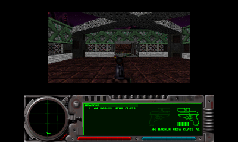
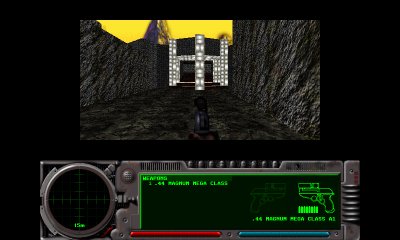
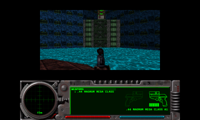
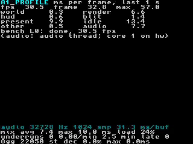
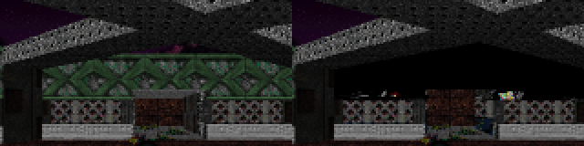
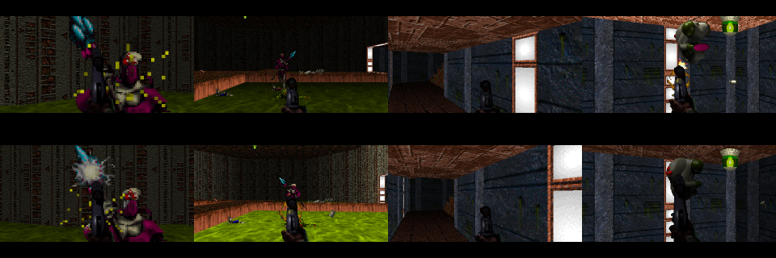
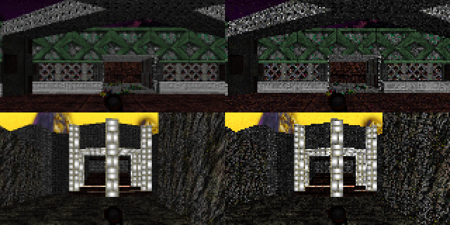
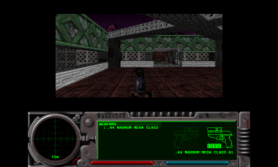
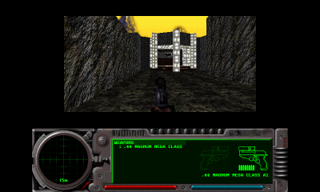
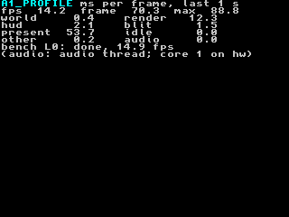

# Aleph One 3DS port: performance

Recorded 2026-10-11 on branch `3ds-port`, on top of stage 6 (`d19dae0`).
Goal: measure first, then optimise; keep only changes with a measured gain
and no visual regression. Engine changes are listed in
[`PATCHES.md`](PATCHES.md) (entries 34 onwards).

## Status (2026-10-11)

**Kept: the direct framebuffer present (a, a').** In Azahar the game goes
from **~15 fps to the 30 fps cap** on all three test spots, with 11-14 ms
of every 33 ms frame left idle (busy 66.9 → 21.5 ms on level 0, −68%); the picture is the same as before (within
1 per colour channel). No compiler flag change, no default resolution
change, no forced frame cap: each was measured and either gained nothing,
broke the picture, or took something visible away (details per
experiment below).

**Measured on a New 3DS** ("Hardware results" below): the default
settings hold the **30 fps cap on all three spots with 14.5-15.2 ms idle
per frame** (busy 17.6-18.3 ms). The console splits the time differently
from Azahar: the rasteriser takes **37-46% less**, the present **39-47%
more** (memory traffic), so `present` (8.7-8.8 ms) is now the largest
zone. With a 60 target the console shows **53 fps**, so experiment d stays
as it is (no clamp). Resolution: Low is not needed. The session also found
and fixed a boot failure on hardware (`PATCHES.md` 25: the heap must fit
the 96 MiB heap area).

**Stage 7 on the New 3DS (2026-10-12):** Classic within 0.14 ms of these
figures, the HUD and Map bottom-screen modes 5.4-6.5 ms busy below it, 30 fps
everywhere: [`STAGE7.md`](STAGE7.md), "Hardware results".

## Results

Every figure is ms per frame in Azahar (see "How to read these numbers").
**busy** = frame − idle: the work per frame. Once the game reaches the 30 fps
cap the frame time stays 33 ms and the gain shows as idle time instead.

| Step | Change | busy, L0 / L6 / L20 | fps | Picture | Kept |
| --- | --- | --- | --- | --- | --- |
| baseline | stage 6 build (re-run with a fixed seed, `bc7fc46`) | 66.9 / 63.8 / 63.7 | 15.0-15.7 | | |
| a | direct framebuffer present | **23.1 / 21.0 / 20.7** (−66%) | **30.3** (capped) | identical to SDL's within ±1 per channel | **yes** |
| a' | present loop fitted to registers (found through b) | **21.5 / 19.5 / 19.3** (−7% vs a) | 30.4 | byte-identical to a | **yes** |
| b | `-O3` / `-ffast-math` / LTO / LTO + `-fno-strict-aliasing` | −0.3…−0.7% / ±0.3% / −3.5…−12% / −4.5% | 30.3 | LTO: **walls missing**; LTO + no-strict-aliasing: identical | no (none of them) |
| c | half-resolution rendering, 2x upscale (the engine's Resolution: Low) | 16.7 / 16.1 / 15.8 (−24 to −28% vs a) | 30.3 | **visibly coarser**: loses the 2x2 supersampling | no (stays an option) |
| d | force the 30 fps cap, no interpolation | (30 is already the default, without interpolation) | 60 / Unlimited: **42.8 / 48.0 / 48.2** | forcing 30 shows fewer frames to anyone who chose 60 | no (decide on hardware) |

## Hardware results (New 3DS, 2026-10-11)

**Setup.** New 3DS, Luma3DS, Homebrew Launcher, 3dslink. The profiler
build (`-DA1_PROFILE=ON`, Release `-O2`) at `2603d0d` (experiment a' plus
the heap fix, `PATCHES.md` 25). DSP firmware present (sound on, 32728 Hz,
the audio thread on core 1), `debug-audio` on. Each benchmark is one
`debug-perf` run (`settle 8`, `measure 20`, `quit 1`) started by pressing
A twice; default preferences unless noted. Logs and captures:
`build-3ds/hw/` (not in git).

**Same spots as Azahar.** Level 20's capture shows the same view as
Azahar's; levels 0 and 6 show the same spot with the view turned by a few
degrees (the fixed seed makes the level identical; the difference is in
the input; in the 30-minute play-through the player saw no stick
drift). The 1 102 differing HUD pixels per capture are the same on all three levels
(the Azahar captures are from the baseline, through SDL's present).

|  |  |  |
| --- | --- | --- |
| level 0 | level 6 | level 20 |

**BENCH lines** (ms per frame; busy = frame − idle):

| Run | fps | frame | max | busy | world | render | hud | blit | present | idle | other | audio (core 1) |
| --- | --- | --- | --- | --- | --- | --- | --- | --- | --- | --- | --- | --- |
| L0 | 30.52 | 32.77 | 57.72 | **18.25** | 0.34 | **6.67** | 0.55 | 1.39 | **8.82** | 14.52 | 0.48 | 8.00 |
| L6 | 30.53 | 32.76 | 58.04 | **17.70** | 0.32 | **6.32** | 0.55 | 1.37 | **8.68** | 15.06 | 0.47 | 8.14 |
| L20 | 30.52 | 32.76 | 58.82 | **17.57** | 0.43 | **5.98** | 0.57 | 1.36 | **8.68** | 15.19 | 0.55 | 8.09 |
| L0, Resolution: Low | 30.54 | 32.74 | 58.33 | 14.46 | 0.33 | 3.17 | 0.55 | 1.63 | 8.26 | 18.28 | 0.53 | 7.88 |
| L0, Framerate Target 60 | **53.16** | 18.81 | 42.16 | 17.80 | 1.46 | 6.71 | 0.31 | 1.40 | 7.25 | 1.01 | 0.67 | 5.01 |

`gaps=0` in every run; 622-624 frames per 20 s window at 30 fps, 1 078 at
60. The bottom screen at the end of the level 0 run (profiler rows, then
the `debug-audio` rows):



The level load (A on BEGIN NEW GAME to the first frame, chapter
screen included) took 76-97 s per run.

**Console against Azahar** (experiment a'; `render`, `hud`, `blit` from
experiment a's run, which a' did not change):

| Zone | Azahar L0 / L6 / L20 | New 3DS L0 / L6 / L20 | change |
| --- | --- | --- | --- |
| busy | 21.52 / 19.48 / 19.27 | 18.25 / 17.70 / 17.57 | −15% / −9% / −9% |
| render | 12.37 / 10.08 / 9.65 | 6.67 / 6.32 / 5.98 | **−46% / −37% / −38%** |
| present | 6.02 / 6.20 / 6.24 | 8.82 / 8.68 / 8.68 | **+47% / +40% / +39%** |
| blit | 1.44 / 1.44 / 1.44 | 1.39 / 1.37 / 1.36 | −3% / −5% / −6% |
| hud | 0.90 / 0.89 / 0.89 | 0.55 / 0.55 / 0.57 | −39% / −38% / −36% |
| world | 0.36 (L0, experiment d) | 0.34 / 0.32 / 0.43 | about the same |
| Low: render, L0 | 5.41 (44% of high) | 3.17 (48% of high) | |
| 60 target: fps, L0 | 42.77 | **53.16** | +24% |

- **The rasteriser is ~40% faster than Azahar says**, the
  **present ~40-47% slower**. As "How to read these numbers" expected:
  the console runs the game at 804 MHz with the L2 cache (SDL2main calls
  `osSetSpeedupEnable`, `STAGE5-PREREQS.md`), which Azahar's fixed cost
  per instruction does not model, nor memory traffic, which dominates the
  present's pass over the 1.2 MB screen surface and the framebuffer.
  Computation (`render`, `hud`) gains, the copy loses. `blit` (also a
  copy, 0.8 MB) lands near Azahar's figure.
- **On the console `present` is the largest zone** (8.7-8.8 ms), ahead of
  `render` (6.0-6.7 ms). In Azahar it was the other way round.
- **max**: the longest frame of every 30 fps window is 57.7-58.8 ms, Low
  included; 42.2 ms at 60. Not investigated.
- **Low resolution** saves 3.5 ms of `render` (busy −21%, Azahar −28%) and
  `present` stays 8.3 ms: as in Azahar, its doubling and averaging are
  wasted work. Not needed at these frame times.

**Experiment d's decision: keep the option (no clamp).** With Framerate
Target 60 the console shows **53.16 fps** on level 0, well above the ~40
threshold; interpolation costs 1.1 ms (`world` 0.34 → 1.46), as in
Azahar, and the main thread hardly sleeps (idle 1.0 ms). The default stays
30. Level 6 was not repeated: the margin over the threshold is 13 fps.

**Play-through** (Marathon 2 level 1 to the exit and on into level 2,
30.4 min from boot to exit, default settings, sound at 32728 Hz, the Level
Music Test plugin, `debug-audio`). The overlay figures were not noted
during play; the player reports a steady frame rate with no slowdown over
the 30 minutes, and:

- **Hitches when entering areas not seen before.** Not measured (the
  profiler logs per window only with `log 1` in `debug-perf`, which also
  fixes the level and seed). Open.
- **Level change and save terminals look frozen.** After level 1's exit
  the screen looks frozen and broken until level 2 has loaded (a level load is
  76-97 s, above); saving at a pattern buffer takes long enough to look
  like a hang. Not timed. Open.
- Audio: 0 underruns in 28.6 min played (`STAGE6.md`).

**For the UI stage's view resolution** (the view gets the whole 400x240
top screen). **Correction (stage 7, `STAGE7.md`):** the view measured here
is 480x240 (115 200 pixels), not 640x320: the port's 400x240 screen mode
is also the engine's legacy "75%" view size (`Screen::seventyfive_percent()`),
and Low renders 240x120 (28 800). Through those points the rasteriser costs
about **2.0 ms + 4.05 ms per 100 000 pixels**, twice the slope below, so
800x480 would be ~17.6 ms of `render` (and ~34 ms busy, below 30 fps).
Stage 7 renders the view at 400x240 1:1 instead. The original estimate: The two Resolution settings give two points of the
rasteriser's cost on this console, level 0: 6.67 ms for 640x320 (204 800
pixels) and 3.17 ms for 320x160 (51 200). A straight line through them is
about **2.0 ms + 2.28 ms per 100 000 pixels**. Extrapolated (estimates,
not measurements; a 5:3 view also shows more of the level than today's 2:1
one):

| View rendered at | pixels | render (est.) | present (est.) |
| --- | ---: | --- | --- |
| 640x320 (today) | 204 800 | 6.67 (measured) | 8.82 (measured; reads 640x480, writes 320x240) |
| **800x480, 2x2-averaged to 400x240** | 384 000 | **~10.8** | ~11 (1.25x today's reads and writes) |
| 400x240 native | 96 000 | ~4.2 | under a third of today's reads, no averaging; not measured |

At 800x480 the frame would be roughly 0.3 world + 10.8 render + 11 present
+ 0.5 other ≈ 22.6 ms, plus ~2.6 blit if the view still goes through the
screen surface and the bottom screen's HUD (0.55 today, plus its own
present): **about 23-26 ms of the 33.3 ms**, so 30 fps with ~7-10 ms to
spare; with a 60 target the interpolated rate would drop from 53 to about
40. Native 400x240 would leave more than half the frame
idle, but loses the 2x2 supersampling (experiment c: visibly coarser).
`present` is the larger lever on this hardware.

## Experiment a: direct framebuffer present

**Change** (`ports/3ds/source/video_3ds.cpp`, `PATCHES.md` 35).
`MainScreenUpdateRects()` hands the 640x480 screen surface to
`a1_3ds::present_screen()`, which writes the top framebuffer itself:

- **One pass.** For each output pixel, the 2x2 block of the surface is
  averaged, converted XRGB8888 → RGBA8 (`<< 8`; the LCD ignores alpha) and
  stored at its rotated place (the LCD scans 240-pixel columns, so screen
  pixel (x, y) is `fb[x * 240 + 239 - y]`). The 40-pixel bars left and
  right are cleared once per framebuffer, not every frame.
- **Same picture as SDL.** The engine asks SDL for *linear* scaling
  (`SDL_HINT_RENDER_SCALE_QUALITY`, `screen.cpp`), and SDL's bilinear
  filter centres output pixel x on source 2x + 0.5: at exactly 2:1 that is
  the 2x2 average. `UHADD8` (ARMv6 SIMD halving add, `__uhadd8`) averages
  four channels in one instruction; it rounds down, so a channel can be 1
  below SDL's. A first version sampled single pixels (nearest neighbour):
  3.6 ms instead of 7.7, but **half the HUD's pixels differed** from SDL's
  output (aliasing), so it was rejected.
- **Cache-friendly order.** 4 output rows per pass: the 8 source rows are
  read left to right, and every framebuffer column receives one 16-byte run
  (half a cache line). Azahar cannot show the effect (no cache model). (The
  first version did 8 rows per pass; see "a'" below.)
- **VBlank sync.** `gfxScreenSwapBuffers(GFX_TOP, false)` takes effect at
  the next VBlank. Before writing, if that swap is still pending
  (`gspIsPresentPending`), it waits for the VBlank (`gspWaitForVBlank`):
  otherwise it would draw into the buffer still on screen and tear. At 30
  fps on a 60 Hz LCD it rarely waits. Then `GSPGPU_FlushDataCache` on the
  framebuffer and the swap, as SDL's driver did.
- SDL's path stays as the fallback for any other surface size or format
  (logged once: `[3ds] video: direct present ...`).

**Numbers** (`perf-bench.sh exp-a2`, against `baseline2`; ms per frame):

| Level | | fps | frame | busy | render | hud | blit | **present** | idle |
| --- | --- | --- | --- | --- | --- | --- | --- | --- | --- |
| 0 | before | 14.95 | 66.90 | 66.88 | 12.37 | 1.77 | 1.44 | 50.40 | 0.01 |
| 0 | after | 30.32 | 32.97 | **23.10** | 12.37 | 0.90 | 1.44 | **7.65** | 9.88 |
| 6 | before | 15.68 | 63.80 | 63.80 | 10.09 | 1.69 | 1.44 | 49.73 | 0.01 |
| 6 | after | 30.36 | 32.94 | **20.95** | 10.08 | 0.89 | 1.44 | **7.74** | 11.98 |
| 20 | before | 15.69 | 63.73 | 63.72 | 9.65 | 1.70 | 1.44 | 49.80 | 0.01 |
| 20 | after | 30.36 | 32.95 | **20.70** | 9.65 | 0.89 | 1.44 | **7.73** | 12.25 |

`present` −85% (50 → 7.7 ms); the game reaches the 30 fps cap and has
10-12 ms to spare per frame. `hud` halved too: it is counted per frame, and
the HUD is redrawn per game tick (30 Hz), so at 30 fps it is spread over
twice as many frames. Nearest-neighbour variant (rejected): present 3.6 ms.

**a' (follow-up, found through experiment b).** With 8 output rows per
pass, GCC kept the 16 source-row pointers on the stack and reloaded them
for every pixel (`objdump` of `video_3ds.o`); LTO's code generation
happened to avoid that, which is where its present gain came from. Now 4
rows per pass, 8 row pointers advanced in place (they stay in registers),
and each horizontal pixel pair is one 64-bit load: about 11 instructions
per output pixel instead of ~18. Same arithmetic, so the output is
byte-identical (0 differing pixels on all three levels):

| Level | busy (a) | busy (a') | present (a) | present (a') |
| --- | --- | --- | --- | --- |
| 0 | 23.10 | **21.52** | 7.65 | **6.02** |
| 6 | 20.95 | **19.48** | 7.74 | **6.20** |
| 20 | 20.70 | **19.27** | 7.73 | **6.24** |

**Picture** (top screens at the end of the run, fixed seed, compared with
the baseline's pixel by pixel): levels 0 and 6 differ in 7.5k / 7.9k of
96k pixels, **by at most 1** per channel (the rounding above); the bars are
identical. Level 20 differs more in the view (animated water, captured at
a different moment) and by at most 1 in the HUD.


## Experiment b: compiler flags

**Builds.** The experiment a code at `-O2` (devkitPro's Release flags,
`-g -O2 -DNDEBUG`, with `-march=armv6k -mtune=mpcore -mfloat-abi=hard`)
against `-O3`, `-O2 -ffast-math`, `CMAKE_INTERPROCEDURAL_OPTIMIZATION=ON`
(GCC `-flto`, engine only: SDL, OpenAL and the codecs are prebuilt
archives) and LTO with `-fno-strict-aliasing`. Each in its own build
directory, `perf-bench.sh exp-b-<variant>`.

| Level | build | busy | vs -O2 | render | present | `.text` |
| --- | --- | --- | --- | --- | --- | --- |
| 0 | -O2 (a) | 23.10 | | 12.37 | 7.65 | 7.15 MB |
| 0 | -O3 | 23.02 | −0.3% | 12.27 | 7.70 | 7.57 MB |
| 0 | -ffast-math | 23.18 | +0.3% | 12.38 | 7.68 | 7.16 MB |
| 0 | LTO | 20.30 | −12.1% | 11.15 | 6.02 | 7.01 MB |
| 0 | LTO, no strict aliasing | 22.03 | −4.6% | **12.97** | 5.97 | |
| 6 | -O2 (a) | 20.95 | | 10.08 | 7.74 | |
| 6 | -O3 | 20.89 | −0.3% | 10.00 | 7.81 | |
| 6 | -ffast-math | 20.89 | −0.3% | 10.08 | 7.68 | |
| 6 | LTO | 18.58 | −11.3% | 9.22 | 6.21 | |
| 6 | LTO, no strict aliasing | 19.98 | −4.7% | **10.80** | 6.03 | |
| 20 | -O2 (a) | 20.70 | | 9.65 | 7.73 | |
| 20 | -O3 | 20.56 | −0.7% | 9.58 | 7.71 | |
| 20 | -ffast-math | 20.69 | −0.1% | 9.65 | 7.72 | |
| 20 | LTO | 19.97 | −3.5% | 10.53 | 6.14 | |
| 20 | LTO, no strict aliasing | 19.78 | −4.4% | **10.38** | 6.09 | |

- **`-O3`**: −0.3 to −0.7%, about the run-to-run spread, for 414 KB
  more code (+6% `.text`). Azahar charges nothing for instruction-cache
  misses; with the ARM11 MPCore's 16 KB L1 instruction cache the larger
  code can cost more than it gains. **Not kept.**
- **`-ffast-math`**: no change (the rasteriser and world are fixed-point;
  float is in sound and a few setup paths). The demo replay
  (`12-sprite-check.txt`) is pixel-identical to `-O2` wherever a capture
  lands on the same frame (3 of 10; the rest differ by capture timing
  only), monsters included. Only risk, no gain. **Not kept.**
- **LTO**: the largest number (−12% on level 0), but **it renders wrong**.
  With the fixed seed the `-O2` build matches the baseline to ±1 per
  channel at every spot, while the LTO build drops a whole wall of the
  room seen through the opening on level 0 (black) and draws stray pixels
  near the floor; level 6's building interior differs as well. Part of the
  "gain" is polygons not drawn. Level 0, `-O2` left, LTO right (zoomed):

  

  The brief's warning was invisible *enemies* (an upstream report). The
  main menu's demo replay (`tests/input/12-sprite-check.txt`) shows
  monsters under LTO here (top `-O2`, bottom LTO, captured at slightly
  different moments of the replay), so that exact symptom did not
  reproduce, but the missing wall is the same kind of failure:

  

- **LTO + `-fno-strict-aliasing`**: the picture is **byte-identical** to
  `-O2` at levels 0 and 6 (0 differing pixels; level 20's water is at a
  different animation phase). So the LTO breakage is strict-aliasing
  undefined behaviour in the engine that whole-program inlining exposes.
  But without strict aliasing the rasteriser is **5-8% slower**; the net
  −4.5% comes entirely from `present` (7.7 → 6.0 ms). **Not kept**: the
  present gain is available without LTO (below), and the renderer's
  aliasing bug stays a trap for any future LTO attempt.

**What LTO pointed at.** At `-O2` the present loop kept its 16 source-row
pointers on the stack (ARM has 13 general registers), reloading them for
every pixel; LTO's code generation happened to do better. Rewriting the
loop to fit in registers is a code change to experiment a (next section).

## Experiment c: half-resolution rendering

**Change: none needed.** The engine already has it: Preferences >
Graphics > Rendering Options > Resolution: **Low** (`scmode_highres="false"`)
renders the world view at half width and height (320x160 instead of
640x320) and `quadruple_surface()` doubles it into the screen surface.
Measured with `PREFS="scmode_highres=false" perf-bench.sh exp-c` on the
experiment a build:

| Level | | busy | render | blit | present | idle |
| --- | --- | --- | --- | --- | --- | --- |
| 0 | high (a) | 23.10 | 12.37 | 1.44 | 7.65 | 9.88 |
| 0 | **low** | **16.73** | **5.41** | 1.30 | 8.16 | 16.23 |
| 6 | high (a) | 20.95 | 10.08 | 1.44 | 7.74 | 11.98 |
| 6 | **low** | **16.14** | **4.79** | 1.30 | 8.22 | 16.80 |
| 20 | high (a) | 20.70 | 9.65 | 1.44 | 7.73 | 12.25 |
| 20 | **low** | **15.77** | **4.31** | 1.30 | 8.12 | 17.15 |

The rasteriser takes 44-56% of its high-resolution time (a quarter of the
pixels, plus per-column and per-polygon costs that do not shrink); busy
time falls 24-28%.

**Picture.** The top screen shows the 640x320 view at 320x160. At high
resolution each screen pixel is the average of 4 rendered pixels (the
2x2 average of experiment a): 4x supersampling. At low resolution each
screen pixel is one rendered pixel. Half the view's pixels differ, by up to
148-228 of 255: textures are grainier, the fence mesh and distant detail
alias, and edges step more (left high, right low; zoomed 2x):



**Decision: not the default.** It is a visible loss on the console's
screen, and with experiment a the default already reaches 30 fps in
Azahar. It stays available as the existing Resolution: Low option (no code
change), the first thing to try if the hardware turns out slower than
30 fps. In low resolution the doubling to 640x480 followed by the 2x2
average in the present is wasted work (blit + present ~9.5 ms); a present
straight from the half-size buffer would save most of it, if Low becomes
important.

## Experiment d: 30 fps cap, no interpolation

**What the engine already does.** The default Framerate Target is 30, the
world's tick rate, and at exactly 30 the engine does no interpolation
(`init_interpolated_world()`, `get_heartbeat_fraction()` return early).
The experiment was to *force* that on the 3DS: clamp `fps_target` to 30 in
`validate_graphics_preferences()` and hide the option. So it can only
change things for players who pick 60, 120 or Unlimited. Measured with
`PREFS="fps_target=60"` and `"fps_target=0"` on the experiment a build:

| Level | target | fps | busy / frame | world | present | idle |
| --- | --- | --- | --- | --- | --- | --- |
| 0 | 30 | 30.32 | 23.10 | 0.36 | 7.65 | 9.88 |
| 0 | 60 | **42.77** | 23.38 | **1.57** | 6.67 | 0.01 |
| 0 | Unlimited | 42.78 | 23.37 | 1.57 | 6.67 | 0.00 |
| 6 | 30 | 30.36 | 20.95 | 0.36 | 7.74 | 11.98 |
| 6 | 60 | **48.02** | 20.82 | **1.41** | 6.61 | 0.01 |
| 20 | 30 | 30.36 | 20.70 | 0.48 | 7.73 | 12.25 |
| 20 | 60 | **48.17** | 20.76 | **1.48** | 6.86 | 0.01 |

- Interpolation costs ~1.1 ms per frame (`world` 0.4 → 1.5: the
  interpolated object and camera positions), so forcing 30 saves that much
  per frame, plus all the idle time: at 60/Unlimited the main thread never
  sleeps (idle 0), as with upstream's Unlimited (`STAGE6.md`, loop audit).
- But in Azahar the game is now fast enough to show **43-48 interpolated
  frames per second** instead of 30. Forcing 30 would take that away from
  anyone who chose it: fewer frames on screen, i.e. a visible regression
  for them, and no change at all for the default.
- 60 and Unlimited behave the same here (neither reaches 60).

**Hardware (2026-10-11): 53.16 fps with a 60 target on a New 3DS, so the
option stays and the clamp below is not applied** ("Hardware results").

**Decision: not kept for now** (no commit of the clamp). Whether 60 is
worth offering depends on the console's real frame time, which Azahar
does not give (no cache model): if a New 3DS cannot get clearly above ~40
fps with a 60 target (hardware checklist), the 43-48 fps advantage is
gone, uneven pacing on the 60 Hz LCD and a CPU that never sleeps remain,
and the clamp should go in. It is six lines:

```diff
 	// Misc/preferences.cpp, graphics dialog
+#ifndef A1_PLATFORM_3DS
 	table->dual_add(fps_target_w->label("Framerate Target"), d);
 	table->dual_add(fps_target_w, d);
+#endif
 	// validate_graphics_preferences(), in the A1_PLATFORM_3DS block
+	clamp(preferences->fps_target, static_cast<int16>(30));
```

## Baseline (stage 6 build + profiler, `3d2a6ca`)

**Where.** Three Marathon 2 levels, at the level's start position, facing
its start direction, standing still (monsters and liquids still move).
`perf-bench.sh baseline`: 8 s settle, 20 s measured, 2 runs per level,
Azahar 2126.2 in New 3DS mode, no DSP firmware (below).

| Level | Name | The spot |
| --- | --- | --- |
| 0 | Waterloo Waterpark | indoor room, textured walls and floor |
| 6 | Ex Cathedra | outdoor canyon, open sky, lit building ahead |
| 20 | My Own Private Thermopylae | animated water (liquid surface) |

|  |  |  |
| --- | --- | --- |
| level 0 | level 6 | level 20 |

**Baseline, ms per frame** (Release `-O2`, 32-bit colour, high resolution,
30 fps target; the default preferences):

| Level | fps | frame | max | world | render | hud | blit | present | other |
| --- | --- | --- | --- | --- | --- | --- | --- | --- | --- |
| 0 | 14.96 | 66.88 | 122.4 | 0.70 | 12.31 | 1.77 | 1.44 | **50.44** | 0.23 |
| 6 | 15.64 | 63.95 | 118.8 | 0.56 | 10.26 | 1.69 | 1.44 | **49.78** | 0.21 |
| 20 | 15.71 | 63.64 | 115.2 | 0.83 | 9.71 | 1.69 | 1.44 | **49.70** | 0.26 |

Re-run with a fixed seed (`bc7fc46`, `baseline2`; the reference for the
experiments): 66.90 / 63.80 / 63.73, within 0.3% of these.

Run-to-run spread of the frame time: 0.1-0.9 ms (66.81-66.95, 63.49-64.41,
63.56-63.71). `idle` is 0.01: the frame never finishes early, so the 30 fps
cap never sleeps.

**What it says.** About **15 fps, and three-quarters of every frame is
`present`**: SDL copying the 640x480 screen surface into a texture,
scaling it into its 400x240 window surface, and its N3DS driver copying
that into the framebuffer one rotated pixel at a time. The rasteriser
(`render`, 10-12 ms) is the only other large item; world simulation is
under 1 ms at these spots.

### How to read these numbers (Azahar, not hardware)

- Azahar's `svcGetSystemTick()` counts **emulated** time: the guest's
  instruction stream at a fixed cost per instruction, and the emulator's
  own speed or the host's load does not change it (a run made during a
  full rebuild and one made idle differ by 0.2%). That is what makes runs
  repeatable to under 1%.
- It does **not** model caches, memory latency or VFP timing. Copy loops
  (present, blit) are dominated by memory traffic on a console; here they
  cost what their instructions cost. Relative changes in instruction count
  are measured well; cache effects (tiling, `-O3` unrolling vs code size)
  are not measured at all.
- **The figures are therefore relative**: they rank changes, and show
  where the time goes; the console's absolute frame times will differ.
  The hardware checklist at the end measures the kept build on a New 3DS.
- **Without sound.** Benchmarks run without `dspfirm.cdc`
  (`--no-dspfirm`). With sound, level 0 measured 67.60 ms/frame against
  66.92 without (audio callback 19.7 ms per frame on the audio thread), so
  the audio thread barely touches the main thread's time in Azahar; on a
  console it runs on core 1. Without it the runs are simpler (no music
  start-up in the window).


## The profiler (`A1_PROFILE`)

A compile-time option of the 3DS build, off by default:

```
cmake -S ports/3ds -B build-3ds-prof -DA1_PROFILE=ON
cmake --build build-3ds-prof
```

`ports/3ds/source/profile_3ds.cpp` times zones of the main thread with
`svcGetSystemTick()` (the 268 MHz ARM11 clock). Times are **exclusive**: a
zone nested in another is subtracted from it. Each figure is milliseconds
per displayed game frame (one `render_screen()` call).

| Zone | Covers | Where |
| --- | --- | --- |
| world | `update_world()`: the 30 Hz game ticks (physics, monsters, projectiles), minus the HUD | `Misc/interface.cpp` `idle_game_state()` |
| render | `render_view()`: the software rasteriser into the world-view buffer | `RenderOther/screen.cpp` |
| hud | the HUD buffer update (`update_interface()`, nested in world) and its blit to the screen surface | `GameWorld/marathon2.cpp`, `screen.cpp` |
| blit | world-view buffer → screen surface (`update_screen()`) | `screen.cpp` |
| present | screen surface → display (`MainScreenUpdateRects()`) | `screen.cpp` |
| idle | the in-game frame pacing sleep (30 fps cap) | `shell.cpp` `main_event_loop()` |
| other | frame time not in any zone: event polling, crosshair, messages, ... | |
| audio | the audio callback (OpenAL mixing + music decoding), on the audio thread: on a console core 1, so not part of the frame | `audio_3ds.cpp` |
| overlay | drawing the profiler's own overlay, once a second; excluded from the frame times | |

**Overlay.** In a profile build the bottom screen shows, once a second, the
figures above for the last second in place of the controls legend:



**Benchmark mode.** If `sdmc:/3ds/alephone/debug-perf` exists:

```
level 6       # level index; BEGIN NEW GAME starts it instead of level 0
settle 8      # seconds of play before measuring
measure 20    # seconds measured
quit 1        # quit after the result (as HOME > Close)
log 1         # also log every 1-second window
```

The profiler waits for the level's first frames, lets `settle` seconds
pass, averages `measure` seconds, logs one line and saves both screens
(`screen-perf-L<level>-*.bmp`):

```
[prof] BENCH level=0 seconds=20.8 gaps=0 frames=312 fps=14.97 frame=66.81 max=118.92 world=0.65 render=12.29 hud=1.77 blit=1.44 present=50.43 idle=0.01 overlay=0.11 other=0.23 audio=0.00
```

`gaps` counts stalls over 0.5 s inside the measured window (should be 0).

**Reading `fps`, `frame` and `frames`** (worked out 2026-10-12,
`NEXT-SPRINT.md` B5). The overlay's time is left out of the wall clock
(`seconds`, `frame`, `fps`), so a run that draws the overlay reports a
slightly shorter frame and higher fps than it ran at, and counts more
frames in its 20 measured seconds. Add `overlay` back to `frame` to compare
runs: stage 7's console runs, Classic 32.76 + 0.22 = 32.98 ms against
HUD 32.98 + 0.01 = 32.99 ms (the overlay is not drawn in game when the
bottom screen is the game's), are the same frame time; the 30.52 against
30.32 fps and 622-624 against 619-620 frames were this, not a slower
present. The real rate is **30.30 fps** in every mode: the engine's 30 Hz
timer runs every `1000 / 30` = 33 ms (integer division, `Misc/vbl.cpp`
`install_timer_task()`, upstream code), and with the 30 fps cap one frame is
drawn per tick.

**Running it.**

| Command | Does |
| --- | --- |
| `scripts/3ds/run-azahar.sh --perf LEVEL [build-3ds-prof/alephone.3dsx]` | one benchmark in Azahar (input script `tests/input/11-perf-bench.txt` presses A to start the game; Azahar is stopped when the game quits) |
| `scripts/3ds/tests/perf-bench.sh LABEL [3dsx]` | the series: `LEVELS` (default `0 6 20`) × `RUNS` (default 2), results in `build/perf/LABEL.txt` and the end-of-run screens in `build/perf/LABEL-L<n>-*.png`. `PREFS="attr=value ..."` overrides `<graphics>` preferences for the series |
| `python3 -I scripts/3ds/tests/perf-table.py build/perf/A.txt [B.txt ...]` | Markdown tables: means per level, and each file against the first |

## Load times (2026-10-12, `NEXT-SPRINT.md` B1, B3, B6)

On the console a level took 76-97 s to load, a save at a pattern buffer
looked like a hang, boot took 41.8 s and HOME > Close during the menu demo
14.4 s. To see where the time goes, the slow paths now log timed steps
(`PATCHES.md` 41): `[3ds] +T ms: what (+D ms)`, D being the time since the
previous mark. Azahar's timings are not the console's (its SD card is a host
folder, and its CPU and file system costs differ: boot's "fonts and
plugins" is 10.9 s there and 2.9 s on the console). The console figures
below are from the New 3DS session of 2026-10-13 (`NEXT-SPRINT.md` stage 2;
logs in `build-3ds/hw/sprint8/`), with `PATCHES.md` 42 and before 43.

**Test:** `run-azahar.sh --load-test --script scripts/3ds/tests/input/15-load-test.txt
--timeout 200`. The Load Test plugin (solo Lua) saves 5 s into level 0
(`Game.save()`), teleports to level 1 at 10 s
(`Players[0]:teleport_to_level(1)`) and saves again 5 s into level 1; logs in
`build-3ds/hw/sprint8/azahar/load-test-*.log` (not in git).

**Level loads** (seconds; Azahar "before" is the code at `063edfd`, "after"
adds `PATCHES.md` 42; the console ran the "after" code):

| Step (mark) | new game, level 0: Azahar before | after | **console** | level change, level 1: Azahar before | after | **console** (1 → 2) |
| --- | --- | --- | --- | --- | --- | --- |
| `goto_level`: level script (MML) | 0.38 | 0.34 | 0.20 | 0.37 | 0.37 | 0.19 |
| map read | 0.13 | 0.15 | 0.08 | 0.13 | 0.14 | 0.08 |
| Lua loaded | 0.10 | 0.12 | 0.01 | 0.10 | 0.10 | 0.01 |
| **`load_collections`: read and decoded** | **28.41** | **0.73** | **0.49** | **28.02** | **0.72** | **0.49** |
| shading tables (`update_color_environment`) | 1.33 | 1.33 | 0.54 | 1.17 | 1.17 | 0.48 |
| **`entering_map`: sounds** | 0.90 | 0.90 | **3.96** | 0.32 | 0.32 | **1.44** |
| `start_game` | 0.24 | 0.24 | 0.17 | 0.15 | 0.14 | 0.09 |
| **whole load** | **31.5** | **3.8** | **5.5** | **30.3** | **3.0** | **3.0** |

On the console, new games on levels 6 and 20 took 2.9 s and 6.2 s (sounds
1.39 s and 4.61 s), and a second level 0 5.5 s (sounds 4.00 s). Before
`PATCHES.md` 42 a level took **76-97 s** there.

(Whole load: from the chapter screen's mark to `start_game`'s for a new
game, from "level change: movie" for a level change.)

- **The shapes were 90% of a load.** Upstream parses a collection straight
  from the file, a few bytes per read and a seek for every bitmap row (RLE
  bitmaps twice: once to size, once to copy), so a level's collections were
  hundreds of thousands of small file reads. Reading each collection with
  one read and parsing it from memory (`PATCHES.md` 42) takes the step from
  28 s to 0.7 s and a level load from ~31 s to 3-4 s in Azahar.
- **Same game:** the benchmark's end-of-run captures (`perf-bench.sh`,
  HUD + Map, levels 0, 6, 20, both screens) are pixel-identical before and
  after, and busy time is unchanged (17.85 / 15.53 / 15.21 ms against
  17.85 / 15.55 / 15.23).
- **On the console** each small read is an IPC call to the file system,
  so the gain is expected to be at least as large; to be measured with the
  same marks (the 76-97 s were never split).
- **On the console** the shapes take 0.49 s (Azahar 0.73), and a level load
  is **2.9-6.2 s**. The largest step is now the **sounds**, 1.4-4.6 s
  (Azahar 0.3-0.9 s): each sound is read 4 KB at a time (`PATCHES.md` 43,
  below).
- The level change still shows the last game frame while it loads (no
  chapter screen on most levels). On the console (level 1 → 2, 3.0 s) the
  user found it **"fine as is"**: no progress screen.

**Saves** (Azahar): metadata 0.4 ms, map preview 100 ms, file written
126-147 ms, surplus check 0.1 ms: about 0.25 s. **On the console**: metadata
8 ms, map preview 76 ms, **file written 69 162 ms**, surplus check 8 ms. The
SD card is not the cause: a test program (`scripts/3ds/tests/sdwrite-test/`)
writes 2.98 MB the way `save_game_file()` does (`"wb+"`, a seek and one
`fwrite()` per piece) in **0.66 s** on the same console, 4.5 MB/s
(fixed 8 KB `fwrite()`s: 0.76 MB/s growing the file, 1.4 MB/s preallocated;
one `FSFILE_Write()` of the whole buffer: 1.6 MB/s). `save_game_file()` now
marks each of its steps (`PATCHES.md` 41) to find the 69 s on the console;
in Azahar they add up to 0.13 s. Each save is **2.98 MB**, 2.76 MB of it
the preview: the overhead map rendered at 1280x720 and stored as a 24-bit
BMP (without SDL2_image there is no PNG, `QuickSave.cpp`
`build_map_preview()`). A smaller preview (320x180 at map scale 2 shows the
same area in 1/16 of the bytes; the load dialog shows it at 128x72) would
save at most ~0.6 s of real writing, so it waits for the split. If the
69 s cannot be removed, the user asked for a small "Saving..." message
on screen during the save.

**Boot** after "preferences loaded" (ms; Azahar from the same logs, the
console from two boots on 2026-10-13, which agree to 1.5%):

| Step | Azahar | **console** |
| --- | --- | --- |
| directories | 375 | 107 |
| image cache | 74 | 20-25 |
| preferences written, plugin MML | 103 | 97-103 |
| SDL_ttf, HTTP, timers | 0.2 | 8 |
| **sound initialized** | 2 707 | **9 350-9 420** |
| intro music, keyboard, gamma | 262 | 198-201 |
| screen initialized | 346 | 215-218 |
| `initialize_marathon` | 26 | 74-75 |
| screen drawing | 114 | 63-67 |
| **dialogs (theme)** | 1 180 | **5 239-5 268** |
| terminals, shape handler | 834 | 1 727-1 728 |
| fades, images | 155 | 184-190 |
| **environment (scenario files), game state** | 4 131 | **12 137** |
| **time to main menu** (from `main()`) | | **41 835-41 946** |

Three steps are 26.7 s of the console's 41.8 s boot: the scenario files
(12.1 s), sound (9.4 s) and the dialog theme (5.2 s). Both of the first two
open the Sounds file, which reads every sound header (975) 4 KB at a time;
`PATCHES.md` 43 takes that from 2.59 s to 0.51 s in Azahar (below).

**Leaving a game** (`finish_game()`, B6): every step is marked. HOME >
Close from a game (the load test's `quit`, which skips the fades and the
scenario reload, `PATCHES.md` 22) takes 26 ms in Azahar. **On the
console** (ms):

| Step | quit to the menu (HUD + Map) | quit to the menu (Classic) | **HOME > Close during the demo** | benchmark's quit (`quit 1`) |
| --- | --- | --- | --- | --- |
| replay stopped | 25 | 29 | 10 | 1 276 |
| fades, `leaving_map` | 517 | 516 | 522 | 9 |
| **environment reloaded** | **12 015** | **12 016** | **12 473** | 13 (skipped) |
| main menu | 313 | 315 | 359 | 8 |
| whole `finish_game()` | 12.9 s | 12.9 s | **13.4 s** | 1.3 s |

The demo close's time is the **scenario reload**
(`load_environment_from_preferences()`), the same 12 s as boot's
"environment" step and as every quit to the menu. `PATCHES.md` 22 skips it
when the system asked the application to close, but that log line
("the system asked the application to close", the APT exit hook) is
missing from the demo run, so the reload ran: when HOME > Close ends the
demo, the hook has not been called yet. The reload is now split
(`PATCHES.md` 41: map file, physics, shapes file, sounds file, external
resources); in Azahar its sounds file step goes from 2.60 s to 0.52 s with
`PATCHES.md` 43.

**Sounds read with one read** (`PATCHES.md` 43, 2026-10-15). The Sounds
file was read through a boost `stream_buffer`, 4 KB per file read: a 4 KB
read for each of the 975 sound headers whenever the file is opened (boot,
twice, and every return to the menu), and a sound's samples 4 KB at a
time, also for the sounds first played during the game, inside
`update_world()` (8 sounds, 595 KB, in level 0's first seconds in Azahar:
the likely cause of the start-of-level hitches, `NEXT-SPRINT.md` B2). Now
each header and each sound is one read. Azahar, load test, before → after:

| Step | before | after |
| --- | --- | --- |
| boot: sounds file opened (`SoundManager::Initialize()`) | 2 593 | **508** |
| boot: environment: sounds file | 2 605 | **518** |
| level 0 (new game): monster sounds (all of a level's sounds) | 961 | **496** |
| level 1 (level change): monster sounds | 335 | **177** |

The headers and sounds are byte-identical (a temporary CRC log of every
header and load: the same 975 headers in order, the same 107 sounds,
3.3 MB). Benchmark captures and every zone but `bottom` (the map's content
at that moment) are unchanged.

**Console, New 3DS (2026-10-18, catch-up runs A and B, profile build,
`3dslink`, HUD + Map @30):** against the 2026-10-13 runs (`hm-L0`, `hm-L20`):

| Step / measure | 2026-10-13 | 2026-10-18 |
| --- | --- | --- |
| boot: environment (scenario files), game state | 12 137 ms | **139 ms** (sounds file opened: 1 004-1 023 ms) |
| time to main menu (from `main()`) | 41.8 s (L0), 44.5 s (L20) | **25.0 s, 21.9 s** |
| level load: sounds (`entering_map`) | 3 965 ms (L0), 4 610 ms (L20) | **750 / 790 ms** ("monster sounds" now; one read per sound) |
| windows with a frame over 60 ms (27-28 per run) | L0: 4 (112, 81, 92, 105 ms); L20: 1 (314 ms) | **L0: 1 (134 ms, the first window); L20: 0** |
| steady state (L0 / L20 last window): frame, render, idle | 32.6, 5.8, ~18.7 / 32.76, -, 19.06 | 32.7, 5.8, ~18.3 / 32.88, -, 19.34 |

The early-level hitches are gone (the user also noticed none playing), the
reload that dominated boot and every quit to the menu is 0.14 s at boot and
**3.2 s** on a quit (map 0.5, shapes 1.7, sounds 1.1 s; was ~12 s), and the
steady state did not move. A normal-build run (Run C): quit to the menu 3.2 s,
HOME > Close during the menu's demo ~4.8 s from the request (the APT exit hook
still does not run, so the reload is not skipped; was 13.4 s). The save is a
separate story: `NEXT-SPRINT.md` backlog item 1, `PATCHES.md` 51-52.

## Menus and dialogs

Every present goes through the new path, not only the game: the main
menu captured through it (`run-azahar.sh --screens`, normal build)
matches stage 4's capture through SDL except for the highlighted BEGIN NEW
GAME (`PATCHES.md` 23, added after that capture); the credits screen and
the in-game HUD render as before. `log.txt` says which path is in use:

```
[3ds] video: direct present (640x480 SDL_PIXELFORMAT_RGB888 -> 320x240 RGBA8 framebuffer)
```

## Hardware checklist (New 3DS)

About 25 minutes. Azahar gave the ranking; the console gives the real
frame times. **Carried out 2026-10-11**: results in "Hardware results".

1. Build the profiler build: `cmake -S ports/3ds -B build-3ds-prof
   -DA1_PROFILE=ON && cmake --build build-3ds-prof`.
2. Upload a `debug-perf` file to `sdmc:/3ds/alephone/` (`scripts/3ds/sd-ftp.sh
   IP put debug-perf /3ds/alephone`):
   ```
   level 0
   settle 8
   measure 20
   quit 1
   ```
   (Without `quit 1` the game keeps running afterwards.)
3. `cmake --build build-3ds-prof --target run-3dslink`, press A twice (BEGIN
   NEW GAME, chapter screen). Wait for the game to quit (~2 min with the
   level load). Fetch `log.txt` (one `[prof] BENCH level=0 ...` line) and
   `screen-perf-L0-top.bmp` / `-bottom.bmp`. Repeat with `level 6` and
   `level 20`. Sound may stay on (the audio thread runs on core 1).
4. Compare with the Azahar table (experiment a'): busy 21.5 / 19.5 / 19.3,
   present 6.0-6.2, render 12.4 / 10.1 / 9.7 ms. Copy loops (present, blit)
   will cost more on the console (memory traffic); if the frame no longer
   fits in 33 ms (`idle` near 0, fps below 30), try Resolution: Low
   (Preferences > Graphics > Rendering Options) and repeat level 0.
5. **Experiment d's decision:** set Framerate Target 60 (Preferences >
   Graphics) and repeat level 0. Above ~40 fps: keep the option. Near 30
   or below: apply the six-line clamp in "Experiment d".
6. Play a minute of level 0 normally (moving, turning, firing) and watch
   the overlay: `fps` near 30, `max` (the longest frame) and any tearing on
   the top screen while turning (there should be none: the swap waits for
   VBlank).

## Stage 10 P0: software baseline at 30 and 60 (Azahar — non-authoritative)

Recorded 2026-10-16 on branch `stage10-c3d` (`1e51162`, no code change),
the reference for stage 10's GPU present
([`CITRO3D_DESIGN.md`](CITRO3D_DESIGN.md), 0.5 and P0). Profiler build
(`-DA1_PROFILE=ON`, Release), Azahar 2126.2, no DSP firmware, one run per
level:
`PREFS="fps_target=30|60 bottom_screen=0|2" RUNS=1 perf-bench.sh p0-<mode><fps>`.
Logs in `build/perf/p0-*` (not in git). busy = frame − idle.

| Series | fps L0 / L6 / L20 | busy L0 / L6 / L20 | render | present | blit | bottom |
| --- | --- | --- | --- | --- | --- | --- |
| HUD + Map @30 | 30.31 / 30.32 / 30.36 | 17.35 / 15.54 / 15.20 | 11.20 / 8.98 / 8.63 | 1.41 | 1.20 | 2.44 / 2.85 / 2.69 |
| HUD + Map @60 | **52.62 / 58.07 / 57.09** | 18.35 / 15.93 / 16.10 | 11.20 / 8.98 / 8.63 | 1.47-1.49 | 1.20 | 2.43 / 2.30 / 2.68 |
| Classic @30 | 30.36 / 30.36 / 30.36 | 21.55 / 19.44 / 19.30 | 12.37 / 10.08 / 9.65 | 6.04-6.24 | 1.44 | — |
| Classic @60 | **47.40 / 52.91 / 52.74** | 21.09 / 18.64 / 18.37 | 12.38 / 10.08 / 9.66 | 4.59-4.62 | 1.44-1.46 | — |

- **Repeatable:** Classic @30 is within 0.04 ms busy of experiment a'
  (21.52 / 19.48 / 19.27, "Results"), seven builds later.
- **HUD + Map @60 is the stage 10 target's first data point** (≥ 55 fps,
  design 0.5): in Azahar L6 and L20 pass, L0 does not (52.62). `gaps=0`
  and `max` 43.9-48.2 ms in every run.
- **Azahar puts the HUD + Map time in `render`, not in `present`:** 1.41 ms
  here against 4.33 ms on the console (`STAGE7.md`:220), and `render`
  11.20 against 5.78 (the ~40% skew of "Hardware results", both ways). The
  GPU present (P1) removes `present` work, so in Azahar it can show at most
  ~1.4 ms per frame in HUD + Map; whether it reaches the target is a
  console question (G0-b, design section 10).
- Console runs (design section 10, item 3): all four series done 2026-10-19
  ("Console G0-b, first session" and "second session" below). On the console the
  software build runs HUD + Map @60 at 59.97 / 60.30 / 59.97.

## Stage 10 P1: GPU present (Azahar — non-authoritative)

Recorded 2026-10-16 on branch `stage10-c3d`. `-DA1_RENDER_C3D=ON -DA1_PROFILE=ON`
build, `debug-c3d` `present gpu`, the same four series as P0
(`PREFS=... C3D=scripts/3ds/tests/c3d/p1-gpu.cfg RUNS=1 perf-bench.sh p1-<mode><fps>`),
Azahar 2126.2, no DSP firmware. Logs in `build/perf/p1-*` (not in git).
Design: `CITRO3D_DESIGN.md` 5.1; the code is `ports/3ds/render_c3d/`.

| Series | fps L0 / L6 / L20 (P0 in brackets) | present, P0 -> P1 | idle L0 / L6 / L20, P0 -> P1 |
| --- | --- | --- | --- |
| HUD + Map @30 | 30.32 / 30.32 / 30.35 (30.31 / 30.32 / 30.36) | 1.41 -> **1.74** | 15.65 / 17.44 / 17.73 -> 14.84 / 17.10 / 17.42 |
| HUD + Map @60 | 51.93 / 57.30 / 56.50 (52.62 / 58.07 / 57.09) | 1.47-1.49 -> **1.75-1.77** | 0.65 / 1.29 / 1.42 -> 0.57 / 1.21 / 1.34 |
| Classic @30 | 30.36 / 30.34 / 30.36 (30.36 / 30.36 / 30.36) | 6.04-6.24 -> 6.14-6.25 | 11.39 / 13.49 / 13.63 -> 11.25 / 13.52 / 13.63 |
| Classic @60 | 44.64 / 52.66 / 52.90 (47.40 / 52.91 / 52.74) | 4.59-4.62 -> 4.94-5.77 | 0.01 / 0.26 / 0.59 -> 0.01 / 0.01 / 0.03 |

`c3d_wait` (`C3D_FrameBegin(0)`) is 0.00 in every run: Azahar finishes a GPU
frame synchronously, so it says nothing about the console.

**G0-a verdict: not met, on the `present` criterion.**

| G0-a item | Result |
| --- | --- |
| scripts 07, 08, 13, 14 pass (13 and 14 in both Bottom Screen settings) | **pass**: run to the end, captures as before, 0 `present_screen()` false returns, HOME > Close logs release before `gfxExit` |
| frame-indexed test @30 and @60 with `alt_load` | **pass**: 24 captures (6 each after presents 120 and 600, per rate), every one uniform and showing frame N (Azahar completes the GPU frame before `C3D_FrameEnd` returns, so N-1 and a mixed image cannot show; console only) |
| captures <= 1/channel, Classic byte-identical | **mostly**: scripts 07 menus/dialog: top and bottom byte-identical to `present cpu` (3 captures x 2 runs). perf-bench end-of-run captures vs P0: 9 of 12 byte-identical (HUD + Map @30 L0/L6/L20, and L0/L6 of the other three series); 3 differ (L20 of HUD + Map @60, Classic @30, Classic @60): the differing pixels are all inside the animated liquid area of L20 (Classic @30: x 80-319, y 94-139, R identical, G/B up to 51) and `present cpu` of the same build matches P0 byte for byte, so the CPU path is deterministic and the GPU run differs. Not explained by the present (every non-water pixel is identical, the 640x480 halving is byte-identical elsewhere); probably the liquid's tick differs at the capture instant because the frame timing differs. **Open**: confirm with a capture at a fixed tick |
| `present` zone drops >= 50% in HUD + Map | **FAIL: +23% (1.41 -> 1.74)**. Breakdown (temporary per-step timers, HUD + Map @30 L0, ms per present): staging fill 1.34, `C3D_FrameEnd` 0.31, flush 0.06, transfer + draw 0.02. The CPU present's rotate-copy costs 1.41 in total. Azahar counts instructions, not cache misses, so a row-major copy is no cheaper than the rotated one; the console saving (design 9.3: 4.33 -> ~1.2) comes from the rotated stores' cache behaviour, which Azahar does not model. The 2x2 UHADD8 halving (Classic) costs the same either way. The fill loop is unrolled by 8 (2.17 -> 1.34 ms); no further instruction-level saving is available while the CPU converts XRGB to RGBA |

The criterion cannot be met by this design in Azahar; G0-b (console) is the real
test. The user decides whether G0-a stands as failed or is waived for that reason.

Other P1 measurements (Azahar, deterministic): `[c3d] init ok: command buffer 512 KiB;
linear free 17800 -> 16775 KiB, VRAM free 0 -> 5257 KiB` (`vramSpaceFree()` is 0
before the first VRAM allocation; 6144 - 5257 = 887 KiB as in 9.1); GX high-water
3 queue entries per frame (limit 4), 0 refused; command buffer use 0.09%; after
release: linear 17800 KiB, VRAM 6144 KiB free again. `odd_surface 1`: a 300x200
RGB565 picture, converted and letterboxed by the GPU present, correct picture and
orientation, 0 false returns. `test_vhalt 1`: one `[c3d] release` (from `SDL_Quit`'s
`gfxExit`), `gfxExit` #1 (up, released) and #2 (down) logged in order, the error
screen is reached and left; the error screen captures are black with and without
citro3d (identical), so Azahar cannot show them. **Corrected 2026-10-23:** the black
captures are real, not Azahar: the error screen's `printf`s go to the log tee, not to
the console (libctru installs its console device on the first `consoleInit` only;
design 5.6.2).

### Needs console verification (P1)

Status after the two console sessions (2026-10-19, "Console G0-b, first session"
and "second session" below) in brackets.

1. citro3d + SDL N3DS + the bottom-screen console: HOME, sleep, HOME > Close, the
   error screen, `C3D_Fini` before `gfxExit` (normal exit, `vhalt`, `abort`) (design 10, 1).
   [HOME and back, sleep, HOME > Close in a dialog: pass. **HOME > Close in a game:
   hangs** when a present runs after the suspend (2 of 2 in the second session; the
   release never returns). Release before `gfxExit` on `vhalt` (main thread and
   second thread): pass. The port's error screen was never visible: its first
   `hidScanInput` faulted (backlog item 14) and its text went to the log (design
   5.6.2); what the user saw was Luma's exception screen (correction, 2026-10-23).]
2. No tearing and frame N or N-1 only (the frame-indexed test with `alt_load`) @30 and
   @60; the VBlank guard before `C3D_FrameEnd`; ordering margin (design 10, 2).
   [Pass @30 and @60: every capture frame N.]
3. The four series on the console (design 10, 3); G0-b: `present` -2 ms in HUD + Map.
   [All four done. HUD + Map: −2.24 to −2.30 ms @30, −1.54 to −1.89 @60. Classic:
   −2.21 to −2.43 @30, −1.26 to −1.28 @60.]
4. Orientation and transfer flags (`FLIP_VERT(1)` upload, full 512x256 transfer,
   `OUT_FORMAT(RGBA8)` target; design 10, 8): Azahar needed the whole-texture transfer
   (a 512x240 transfer shifted the picture 16 rows).
   [Pass: `present_diff` 153 checks, 0 with RGB differences.]
5. Linear heap and VRAM free on the console (the 512 KiB command buffer and 512 KiB
   staging cost ~1 MiB of the linear heap; design 10, 12).
   [As in Azahar: linear 17800 -> 16775 KiB, VRAM 0 -> 5257 KiB free; all back after release.]
6. Whether the L20 liquid difference above also shows there. [No: by eye the GPU
   runs' L20 water was indistinguishable from the software runs'.]

### P1 follow-ups (critic P1 minors 4, 5, 1; 2026-10-17)

Fixed on `stage10-c3d` after G0 (no milestone tag). The critic's wording is in its P1
review; the summary is `NEXT-SPRINT.md` G0-b item 7. Azahar — non-authoritative.

- **Minor 4: `error_screen()` / `gfxExit()` off the main thread.** The critic: "an
  assert on the audio thread would then make citro3d calls while the main thread may
  be inside a frame ... record the main thread's id at init; from any other thread,
  skip the citro3d calls". `back/context.cpp` records the kernel thread id
  (`svcGetThreadId(CUR_THREAD_HANDLE)`, `svc.h`:913) when citro3d comes up (always in
  a present, so on the main thread). `a1_c3d_release_top()` and the `gfxExit` wrapper
  go through `release_from_any_thread()`: on the main thread, unchanged; on another
  thread, no citro3d call: it sets a request that the main thread's next present
  serves, and sleeps up to 2 s for it (an assumption: whether the main thread presents
  during a 3-4 s level load is not established). Serving it, the main thread releases
  and then **leaves the top screen alone** for the rest of the run (`a1_c3d_present()`
  returns true without drawing), so neither a GPU nor a CPU present touches the
  framebuffers the requester's `gfxExit()` frees. If the main thread never presents
  again (blocked), citro3d is left up; `error_screen()` then keeps off the top screen
  (no `gfxInitDefault()`, no top swap) and `__wrap_gfxExit` skips the real `gfxExit()`
  (freeing the framebuffers under live GPU frames is worse than leaving them to the
  process exit that follows). A request made before citro3d is up stops it from
  starting later. The releasing thread clears `s_up` last, after its log lines, so the
  requester does not take the console over while it is still printing. A plain "skip"
  (the critic's minimum) would have let `SDL_Quit`'s `gfxExit()` on that thread free
  the framebuffers under the main thread's frames. Revised after the critic's review of
  the three commits (round 1, APPROVE with 7 minors, all addressed).
  Callers checked: `main.cpp`:84/97 (main), `csalerts_sdl.cpp`:181 `alert_user` (any
  thread, via `vhalt`), `on_abort`/`on_terminate` (the failing thread), the two boot
  errors in `a1_3ds_platform.cpp` (main, before citro3d). New `debug-c3d` values
  `test_vhalt 2` (`abort()` on a second thread, `p1-vhalt-thread.cfg`) and
  `test_vhalt 3` (`vhalt()` on a second thread, `p1-vhalt-thread-sdl.cfg`) and
  `test_vhalt 4` (`error_screen()` itself on a second thread, `p1-vhalt-thread-screen.cfg`;
  test threads have 64 KiB stacks). Results after round 1, script `17-c3d-vhalt.txt`:
  - `p1-vhalt.cfg` (main thread): as in P1: `gfxExit call #1 (citro3d up: release
    first)`, `release #1`, the error screen, `tap A`, `gfxExit call #2 (citro3d down)`.
  - `test_vhalt 3`: `gfxExit on a thread other than main (thread 8, main 1): asking the
    main thread to release`, `release requested by another thread: releasing on the main
    thread; the top screen is left alone from now on`, `release #1`, `gfxExit: released
    by the main thread`; then the real `gfxExit()` on thread 8.
  - `test_vhalt 4`: `release_top on a thread other than main (thread 8, main 1)`, the
    main thread releases, `release_top: released by the main thread`, the error screen
    is drawn (captured on the bottom screen). The script's A does not dismiss it: script
    input reaches the main thread, not the error screen's own `hidScanInput` on thread 8.
  - The `vhalt()`/`abort()` paths do not end cleanly, **with or without citro3d**
    (`present cpu`: the same): `test_vhalt 3` faults in a loop in `hidScanInput` after
    `SDL_Quit`, `test_vhalt 2` dies in newlib's `_write_r` before `error_screen()`, and
    even the main-thread `test_vhalt 1` (`present cpu` too) logs ~8200 null reads in
    `hidScanInput` in `abort()`'s second error screen after the first is left. A
    pre-existing port problem, now `NEXT-SPRINT.md` backlog item 14.
  - Linear heap: 19912 -> 19908 KiB at boot (the larger program image; the heap is what
    remains; 19904 after round 1); free after release equals free at boot.
- **Minor 5: the staging flush covers what is written.** `back/present.cpp`:
  `kStagingWrittenBytes` = `kStagingPitchPx * kScreenH * 4` (512x240, 480 KiB) for the
  per-present `GSPGPU_FlushDataCache` and for the two layout-change clears in
  `fill_half`/`fill_other` (so every CPU write after init lies inside the flushed range).
  Allocation, the init clear and its flush, and the 512x256 transfer stay whole-texture
  (rows 240-255 are cleared once at init and read by every transfer). Expected effect:
  1/16 less flushed per present; **not measured** (Azahar does not model the cache; the
  P1 flush step was 0.06 ms there). Azahar: script 07 with `p1-gpu.cfg` (6 captures) and
  `p1-odd.cfg` (7 captures, the letterbox clear path) byte-identical to P1's.
- **Minor 1: `present_diff N`, the GPU present checked against the CPU present.** As
  the critic specified: every N-th present, `video_3ds.cpp`'s own code builds the
  picture the CPU present would show into a malloc'd 240x400 buffer
  (`a1_3ds::present_reference()`, A1_RENDER_C3D builds only; the 640x480 loop became
  `half_rotate()`, forced inline, so `video_3ds.o` of the OFF build disassembles
  identically to before); `gfxGetFramebuffer(GFX_TOP, GFX_LEFT)` is noted just before
  `C3D_FrameEnd` (the transfer's destination, design 0.3); after the next
  `C3D_FrameBegin(0)` (that frame, transfer included, has retired) the framebuffer is
  invalidated (`GSPGPU_InvalidateDataCache`, `gspgpu.h`:246) and compared word for word.
  Log: per check (every mismatch, the first 3 matches; 30 lines at most) the number of
  pixels differing in RGB, those differing only in A, the per-channel maximum and the
  first differing screen pixel; `present_diff final` at release. Surfaces the CPU
  present does not take (odd_surface's RGB565) and an unexpected framebuffer size are
  counted separately as not checkable; ignored
  with `calibrate`. Off: one test per present. `scripts/3ds/tests/c3d/p1-diff.cfg`
  (N = 30). Results:
  - script 07 (menus, dialog, HOME; the 640x480 path): every check 0 pixels differ.
  - HUD + Map @30 L0 / L6 / L20 (`perf-bench.sh`, the 400x240 path): 32 / 32 / 31
    checks, **0 with RGB differences**, max |diff| 0 on every channel.
  - Negative control (a temporary build, not committed, setting B bit 0 of staging pixel
    (7, 5)): `1 of 96000 pixels differ in RGB ... B 1 ... first at screen (7, 5): gpu
    0x00000100 cpu 0x00000000` at every check, so the check, its coordinates and the
    orientation are right. (A first attempt toggled the bit each present: every check,
    at even presents, saw it cleared, i.e. the checked frame is frame N, not N-1.)
  - The `present` zone with the check on (1.87-1.88 ms vs 1.74 in P1) includes the
    checked presents' copy and compare: not a figure for the present itself.
  On the console this settles item 4 above (orientation and transfer flags):
  `NEXT-SPRINT.md` G0-b step 4c.

### Merge of 3ds-port (2026-10-19)

`stage10-c3d` merged `3ds-port` up to `42932d7` (merge `e1ef6a2`): `PATCHES.md`
50-53 (player name, 256x144 save preview, "Saving..." box, bottom map polygons)
and the `atexit` `SDL_Quit()` for a dialog's `exit(0)` (`STAGE5.md` "HOME > Close
inside a modal dialog"). Conflicts were in docs only. The four builds (OFF,
OFF-prof, ON, ON-prof) build with 0 warnings; `nm` on both OFF `alephone.elf`:
no `C3D_`/citro3d symbols. The one code interaction is the new route into
`gfxExit()` (`atexit` -> `SDL_Quit()` -> SDL's video quit), which the
`--wrap=gfxExit` hook covers without a change. Azahar — non-authoritative, every
run with `debug-c3d` and the ON build unless noted:

| Check | Result |
| --- | --- |
| script 07 (menus, dialog, HOME, sleep), `p1-diff.cfg` | **pass**: every check 0 of 96000 pixels differ, 0 false returns; captures correct |
| script 19 (HOME > Close in Preferences), `p1-gpu.cfg` | **pass**: `exit without shutdown_application (a dialog's exit): SDL_Quit`, `gfxExit call #1 (citro3d up: release first)`, `release #1`, `release done` (linear 17792 KiB, VRAM 6144 KiB: as at boot), `exit`; no guest fault in `azahar_log.txt` |
| script 15 + `--load-test` (two saves, a level change), `p1-diff.cfg` | **pass**: both saves log every `save:`/`save_game_file:` mark (about 130 ms each in Azahar); `present_diff final: 65 checks, 0 with RGB differences`. The "Saving..." box is presented through `MainScreenUpdateRect` like every frame; it is up for too short a time in Azahar to capture: console |
| script 17, `p1-vhalt.cfg` | as in P1: release, `gfxExit` #1 (up) and #2 (down), error screen. The `atexit` hook stays silent (`SDL_Quit` has already run). ~8150 null reads in `hidScanInput` after the second error screen: backlog item 14, as before |
| script 17, `p1-vhalt-thread-sdl.cfg` / `-screen.cfg` | as in the P1 follow-ups (hand-off to the main thread, `release #1`, then item 14's `hidScanInput` faults for `test_vhalt 3`; none for `test_vhalt 4`). The `test_vhalt 4` error-screen captures are black; the pre-merge build (`615902f`, same script) gives byte-identical captures, so it is not the merge. (Corrected 2026-10-23: nor Azahar; the text goes to the log, design 5.6.2) |
| HUD + Map @30 L0/L6/L20, `p1-diff.cfg` (ON-prof) | `present_diff final` 32 / 32 / 31 checks, **0 with RGB differences** |
| the same, OFF-prof against ON-prof | end-of-run captures **byte-identical on all six** (top and bottom, L0/L6/L20; L20's liquid matched this time) |

Profile figures (one run each, not a benchmark series): OFF `present` 1.41 ms,
ON 1.73 (P1: 1.41 -> 1.74, unchanged by the merge). `bottom` is 2.42-2.77 OFF
and 2.50 ON at L0 with `p1-gpu.cfg`; with `p1-diff.cfg` it reads 2.93-3.28, the
check's copy and compare landing in that zone (another reason not to benchmark
with it). The P0 tables predate patch 53 (on the console `bottom` +0.3 ms per
frame), so G0-b compares the ON build with the OFF build of the same commit.

### Console G0-b, first session (2026-10-19, New 3DS)

`NEXT-SPRINT.md` "Stage 10 G0-b runbook" steps 2, 3, 4, 4c and most of 4d, run
2026-10-19 01:09-02:33 on the New 3DS over 3dslink (24 launches). Builds from
2026-10-18 23:33-23:36, the merge tree committed as `e1ef6a2` at 23:37 (`a5593c0`
after it is docs only): `build-3ds-prof` (OFF, "SW" below) and
`build-3ds-c3d-prof` (ON, `p1-gpu.cfg` as `debug-c3d`, "GPU") for the
benchmarks, `build-3ds-c3d` for the functional run. Series set with
`build-3ds/hw/sprint8/setprefs.sh IP MODE FPS`, one `debug-perf` run per level,
Classic @60 L0 three times each way (averaged below: SW fps 53.01 x3, GPU 52.92 /
53.16 / 53.14). Transcripts in `build-3ds/hw/g0b/` (`run.sh BUILD TAG`), the
GPU end-of-run captures in `build-3ds/hw/sprint8/g0b-*` (not in git). `gaps=0`
in every benchmark run. busy = frame − idle; deltas are GPU − SW.

| Series | fps L0 / L6 / L20, SW -> GPU | busy, SW -> GPU (Δ) | `present`, SW -> GPU (Δ) | `bottom`, SW -> GPU |
| --- | --- | --- | --- | --- |
| HUD + Map @30 | 30.66 / 30.61 / 30.63 -> 30.62 / 30.65 / 30.64 | 14.02 / 13.59 / 13.72 -> 12.65 / 11.91 / 12.00 (**−1.37 / −1.68 / −1.72**) | 4.33 / 4.29 / 4.27 -> 2.03 / 2.03 / 2.03 (**−2.30 / −2.26 / −2.24**) | 1.96 / 2.31 / 2.44 -> 2.93 / 2.89 / 2.95 |
| HUD + Map @60 | **59.97 / 60.30 / 59.97** -> 60.41 / 60.20 / 60.33 | 15.27 / 14.82 / 14.91 -> 13.82 / 13.80 / 13.57 (**−1.45 / −1.02 / −1.34**) | 4.64 / 4.97 / 4.99 -> 2.75 / 3.43 / 3.27 (**−1.89 / −1.54 / −1.72**) | 1.94 / 1.83 / 2.06 -> 2.37 / 2.33 / 2.40 |
| Classic @30 | not run | | | |
| Classic @60 | 53.01 / 53.02 / 52.94 -> 53.07 / 53.11 / 53.24 | 17.82 / 17.77 / 17.68 -> 17.12 / 17.01 / 16.92 (−0.70 / −0.76 / −0.76) | 7.21 / 7.48 / 7.65 -> 5.93 / 6.22 / 6.37 (−1.28 / −1.26 / −1.28) | — |

- **G0-b `present` criterion (−2 ms in HUD + Map): met @30, not @60.** @30
  `present` drops 2.24-2.30 ms to a flat 2.03 (the P1 prediction, design 9.3,
  was ~1.2). @60 it drops 1.54-1.89 ms, to 2.75-3.43: the GPU present costs more
  per frame at 60 than at 30. Not explained; a guess, not measured, is that at
  60 the staging fill meets the previous frame's transfer still reading it.
- **Part of the saving moves into `bottom`:** +0.51-0.97 ms @30, +0.34-0.50 @60.
  `render`, `hud` and `blit` are unchanged (within 0.1 ms), so the real saving
  is the busy delta, about `present` + `bottom`: 1.33-1.73 ms @30, 1.02-1.46 @60.
  Not explained either; `bottom` runs after the top present, so the bottom
  screen's CPU copy may now meet the GPU's transfer in memory (unverified).
- **The worst frame is longer with the GPU present:** `max` 39.9-42.1 -> 49.7-61.9
  ms (HUD + Map @30), 23.5-25.8 -> 33.8-35.3 (@60), 33.8-38.6 -> 38.6-46.6
  (Classic @60). `c3d_wait` is 0.00 in HUD + Map and 0.23 in Classic; `world` and
  `other` are 0.2-0.3 ms higher in Classic @60 with the GPU present.
- **The stage 10 target is already met by the software renderer on the
  console:** HUD + Map @60 runs 59.97 / 60.30 / 59.97 fps (busy 14.8-15.3 ms;
  the target is ≥ 55 fps, busy ≤ 18 ms, design 0.5 and 11.1). The P0 data point
  (52.62 / 58.07 / 57.09) is Azahar, where `render` reads ~2x the console's
  (11.20 against 5.84 at L0). The spare time at 60 is small: idle 1.41-1.76 ms
  per frame (SW), 2.73-3.01 (GPU). Classic @60 stays at ~53 fps both ways
  (not worse than 53.16, as the target asks).
- The HUD + Map @30 SW `present` (4.33 at L0) equals `STAGE7.md`'s console
  figure (`STAGE7.md`:220), so the console figures repeat across sessions.
- The first HUD + Map @60 SW L0 attempt stopped without a BENCH line (kept as
  `hm60-sw-L0.cut1.txt`); the figure is the rerun.

**Frame-indexed test (step 3): pass.** `p1-calibrate-altload.cfg`, HUD + Map,
@30 and @60: 18 and 13 captures (6 after presents 120 and 600, 6 after 1200 @30,
1 @60, where the benchmark ended), checked with
`c3d-pixdiff.py cal`: every capture is 400x240 of one colour, and every colour
is that capture's own frame (N; none N−1, none mixed). The heavy frames
(20 ms busy wait) make these runs' fps (29.06, 36.37) and `max` (255-260 ms)
meaningless as benchmarks; @30 logged `gaps=1`.

**Functional run (steps 4, 4c, 4d): pass, as far as the log goes.**
`build-3ds-c3d`, `p1-diff.cfg` (`present gpu`, `present_diff 30`), 271 s. The
3dslink connection dropped at the lid (146 s); the timeline is from the SD
card's `log.txt` (`build-3ds/hw/g0b/fn/fn-main-log.txt`):

| Check | Result |
| --- | --- |
| menus, dialogs (640x480 path) | `present: 640x480 -> 320x240 (UHADD8 box, << 8) centred, GPU upload`; main menu at 24.6 s |
| a game in HUD + Map (400x240 path) | `present: 400x240 -> staging 1:1, GPU upload` |
| HOME and back | suspended 117.3 s, resumed after 3.9 s |
| sleep (lid) and wake | suspended 146.3 s, resumed after 0.9 s |
| save | `save: begin` 159.0 s to `surplus saves checked` 163.4 s (game wad 1.64 s, preview wad 2.60 s written). The "Saving..." box: by eye (the user), shown fine on both screens, with the GPU present and with the software build |
| Classic | the prefs went from HUD + Map @30 (set before the run) to Classic @30 (`fn/prefs-after`), so Classic was chosen in Preferences; three games ended (`finish_game` at 174, 221, 252 s) |
| HOME > Close in a dialog (4d) | `exit without shutdown_application (a dialog's exit): SDL_Quit`, `gfxExit call #1 (citro3d up: release first)`, `release #1`, `release done`, `exit`. Luma dumps: not checked |
| `present_diff` (4c) | `present_diff final: 153 checks, 0 with RGB differences; not checkable: 0 ... 0`, max \|diff\| 0 on every channel: the GPU picture equals the CPU present's word for word on both paths, so orientation and transfer flags are right (design 10.8, "Needs console verification (P1)" item 4) |
| citro3d state | `init ok: command buffer 512 KiB; linear free 17800 -> 16775 KiB, VRAM free 0 -> 5257 KiB` (the same as Azahar); after release linear 17812 KiB, VRAM 6144 KiB; linear heap at boot 19912 KiB; 4620 presents, GX high-water 3, 0 refused, 0 `present_screen()` false returns, command buffer use 0.09% |

**Look (step 5): pass, by eye.** The user, after the session: the L20 water in
the GPU runs looked indistinguishable from the software runs. So the Azahar
capture differences in the liquid area (P1, G0-a table) do not show as a
visible difference on the console.

Not run in this session (`NEXT-SPRINT.md` G0-b runbook, the remaining steps):
the Classic @30 series; `p1-vhalt`, `p1-odd` and the three off-main-thread
configs (4b); the Luma dump check (4d). All of them ran in the second session
(below). The G0-b verdict and G1 are the user's (step 7).

### Console G0-b, second session (2026-10-19, New 3DS)

The rest of the G0-b runbook, run 2026-10-19 10:07-11:20 on the New 3DS, same
builds as the first session, same tools. Transcripts in `build-3ds/hw/g0b/`
(`cl30-*`, `vhalt*`, `odd`, `home-close-1`), each run's card logs in
`g0b/<run>-sd/`, the Luma dumps in `g0b/luma/` and `g0b/<run>-sd/` (not in git).
Resolved with `arm-none-eabi-addr2line` against `build-3ds-c3d/alephone.elf`;
every dump's code bytes were checked against that build first.

**Classic @30 (step 2), SW -> GPU**, one run per level, `gaps=0` in every run:

| Level | fps | busy (Δ) | `present` (Δ) | `max` | `c3d_wait` |
| --- | --- | --- | --- | --- | --- |
| L0 | 30.80 -> 30.84 | 18.07 -> 16.32 (**−1.75**) | 8.56 -> 6.35 (**−2.21**) | 57.6 -> 62.5 | 0.38 |
| L6 | 30.83 -> 30.86 | 17.72 -> 15.67 (**−2.05**) | 8.65 -> 6.22 (**−2.43**) | 57.5 -> 54.8 | 0.36 |
| L20 | 30.83 -> 30.82 | 17.63 -> 15.71 (**−1.92**) | 8.66 -> 6.31 (**−2.35**) | 58.1 -> 63.0 | 0.40 |

The SW figures match the earlier console Classic @30 L0 (busy 18.24, `present`
8.67-8.78; design 0.4). The first GPU L0 attempt is kept as `cl30-gpu-L0.stall1.txt`:
its 3dslink mirror stalled at +50 s and the game loop froze for ~100 s after the
BENCH line (no log line at all in that time, then a normal `finish_game`); its
figures equal the rerun's (`present` 6.36) but it logged `gaps=1`, so the rerun is
the figure. Cause: `tee_write()` (`a1_3ds_platform.cpp`) writes each line to the SD
log, then `send()`s it to the host on a blocking socket while holding the log lock,
so a Wi-Fi stall blocks every thread that logs (`NEXT-SPRINT.md` backlog item 15).

**Crash dumps (4d): no dump from the GPU present.** `/luma/dumps/arm11/` held
dumps 0-2 before this session: 0 is the stage 3 one, 1 and 2 (byte-identical) are
the HOME > Close-in-a-dialog crash fixed on 2026-10-18 (`STAGE5.md`: PC
`syncArbitrateAddress`, SP `0x0814b7c8`). None from the first session. Dumps 3-6
are this session's error-path runs, below.

**Error paths (4, 4b), `build-3ds-c3d`:**

| Run | citro3d part | What the console showed | How it ended |
| --- | --- | --- | --- |
| `p1-vhalt` (`vhalt()` on main) | **pass**: `gfxExit call #1 (citro3d up: release first)`, `release #1`, `release done` (linear 17800 KiB, VRAM 6144 KiB), then the error | Luma's exception screen ("An exception occurred": registers on top, a stack dump on the bottom), not the port's error screen: corrected 2026-10-23 (the first reading took it for the port's; its text went to the log, design 5.6.2) | dump 3, data abort reading `0x10` in libctru `hidScanInput` (`hid.c:185`) via `__wrap_hidScanInput` from `a1_3ds::error_screen`: HID already shut down. Luma's exception screen, then power-off. No `gfxExit call #2` logged |
| `p1-odd` | **pass**: `present: 300x200 SDL_PIXELFORMAT_RGB565 converted and letterboxed into 400x240`, 0 false returns, `odd_surface` +1 per second | the picture once a second (the menu and the picture alternate: by design) | the two captures (`screen-c3d-odd{1,2}-top.bmp`) equal the generator's picture in all 60 000 pixels within 1 level, at (50, 20), diagonal top-left to bottom-right, letterbox black. The HOME > Close at the end **hung** (below) |
| `p1-vhalt-thread-sdl` (`vhalt()` on a second thread) | **pass**: `gfxExit on a thread other than main (thread 291, main 280)`, `release requested by another thread`, `release #1`, `release done` | Luma's exception screen | dump 4, the same `hidScanInput` null read, **on the main thread** (`main_event_loop` -> `SDL_WaitEventTimeout` -> `N3DS_PumpEvents`): the second thread's `SDL_Quit` shut HID down under it. `gfxExit: released by the main thread` not logged (the process died first) |
| `p1-vhalt-thread-screen` (`error_screen()` on a second thread) | **pass**: `release_top on a thread other than main (thread 294, main 283)`, `release requested ...`, `release #1`, `release done`, `release_top: released by the main thread` | **no error screen**: the top screen kept the dimmed main menu (the top is left alone, as designed), the bottom screen stayed black | the error screen's own captures: bottom framebuffer **0 of 76 800 pixels lit**, so the text never reached it (the Azahar captures were black for the same reason: `PERF.md` "Merge of 3ds-port" put them down to Azahar; they are real). Aleph One then exited (3dslink saw the close); dump 5 is **not Aleph One** (its code is not in the build; PC on `svc 0x3c`, `svcBreak`, SP `0x0fffffc8`): the next program, probably the Homebrew Launcher, panicked on start |
| `p1-vhalt-thread` (`abort()` on a second thread) | not reached: the log ends at `test_vhalt 2: calling abort() on a second thread` | Luma's exception screen | dump 6, data abort reading `0x18` in newlib `_lseek_r`, on the main thread, in a resource-file `fseek` (`update_interface_display` -> `draw_full_screen_pict_resource_from_images`): the second thread's `abort()` had torn down stdio under it |

The `hidScanInput` and `_lseek_r` faults are backlog item 14, now confirmed on the
console: in Azahar they were logged null reads; on the console a data abort, Luma's
exception screen and a power-off. They occur with any fatal error, citro3d or not.
Root causes (2026-10-19/23): the `hidScanInput` faults (dumps 3, 4) come from SDL2
2.32.10's `SDL_Quit` releasing HID once more than it took (fixed on `3ds-port`,
`5cd45ce`); the `_lseek_r` fault (dump 6) from newlib's per-thread signal handlers:
`abort()` off the main thread skips `on_abort` and runs libctru's whole exit on that
thread while the main thread runs on (design 5.6.3).

**HOME > Close in a game hangs with the GPU present: a G0-b blocker.** Twice in two
tries (`odd`, then `home-close-1` with plain `p1-gpu.cfg`, both Classic @30): HOME,
then Close, and the HOME menu stays on "Closing software..." for good; only holding
the power button turns the console off.

| | first session (2 closes, fine) | second session (2 closes, hung) |
| --- | --- | --- |
| a present after `suspended (HOME menu or applet)` | none | **yes** (a `[c3d] stats` line, printed from inside a present, ≥ 1 s after the previous one) |
| `exit without shutdown_application ... SDL_Quit` -> `gfxExit call #1` -> `release #1` | yes | `home-close-1`: yes, 10.9 s after the suspend; `odd`: nothing after the stats line |
| `release done: C3D_Fini returned` | yes | **never** |

So in `home-close-1` the hang is inside `release()` (`back/context.cpp`:170-178):
one of `C3D_FrameEnd(0)`, the empty `C3D_FrameBegin(0)`/`C3D_FrameEnd(0)` that
retires the queue, or `C3D_Fini()` waits for GPU work that never completes. Which
one is **UNVERIFIED** (needs a log line between them). In `odd` the log ends before
the exit line, so there it is most likely the next present's `C3D_FrameBegin(0)`
(design 5.6.1, correction 2026-10-23). The trigger is a present while the
app is suspended: the GPU present queues work for the GPU while the HOME menu owns
it, and every later wait on that queue blocks. The software present writes the
framebuffer with the CPU, so it has nothing to wait for. A likely fix is to skip
the GPU present while suspended (the port tracks it: `s_in_home` / `s_asleep`,
`input_3ds.cpp`) and not to wait on the queue in `release()` after such a frame;
**UNVERIFIED** until built and tried. Design 5.6.1 has the full chain: after Close,
upstream's quit dialog draws one more frame, after the app has lost its GPU rights.

Card after the session: `debug-c3d`, `debug-perf` and `debug-input-script` deleted;
prefs set to the user's HUD + Map, Framerate Target 60.

## Stage 10 plan A piece 5: cost of the present gate (Azahar — non-authoritative)

Recorded 2026-10-24. `-DA1_RENDER_C3D=ON -DA1_PROFILE=ON`, `p1-gpu.cfg`, HUD + Map, Framerate
Target 60 (`PREFS="fps_target=60 bottom_screen=0" LEVELS=0 RUNS=1 perf-bench.sh`), level 0,
three runs each, interleaved. Before: HEAD `833b92784` built in a separate worktree the same
way; after: piece 5 (the gate, `gate_present()`/`gate_closed()` per present, bounded
release). Logs in `build/perf/a5-*` (not in git).

| Build | fps | frame | busy | present | bottom | idle | max |
| --- | --- | --- | --- | --- | --- | --- | --- |
| before (3 runs) | 51.72 / 51.74 / 51.69 | 19.34 / 19.33 / 19.35 | 18.78 / 18.77 / 18.80 | 1.74 / 1.74 / 1.75 | 2.55 / 2.55 / 2.56 | 0.56 / 0.56 / 0.55 | 61.8 / 47.4 / 52.5 |
| after (3 runs) | 51.69 / 51.82 / 51.78 | 19.35 / 19.30 / 19.31 | 18.78 / 18.73 / 18.74 | 1.75 / 1.74 / 1.74 | 2.54 / 2.52 / 2.52 | 0.57 / 0.57 / 0.57 | 52.3 / 45.1 / 49.4 |

No measurable change (busy -0.3% to +0.0%, `present` within 0.01 ms): per present the gate
adds three evaluations of `gspHasGpuRight()`, `aptShouldClose()` and `app_suspended()` (cached
flags) and one `svcGetSystemTick()`. `c3d_wait` stays the unchanged `C3D_FrameBegin(0)` while
the gate is open. These are Azahar instruction counts; the console decides.

## Stage 10 console plan A: close timings (Console (New 3DS), 2026-10-24)

A6 session (`CONSOLE-SESSION-A6.md`), `build-3ds-c3d`, launcher starts, SD `log.txt`. Timings
are `[3ds]` log stamps (ms resolution) from the d1 `ONSUSPEND` hook to `exit`; only the A runs
were done. Raw logs: `build-3ds/hw/a6/` (outside git).

| Run | Config | Mode | Hook to `main loop ended` | Hook to `exit` | `queue retired after` |
| --- | --- | --- | --- | --- | --- |
| A1 | `p1-home-close-diag.cfg` (gate off, 5 s bound, forced frame) | Classic @30 | 4.1 s | 9.4 s | never: abandoned at 5000 ms |
| A2-1 | `p1-gpu.cfg` | HUD + Map @60 | 3.0 s | 3.3 s | 0 ms |
| A2-2 | `p1-gpu.cfg` | HUD + Map @60 | 2.7 s | 3.0 s | 0 ms |
| A2-3 | `p1-gpu.cfg` | Classic @30 | 4.5 s | 4.8 s | 0 ms |
| A3 (POWER route, main menu) | `p1-diff.cfg` | HUD + Map @60 | 0.6 s | 0.9 s | 0 ms |
| A4-1 (dialog) | `p1-gpu.cfg` | HUD + Map @60 | n/a (no `finish_game`) | 2.8 s | 0 ms |
| A4-2 (main menu) | `p1-gpu.cfg` | HUD + Map @60 | 3.2 s | 3.5 s | 0 ms |

- The release itself (gate closed, queue retired, `C3D_Fini`, `gfxExit`) takes about 0.3 s
  in these runs (`main loop ended` to `exit`); most of a close is the game's own
  `finish_game` (about 2.6-3.1 s from the hook to `finish_game: begin`, then 0.1-1.4 s).
- The 9.4 s of A1 is the diagnostic's own doing: its forced present frame submitted work
  without GPU rights, and the release waited the full 5000 ms for a queue that never retired.
- Present gate at the console, over the whole session: `gate_skipped` 0-2 per close, 0 in
  A3's 5000 presents (HOME, sleep and the keyboard never saw it closed), `present_diff` 0 of
  96000 pixels in 166 checks.
- No frame-time measurement was taken in this session (no benchmark runs).
- Part B, fatal-error releases (Console (New 3DS), 2026-10-25/26, no `debug-c3d`, GPU
  present on): every one logged `queue retired after 0 ms` (modes 1-6, 11), 96-270 ms after
  the last frame end, `C3D_Fini` returned, linear free back to 17776-17788 KiB, VRAM free
  6144 KiB. Mode 6 ran 29 s from the first present to the error (+29.1 s) and exited at +49.6 s
  (the user read the screen). The fallback runs (6b, mode 10) release nothing by design.

## Stage 10 B-a: the two-frame present (Azahar — non-authoritative)

Recorded 2026-10-26 on `stage10-c3d`, commit `a35aa79f4` (review follow-ups in the next commit).
Design `CITRO3D_DESIGN.md` 5.7 (the zero-copy present, plan B) and 5.7.11 (B-a): port code only,
`debug-c3d two_frame 1` runs today's staging present as two C3D frames (U: fill, flush, upload;
D: waits for U in zone `c3d_upload`, then the quad), so the console can measure what B-b's engine
edit would save before it is built. New zones `c3d_fill`, `c3d_upload`, `c3d_vblank` (inside
`present`, exclusive); `perf-table.py` adds them and "present total". Critic: APPROVE (5 minors,
folded). `two_frame 0` (default) issues the same GPU work as before; the OFF builds' `objdump -d`
is identical to before and `nm` finds no citro3d symbol.

| Check | Result |
| --- | --- |
| `b-diff.cfg` (`two_frame 1`, `present_diff 30`), HUD + Map @30 L0 (perf-bench, ON-prof) | `present_diff final: 32 checks, 0 with RGB differences`, max \|diff\| 0; `gaps=0` |
| scripts 13 and 14 (`--terminal-test`), both Bottom Screen settings, `b-diff.cfg` | 21 / 25 / 8 / 10 checks, **0 with RGB differences**; 0 false returns, GX high-water 2, `release done`, no guest fault |
| script 07 (menus, dialog, HOME, sleep), `b-diff.cfg` | about 85 checks over 2574 presents, no mismatch line (every mismatch is logged; the run ends at the 150 s timeout, so no `final` line); HOME and sleep round trips, 0 false returns, GX high-water 2 |
| script 22 and 22-fast (HOME > Close in a game), `b-two-frame.cfg` | pass: gate closed, `gfxExit call #1`, `release #1`, `queue retired after 0 ms`, `release done` (linear 17776 KiB, VRAM 6144 KiB), `exit`; no guest fault |
| `calibrate 1` + `alt_load 1` + `two_frame 1` | 12 captures, each uniform and its own frame N |
| `odd_surface 1` + `two_frame 1` | captures byte-identical to `two_frame 0` |

Profile, ON-prof, HUD + Map @30 L0, 2 runs each (ms per frame):

| debug-c3d | busy | present | c3d_wait | c3d_fill | c3d_upload | c3d_vblank | present total | blit | bottom | max |
| --- | --- | --- | --- | --- | --- | --- | --- | --- | --- | --- |
| `p1-gpu.cfg` (`two_frame 0`) | 17.98 | 0.41 | 0.00 | 1.33 | 0.00 | 0.00 | 1.75 | 1.20 | 2.76 | 68.35 |
| `b-two-frame.cfg` (`two_frame 1`) | 17.77 | 0.45 | 0.00 | 1.34 | 0.00 | 0.00 | 1.79 | 1.20 | 2.50 | 69.20 |

The fill is 1.33 ms here (P1's breakdown: 1.34) and the two-frame structure costs +0.04 ms of
instructions; but Azahar completes GPU work synchronously (`c3d_upload` and `c3d_wait` read 0, the
stats line's `gpu_ms` are not meaningful), so **the go / no-go for B-b is the console's**
(`NEXT-SPRINT.md` "B-a console runbook": saving = `c3d_fill` − (present total `two_frame 1` −
present total `two_frame 0`) ≥ 0.5 ms @30 on L0, L6 and L20). Not exercised in Azahar: the gate
closing between frames U and D (a real Close landing there).

### Console (New 3DS), 2026-10-26: the B-a series

HUD + Map @30, `build-3ds-c3d-prof`, 2 runs per cell, `two_frame 0` and `1` interleaved (L0 tf0 a, tf1 a,
tf0 b, tf1 b; then L6, L20). All 12 runs `gaps=0`, fps 30.63-30.67; every transcript's `[c3d] debug-c3d:`
line shows the intended `two_frame`. Raw transcripts: `build-3ds/hw/b0/` (not in git). Means of the two
runs, ms per frame (present total = `present` + `c3d_wait` + `c3d_fill` + `c3d_upload` + `c3d_vblank`):

| Level | two_frame | present | c3d_fill | c3d_upload | c3d_vblank | present total | bottom | blit | busy | max |
| --- | --- | --- | --- | --- | --- | --- | --- | --- | --- | --- |
| L0 | 0 | 0.93 | 1.14 | 0.00 | 0.00 | 2.065 | 2.96 | 0.96 | 12.82 | 50.7-53.0 |
| L0 | 1 | 1.01 | 1.15 | 0.61 | 0.00 | 2.770 | 2.54 | 0.96 | 13.08 | 51.0-60.0 |
| L6 | 0 | 0.90 | 1.12 | 0.00 | 0.00 | 2.015 | 2.88 | 0.96 | 11.97 | 47.2-50.1 |
| L6 | 1 | 1.05 | 1.13 | 0.62 | 0.00 | 2.785 | 2.46 | 0.95 | 12.31 | 51.5-63.5 |
| L20 | 0 | 0.94 | 1.12 | 0.00 | 0.00 | 2.055 | 2.97 | 0.95 | 11.96 | 47.6-50.5 |
| L20 | 1 | 1.08 | 1.13 | 0.62 | 0.00 | 2.820 | 2.61 | 0.94 | 12.35 | 50.2-55.3 |

**Verdict by the 5.7.11 rule** (saving = `c3d_fill` of the tf0 runs − (present total tf1 − present total
tf0); go iff >= 0.5 ms on L0, L6 and L20): L0 1.14 − 0.705 = **0.435 ms**, L6 1.12 − 0.770 = **0.350 ms**,
L20 1.12 − 0.765 = **0.355 ms**. **NO-GO on all three levels.** The repeats agree within 0.01-0.05 ms (the
~1 ms noise assumed in 5.7.1 was pessimistic), so the shortfall is not noise. Sanity: tf0 present total
2.01-2.08 ms against G0-b's 2.03; `c3d_fill` agrees on both sides (1.11-1.15). `c3d_vblank` reads 0.00 @30.
`gpu_ms` (stats lines, tf1): draw 1.3-1.5, upload 0.61-0.66 (tf0: draw 2.34, no upload split). The upload
wait, 0.61-0.62 ms in every run, is most of B's remaining cost.
**Not in the rule: `bottom` falls ~0.4 ms with `two_frame 1`** (2.96 -> 2.54, 2.88 -> 2.46, 2.97 -> 2.61),
so busy time rises only 0.25-0.40 ms, not the 0.70-0.77 ms of the present total. If that move carried over
to B-b (unexplained, UNVERIFIED), the saving would read fill − busy delta = 0.9 / 0.8 / 0.7 ms. It is not
the rule the design fixed, and no engine edit is built on it.

**@60, L0, one pair** (`two_frame 0` / `1`): fps 60.17 / 60.26, frame 16.62 / 16.60, max 34.78 / 35.33,
`gaps=0` both; present total 3.01 / 3.33 (`c3d_vblank` 1.08 / 0.70, `c3d_upload` 0 / 0.61), busy 14.23 /
14.17. No regression; at 60 the VBlank wait absorbs most of the extra present cost, so a CPU saving would
turn mostly into VBlank wait (the effect 5.7.1 warns about).

**Functional run** (`build-3ds-c3d`, `b-diff.cfg`; HUD + Map, HOME round trip, lid closed ~5 s, Classic via
Preferences, new game, HOME > Close): PASS. `present_diff final: 151 checks, 0 with RGB differences` (max
|diff| 0), `present_screen_false_returns=0`, `gx_high_water=2`, `gx_refused=0`, `release done`, `real gfxExit
returned`, exit; the launcher came back, no Luma screen, dumps unchanged (0-6). The 3dslink transcript ends
at the lid ("Connection reset by peer"); the rest is in the card's `log.txt` (`b0/fn-b-log.txt`).

## Stage 10 M0: renderer harness, calibration, null mode (Azahar — non-authoritative)

Recorded 2026-10-26/27 on `stage10-c3d` (the M0 commit). Design `CITRO3D_DESIGN.md` 1.2 (hook 1,
`PATCHES.md` 45) and section 7 "M0 specification": `a1_c3d::render_frame()` behind the seam, a
diff harness that records **one** traversal and replays it (the weapon layer calls `rand()`, so
a second traversal is not side-effect free), a class/fullbright filter, null mode (`R`), and a
readback calibration of an unlinked view target. No C3D rasteriser yet: both diff sides are SW.
Builds `build-3ds-c3d(-prof)`, 0 warnings; the OFF builds' `objdump -d` is identical to the
previous commit's and `nm` finds no citro3d symbol. Azahar 2126.2, runs serialised with the
stage10-bb session through a shared lock (`~/Applications/Azahar-2126.2/user/.run-lock`).

| Acceptance | Result |
| --- | --- |
| (a) `ppcheck.sh` on `render.cpp` | **IDENTICAL** on both volumes (127 509 / 120 992 lines), `-fsyntax-only` 0 diagnostics |
| (b) `m0-readback-cal.cfg` (`readback_cal 1`), L0 | `readback_cal summary: 30 frames, orientation ok 30, current frame ok 30, channels ok 30, skipped 0` with the design's starting values (below); GX high-water 3 (clear + frame end + the readback's +1); no guest fault |
| (b, revise 1) `m0-readback-cal.cfg`, L0, in-frame readback + retirement pair + full-image check | `readback_cal summary: 30 frames, orientation ok 30, current frame ok 30, channels ok 30, mismatched pixels 0 (sentinel 0), skipped 0`; every line `mismatched 0 (sentinel 0)`; `gx_high_water` 4; no guest fault |
| (b', revise 1) `m0-readback-cal-resize.cfg`, L0 | the same summary, 30/30; 29 `target deleted` lines alternating 400x240 / 392x232; `c3d-rbcal-29` is 392x232; no guest fault, no panic |
| (c) `m0-diff.cfg` (`renderer sw`, `diff 1`, `diff_frames 20`, `classes all`), L0 / L6 / L20 (perf runs) and the menu demo (script 12) | `DIFF summary frames=20 checks=200 differ_total=0 dropped=0` in all four; `c3d-diff.py log --expect-zero` passes |
| (c), spread: `diff 15`, `diff_frames 40`, menu demo and L20 | `frames=40 checks=400 differ_total=0 dropped=0` both |
| (d) `m0-null.cfg` (`renderer c3d`, `mode null`), L0 / L6 / L20, HUD + Map @30 | table below |
| P1 scripts 08, 13, 14 (`p1-diff.cfg`) | `present_diff final`: 130 / 51 / 11 checks, **0 with RGB differences**; `release done`, 0 false returns |
| script 13 with `present_diff 30` + `readback_cal 1` | calibration 30/30 ok and `present_diff final: 50 checks, 0 with RGB differences`: the view frames do not disturb the present (its vertex buffer is restored) |
| script 13, same cfg, revise 1 | calibration 30/30 ok, `mismatched pixels 0 (sentinel 0)`, `present_diff final: 50 checks, 0 with RGB differences` |
| (b, revise 2) `m0-readback-cal.cfg`, L0, `C3D_FrameSplit(GX_CMDLIST_FLUSH)` before the in-frame transfer | `readback_cal summary: 30 frames, orientation ok 30, current frame ok 30, channels ok 30, mismatched pixels 0 (sentinel 0), skipped 0`; `gx_high_water` 5 (+1: the split) |
| (b', revise 2) `m0-readback-cal-resize.cfg`, L0 | the same summary, 30/30; 29 `target deleted` lines (15 at 400x240, 14 at 392x232); no guest fault |
| script 13, `present gpu` + `present_diff 30` + `readback_cal 1`, revise 2 | calibration 30/30 ok, `mismatched pixels 0 (sentinel 0)`, `present_diff final: 51 checks, 0 with RGB differences` |
| script 07 (`p1-diff.cfg`) | runs to the 150 s timeout as in B-a, no mismatch line |
| script 22 (`p1-gpu.cfg`, HOME > Close in a game) | `gate closed`, 3 skipped presents, `release done`, linear 17 728 KiB free after |

Classes the (c) runs exercised (checks with coverage): walls, floors, replay and frame in every
frame; landscape on L0/L6; sprites on L0 and the demo; **weapons** in 19 of 20 frames (40 of 40
spread), so the fluttering weapon is covered by record/replay; static on 4 L0 frames (the
level-start teleport); **tinted never** (needs invisibility: M4's Lua plugin).

Null mode vs SW, ON-prof, HUD + Map @30, 1 run each (ms per frame; `R` = `c3d_null`, nested in
`render`; `R_est = R / render × 5.78 ms`, design 0.5):

| Level | SW busy | null busy | render (SW) | R | R_est | V max / p99 | I max / p99 | polys max | rects max | state changes max / p99 | (texture, table) pairs max |
| --- | ---: | ---: | ---: | ---: | ---: | --- | --- | ---: | ---: | --- | ---: |
| L0 | 18.22 | 18.88 | 11.20 | 0.66 | 0.34 | 375 / 371 | 591 / 585 | 71 | 18 | 80 / 78 | 26 |
| L6 | 15.30 | 16.38 | 8.98 | 0.96 | 0.62 | 387 / 387 | 597 / 597 | 89 | 5 | 83 / 83 | 11 |
| L20 | 15.63 | 16.11 | 8.63 | 0.50 | 0.33 | 174 / 174 | 276 / 276 | 41 | 1 | 25 / 23 | 9 |

`R` (traversal, clipping, classification and the state-key test, no rasterisation) is a small
part of `render`, so G2-a's front-end floor (`R_est ≤ 3 ms`) has a wide margin; the counts are
deterministic and so authoritative in Azahar, the times are not. State changes are close to the
primitive count: consecutive-state merging (2.1) will save little, so M1 should expect about one
draw per polygon. Ring sizes (9.2) at 2 × max: **1 024 vertices and 2 048 indices per frame**. These
come from three bench spots; a busier view overflows to a discard (1.5), and M1 logs the ring's
high-water mark.

**Revise round 1 (Azahar — non-authoritative; critic round 1).** `C3D_RenderTargetDelete` svcBreaks inside a
frame, and the first readback used an out-of-frame `C3D_SyncDisplayTransfer`, whose PPF wait can return
before its own transfer (sticky event, `CITRO3D_DESIGN.md` 0.3). Now: the target is created and deleted
before the frame; the transfer is queued in the view frame behind the draws; an empty
`C3D_FrameBegin(0)`/`FrameEnd` pair confirms retirement; the staging is pre-filled with a per-frame
sentinel and flushed, and every pixel is checked. Azahar completes transfers synchronously, so it
**cannot show the race**: the passes above prove the check and the resize path, not the wait; the
console run (`NEXT-SPRINT.md` "M0 console check", steps 1 and 1b) is what does. The final null/diff
summaries also print on the `atexit` path (`m0-null.cfg` L0 re-run: one `[c3d] null frames=1413 ...`
line, counts unchanged: V 375/371, I 591/585, polys 71, rects 18, state changes 80/78, pairs 26); the
null summary is no longer logged every 300 frames (its sort ran inside the `render` zone). The recorder
is about 1.9 MiB (240 B per event), not 1.1.

**Revise round 2 (Azahar — non-authoritative; critic round 2).** Revise 1's in-frame transfer submitted
the four draws through its own command-list split with flags 0, so without GSP's cache flush, while
`C3D_FrameEnd(GX_CMDLIST_FLUSH)` skips the whole-heap flush: on the console the GPU could run the draw
segment from stale RAM (`CITRO3D_DESIGN.md` 0.3, new row). The draws are now split off first with
`C3D_FrameSplit(GX_CMDLIST_FLUSH)`. Azahar does not model the CPU cache, so the passes above show the
change is harmless there, not that it was needed: the console run decides. Readback cost =
`c3d_readback + c3d_wait` (the retirement wait is timed in `c3d_wait`).

**Found on the way:** libctru's `shaderInstanceFree()` frees the instance itself
(`shaderProgram.o` +0x28-0x2c), so `back/view.cpp`'s throwaway instance (to look up the present
shader's `projection` uniform) must come from `malloc`; a stack instance corrupted the heap right
after the first calibration frame (`_free_r` faults, reproduced with and without the BMP dump).

**Needs console verification (M0):** the unlinked target's readback orientation and flags (design
section 10 item 8); that a view frame's `C3D_FrameEnd` with no linked target causes no top-screen
swap; that the out-of-frame `C3D_SyncDisplayTransfer` waits for its own completion; the TEV
constant colour's byte order (0xAABBGGRR, the corners came out right in Azahar); `R` on the
console.

## Stage 10 B-b: the zero-copy present (Azahar — non-authoritative)

Recorded 2026-10-27 on branch `stage10-bb` (merged into `stage10-c3d` on 2026-11-07 before M6, user decision), commits `631913d64` and
`3dfaac6aa` (review follow-ups), tag `port-stage10-B`. Design `CITRO3D_DESIGN.md` 5.7: one engine edit
(`PATCHES.md` 55) creates `main_surface` over a 512 KiB linear buffer (pitch 2048) that the port hands out
for the 400x240 surface. The present then skips the fill: frame U flushes the surface and uploads it
(`GX_DisplayTransfer`, no format change), and frame D draws the quad three times with one-channel write masks
to put the channels back (texel R,G,B,A = surface X,R,G,B). `debug-c3d zero_copy 0|1`, default 1. The
640x480 surface (menus, Classic) never takes the path and keeps the staging present. Critic: round 1
REVISE (PATCHES.md 55 missing, 3 minors), round 2 APPROVE. Design and code agreed when re-read before
the build; nothing in 5.7 changed.

| Check | Result |
| --- | --- |
| `b-zero-copy-diff.cfg` (`zero_copy 1`, `present_diff 30`), HUD + Map @30 L0/L6/L20 (perf-bench, ON-prof) | 31 / 32 / 32 checks, **0 with RGB differences**, max \|diff\| 0 in R, G, B and A (so 0 alpha-only too); one `zero_copy: surface buffer` line per run; `gaps=0` |
| scripts 13, 14, 26 (new: game, quit to menu, second game), both Bottom Screen settings, `b-zero-copy-diff.cfg` | 31 / 37, 8 / 13, 34 / 41 checks, **0 with RGB differences**; one buffer line in HUD + Map, none in Classic (640x480 surface); 26 shows game -> menu -> game |
| scripts 07 and 08, `b-zero-copy-diff.cfg` | 07: no mismatch line (ends at the timeout); 08: 71 checks, 0 differences |
| scripts 22 and 22-fast (HOME > Close in a game), `b-zero-copy.cfg` | pass: gate closed, `release done`, exit; no guest fault |
| every run above | `present_screen_false_returns=0`, `gx_high_water=3` (the staging path reads 3 too), `gx_refused=0` |
| negative control 1: the ToGreen / ToBlue operands swapped, script 13 | menus (640x480) 0 differences; from present 120 (in game) ~56 k pixels differ per check, max R 0, G 250, B 250 |
| negative control 2: the stage-0 restore skipped (Plain draw after a reorder without `set_present_draw`), script 26 | 3 of 34 checks differ (87-94 k pixels) after game -> menu |
| OFF builds (`build-3ds`, `build-3ds-prof`) | `objdump -d` identical to `cb40b9db9`; `nm` grep 0; 0 warnings (ON builds 0 too); `ppcheck.sh` on `screen.cpp`: IDENTICAL |

Profile, `build-3ds-c3d-prof`, the same binary both ways (`b-zero-copy-off.cfg` / `b-zero-copy.cfg`); HUD
+ Map @30 2 runs per cell, @60 and Classic 1 run; every log's `[c3d] debug-c3d:` line shows the intended
`zero_copy`, `gaps=0` throughout. ms per frame (present total = `present` + `c3d_*`):

| Setting | Level | zero_copy | fps | present | c3d_wait | c3d_fill | c3d_upload | c3d_vblank | present total | blit | bottom | busy | max |
| --- | --- | --- | --- | --- | --- | --- | --- | --- | --- | --- | --- | --- | --- |
| HUD + Map @30 | L0 | 0 | 30.33 | 0.41 | 0.00 | 1.33 | 0.00 | 0.00 | 1.74 | 1.20 | 2.50 | 17.72 | 68.79 |
| HUD + Map @30 | L0 | 1 | 30.33 | 0.48 | 0.00 | 0.00 | 0.00 | 0.00 | 0.48 | 1.20 | 2.50 | 16.48 | 67.10 |
| HUD + Map @30 | L6 | 0 | 30.31 | 0.41 | 0.00 | 1.33 | 0.00 | 0.00 | 1.74 | 1.20 | 2.42 | 15.46 | 74.44 |
| HUD + Map @30 | L6 | 1 | 30.31 | 0.48 | 0.00 | 0.00 | 0.00 | 0.01 | 0.49 | 1.20 | 2.67 | 14.46 | 66.44 |
| HUD + Map @30 | L20 | 0 | 30.34 | 0.41 | 0.00 | 1.33 | 0.00 | 0.00 | 1.74 | 1.20 | 3.02 | 15.86 | 63.32 |
| HUD + Map @30 | L20 | 1 | 30.33 | 0.48 | 0.00 | 0.00 | 0.00 | 0.00 | 0.48 | 1.20 | 3.02 | 14.65 | 60.39 |
| HUD + Map @60 | L0 | 0 | 51.72 | 0.41 | 0.00 | 1.33 | 0.00 | 0.01 | 1.75 | 1.20 | 2.54 | 18.77 | 52.78 |
| HUD + Map @60 | L0 | 1 | 54.45 | 0.47 | 0.00 | 0.00 | 0.00 | 0.01 | 0.48 | 1.20 | 2.53 | 17.43 | 43.02 |
| HUD + Map @60 | L6 | 0 | 56.88 | 0.41 | 0.00 | 1.33 | 0.00 | 0.03 | 1.77 | 1.20 | 2.38 | 16.35 | 61.85 |
| HUD + Map @60 | L6 | 1 | 59.61 | 0.47 | 0.00 | 0.00 | 0.00 | 0.35 | 0.82 | 1.21 | 2.36 | 15.32 | 51.08 |
| HUD + Map @60 | L20 | 0 | 56.22 | 0.40 | 0.00 | 1.33 | 0.00 | 0.04 | 1.77 | 1.20 | 2.75 | 16.49 | 50.27 |
| HUD + Map @60 | L20 | 1 | 59.57 | 0.47 | 0.00 | 0.00 | 0.00 | 0.13 | 0.60 | 1.21 | 2.70 | 15.20 | 49.38 |
| Classic @60 | L0 | 0 | 44.59 | 0.47 | 0.00 | 4.31 | 0.00 | 1.00 | 5.78 | 1.44 | 0.00 | 22.42 | 61.21 |
| Classic @60 | L0 | 1 | 44.54 | 0.47 | 0.00 | 4.31 | 0.00 | 1.03 | 5.81 | 1.44 | 0.00 | 22.44 | 59.06 |

Reading, with Azahar's limits (GPU work completes at once, so `c3d_upload` and `c3d_wait` read 0; no cache
model):

- **The fill goes** (1.33 -> 0.00) and the three draws add +0.06-0.07 ms of instructions to `present`:
  present total -1.25 ms, busy -1.00 to -1.24 ms @30. This is an upper bound. The console adds the
  upload wait B-a measured (0.61-0.62 ms), so 5.7.11's arithmetic predicts 1.12-1.14 − 0.07 − 0.62 ≈
  0.45 ms on the console before any `bottom` effect.
- **The `bottom` drop of B-a does not show in Azahar:** L0 2.50 / 2.50, L6 2.42 / 2.67, L20 3.02 / 3.02.
  Azahar has no cache model, so this neither confirms nor refutes the console's ~0.4 ms. (B-a's Azahar pair
  2.76 / 2.50 was two separate runs, and this series' zc0 already reads 2.50.) Open for the console.
- **The @60 VBlank absorption shows only in part.** In Azahar the @60 frame is CPU-bound (fps 52-57,
  `c3d_vblank` ≤ 0.04 with `zero_copy 0`), so most of the saving shows as frame rate (+2.7 to +3.4 fps). Once
  L6 and L20 reach ~59.6 fps, `c3d_vblank` rises to 0.35 / 0.13: the start of the absorption 5.7.1 warns
  about. On the console @60 is already at 60 on L0 (B-a pair), so expect it there mostly as VBlank wait.
- **Classic @60 is unchanged** (44.59 / 44.54; fill 4.31 both): its 640x480 surface never takes the path, by
  design.

The console runbook is `NEXT-SPRINT.md` "B-b console runbook" (not run).

## Next candidates (not done)

Ranked by the profile after a' in Azahar: `render` (9.7-12.4 ms) is now
the largest item, then `present` (6.0-6.2), `blit` (1.4) and `hud` (0.9).
**On a New 3DS the order is `present` (8.7-8.8 ms), then `render`
(6.0-6.7), `blit` (1.4), `hud` (0.55)** ("Hardware results"), so present
and blit work comes first there.

- **Low resolution done properly:** in Resolution: Low the half-size view
  is doubled to 640x480 and then averaged back down (blit + present
  ~9.5 ms of wasted copying). Presenting the half-size buffer directly
  would make Low cost little more than its rasteriser time.
- **Skip the 640x480 surface for the view:** the world view could be
  rendered at 640x320 and presented straight from `world_pixels` (with the
  HUD from its own buffer), saving `blit` and one full pass over the view.
- **The rasteriser** (`RenderMain/`): the next real target, e.g. the
  texture-mapping inner loops in `scottish_textures`; measured per zone
  with this profiler before and after. LTO showed there is strict-aliasing
  UB there; fixing it would also make an LTO build safe to evaluate.

## Files

| Path | Purpose |
| --- | --- |
| `ports/3ds/source/profile_3ds.cpp`, `ports/3ds/include/a1_3ds_profile.h` (new) | the profiler, overlay rows, benchmark mode |
| `ports/3ds/source/video_3ds.cpp` (new) | the direct present |
| `ports/3ds/source/input_3ds.cpp`, `audio_3ds.cpp`, `include/a1_3ds_platform.h` | overlay drawing and quit for the profiler; audio callback time; `present_screen()` |
| `ports/3ds/CMakeLists.txt` | `A1_PROFILE` option, the two new sources |
| `Source_Files/…` (4 files) | `PATCHES.md` 34-35 |
| `scripts/3ds/run-azahar.sh` | `--perf LEVEL` |
| `scripts/3ds/tests/perf-bench.sh`, `perf-table.py` (new) | benchmark series and tables |
| `scripts/3ds/tests/input/11-perf-bench.txt`, `12-sprite-check.txt` (new) | start a benchmark game; capture the demo replay |
| `scripts/3ds/tests/sdwrite-test/` (new, 2026-10-15) | SD card write speed on the console (`build.sh` → `build/sdwrite-test/sdwrite.3dsx`, run with 3dslink `-s`); "Load times", saves |

## Stage 10 M1: flat-shaded walls (Azahar — non-authoritative)

Recorded 2026-10-27 on `stage10-c3d` (`54d1e03c4` M1, `ac9a0241a` revise 1; tag `port-stage10-M1`).
Design `CITRO3D_DESIGN.md` section 7 "M1 specification": side B of the diff harness is drawn by
citro3d — opaque textured walls through `front/c3d_rasterizer` and `back/draw.cpp` into the unlinked
view target, read back keeping alpha; play frames stay software (M4). No engine edit. Builds
`build-3ds-c3d(-prof)` 0 warnings; the OFF builds' `objdump -d` is **identical** to the M0 commit's
(`build-3ds` and `build-3ds-prof`), `nm` finds no citro3d symbol. Host tests: 93 744 checks, 0
failures. Every run below is on the final binary (`ac9a0241a`, `build-3ds-c3d-prof`), HUD + Map
400x240, Azahar 2126.2 with the 8.2 settings, runs serialised through the shared card lock.

| Acceptance | Result |
| --- | --- |
| `m1-diff-walls.cfg` L0 (`--perf 0`) | 20 compared, cov_mismatch **140 / 0** (edge / non-edge), band 103 878 → 0.135 %; ties 440, tie mismatches 140; `sentinel` 0; 0 discards |
| same, L6 | 20 compared, **60 / 0**, band 56 180 → 0.107 %; ties 420 / 60; 0 discards |
| same, L20 | 20 compared, **72 / 0**, band 22 510 → 0.320 %; ties 92 / 72; 0 discards |
| `m1-film.cfg`, film `M2 L01 Waterloo Waterpark.46857.filA` (`run-azahar.sh --film`) | 200 compared (diff 2 over ~14 000 frames), **1 021 / 0**, band 399 258 → 0.256 % (worst check 1.77 %); ties 2 351 / 1 021; 0 discards, 0 dropped; the film is handed over as `argv[1]` |
| `c3d-diff.py log … --coverage walls --band-pct 2 --min-checks 20 / 200` | exit 0 on all four |
| `m1-gxq4.cfg` (`gxq_budget 4`) | 20 compared, 0 discards (a view frame takes 3 queue entries) |
| `m1-gxq2.cfg` (`gxq_budget 2`) | 20 × `discarded (gx)` (the readback refused), SW fallback, no crash |
| `m1-ring-small.cfg` (`ring_vertices 64`) | 20 × `discarded (ring)` after 10 draws each (`view_end_words` 8: the discard path's flush and `C3D_FrameEnd`), no crash |
| `m1-cmdbuf32.cfg` (`cmdbuf_kib 32`, 8 192 words) | no crash, **no discard** (a walls view frame needs ≤ 1 104 words; `usage_max` 0.1162) |
| `m1-reserve-first.cfg` (`reserve_extra 131072`) | 20 × `discarded (cmdbuf)`, 0 draws |
| `m1-reserve-mid.cfg` (`reserve_extra 130020`) | 220 draws, then 20 × `discarded (cmdbuf)` (`view_end_words` 10), no crash |
| `m1-present-diff.cfg` + script 13 / script 08 (walls view frames interleaved with the present) | `present_diff final`: 35 / 112 checks, **0 with RGB differences**; walls 40 compared each, 0 non-edge; `prog_restore_mismatch` 0 |
| P1 scripts 07 (`p1-diff.cfg`), 14 (`p1-diff.cfg`, `--terminal-test`), 22 (`p1-gpu.cfg`) | 07 to its 150 s timeout, every `present_diff` 0; 14 `present_diff final: 11 checks, 0`; 22 `gate closed`, 2 skipped presents, `release done` (17 704 KiB linear free) |
| M0 calibration `m0-readback-cal.cfg` / `-resize.cfg` (now with the alpha quad) | `30 frames, orientation ok 30, current frame ok 30, channels ok 30, alpha ok 30, mismatched pixels 0 (sentinel 0), skipped 0`, both |

**Coverage.** 0 non-edge mismatches everywhere, and **every edge mismatch is a tie pixel** (a pixel
centre exactly on a drawn edge: 140 = 140, 60 = 60, 72 = 72, 1 021 = 1 021): Azahar's GPU excludes
top-edge ties, SW's midpoint walk includes them. Before tie pixels joined the band (design
"Implementation notes" (a)), the film run had 1-2 non-edge mismatches on 1-px sliver walls whose tie
pixel was surrounded by other walls. Apart from ties the C3D wall coverage equals SW's exactly, as
the host coverage model predicts (16 400 tie pixels, 0 other mismatches). PICA's own tie rule is a
console item.

**Command buffer** (deterministic, so authoritative in Azahar; `[c3d] cmdbuf final`):

| | L0 | L6 | L20 | film (max) |
| --- | ---: | ---: | ---: | ---: |
| words per view frame (`P1 − P0`) | 952 | 1 072 | 564 | 1 072 |
| words per draw, max (the first draw: world program upload + state) | 254 | 254 | 254 | 254 |
| readback words (flushing split + transfer) | 8 | 8 | 10 | 10 |
| `C3D_FrameEnd` words on a view frame (empty buffer) | 0 | 0 | 0 | 0 |
| words per present frame / its `C3D_FrameEnd` | 286 / 10 | 286 / 10 | 286 / 10 | 286 / 10 |
| `C3D_GetCmdBufUsage()` max (512 KiB) | 0.0073 | 0.0082 | 0.0043 | 0.0082 |
| draws / polygons / vertices / indices (20 frames) | 480 / 680 / 2 720 / 4 080 | 560 / 960 / 3 880 / 5 880 | 144 / 263 / 1 110 / 1 752 | 2 050 / 2 698 / 11 053 / 16 971 (200) |
| ring high-water per half, vertices / indices | 136 / 204 | 194 / 294 | 65 / 99 | 147 / 225 |

Discard path `C3D_FrameEnd` words: 8-10 (`ring-small`, `reserve-mid`). Reserves set to 2 × the worst
case: **`kDrawReserveWords` 508, `kEndReserveWords` 20**. `C3D_Init` stays **512 KiB** (worst usage
under 1 %). A present after a view frame re-uploads its shader; the present frame words stayed 286
(the measured present maximum). Draws per polygon 0.55-0.76 (consecutive equal keys merge more for
walls than M0's all-class count suggested).

**Ring sizes** (re-measured, carried from M0): `mode null` over the menu demo (script 12, 4 580 frames:
V max 374 / p99 353, I max 582 / p99 549) and over the film (`m1-null-ring.cfg`, 3 920 frames: V 362 /
329, I 570 / 510), with M0's bench views (max V 387, I 597): 2 × max rounded up to 1 024 gives
**1 024 vertices and 2 048 indices per half**, unchanged. Walls alone used at most 194 / 294.

Not measured: time. Diff frames are not benchmark frames (each C3D check waits for its own
retirement); M1 brings no speedup by design. Classic's world view was not exercised (HUD + Map only).

### Stage 10 M1 — console, short check (New 3DS, 2026-11-02)

`NEXT-SPRINT.md` "M1 console check, short version", run on `686e5cd01` (`build-3ds-c3d-prof`: M1's path
plus M2 session 1, `textures 0`), HUD + Map, over 3dslink; transcripts in `build-3ds/hw/m1/` (not in git).

| Launch | Result |
| --- | --- |
| 1, `m0-readback-cal.cfg` + `debug-perf` L0 | `readback_cal summary: 30 frames, orientation ok 30, current frame ok 30, channels ok 30, alpha ok 30, mismatched pixels 0 (sentinel 0), skipped 0` — **pass** |
| 2, `m1-diff-walls.cfg` + `debug-perf` L0 | 20 compared, cov_mismatch **380 / 0** (edge / non-edge), band 103 882 → 0.366 %; `sentinel` 0; 0 discards; `c3d-diff.py --coverage walls` exit 0 — **pass**. Rings at phys `0x20310080` / `0x20320080`, physical range check ok |
| command words (deterministic) | `view_frame_words=952 draw_words=254 readback_words=8`, `present_frame_words=286 present_end_words=10`: **identical to Azahar**; `prog_restore_mismatch=0` |
| tie pixels | 440 ties, **380 tie mismatches** (Azahar 140): PICA leaves out most exact-tie pixels that SW covers; all inside the band (design M1 "Implementation notes" (a)) |

Settles the readback on hardware (orientation, flags, the in-frame transfer with the retirement wait, the
invalidate), the ranged ring flushes before the flushing split, and the ring buffers' physical range
(design section 10 item 8). Per the kickoff, M2's texture upload code may now be written.

## Stage 10 M2 session 1: conversion, cache logic, hooks, floors (Azahar — non-authoritative)

Recorded 2026-11-02 on `stage10-c3d` (`f35b2d8fe` spec; `c28261369` parts 1-2, `015c8bd4a` part 3 =
`PATCHES.md` 46, `a6d99f2d3` part 4, `c4756ffde` part 5, `b7eb81910` gate revision, `686e5cd01` review
fixes; no tag: M2 is finished in session 2). Design section 7 "M2 specification". Builds 0 warnings; OFF
builds' `objdump -d` differs only in one `vassert` line number (`PATCHES.md` 46); `nm` 0. Host tests
95 164 checks, 0 failures: tiling and full conversion byte-identical to `tex3ds -f rgba8 -z none -r`
(W 8/16/128/256); horizontal coverage model 0 mismatches on 5 257 convex polygons (ties apart).

**Texcoord prediction (host, exact SW texel at the pixel centre):** walls 98.30 %, floors 89.62 % at
`δ = −½` (26.69 % / 7.87 % at `δ = 0`), 100 % within one texel; the GPU vs the exact map 99.93 % /
99.98 %: SW's integer mapper is the inexact side. Gate revised by the user (design Review log "M2
implementation, colour gate"): neighbourhood rule.

**Interim run** (`textures 0`, flat colour, coverage only, `classes walls,floors`; `build-3ds-c3d-prof`
at `c4756ffde`; both Azahar backends: `graphics_api` default and 0 = software):

| Run | Walls cov_mismatch edge/non-edge | Floors | Band (both) | Discards |
| --- | --- | --- | --- | --- |
| L0, host GPU / software | 140 / 0 | 180 / 0 | 0.150 % | 0 |
| L6, both | 60 / 0 | 80 / 0 | 0.148 % | 0 |
| L20, both | 72 / 0 | 72 / 0 | 0.315 % | 0 |
| film (200 frames), both | 1 272 / 0 | 1 688 / **13** | 0.341 % | 0 |

Walls equal M1's figures exactly (the shifted `w` changes no coverage). Both backends gave identical
figures. **Finding:** the film's 13 non-edge floor pixels (frames 4, 18, 30; 0.0002 % of 7.36 M covered,
inside M2's 0.1 % gate, not inside the interim run's 0) are a 1-row floor sliver near the horizon
(frame 4, row 111: SW covers x 65-108, C3D x 60-108). Likely cause (UNVERIFIED): integer vertex
rounding makes the sliver slightly non-convex; SW fills between its left and right chains, the C3D fan
from vertex 0 covers outside them. Session 2: log such a polygon's vertices to confirm; draw non-convex
polygons as SW's row spans (one 1-row quad per row, texcoords exact); extend the host coverage model to
non-convex monotone polygons.

## Stage 10 M2: textured walls and floors, texture cache v1 (Azahar — non-authoritative)

Recorded 2026-11-02 on `stage10-c3d` (`1c3b9c6f5` parts 6-7, `38ca4868e` review fixes; tag `port-stage10-M2`).
Design section 7 "M2 specification" and "M2 status". `build-3ds-c3d-prof`; the series ran at `1c3b9c6f5`, and
the runs the review fixes touch (L0, L6, `vram512`, film; host GPU) were re-run at `38ca4868e` with the same
figures. Builds 0 warnings; OFF builds' `objdump -d` identical to the session start, `nm` 0; no engine edit
(patch 46 unchanged). Host tests 95 178 checks, 0 failures. Colour judged with `c3d-diff.py log … --colour
walls,floors --nonedge-pct 0.1 --within 98 --tol 2 --mean 1.0` (neighbourhood rule; "within" and "mean" below
are the neighbourhood figures, "strict" is Δ to A's own pixel).

**Orientation run first** (`m2-orient.cfg`, L0, 3 checks): with the tiler's row flip walls 99.68 % / mean 0.05,
floors 99.85 % / 0.02; `A1_C3D_TILE_NOFLIP` build 55.75 % / 9.87 and 59.79 % / 7.88. The flip stays.

| Run (`m2-diff.cfg` unless named) | Backend | Walls within / mean (strict) | Floors within / mean (strict) | Non-edge | Discards |
| --- | --- | --- | --- | --- | --- |
| L0 | host GPU (software) | 99.68 % / 0.05 (99.05 %); software 99.69 % | 99.85 % / 0.02 (99.39 %); software 99.85 % | 0 | 0 |
| L6 | host GPU (software) | 99.38 % / 0.13 (98.80 %); software 99.35 % | 99.66 % / 0.05 (98.62 %); software 99.64 % | 0 | 0 |
| L20 | host GPU / software | 99.58 % / 0.08 (99.02 %), both | 99.21 % / 0.14 (98.24 %), both | 0 | 0 |
| film `m2-film.cfg` (200) | host GPU | 99.76 % / 0.05 (98.84 %) | 99.14 % / 0.16 (97.22 %) | 0 | 0 |
| film (200) | software | 99.83 % / 0.03 (98.85 %) | 99.10 % / 0.19 (96.75 %) | 0 | 0 |
| `m2-diff-uv0.cfg` L0 / L6 / L20 | host GPU | 72.2 / 45.7 / 67.5 % | 69.8 / 72.5 / 82.0 % | 0 | 0 (**fails**: `uv_half 1` wins) |
| `m2-gxq4.cfg` L0 | host GPU | as L0 | as L0 | 0 | 0; promotions 11 done / 10 deferred, GX high-water 5 |
| `m2-promote0.cfg` L0 | host GPU | as L0 | as L0 | 0 | 0; 11 linear, 0 promoted |
| `m2-vram512.cfg` L0 | host GPU | as L0 | as L0 | 0 | 0; 125 conversions, 122 promotions, 114 evictions |
| `m2-load.cfg` + `15-load-test.txt` (45 checks) | host GPU | 99.51 % / 0.12 | **97.78 %** / 0.43 | 0 | 0; 3 generation changes, 31 deferred frees |

All `--colour` runs exit 0 except `uv0` (by design) and the load test (floors: a recorded exception, design
Review log "M2 acceptance, load test colour": one minified ceiling on level 1, 80.3 % exact, host-predicted 80.7 %
at ≥ 2 texels per pixel). Every run: `sentinel` 0, `tex_restore_mismatch` 0, `prog_restore_mismatch` 0,
`alloc-fail` 0, `discards tex` 0, `draw_words` max 268 (the first textured draw; flat 254), GX high-water ≤ 12.

**Texture cache.** L0 converts 11 textures (704 KiB; first view frame 512 KiB = 8 textures), all promoted in
the next two view frames (8 + 3, `promote_max 8`), sampled from VRAM afterwards with figures identical to the
linear frame's. Most conversions in one view frame on these levels: 10 (640 KiB, script 13); **≥ 16 was not
reached** (the acceptance item cannot be shown here; GX entries are ≤ 8 + 3 + 1 by construction).
**Spans** (non-convex polygons): film 128 polygons / 4 190 quads (largest 143), L6 20 / 120, 0 ring refusals;
the logged first one, `(200,158) (290,139) (399,142) (400,142) (400,154)`, confirms the session-1 sliver cause.

**Regression:** `m2-present-diff.cfg` + script 13 / 08: `present_diff final` 23 / 68 checks, 0 with RGB
differences; `m1-diff-walls.cfg` L0 (now `textures 0`): `--coverage walls` exit 0, 140 / 0 as M1;
`m0-readback-cal.cfg` / `-resize.cfg`: 30/30 ok, both; P1 scripts 07 (`p1-diff.cfg`, every `present_diff` 0),
14 (`present_diff final: 11 checks, 0`), 22 (`gate closed`, 3 skipped presents, `release done`, 17 692 KiB
linear free). Azahar 2126.2 hung in its own teardown after the game's clean exit once (script 13); killed.

### Stage 10 M2 — console, short check (New 3DS, 2026-11-03)

`NEXT-SPRINT.md` "M2 console check, short version", run on `c5730dbef` (code = tag `port-stage10-M2`;
`build-3ds-c3d-prof`, nothing rebuilt), HUD + Map, Framerate Target 60 (the card's setting, unchanged), over
3dslink; transcripts `build-3ds/hw/m1/m2s-l0.txt`, `m2s-gxq4.txt`, `m2s-gxq4-demo.txt` (not in git). Same
`c3d-diff.py log … --colour walls,floors --nonedge-pct 0.1 --within 98 --tol 2 --mean 1.0 --min-checks 20`.

| Launch | Result |
| --- | --- |
| 1, `m2-diff.cfg` + `debug-perf` L0 | exit 0; non-edge 0; `sentinel` 0; 0 discards. The menu's demo started before the A presses and took diff frames 1-2 (its own 10 textures, `conv 21` in all); frames 3-20 are the benchmark — **pass** |
| 2, `m2-gxq4.cfg` + `debug-perf` L0 | first attempt: the demo took all 20 diff frames (moving view; exit 0, 0 discards, `promo 11/9`, `view_frame_words=1376`; kept as `m2s-gxq4-demo.txt`, inconclusive). Repeated with A pressed at once: all 20 checks in the benchmark, exit 0, non-edge 0, `sentinel` 0, 0 discards — **pass** |
| `[c3d] tex … [final]`, run 2 | `conv 11 (704 KiB, max/frame 512 KiB, over 0) promo 11/10 evict 0 dfree 11 alloc-fail 0 discards 0`: **as Azahar**; promotions one per view frame (`promo 3/3` → `9/9` → `11/10` over the first checks) |
| command words (deterministic), both runs | `view_frame_words=1288 draw_words=268 readback_words=8`, `present_frame_words=286 present_end_words=10`: **identical to Azahar**; `tex_restore_mismatch=0`, `prog_restore_mismatch=0` |

Per benchmark check (every check, both runs, at the same coverage; Azahar in brackets):

| Class | covered A/B | cov_mismatch | ties / tie_mismatch | within_nb | mean_nb | max_nb |
| --- | --- | --- | --- | --- | --- | --- |
| walls | 40140/40133 (40140/40137) | 19/0 (7/0) | 22 / 19 (22 / 7) | 99.53 % (99.68 %) | 0.08 (0.05) | 60 (60) |
| floors | 52624/52631 (52624/52627) | 19/0 (9/0) | 35 / 19 (35 / 9) | 99.74 % (99.85 %) | 0.04 (0.02) | 60 (32) |

**The checks are not all identical, and that is the scene, not the texture path.** In both runs the walls'
coverage cycles 40140 → 40114 → 40097 → 40071 and back (floors stay 52624/52631): it moves on side A
(software) by the same amount as on side B, so something in view moves on the console that is still in
Azahar's run. **Likely cause, not verified:** L0 starts with allied and enemy NPCs fighting. The NPCs
themselves cannot enter the figures (each class is replayed through a filter onto a cleared image, walls or
floors polygons only, and both sides come from the same recording of the same frame), and the camera did not
move (floors constant); an indirect effect of the fight on wall geometry, such as a door a monster opens,
would fit, but no capture or log shows it. The console seeds from real entropy, so the fight differs per run;
why Azahar's 20 checks stayed identical is not known either. **Size of the effect** (the 18 / 20 benchmark
checks): walls coverage 40071-40140 (69 pixels, 0.17 %), `differ` 576-579, `within_nb` 99.53-99.54 %
(0.01 point), `mean_nb` 0.08, `max_nb` 60, `cov_mismatch` and `tie_mismatch` 19 unchanged; floors: only `ties`
35 / 36. That is about a tenth of the console-Azahar gap (0.15 / 0.11 point) and far inside the gate (98 %,
mean 1.0). Every check at a given coverage has exactly the same diff figures, whatever the texture
residency: run 1's first benchmark check (linear textures, promoted during it), run 2's checks 1-3 (promotions
still deferred) and both runs' last checks (all VRAM) all read `differ=579 within_nb=99.53% mean_nb=0.08
max_nb=60`. The demo's first view also gives identical figures in both runs (`walls covered=42584/42586
differ=514 within_nb=99.55%`) with all 8+3 promotions done in run 1 and only some in run 2. No check is
worse than its peers: no sign of a missing conversion flush or a bad TextureCopy. The console's lower colour
figures are uniform across checks: its rasteriser leaves out more tie pixels (19 vs 7 / 9, as M1's 380 vs 140)
and its sampling is not Azahar's host GPU. The upload cost is not measured (`c3d_tex` 0 in BENCH: diff frames
are not benchmark frames); BENCH runs 59.52 / 59.81 fps, `gaps=0`.

Settles design section 7 "Upload model" on hardware: the ranged `GSPGPU_FlushDataCache` after each
conversion, and the `C3D_SyncTextureCopy` RAW promotion queued after `frame_begin()` and before the clear.

## Stage 10 M3: lighting — shade LUT, two TEV stages, infravision (Azahar — non-authoritative)

Recorded 2026-11-05 on `stage10-c3d` (`c3b4349c4`, `d9ca37b76`, `cc4f6ea78` parts 1-5; `eff8931b5` review
fixes and the ring sizing; `087ab93cb` + `dd955459a` unit 1 unbound after each lit frame). Design section 7
"M3 specification"; the final series ran on `dd955459a` (`build-3ds-c3d-prof`). Builds 0 warnings; no engine
edit; OFF builds' `objdump -d` hashes identical to the session start (`6578c05eebb0feb3` / `8f9ad3a55fc0ce08`),
`nm` 0. Host tests 102 674 checks, 0 failures: **shade LUT vs `calculate_shading_table` on 476 930 000
samples, worst 1 level, 90.6 % exact** (s pinned to 0, negative ambient, full bright and shadeless exact);
L8 tiling byte-identical to `tex3ds -f l8` (W 16 and the LUT itself); lit colour prediction ≤ 2 per channel,
mean ≤ 0.47. Gate: `c3d-diff.py log … --colour walls,floors --shading lit --nonedge-pct 0.1 --within 98 --tol 4
--mean 1.5` (M2's neighbourhood rule, 8.3's lit numbers; "within" and "mean" are neighbourhood figures,
"strict" is Δ to A's own pixel); infravision `--shading infra --tol 2 --mean 1.0`; M2's gate unchanged.

| Run | Backend | Walls within / mean | Floors within / mean | Non-edge | Gate |
| --- | --- | --- | --- | --- | --- |
| `m3-diff.cfg` L0 (20) | host GPU / software | 99.69 % / 0.21; sw 99.69 % / 0.11 | 99.87 % / 0.71; sw 99.87 % / 0.15 | 0 | pass, both |
| L6 (20) | host GPU / software | 99.45 % / 0.51; sw 99.42 % / 0.21 | 99.69 % / 0.60; sw 99.67 % / 0.20 | 0 | pass, both |
| L20 (20) | host GPU / software | 99.73 % / 0.79; sw 99.72 % / 0.10 | 99.31 % / 0.30; sw 99.31 % / 0.14 | 0 | pass, both |
| film L01 `m3-film.cfg` (200) | host GPU | 99.86 % / 0.40 | 99.46 % / 0.57 | 0 | pass |
| film L08 `m3-film-l08.cfg` (200) | host GPU | 99.69 % / 0.60 | 99.49 % / 0.81 | 0 | pass; flash checks 10, `M` max 57 344 |
| film L01 / L08, default config | software | 99.85 % / 0.17 (96 checks); 99.83 % / 0.20 (36) | 99.71 % / 0.19; 98.78 % / 0.49 | 19+28 / 12+63 (≤ 0.004 %) | **Azahar dies** mid-film (below) |
| film L01 / L08 + `gxq_budget 3` (all textures and the LUT in linear memory) | software | 99.87 % / 0.16; 99.69 % / 0.28 | 99.80 % / 0.17; 99.47 % / 0.25 | 0 | **pass**, both; flash checks 4 / 8 |
| infravision `m3-infra.cfg` + plugin (20) | host GPU / software | 99.73 % / 0.04, both | 99.89 % / 0.01; sw 99.88 % | 0 | pass, both; 1 320 polygons, all shadeless |
| `m2-diff.cfg` (`fullbright 1`) L0 | host GPU / software | 99.68 % / 0.05; sw 99.69 % | 99.85 % / 0.02 | 0 | pass, both: **M2's figures exactly** |
| `m3-alpha2.cfg` (`alpha_x2 1`) L0 | host GPU / software | as `m3-diff` L0 | as `m3-diff` L0 | 0 | recorded: **both backends clamp** |

Every gated run: `sentinel` 0, 0 discards, `[c3d] shade: LUT built` / `promoted to VRAM` once, `citro3d
context layout confirmed`, and `tex_restore_mismatch`, `tex1_restore_mismatch`, `tev1_not_init`,
`unit1_left_bound`, `prog_restore_mismatch` all 0. **Command words** (deterministic): `view_frame_words=1304
draw_words=282 readback_words=10` (M2: 1288 / 268 / 8); the draw reserve becomes 2 × 282 = **564**; GX
high-water 13 (M2 12 + the LUT promotion). Lighting's own error on L0 (same view, M2 full bright → M3 lit):
`mean_nb` walls 0.05 → 0.21, floors 0.02 → 0.71 on the host GPU (0.11 / 0.15 on Azahar's software backend,
whose integer TEV rounds differently; the host prediction allows ≤ 0.47 average from the TEV alone, more on
dim floors). **Not reached:** negative ambient (`c3d_neg_ambient_polys` and `c3d_ambient_wrap` 0 on both films:
the L08 light never went negative while in view); flash checks 0 on the L01 film in this run (2 in an earlier
one: film timing differs between runs).

**Negative ambient (2026-11-06, piece 0 of `KICKOFF_M4.md`, the M3 binary).** A solo Lua plugin
(`scripts/3ds/tests/plugins/Negative Light Test/`, `run-azahar.sh --negative-light-test`) sets every state of
every light to intensity −0.5 and toggles each light once at `init`, so the new state is entered at once.
`m3-neglight.cfg` (= `m3-diff.cfg`) on L0, 20 checks: **`c3d_neg_ambient_polys` 604 of 1 320 lit polygons,
`c3d_ambient_wrap` 0** (−0.5 gives SW index 128: drawn, not excluded), M3's lit gate passes on both backends:
host GPU walls 99.94 % / `mean_nb` 0.15, floors 99.88 % / 0.67; software backend 99.94 % / 0.02, 99.86 % / 0.04;
0 non-edge mismatches, the layout line and the three unit-1/TEV counters 0 in both runs. (Walls pin their
ambient to [0, 1], so the negatively lit polygons are floors and ceilings, as the specification says.)

**Ring sizing.** The L08 film's non-convex floors (M2's span quads, up to 140 per polygon) overflowed the
1 024-vertex ring half in 2 checks (`discarded (ring)`; high-water of the accepted checks 973 / 1 467): the
defaults are now **2 048 vertices / 4 096 indices** per half (+72 KiB linear); with them 0 refusals, high-water
780 / 1 170 in the final run.

**Azahar's software backend and texture unit 1.** (1) The first series ran with the LUT left bound on unit 1
after each frame (the design's answer to `C3D_TexBind(1, NULL)` dereferencing NULL + 12): every
software-backend run died at the present after the first lit check (macOS crash report: `EXC_BAD_ACCESS` in
`Pica::Texture::LookupTexelInTile`, a `SwRenderer` worker), because unit 1 stayed enabled while the present's
shader outputs no texcoord1. Fixed by unbinding unit 1 after each lit frame (design "M3 acceptance, unit 1
after the frame"); the host-GPU backend never showed it. (2) With that fix the 20-check runs pass under the
software backend, but **the two films still kill Azahar's software backend mid-run** (L01 after 96 checks, L08
after 36; deterministic: the same frame in two runs; no crash report written). `lit 0` (one TEV stage, no
unit 1) runs the same L08 film to the end, so it is the second texture unit in view frames; it is **not** the
texcoord1 values (a constant texcoord1 crashes too, earlier; `u` clamped to [−1, 2] crashes at the same
frame). Azahar's software sampler clamps coordinates before the texel lookup (`GetWrappedTexCoord`,
`ClampToEdge`; read from the Azahar sources). **Bisection by memory region** (L08 film, software backend):
textures and LUT both linear (`gxq_budget 3`) → the whole film runs and passes; textures linear, LUT in VRAM
(`promote_max 0`) → dies at frame 4, the first frame sampling the VRAM LUT; LUT never promoted (test build),
textures in VRAM → dies at frame 4, the first frame sampling VRAM textures; the default (both in VRAM) runs
until a newly converted texture is sampled from linear memory in its first frame. An RGBA8 LUT (test build)
dies the same way, and keeping the LUT's linear copy alive changes nothing (not a use-after-free). **Cause:
Azahar's software rasteriser faults when one draw samples textures from FCRAM and from VRAM** (PICA reads
physical addresses, so this is the emulator's; the host-GPU backend is unaffected). Under the software backend
the films are therefore run all-linear (`gxq_budget 3`) and pass; the default-config crash is recorded (design
Review log "M3 acceptance, software-backend films").

**Regression:** `m3-present-diff.cfg` + script 13 / 08: `present_diff final` 23 / 68 checks, 0 with RGB
differences, the five restore counters 0; P1 scripts 07 (`p1-diff.cfg`: 3 present checks, 0 differ), 14
(`present_diff final: 11 checks, 0`), 22 (`gate closed at present 920`, `release done`); `m1-diff-walls.cfg` L0
`--coverage walls` exit 0 (140 / 0, as M1); `m0-readback-cal.cfg` 30/30 ok. An earlier series lost runs to a
full disk (from outside the session); every figure above is from the final series.

## Stage 10 M4: sprites, weapons, invisibility; play mode on (Azahar — non-authoritative)

Recorded 2026-11-06 on `stage10-c3d` (`f389f85a5` code, `2de08146a` review fixes; the record commit adds
comment-only fixes and the play gate's killed-run fallback). Design section 7 "M4 specification"; the final
series ran on `2de08146a` (`build-3ds-c3d-prof`, `build/m4/tools/series.sh`). Builds 0 warnings; no engine edit;
OFF builds' `objdump -d` identical to the session start, `nm` 0. Host tests **2 617 932 checks, 0 failures**:
`rect_setup` = a literal SW transliteration on 25 600 rectangles; texel agreement of the corner-evaluated quad
(`rect_bias` 1/131072 texel) 100 % in double and float32, 99.85 % in a float24 model (**UNVERIFIED** on PICA);
RLE conversion and non-square tiling = `tex3ds` (A8, RGBA8 with A=0 texels' RGB ignored); the LUT's column 0 is
the identity (texcoord1 of a rectangle exact); the tinted blend factor vs SW worst 1; `Coverage::All`.

**Gates** (user decisions, design Review log "M4 pre-implementation, gates" and "M4 acceptance, sprite gate"),
each class a separate invocation of `python3 -I scripts/3ds/tests/c3d-diff.py log LOG`:
sprites/weapons `--colour sprites,weapons --shading lit --nonedge-pct 0.5 --within 98 --tol 4 --mean 1.5
--min-checks 20 --min-covered 2000 --min-covered-checks 10` (L6 and L20: `--colour weapons`: no sprite at those
bench spots; films `--min-checks 200 --min-covered 20000 --min-covered-checks 100`); full frame `--colour frame
--shading lit --within 97 --tol 4 --mean 255`; tinted `--colour tinted --shading lit --strict tinted
--nonedge-pct 0.5 --within 98 --tol 3 --mean 255` (+ its frame at `--tol 3`); play `c3d-diff.py play LOG
--min-play-checks 1` (each check ≥ 97 % within Δ ≤ 4 on its own; `--min-c3d 0` for script 14, `--expect-offs 2`
for the off test). "within" is the neighbourhood figure, "strict" Δ to A's own pixel.

| Run (checks) | Backend | Sprites within / non-edge | Weapons within | Frame within (strict) | Gate |
| --- | --- | --- | --- | --- | --- |
| `m4-diff.cfg` L0 (20) | host GPU / software | 99.95 % / 79 (0.159 %); sw 99.83 % / 78 | 100 %, both | 99.70 % (99.16); sw 99.69 % | pass, both |
| L6 (20) | host GPU / software | (none on screen) | 100 %, both | 99.52 % (98.75); sw 99.49 % | pass, both |
| L20 (20) | host GPU / software | (none on screen) | 100 %, both | 99.52 % (98.81); sw 99.52 % | pass, both |
| film L01 `m4-film(-swbe).cfg` (200) | host GPU / software | 99.96 % / 496 (0.096 %); sw 99.89 % / 245 | 100 %, both | 99.74 %; sw 99.79 % | pass, both |
| film L08 `m4-film-l08(-swbe).cfg` (200) | host GPU / software | 99.95 % / 117 (0.016 %); sw 99.73 % / 159 | 100 %, both | 99.55 %; sw 99.52 % | pass, both |
| tinted `m4-tinted(-swbe).cfg` + `--invisibility-test` L0 (20) | host GPU / software | tinted **100 % exact** (59 040 px, 40 rectangles), both | — | 99.64 %; sw 99.52 % | pass, both |

Software-backend runs use the `-swbe` configs (`gxq_budget 3`, M3's Azahar fault). Worst single checks: sprites
98.58 % (L01, host GPU); under the software backend single sprite checks fall to 71 % (L01) and 62.5 % (L08) on
checks of a few dozen pixels (a sprite at the screen edge), pooled 99.89 / 99.73 %. Weapons differ by at most 1
everywhere (exact through the LUT's column 0).

**Play mode** (`m4-play(-swbe).cfg`: `play 1`, `play_check 30`; every 30th C3D play frame compared with SW's
replay over the same previous frame):

| Run | C3D / SW frames (SW reasons) | Play checks: pooled / worst | Notes |
| --- | --- | --- | --- |
| script 12 (sprite check), host GPU / software | 2 845 / 0; sw 2 855 / 0 | 94: 99.69 % / 99.27 %; sw 95: 99.69 % / 99.26 % | 20 909 rectangles, 8 478 clipped away |
| L01 film `m4-play-film(-swbe).cfg`, host GPU / software | 12 030 / 2 915 (2 646 landscape, 269 static); sw 10 167 / 2 836 | 401: 99.73 % / 98.68 %; sw 338: 99.64 % / 98.52 % | run killed at the film's end (no final line: the gate reads the last per-second line) |
| script 06 (gameplay) | 67 / 940 (landscape) | 2: 99.68 % / 99.65 % | |
| script 07 (HOME, sleep, menus) | 2 746 / 0 | 91: 99.68 % / 99.26 % | killed by its script's end; no hang, no fault |
| script 13 (bottom screen) | 298 / 805 (landscape) | 9: 99.70 % / 99.70 % | |
| script 14 (terminal, `--terminal-test`) | 0 / 226 (landscape) | 0 | L0's start is all landscape: gated `--min-c3d 0` |
| Classic L20 (`bottom_screen=2`, perf-bench) | 840 / 0 | 28: 99.70 % / 99.70 % | 640 × 320 world view |
| off test `m4-off.cfg` (`reserve_extra 1000000`) + `--level-hop-test`, L20 | 0 / 1 612 (1 567 off) | — | 10 cmdbuf discards → off; level hop → on; 10 more → off: **offs 2, ons 1** |

Every play run: `sentinel` 0, 0 discards (except the off test's 20 cmdbuf ones), 0 skips, `overflow` 0. **Present
diff** with play on (`m4-present-diff.cfg`): L20 + `--invisibility-test` 49 checks, script 08 116 checks, **0 with
RGB differences**. **Regression:** M3 lit gate L0 unchanged on both backends (walls 99.69 %, floors 99.87 %,
`view_frame_words=1304`: M4 adds no word to a frame without rectangles), M2's full-bright gate unchanged (walls
99.68 / 99.69 %, floors 99.85 %), `m1-diff-walls.cfg` `--coverage walls` exit 0 (140 / 0), `m0-readback-cal.cfg`
30/30, P1 script 22 (`release #1 … gate closed`, `real gfxExit returned`).

**Command buffer, rings, cache.** Command words: `view_frame_words` 3 432 on the L0 diff (both backends, the same
scene), 3 376 tinted, up to 3 356 in play frames, 1 172 in Classic; `draw_words=282`, `readback_words=10`: the
draw reserve **564** holds; `usage_max` ≤ 0.0262. Tinted: `blend_sets=40 blend_restores=40`; every other run 0 /
0; `prog_restore_mismatch`, `tex_restore_mismatch`, `tex1_restore_mismatch`, `tev1_not_init`, `unit1_left_bound` 0
everywhere. Ring high-water (of 2 048 / 4 096 per half): **1 440 / 2 154** (L01 film in play mode), 915 / 1 371
(script 12). Texture cache (512 slots): L01 play film 1 463 conversions (102 MiB converted, ≤ 1 190 KiB per
frame), 1 295 evictions, 3 allocation failures absorbed by eviction, 0 texture discards; script 12 595
conversions, 547 evictions, 0 failures.

**C3D vs SW bench** (`perf-bench.sh`, HUD + Map @30, `m4-bench-c3d.cfg` = play on vs `m4-bench-sw.cfg`):

| Level | SW busy / render | C3D busy / render + c3d_draw + c3d_readback | C3D play frames | Busy |
| --- | --- | --- | --- | --- |
| L0 | 17.74 / 11.21 | 17.88 / 0.80 + 10.59 + 0.00 | 0 of 866 (all landscape → SW replay inside `c3d_draw`) | +0.8 % |
| L6 | 15.97 / 8.98 | 15.67 / 1.06 + 8.12 + 0.00 | 0 of 867 (all landscape) | −1.9 % |
| L20 | 15.62 / 8.64 | 19.11 / 1.08 + 8.37 + 2.18 | 868 of 868 | **+22.3 %** |

fps 30.3 everywhere, `gaps` 0. As designed (0.5), readback mode is no speedup: on L20 the GPU draw + wait +
readback + copy cost more than SW's span loop in Azahar (which understates copies; the console decides). The
end-of-run captures: L0 and L6 identical to SW (SW frames), L20 925 of 96 000 pixels differ by more than 4.
Classic L20 with play on: 29.03 fps, `max` 366 ms (one hitch; no SW Classic run in this series).

## Stage 10 M5: landscapes, static, eviction and fallback hardening; G2-a (Azahar — non-authoritative)

Recorded 2026-11-07 on `stage10-c3d` (`13910b169` session 1, `663d05820` and `9d6fde66f` review fixes; the record
commit adds the series' config fixes). Design section 7 "M5 specification"; the series ran on `9d6fde66f`
(`build-3ds-c3d-prof`, `build/m5/tools/series.sh`). Builds 0 warnings; no engine edit; OFF builds' `objdump -d`
identical to the session start, `nm` 0. Host tests **2 654 258 checks, 0 failures** (the landscape sweep at cut 512
and 300, the promotion-pressure test, `land_cut`, the cut-300 conversion of both parts).

**Gates** (design 7 M5 "Colour and density gates"; M4's sprite, frame and play gates unchanged): landscape
`--colour landscape --shading lit --strict landscape --nonedge-pct 0.1 --within 98 --tol 2 --mean 255` (gated on the
strict figures; `--min-covered 2000 --min-covered-checks 10`, films 20 000); static `--static --min-covered 40000`
(density within ±2 points of SW, pooled); the full frame with landscapes **included** `--colour frame --shading lit
--within 97 --tol 4 --mean 255`. A run whose bench spot or film shows no landscape (L20, films L06 and L21) or too
little (L16: 1 858 pixels) fails `--min-covered` by construction: read by hand (every check that had sky was exact
on the host GPU). Per-film static covers 0-30 164 pixels, under 40 000: the static gate is the dedicated film below.

| Run (checks) | Backend | Landscape pixels / strict | Sprites within (weapons 100 %) | Frame within (strict) | Gate |
| --- | --- | --- | --- | --- | --- |
| `m5-diff` L0 (20) | host GPU / software | 308 940 / **100 %**; sw 99.58 % | — | 99.72 % (99.21); sw 99.71 % | pass, both |
| L6 (20) | host GPU / software | 254 700 / **100 %**; sw 99.93 % | — | 99.58 % (98.91); sw 99.55 % | pass, both |
| L20 (20) | host GPU / software | (none) | — | 99.52 % (98.81); sw 99.52 % | frame pass |
| look-up L0 `m5-lookup` cut 400 (60) | host GPU / software | 2 186 532 / **100 %**; sw 2 037 763 / 97.72 % (gate 97) | — | 99.80 %; sw 99.59 % | pass, both |
| look-up L6 (60) | host GPU / software | 2 222 713 / **100 %**; sw 2 202 728 / 99.26 % | — | 99.55 %; sw 99.52 % | pass, both |
| film L01 `m5-film` (120) | host GPU / software | 61 134 / 100 %; sw 168 296 / 98.99 % | 99.97 %; sw 99.86 % | 99.70 %; sw 99.78 % | pass, both |
| film L06 (120) | host GPU / software | (none) | 99.95 %; sw 99.73 % | 99.63 %; sw 99.60 % | sprites, frame pass |
| film L10 (120) | host GPU / software | 173 906 / 100 %; sw 170 458 / 99.91 % | 99.92 %; sw 99.78 % | 99.58 %; sw 99.59 % | pass, both |
| film L16 (120) | host GPU / software | 1 858 / 100 %; sw 1 392 / 99.49 % (by hand) | 99.96 %; sw 99.89 % | 99.75 %; sw 99.74 % | sprites, frame pass |
| film L21 (120) | host GPU / software | (none) | 99.85 %; sw 99.60 % | 99.57 %; sw 99.59 % | sprites, frame pass |

The look-up runs (`--look-up-test`: a Lua plugin tilts the view to 28° and sways 14-28°) use the test-only `land_cut
400` so that the cut between the two texture parts is on screen (Marathon 2's visible sky is rows 302-500: row 512
never is): 306 / 236 landscape spans on L0 / L6, both parts drawn. Under the software backend every strict miss is
one column late (the span path's one-line quads under float24, design Review log "M5 code review, round 1": gated
at 97 there, a console item). Worst single checks: frame 97.50 % (L10, both backends); sprites 98.41 % (host GPU),
76.24 % under the software backend on a few-dozen-pixel check (M4 had 62.5 %).

**Static** (`m5-static-film(-swbe).cfg`, the L06 film, every 2nd frame; the first run asked for 800 checks of a film
that lasts ~488 and never reached its summary line, rerun at `diff_frames 450`): host GPU **pass**, 450 checks, 33 with static, ΣC 81 730, density 56.89 / 57.26 %
(**+0.37 points**), B outside C 2 non-edge pixels (0.002 %); its frame gate 99.70 % within (worst check 97.85 %).
Software backend: density 75.80 / 76.28 % (+0.49 points) but ΣC 35 820, under the 40 000 minimum: the film's last
static stretch falls after check 450 (the first run's 487 checks reached ΣC 63 426 at −0.35 points, with no summary
line); read by hand as within ±2 on both runs; frame 99.67 % (worst 98.26 %). Per-film static (the 5 films, per check
≥ 4 096 pixels printed, not gated): deltas −1.47 … +1.94 points.

**Play mode** (`m5-play(-swbe).cfg` etc.: `play 1`, `play_check 30`; landscapes and static now drawn by C3D):

| Run | C3D / SW frames | Play checks: pooled / worst | Notes |
| --- | --- | --- | --- |
| L01 film `m5-play-film`, host GPU / software | 13 431 / 0; sw 8 568 / 0 | 447: 99.68 % / 98.59 %; sw 285: 99.60 % / 98.15 % | M4: 2 915 to SW; 588 static frames; killed at the film's end |
| script 12, host GPU / software | 2 849 / 0; sw 1 391 / 0 | 94: 99.66 % / 98.50 %; sw 46: 99.56 % / 99.22 % | |
| L0 / L6 / L20 bench spots | 930 / 940 / 988, 0 SW | 31 / 31 / 32: 99.73 / 99.58 / 99.57 % | L0 and L6 all landscape (M4: 0 C3D frames) |
| `vram_cap 512` L0 / L6 / L20 | 903 / 942 / 990, 0 SW | 30 / 31 / 33: 99.72 / 99.58 / 99.57 % | L0: 166 conversions, 122 evictions, 0 allocation failures, 0 discards |
| script 06 / 07 / 13 / 14 | 676 / 2 711 / 799 / 150, 0 SW | 22 / 90 / 26 / 5: worst 99.72 / 98.50 / 99.72 / 99.74 % | 14: M4 had 0 C3D frames (all landscape) |
| Classic L20 (perf-bench) | 840 / 0 | 28: 99.70 % / 99.69 % | |
| `fail_every 50`, L01 film | 13 890 / 43 | 463: 99.72 % / 98.63 % | 43 forced texture failures, never 10 in a row (`offs 0`); 393 audits, all `ok` |
| `fail_every 1` + `--level-hop-test`, L20 | 0 / 1 611 | — | 10 `tex` discards → off; level hop → on; 10 more → off: **offs 2, ons 1** |

Every play run: `scan` 0 for every reason (no landscape or static frame goes to SW any more), discards 0 except the
forced ones, skips 0, `overflow` 0, `sentinel` 0. **Texture cache** (L01 play film, host GPU): 1 924 conversions,
1 740 evictions, 16 promotions blocked for their generation (2 landscape parts), 16 allocation failures, 1 burst, 0
discards, audit ok (session 1 before the promotion fix: 1 732 allocation failures, 3 bursts). The level-start line:
`audit ok`, up to 3 008 KiB converted in the first frame (L20), GX high-water 13. **Present diff** with play on:
script 08 116 checks, L0's bench spot (`m5-present-diff-l0.cfg`: 59 static frames, `static_sets=121
static_restores=121`) 46 checks, **0 with RGB differences** (the L06 film run is killed at the film's end before its
final line: its 3 logged checks were 0). **Regression:** M3's lit gate L0 unchanged on both backends (walls 99.69 %, floors
99.87 %, `view_frame_words=1304`), M2's full-bright gate unchanged (walls 99.68 / 99.69 %, floors 99.85 %),
`m1-diff-walls.cfg` `--coverage walls` exit 0, `m0-readback-cal.cfg` and P1 script 22 (`real gfxExit returned`).
Restore counters 0 everywhere; `static_sets` = `static_restores` + `static_frames_ended`. Command words up to 4 888
per view frame (L01 film; buffer 131 072 words, `usage_max` 0.0428); ring high-water 1 440 / 2 154 (host GPU), 1 549
/ 2 331 (software backend) of 2 048 / 4 096.

**G2-a** (design 0.5; design 7 M5 "G2-a": final binary, host-GPU backend, HUD + Map @30, `m5-bench-c3d.cfg` = play
on vs `m5-bench-sw.cfg` = `renderer sw`; recorded, not deciding: user decision 2026-11-07):

| Level | SW busy / render | C3D busy / render + c3d_draw + c3d_readback | C3D play frames | Busy (limit +1 ms) |
| --- | --- | --- | --- | --- |
| L0 | 17.72 / 11.20 | 19.76 / 0.80 + 10.21 + 2.18 | 865 of 865 | **+2.04 ms** (+11.5 %) |
| L6 | 15.44 / 8.98 | 20.32 / 1.06 + 10.20 + 2.18 | 868 of 868 | **+4.88 ms** (+31.6 %) |
| L20 | 15.62 / 8.63 | 19.13 / 1.08 + 8.41 + 2.18 | 869 of 869 | **+3.51 ms** (+22.5 %) |

(1) `R_est ≤ 3 ms`: **passes** (M0's table: 0.34 / 0.62 / 0.33 ms). (2) busy(readback) ≤ busy(SW) + 1 ms:
**fails on all three**, as predicted (L20 +3.51 ms: M4 measured +3.49). L0 and L6 now run C3D frames (M4's bench
spots were all SW): their landscapes cost `c3d_draw` 10.2 ms against SW's `render` 11.2 / 9.0. fps 30.3 everywhere,
`gaps` 0. G2-a fails; per the user's decision M6 (direct mode, which removes the readback and the copy) is next all
the same. Azahar understates copies (~40 %), so G2-b on the console is likely worse.

## Stage 10 M3-M5 — console, short checks (New 3DS, 2026-11-07)

One sitting, 15 launches, HUD + Map; Framerate Target 30 for the whole session (the card's 60 was set to 30 with
`setprefs.sh` and put back byte-identical at the end). Code = tag `port-stage10-M5` (`git diff --stat
port-stage10-M5 HEAD -- ports scripts` empty), `build-3ds-c3d-prof`, over 3dslink; transcripts
`build-3ds/hw/m1/{m5s-*,m4s-*,m3s-*}.txt` (not in git). Runbooks: `NEXT-SPRINT.md` "M3 / M4 / M5 console check,
short version". No Luma dump, no hang, every launch ended with `real gfxExit returned`. Azahar references are
the host-GPU figures of "Stage 10 M3" / "M4" / "M5" above. M3 step 3 (the L08 film), M4's software rerun
(`m4s-sw20`) and M4's optional Classic run were not run (the user's plan; the M5 bench covers L20's SW figure).

**Summary.** M3: **pass** (lit colours equal Azahar's within 0.02 `mean_nb`; the ×2 alpha clamps). M4: **pass**
(sprites 78 non-edge vs Azahar 79; tinted blend bit-exact; play mode 780/780 C3D; HOME, lid and Close in play mode
clean). M5: landscapes on L6 **pass** (strict 100 %), static + present **pass** on the counters (static not seen
by eye), Look Up Test **strict 97.84 %, under the 98 % gate by 0.16 point** (the predicted PICA-float24 outcome).
**G2-b: readback costs +6.2 / +7.8 / +7.3 ms of busy time on L0 / L6 / L20 (Azahar +2.0 / +4.9 / +3.5).**

### M5 (launches 1-3 and the bench)

| Launch | Result |
| --- | --- |
| 1, `m5-diff.cfg` + L6 | landscape strict: exit 0, 254 700 px, **100.000 %**, max 0, 0 non-edge, `sentinel=0` (Azahar: same); frame: exit 0, 99.32 % (Azahar 99.58 %), `mean_nb` 0.52, 0 discards, restore counters 0. `view_frame_words=3464 draw_words=282 readback_words=10`. `c3d_land_spans=0` (L6 has no cut). `tex: level start gen 1: KiB 2048 0 448 0 0 64 …`, `promo 9/0/0(land 0)`, `audit ok`, 0 alloc-fail, 0 evictions. BENCH `max=479.92` ms: the level-start conversion frame |
| 2, `m5-lookup.cfg` (Look Up Test plugin) + L0, 60 checks | **landscape strict 97.842 %** (gate 98 %: exit 1, `--colour` fail). `within_nb` 99.872 %, `mean_nb` 0.015, `max_nb` 91, **0 non-edge**, `empty=0`, 1 988 404 px; `c3d_land_spans=274`, 25 220 span quads, 0 ring refusals; frame exit 0 (`mean_nb` 0.92). Azahar: host GPU 100 %, software backend 97.72 %. `view_frame_words=3328`; `tex … promo 22/0/0(land 0) evict 12 alloc-fail 0 audit ok`. Not dumped, so "every miss one column late" is inferred from the match with the software backend, not seen |
| 3, `m5-present-diff-l0.cfg` + L0 | `present_diff final: 31 checks, 0 with RGB differences`, max \|diff\| 0; `static_sets=39 = static_restores=39 + static_frames_ended=0`; `[c3d] play final frames=827 c3d=827 sw=0`, discards and skips 0, `sentinel=0`; 25 static frames, 47 static rects; `view_frame_words=3956`; `land_spans=827` in 827 frames (the span path also runs in default-config play on L0, which had no landscape diff). **The user saw no static on screen** (25 of 827 frames, about 1 s): the static's look (`MODULATE` on masked draws) is **not visually verified** |

**G2-b** (C3D play mode, readback, `m5-bench-c3d.cfg`, against `m5-bench-sw.cfg`; 30 fps cap, `gaps` 0-1; busy = frame − idle):

| Level | C3D frame / idle / **busy** | SW frame / idle / **busy** | **C3D − SW** | Azahar | C3D `render` / `c3d_draw` / `c3d_readback` / `c3d_wait` | SW `render` |
| --- | --- | --- | --- | --- | --- | --- |
| L0 | 33.57 / 14.52 / 19.05 | 32.61 / 19.71 / 12.90 | **+6.15 ms** | +2.04 | 1.22 / 5.77 / 1.74 / 2.13 | 5.90 |
| L6 | 32.82 / 13.12 / 19.70 | 32.58 / 20.65 / 11.93 | **+7.77 ms** | +4.88 | 1.35 / 5.84 / 2.25 / 2.13 | 5.16 |
| L20 | 33.07 / 13.84 / 19.23 | 32.60 / 20.62 / 11.98 | **+7.25 ms** | +3.51 | 1.45 / 5.01 / 1.69 / 2.26 | 4.93 |

fps 29.79 / 30.47 / 30.24 (C3D) against 30.67 / 30.69 / 30.67 (SW); C3D `max` 87-88 ms against SW 51 ms. Azahar
understated the copy cost as predicted (2-3×). Recorded, not deciding (user decision 2026-11-07). The SW `max` of
a window is 40-50 ms; **every 1 s window of the C3D play runs holds one frame of 70-87 ms** (m4s-play20, with play
checks every 30th frame: 165-215 ms). The user also reported a regular micro-stutter in play: **cause found in the follow-up below** (the once-a-second
`[c3d]` stats printing); the busy figures above include it, and the L0 row is restated there.

### M4 (launches 10-13)

| Launch | Result |
| --- | --- |
| 11, `m4-diff.cfg` + L0 | sprites,weapons: exit 0; **sprites** 99.508 % within, **78 non-edge (0.155 %)**, `mean_nb` 0.655, `max_nb` 77, worst check 97.50 %; **weapons** 100.000 %, max 1; frame exit 0, 99.563 % (Azahar: sprites 99.95 %, 79 non-edge 0.159 %, 0.61; weapons 100 %, max 1; frame 99.70 %). `rect_bias 1` holds on hardware (no retry with 2 or 0 needed). `view_frame_words=3724` against Azahar's 3432: scene content (this build's console runs vary 3328-3956), not a hardware difference. Discards 0, five restore counters 0, `unit1_left_bound=0` |
| 12, `m4-tinted.cfg` + Invisibility Test + L0 | exit 0; tinted **59 040 px, 100.000 %, max 0, 0 non-edge** (= Azahar); `blend_sets=40 = blend_restores=40` (= Azahar); `tinted_rects=40`. PICA's constant-colour blend rounds as Azahar's, no offset. `view_frame_words=3668` |
| 13, `m4-play.cfg` + L20 | `c3d-diff.py play --min-play-checks 1`: exit 0, **26 checks, `within_nb` 99.445 %** (worst 99.41 %; Azahar 28 at 99.70 %); `play final frames=780 c3d=780 sw=0`, discards and skips 0, `sentinel=0`. BENCH (with play checks, not comparable to the bench above) 26.46 fps, `render` 5.77, `c3d_draw` 5.18, `c3d_readback` 2.09 |
| 10, `m4-play.cfg`, step 4 (HOME, lid, Close) | **pass.** HOME at +186.8 s, resumed after 4.2 s, picture right; lid closed at +199.6 s (`ONSLEEP`), `ONWAKEUP` 1.1 s later, play continued, picture right; HOME > Close (the user: about 1 s): `gfxExit` with the gate closed (`gpu_right 0, should_close 1, suspended 1`), queue retired after 0 ms, `C3D_Fini` returned, `real gfxExit returned`; `play final frames=4170 c3d=4170 sw=0`, 0 skipped presents, `gate_episodes=0`. No new Luma dump (`crash_dump_00000000-6`, all older). The first hardware test of play frames in flight across suspend |

Late-session finding (launch 10, 4 170 frames, 85 textures converted): `tex … promo 84/0/1(land 1) … evict 29 alloc-fail 1`:
**one landscape promotion was blocked** (no contiguous 2 MiB VRAM block that late), so that part was sampled from
FCRAM; nothing wrong on screen. VRAM does not always find the block next to the render targets (design 10 item 10
for M6).

### M3 (launches 14-15)

| Launch | Result |
| --- | --- |
| 14, `m3-diff.cfg` + L0 | exit 0; walls 40140/40133 `cov_mismatch=19/0` `ties=22 tie_mismatch=19` **99.556 %** `mean_nb` **0.23** `max_nb` 60; floors 52624/52631 `19/0` `ties=35 tie_mismatch=19` **99.800 %** `mean_nb` **0.72** `max_nb` 21; 0 non-edge (Azahar: walls 99.69 % / 0.21 / 60, floors 99.87 % / 0.71 / 21). `LUT built (linear, 65536 B)`, `LUT promoted to VRAM`, `citro3d context layout confirmed (unit 1 slot at +0x11c)`; `tev1_not_init=0 unit1_left_bound=0`, restore counters 0, discards 0. **`view_frame_words=1304 draw_words=282 readback_words=10`: identical to Azahar** |
| 15, `m3-alpha2.cfg` + L0 | exit 0; the same figures as launch 14 (walls 99.556 % / 0.23, floors 99.800 % / 0.72), 0 non-edge, `alpha_x2 1`, command words identical: **the ×2 alpha clamps on PICA** (as Azahar) |

### Design section 10 item 6, this session

Verified: M3 TEV modulate rounding (`mean_nb` within 0.02 of Azahar, max identical); ×2 clamp; unit 1's unbinding
after a lit frame on hardware; M4 rectangle texel choice at `rect_bias 1`; the constant-colour blend (exact);
play-mode HOME / sleep / Close; M5 landscape columns without a cut (strict 100 %); the 2 MiB part's conversion at
level start (L6) and the present path with static (31 checks, exact). Refuted (predicted): the span path's columns
under float24 are not exact (97.84 % strict, as Azahar's software backend). Measured: G2-b. Not reached or not
settled: static's look; the landscape part's `TextureCopy` when infravision toggles; sampling a part from FCRAM
against VRAM (one blocked promotion seen, no timing); texcoord1 at LUT bin edges; A8 / clamp / non-square POT
beyond what the diffs imply (no mismatch); the 2 MiB VRAM block (blocked once late in a long session).

### Stutter follow-up: the once-a-second stats printing (New 3DS, 2026-11-07)

The user reported a freeze about once a second in play. The G2-b logs showed one 65-93 ms frame in every 1 s
profiler window (software: 40-50 ms). The suspect was `stats_tick()`: two once-a-second printers (`back/context.cpp`
and `front/frame.cpp`, the latter with `fflush(stdout)`), about six `[c3d]` lines a second, mirrored over 3dslink
and written to the SD log. A test-only key **`quiet 0|1`** (`core/config.h`; both printers return at once; the
final stats and the profiler's own `[prof] window` line stay) was added; `stutter-base.cfg` / `stutter-quiet.cfg`
(`scripts/3ds/tests/c3d/`), `debug-perf-L0` with `log 1`, HUD + Map @30, play mode, 20 s measured, a slow steady
turn in place; transcripts `stut-base.txt`, `stut-quiet.txt` (not in git). Build `build-3ds-c3d-prof`, 0 warnings.

| Run | Window maxima | BENCH `max` | `present` | idle | busy | C3D − SW (12.90) | Felt |
| --- | --- | --- | --- | --- | --- | --- | --- |
| G2-b earlier (`m5s-c3d-L0`) | 62-87 ms | 86.9 | 1.89 | 14.52 | 19.05 | +6.15 | stutter |
| `stutter-base` (stats on) | 65-93 ms (28 windows, 36 stats lines) | 93.3 | 1.93 | 14.46 | 18.41 | +5.51 | stutter |
| `stutter-quiet` (`quiet 1`) | **40-53 ms** (0 stats lines) | **52.9** | **0.49** | 16.25 | **16.36** | **+3.46** | **"much smoother"** |

**Verified:** the stats printing was the stutter. With it off the windows fall to the software renderer's range, and
the profiler's window line (still printed) is not the cause. Run 3 (`quiet 1` and no `log` line) was not needed.
The printing also cost about 2 ms of busy time per frame, almost all in `present` (1.93 → 0.49 ms; the 3dslink
mirror and the SD write), so **G2-b above is overstated for L0 by about 2 ms (+6.15 → +3.46 against SW)**. L6 and
L20 were not re-run; the same ~2 ms is expected, not measured. A shipping build has none of these prints.
Any later console busy comparison (M6) must use `quiet 1`. Not committed: the user decides whether `quiet` stays.


## Stage 10 M6: direct mode (HUD + Map); G3-a; the first speed bench (Azahar — non-authoritative)

Recorded 2026-11-07 on `stage10-c3d`: commits `d6b252cee` (M6), `896fbb3a9` (code review follow-ups), `b94124840` (the policy
counted every frame), tag `port-stage10-M6`. Design `CITRO3D_DESIGN.md` section 7, "M6 specification" (revision 1).
`stage10-bb` (B-b) was merged first (`02c6319d9`, user decision), so every series below has the zero-copy present.
Binary of the acceptance: `896fbb3a9` (`build/m6/final-prof.3dsx`); the script 20/14/13 reruns, Classic and the bench on
`b94124840` (`final2`; it only adds the policy counter). Logs `build/m6/`, bench `build/perf/fin-*` (not in git).

**The texture-cache hash (prerequisite).** `c3d_draw` (readback mode, `m5-bench-c3d.cfg`, @30) before / after: 10.21 /
10.20 / 8.41 → 10.19 / 10.21 / 8.41 ms on L0 / L6 / L20: no change. The spots make ~71 lookups a frame. Host, full cache
(512 slots, half misses): 292 → 3.5 ns per lookup, longest chain 3-6. Kept as a worst-case bound with deterministic
counters (`probes` / `probes_old` in the `tex:` line), not as a speedup.

**Acceptance** (both backends where marked; "hw" = host GPU, "sw" = Azahar's software backend, `gxq_budget 3`):

| Item | Result |
| --- | --- |
| (1) `direct_check` every 30th direct frame, overlays on (FPS, position, crosshair, messages) | L0 / L6 / L20 hw: 41 / 41 / 44 checks, **100.000 %, max Δ 0**; sw: 41 / 41 / 44, 100.000 % within Δ 1 (max 1); L01 film hw 610, sw 420 checks, all 100.000 %; `over_32` 0, `overlay_leaks` 0 everywhere; `seed_check` 0 of 96 000 |
| (1b) sync path (`sw_every 50`, L6) | 25 forced SW frames: 25 syncs, 26 seeds, the 40 checks after them 100.000 % |
| (2) captures, direct vs readback, `overlays 2` | 99.755 / 99.765 / 99.549 % within Δ 1, 0 over Δ 32, max 10 / 9 / 16 (anti-aliased text edges: SDL's two blend roundings); **passes the recorded exception** (≥ 99.5 %, user decision, design Review log "M6 acceptance, capture gate") |
| (3) ineligible frames | policy `blocked=`: script 20 map 613; script 14 terminal 1 014; script 13 map 119, darken 30; Classic L20 `not_native` 975 of 975 (readback on the texture target at 480x240, 32 play checks, worst 99.61 % within Δ 2); damage flashes `gamma`: L01 film 776 (hw) / 197 (sw) frames readback; no direct frame while any held |
| (4) frame-indexed test (`m6-cal.cfg`, `alt_load 1`) | @30 12 / 12, @60 18 / 18 captures: colour of frame **N** (never N − 1 here), the band at 8·(N mod 30), corners right, no magenta: `view_v_flip 1` and `band_from_end 1` right |
| (5) `readback_cal 1` on the 512x256 texture target | 30 / 30 orientation, current frame, channels, alpha; 0 mismatched |
| (6) GX high-water | 10-11 (hw), 4 (sw); composite frames ≤ 4 entries |
| (7) scripts 07, 13, 14, 22 in mode direct | pass (07: 3 913 direct / 55 `gamma`; 22: HOME > Close, 709 direct frames, `release done`) |
| (8) M1-M5 gates on the M6 binary (mode readback) | 25 gates pass (diff L0/L6 both backends, L20, look-up, film L01, play L0/L6/L20 + film, `vram_cap 512`, `fail_every 50` and `1`, M1-M3 diffs, `readback_cal`, script 07); `present_diff` 49 checks, 0 differences |
| (9) OFF builds | `objdump -d` identical to the start of M6; `nm` 0; 4 builds, 0 warnings; `ppcheck.sh` IDENTICAL |

**G3-a** (`g3a 1`: the direct view target 1 024x512, the view drawn at 800x480; pool VRAM cap 2 048 KiB = 9.1's M7 column):
every allocation succeeds (0 `alloc-fail`, 0 discards, all frames direct); VRAM free at exit (targets and pool still held)
**329 / 585 / 2 057 KiB** on L0 / L6 / L20 (without `g3a`: 373 / 1 609 / 3 593); GX high-water 3-10. On L0 the pool sits
at its 2 048 KiB cap and the linear pool at 3 997 of 4 096 KiB with 58 evictions (the 2 MiB landscape part against the
cap): **M7 should take the RGB8 landscape** (design 7, "M7's landscape budget"). Command-buffer use is resolution-independent
(`usage_max` 0.030 with or without). **G3-a holds** (recorded, not deciding).

**The bench** (`perf-bench.sh`, `RUNS=1`, HUD + Map, stats printing on as in M5; every world frame direct on each spot):

| @30 | busy L0 | L6 | L20 | `render`+`c3d_draw` (L0) | `blit` | `present` | `bottom` (L0) |
| --- | ---: | ---: | ---: | ---: | ---: | ---: | ---: |
| SW | 16.52 | 14.75 | 14.39 | 11.20 | 1.20 | 0.48 | 2.51 |
| readback (M5) | 19.03 | 19.15 | 17.95 | 0.81 + 10.20 (+ 2.19 readback) | 1.20 | 0.51 | 3.02 |
| **direct (M6)** | **10.48** | **10.55** | **9.38** | 0.81 + 4.87 | **0** | 0.27 (+ 0.09 composite) | 3.02 |

| @60 | fps L0 | L6 | L20 | busy L0 | L6 | L20 | of it `c3d_vblank` (L0 / L6 / L20) |
| --- | ---: | ---: | ---: | ---: | ---: | ---: | --- |
| SW | 54.37 | 59.62 | 59.53 | 17.44 | 15.31 | 15.23 | 0.03 / 0.37 / 0.14 |
| readback (M5) | 50.43 | 50.26 | 52.07 | 19.64 | 19.85 | 18.48 | 0.01 |
| **direct (M6)** | **59.71** | **59.66** | **59.71** | 14.81 | 14.75 | 14.72 | 4.30 / 4.08 / 5.37 |

Direct − SW @30: **−6.04 / −4.20 / −5.01 ms** busy; direct − readback: −8.55 / −8.60 / −8.57 ms. @60 direct holds the cap
on all three spots (busy without the VBlank wait ≈ 10.5 / 10.7 / 9.4 ms); SW misses it on L0. Where the time went: the
readback (2.19 ms) and the blit (1.20 ms) are gone, `c3d_draw` halves (10.2 → 4.9 ms: in readback mode it included the
wait for the GPU and the sentinel fill; in direct mode the view frame ends without waiting), the present drops to 0.27 +
0.09 ms (no fill or upload of `main_surface`). Azahar runs the GPU work inside `C3D_FrameEnd`, so `c3d_wait` stays 0.01 ms
and `gpu_ms view` 0.08: the console's `c3d_wait` (the view frame's GPU time not hidden by the bottom screen, hook 3c) is
unknown. `bottom_pending` (direct frames whose bottom swap was still pending at hook 3b): 0-3 @30, 105-203 of ~1 670 @60.
`c3d_overlay` 0.58 ms in the overlays-on runs (the dirty-tile clears: ~25 tiles a frame), 0 in the bench (no overlays).
**The console decides** (`NEXT-SPRINT.md` "M6 console check, short version"; Azahar overstates `render` ~40 % and
understates copies ~40 %, "How to read these numbers").

## Stage 10 M6 — console, short check (New 3DS, 2026-11-07)

The medium variant of `NEXT-SPRINT.md` "M6 console check, short version" (user decision: steps 1-3, step 4 at Framerate Target 60
only; 15 launches), on the real New 3DS, `build-3ds-c3d-prof` at `port-stage10-M6` (code identical to the tag, 0 warnings, no
renderer code written in the session). HUD + Map; Target 30 for steps 1 (first half), 2 and 3, Target 60 for the rest. Raw
transcripts and captures: `build/hw/m1/m6c-*.txt`, `build/hw/m6c/` (`cal30/`, `cal60/`, `bench/`); never in git. Console
results, authoritative; Azahar's references are in "Stage 10 M6" above.

**Result: no hardware bug found. The direct path is pixel-exact on PICA, the orientations are right, HOME / sleep / Close
with two frames in flight are clean, and direct holds 60.5 fps @60 on L0 / L6 / L20 (goal ≥ 55 met).** The software renderer
also holds 60.5 fps @60 on the console on all three spots, so the goal does not discriminate between them; the gain of
direct mode is in busy time (below). One caveat on step 1 (the 120-window).

### Step 1: frame-indexed test and orientation (launches 1-2)

| Run | `c3d-m6cal.py` | Azahar |
| --- | --- | --- |
| @30, L0 (`m6c-cal30`) | 17 ok, 7 failed of 24 | 12/12 |
| @60, L0 (`m6c-cal60`) | **18 ok of 18** (frame N, band rows 0-40, corners, no magenta) | 18/18 |

- Every capture that went through the direct composite (log line `…; composite`) is exact: colour of frame N, the white
  band at row 8·(N mod 30), the four corner colours, no magenta. **`view_v_flip 1` and `band_from_end 1` are right on PICA.**
- The 7 failures @30 are flat-colour captures, **not an orientation error**: presents 120-125 fall before the game starts
  (the first `[c3d] frame stats` line is at present 223, so about 100 presents of menu and loading screens come first; the
  console's level load is slower than Azahar's), and present 1803 is one non-composite present (most likely one of the 14
  gamma-blocked readback frames, `why=gamma:14`; inferred from the counters, not proven). The runbook's strict rule "every
  capture ok" is therefore **not met @30 (17 of 24)**; the harness's fixed capture window (120, 600, 1200, 1800) is what is
  placed badly for the console. At @60 the user's A-press timing put present 120 inside the game and all 18 passed.
  Not re-run (no code change was in scope).

### Step 2: in-frame equivalence, seed and sync, @30 (launches 3-4)

| Run | `direct_check` | `seed_check` | `composite final` | `direct final` |
| --- | --- | --- | --- | --- |
| L0, `m6-direct.cfg` | 27 lines, `within_1` 100.000 %, `over_32` 0, max Δ 0 | 0 of 96000 differ | `leaks=0 bad=0 big=0`, 27 audits | direct 834 of 835, readback 0, sw 1, `bottom_pending` 13 |
| L6, `m6-sync.cfg` | 27 lines, 100.000 %, 0, Δ 0 | n/a | `leaks=0 bad=0`, 27 audits | direct 832 of 848, `syncs` 16, `sync_failed` 0, `forced_sw` 16, `bottom_pending` 20 |

Exactly Azahar's figures: **PICA's blend rounding equals `direct_check`'s arithmetic (Δ 0, not the 1-2 the runbook allowed)**,
the seed's linear-to-tiled transfer is exact, and the CPU-to-GPU re-sync after a forced software frame works (16 of 16).

### Step 3: HOME, sleep, map, HOME > Close (launch 5, `m6-ineligible.cfg`, @30, played by the user)

From the card's `log.txt` (the 3dslink mirror ended at the lid close, "Connection reset by peer"): HOME suspended +55.5 s,
resumed after 4.2 s; HOME again +62.5 s, resumed after 4.0 s; `suspended (sleep)` +76.3 s, resumed after 1.0 s; HOME > Close
+108.4 s: `gate closed at present 2183 (gpu_right 0, should_close 1, suspended 1)`, `release #1 … gate closed`, queue retired after
0 ms, `release done: C3D_Fini returned`, `real gfxExit returned`, no `release abandoned`. `direct final`: direct 1735 of 1799,
readback 63 (`darken`), sw 1, `blocked=map:210,darken:63`, `leaks=0`, `frames_gate_closed=0`. The user saw the live view
after every return, the map and the overlays, the launcher came back after Close, no Luma screen, nothing out of place.
Reading note: the periodic `[c3d] stats` lines all print `gate_skipped=0` (the last was before the Close); `gate_skipped=1
gate_episodes=1` is on the `[c3d] final:` line. Only the final Close closed the gate; the HOME menus and the lid suspended
the game before a present could be skipped. `tex … alloc-fail 5`, `promo 102/0/5(land 1)`, `vram_free_kib=380` at exit in that
run: recorded, not examined (see section 10 item 13 below).

### Step 4: the @60 bench (launches 6-14; `quiet 1`; one run per cell)

| @60 | level | fps | frame ms | busy ms | busy vs SW | render | `c3d_wait` | `c3d_composite` | `c3d_vblank` | bottom | idle |
| --- | --- | --- | --- | --- | --- | --- | --- | --- | --- | --- | --- |
| SW | 0 | 60.50 | 16.53 | 14.00 |  | 5.65 | 0.00 | 0.00 | 2.01 | 2.09 | 2.53 |
| SW | 6 | 60.51 | 16.53 | 13.69 |  | 5.02 | 0.00 | 0.00 | 2.42 | 2.01 | 2.84 |
| SW | 20 | 60.50 | 16.53 | 13.60 |  | 4.80 | 0.00 | 0.00 | 2.38 | 2.11 | 2.93 |
| readback | 0 | 54.74 | 18.27 | 17.41 | +24.4 % | 0.55 | 2.16 | 0.00 | 0.09 | 2.21 | 0.86 |
| readback | 6 | 53.80 | 18.59 | 17.74 | +29.6 % | 0.71 | 2.08 | 0.00 | 0.06 | 2.22 | 0.85 |
| readback | 20 | 54.59 | 18.32 | 17.33 | +27.4 % | 0.78 | 2.45 | 0.00 | 0.08 | 2.29 | 0.99 |
| **direct** | 0 | **60.54** | 16.52 | 13.34 | −4.7 % | 0.56 | 0.73 | 0.19 | 5.41 | 1.78 | 3.18 |
| **direct** | 6 | **60.51** | 16.53 | 13.32 | −2.7 % | 0.69 | 0.70 | 0.11 | 5.27 | 1.72 | 3.21 |
| **direct** | 20 | **60.56** | 16.51 | 12.80 | −5.9 % | 0.76 | 0.78 | 0.20 | 5.36 | 1.92 | 3.71 |

Azahar @60 for comparison (fps): direct 59.66-59.71, SW 54.37 / 59.62 / 59.53, readback 50.26-52.07. The console is better than
Azahar on all three (SW's L0 54.37 in Azahar was the overstated `render`, as `PERF.md` "How to read these numbers" says).

- **Direct validity:** `direct final` direct = frames on all three (1670 / 1680 / 1705 of the same), readback 0, `leaks=0`,
  release clean; `bottom_pending` 84 / 85 / 108 (5-6 % of frames: the bottom screen's VBlank wait landing before the composite
  is exercised and shows no artefact).
- **The goal (≥ 55 fps @60, L0/L6/L20): met, 60.5 on each.** Readback is under 55 on all three (53.8-54.7), the G2-a/G2-b
  finding again (+4 ms busy over SW).
- **Real `c3d_wait`: 0.70-0.78 ms per frame** (Azahar 0.01). The bottom screen's CPU work hides most of the view frame's GPU time.
- **Direct versus SW on the console: busy −0.66 / −0.37 / −0.80 ms** (one run each, no spread known). That is smaller than
  Azahar's @30 figure (−6.04 / −4.20 / −5.01 ms), but the console run was @60 and not like for like: @30 on the console was
  not run (medium variant). The software renderer is not the bottleneck at @60 on the console.
- **G3-b (L0 @60, direct, without `quiet 1`, launch 15):** `gpu_ms view` 1.29-1.49 ms in the steady state; 28 samples, mean
  1.49, max 4.36 (one outlier, not examined). That run: fps 57.29, busy 14.31 ms (the stats printing, as in "Stutter follow-up").
  Recorded; G3-b does not decide.
- `c3d_vblank` direct 5.3-5.4 ms against SW 2.0-2.4 ms: the frame waits for VBlank with ~3.2-3.7 ms of idle left.

### Design section 10 item 13, "M6:" questions

Verified: the texture target's orientations (`view_v_flip 1`, `band_from_end 1`, the seed's `OUT_TILED(1)` with no flip);
PICA's blend rounding against `direct_check` (Δ 0); two C3D frames in flight across HOME / sleep / Close; the bottom screen's
VBlank wait before the composite (`bottom_pending` 5-6 % of frames, no artefact). Measured: `c3d_wait` 0.70-0.78 ms, the
view's GPU time 1.3-1.5 ms. **Not reached:** whether VRAM contents survive HOME for `tex_view` (the picture was right after
each return and the texture audit says `ok`, but no pixel check was made); contiguous 512 KiB / 2 MiB VRAM blocks after pool
churn (step 3's `alloc-fail 5` is a lead, not examined).

## Stage 10 M8: the Renderer preference (Azahar — non-authoritative)

Recorded 2026-11-08 on `stage10-c3d`, tag `port-stage10-M8` (`CITRO3D_DESIGN.md` section 7, "M8"; `PATCHES.md` 48). Binaries:
`build-3ds-c3d` (the dialog script) and `build-3ds-c3d-prof` (the benches), **no `debug-c3d` file** in any run: the preference
alone selects the renderer. Logs `build/perf/m8-*` (not in git). What "GPU (experimental)" means (user decisions 2026-11-08):
`renderer c3d`, `mode direct` and the new key **`fallback sw`**: a frame that may not be direct is drawn by SW, not read back
(readback costs +6.2 / +7.8 / +7.3 ms busy against SW on the console, G2-b). `overlays` is left out (a test key). With a
`debug-c3d` file the file decides everything.

| Item | Result |
| --- | --- |
| switches at the next frame | script 27: game 1 Software (no `[c3d] play`/`direct` lines), Preferences > Graphics > Renderer flipped, game 2: `[c3d] preference: Renderer GPU (renderer c3d, mode direct, fallback sw)` and **922 of 922 frames direct** from frame 1 |
| persisted | the file then holds `c3d_renderer="1"`; the next launch is GPU from its first frame (807 of 807 direct); flipped back: `c3d_renderer="0"`, `switch_off=1 syncs=1`, no direct frame after |
| Software unchanged (@30, preference off) | busy 16.50 / 14.23 / 14.38 ms on L0 / L6 / L20 against M6's SW row 16.52 / 14.75 / 14.39; `render` 11.20 / 8.98 / 8.63, `blit` 1.20, `present` 0.48: identical; L6's 0.5 ms is all `bottom` (2.93 → 2.42, the map: random start) |
| Classic @60 L20 | Software **52.90** fps, GPU preference **52.89** (1 496 of 1 496 frames `not_native` → `fallback_sw`): no readback penalty |
| OFF builds, host build | `PATCHES.md` 48: only `__LINE__` words move, `nm` 0, `ppcheck` DIFFER 0 normalised; 4 builds 0 warnings; host tests 2 654 843 checks, 0 failures |

**The Brightness check** (kickoff item 5; GPU preference, HUD + Map @60, L0, one run per level; the dialog's 8 levels, 2 =
"Dark" = `DEFAULT_GAMMA_LEVEL`):

| Brightness | 0 | 1 | **2** | 3 | 4 | 5 | 6 | 7 |
| --- | ---: | ---: | ---: | ---: | ---: | ---: | ---: | ---: |
| frames / direct | 627 / 0 | 624 / 0 | **1 668 / 1 668** | 624 / 0 | 626 / 0 | 625 / 0 | 627 / 0 | 626 / 0 |
| `blocked=gamma:` | 627 | 624 | **0** | 624 | 626 | 625 | 627 | 626 |
| fps | 21.94 | 21.95 | **59.61** | 21.95 | 21.94 | 21.93 | 21.97 | 21.95 |

**Every non-default level blocks every frame**, as the code predicts: `gamma_correct_color_table` (`fades.cpp`:451) makes
`world_color_table` differ from the uncorrected table at any gamma other than 1.0, so `using_default_gamma` is false on every
frame (`screen.cpp`:2262). Under `fallback sw` those frames are plain Software. **And Software itself is slow there:** Software
at Brightness 0 (preference off) runs **21.96 fps, `blit` 27.44 ms** against 1.20, the same as the GPU preference. The cost is
the engine's `apply_gamma` (`screen.cpp`:2060), a generic per-pixel loop (two `switch`es and six mask-shift pairs a pixel over
96 000 pixels) run in `update_screen` on every frame with a non-default Brightness **and on every fade or flash frame**, with or
without the GPU renderer. Pre-existing, not caused by M8; Azahar overstates instruction cost (~40 % on `render`), the console's
figure is unknown. Two ways out, for the user to decide: M6b tier 2 (Brightness as a GPU lookup) and a Software fast path for
`apply_gamma` (32-bit, one format: a candidate under rule 1, worth measuring on its own since every fade pays it).

**Resolved (user decision, 2026-11-08): Brightness was removed from the options** (`PATCHES.md` 56, on `3ds-port` and here): the
level is always the default, so neither Software nor the GPU renderer pays for it. Script 27 rerun on the new dialog layout:
921 of 921 frames direct after the flip.


## Stage 10 M6b: fades, flashes and tints in direct mode (Azahar — non-authoritative)

Recorded 2026-11-08 on `stage10-c3d`: commits `9d2b445cd` (part 1), `886906177` (parts 2-3), the review follow-ups and docs,
tag `port-stage10-M6b` (`CITRO3D_DESIGN.md` section 7, "M6b specification" revision 3, and the Review log "M6b: SW's dodge
and burn overflow", "M6b implementation notes", "M6b code review"). No engine edit. Binary `build-3ds-c3d-prof`; logs
`build/m6b/` (not in git). "hw" = host GPU, "sw" = Azahar's software backend (`gxq_budget 3`).

**Host tests** (`c3d-host/build.sh`, 2 654 878 checks, 0 failures; replicas of `fades.cpp`'s six faders with its own integer
types, t = 0..1 in 1/64 steps, alone and over each of the 5 liquids):

| Part | Result |
| --- | --- |
| 1 affine | 1 625 tint / soft_tint curves: worst error **1** alone, **2** over a liquid; the level-start black A = B = 0 |
| 2 fold | 2 730 negate / dodge / burn curves: 2 599 fold + 118 affine, 13 not found without a hint (dodge over a liquid at t ≥ 60/64), **0** with the cache's hint; every accepted fit re-checked within 2 of its reference; negate always on SW's own curve; 1 061 dodge/burn channels on the overflow-free entries (user decision) |
| 3 static | randomize at masks 2^k - 1, k = 8..16: every one without a liquid, 202 of 216 over one (misses fall back); **0** false statics among 12 480 other curves |

**Acceptance** (Fade Test: every fade type, `direct_check 5`; Liquid Test: under water, red flashes then negative flashes):

| Run | Frames direct | Fade `direct_check`s | Notes |
| --- | --- | --- | --- |
| Fade Test hw | 2 939 of 2 940 (`blocked=gamma:1`) | 305, **fade_bad 0**, min within_2 100.000 %, max Δ 2 | 1 204 affine, 300 fold, 19 static frames (4 unchecked by design); the one readback: the flicker negative's first frame (`fit no`) |
| Fade Test sw | 2 992 of 2 993 | 321, **fade_bad 0**, min within_2 99.944 %, max Δ 3 | same classification |
| Liquid Test hw | 2 178 of 2 178 (`blocked=-`) | 412, fade_bad 0, max Δ 2 | red over water: A = 21,21,89 … (liquid + flash affine); negative over water: fold, `trust` 255 everywhere, `quirk_px` 0; underwater blue max Δ 1 (the diagnostic) |
| Liquid Test sw | 2 357 of 2 357 | 448, fade_bad 0, max Δ 2 | |
| L01 film hw, fades on | 19 980 of 19 997 | 80 (71 affine, 9 fold), all 100.000 % within 2, max Δ 1 | the 17 readback frames are `fit no` (flicker negative); 586 checks without a fade 100.000 % within 1 |
| L01 film hw, `fades 0` | 17 750 of 18 521, `gamma:771` | — | reproduces M6 (776 of 19 058; the replay's frame count varies) |
| M6 `direct_check`, L0 / L6 / L20 hw | all | 41 / 41 / 44 without fades: **100.000 %, max Δ 0** | identical to M6 |

Restores: `tex1_restore_mismatch` 0, `tev1_not_init` 0, `unit1_left_bound` 0 through every run. The red flash is red (the
blend colour's byte order holds in Azahar). **`fade_quirk_px`** (checked pixels where SW's own curve differs from the
reference by more than 2): dodge purple 66 905 in 6 checks, dodge yellow 201 107 in 12, burn cyan 28 653 in 13, burn green
60 535 in 20: the int32 overflow and dodge's wrap, drawn in the intended form by the user's decision, so `fade_bad 0` there is
against that form, not SW's picture. Also 1 746 in 2 flicker-negative checks (its random transparency goes beyond the range
the host test covers); every other type 0.

**Cost** (Fade Test @60, `quiet 1`, no checks):

| | fps | `blit` | `c3d_composite` | frames readback |
| --- | ---: | ---: | ---: | ---: |
| `fades 0` (M6/M8 behaviour) | 39.65 | 8.54 | 0.07 | 867 |
| **fades on** | **59.68** | 0.01 | 0.10 | 1 |

The passes add ~0.03 ms of CPU to the composite on average (about half the frames carry a fade); the fit (`fade_fit_ms`) is
0.5 ms on average per change of the curves, ≤ 2.2 ms for a fade's steps, 51 ms once for a curve no part classifies (since the
review, only the quick phase runs after such a miss, until the identity). Azahar overstates CPU cost; `gpu_ms` is not
measurable here. **The console decides** (`NEXT-SPRINT.md` "M6b console check").

## Stage 10 M9: stereoscopic 3D (Azahar — non-authoritative)

Recorded 2026-11-13 on `stage10-c3d`: commits `8de3697da` (the stereo path at parallax 0), `f77ef9af7` (parallax: `w`, slider and
ramp, calibration, gap count, right-eye capture), `f81a41962` (review fix: the right eye is copied from the left, not
cleared) and the records commit (the seeded-frame rule, T6, the bench, this section); tag `port-stage10-M9` on the last.
Design `CITRO3D_DESIGN.md` section 7 "M9 specification" (revision 2) and the Review log "M9 commit 1: code review", "M9
commit 2: code review", "M9 done". **No engine edit, no `PATCHES.md` entry.** Everything below ran in Azahar (host GPU =
"hw", Azahar's software backend with `gxq_budget 3` = "sw"); **nothing was run on the console**. **Three binaries, by log
directory:** `c2` = `f77ef9af7`'s code, the right eye still cleared (the T4 gap row at slider 100; the M1-M5 and M6b regressions);
`c2r` = `f81a41962`'s code (T3 in all its rows, T4 at P = 0, T5b, T1 sw, both Fade Test rows, film runs 1-3 of fill 0 and the
fill 1 film); `c3` = the records commit's code, `build-3ds-c3d-prof` md5 `f8d3cf57…` (T1 hw, T2 levels hw, the fourth fill 0 film
run, T5 direct, T6, the bench, `reseed`; the negative control is its own build of `f77ef9af7`). The older runs were not
repeated because nothing they exercise changed afterwards: the generation reset touches only the stereo state, `init_right`
differs only on a seeded stereo frame (every bench and film run has `seeds=1`), `reseed` is 0 unless the key is given, and T5
direct was rerun on `c3` (41 / 41 / 44 checks, 0 bad). Logs `build/m9/`, `build/m9/c2/`, `build/m9/c2r/`,
`build/m9/c3/`, bench `build/perf/m9c3-*` (not in git).

**What was built.** `core/stereo.{h,cpp}` (the ramp `stereo_step` at 1/N per frame, `stereo_shift`, `stereo_w`, the weapon's
depth, the VRAM cap rule, the calibration model), the vertex shader's shift `e·P·max(1 − w0/w, −near)`, the right screen
target (`GFX_RIGHT`) and a second 512x256 view texture (allocated at `present_init`, `gfxSet3D` following the preference),
the per-frame draw list and its replay (L centre, L shifted, R centre, R shifted; fill 0: shifted only), the two-eye
composite (overlays at zero parallax, the fade for both eyes), the front end's `w` on stereo frames (rectangles their depth,
the weapon `weapon_w`, landscapes `kWPerspMax`, unmasked static polygons their surface's depth), the slider, and the test
keys `stereo_force`, `stereo_check`, `stereo_cal`, `stereo_gaps`, `stereo_fail`, `reseed`.

### Gates

| Gate | Result |
| --- | --- |
| Host tests (`c3d-host/build.sh`) | 2 658 015 checks, 0 failures (the ramp, `stereo_shift` at the four calibration depths, `weapon_w`, the cap rule, the calibration model with a failing case, the GX accounting incl. the order that discards a frame) |
| **T1** `stereo_cal` (5 quads at depths w0/2, w0, 2·w0, far and one at the left edge, P = 8) | **30 of 30** frames `tex L 5/5 R 5/5 fb L 5/5 R 5/5` on both backends (every quad's first and last column as the model: left 108 / 150 / 196 / 242 / 10, right 92 / 150 / 204 / 258 / 0..9; no wrap at columns 400-511). Overlays off: the test overlay's text covers quads 0 and 4 |
| **T2** identity (`stereo_force 1`, slider 0, `stereo_check 30`): L0 / L6 / L20, fill 1 and 0, hw and sw | 36 / 36 / 42 (fill 1) and 39 / 39 / 43 (fill 0) checks, **0 differing pixels** in every one, 3D mode on, buffers distinct; `direct_check` 100 % within 1 (max Δ 0 hw, 1 sw), `over_32` 0 |
| **T2** Fade Test, fill 1 / 0 (hw) | 519 and 546 checks, 0 bad; the fade checks 0 bad |
| **T2** L01 film, `stereo_check 5` (hw; fill 0 runs 1-3 and fill 1 on `c2r`, fill 0 run 4 on `c3`) | fill 0: 3 568 / 3 717 / 3 715 / 3 722 checks (four runs), **0 bad**; fill 1: 3 610 checks, 0 bad. 11-21 right-eye copies per run; 27-44 checks fell within 12 world frames of a copy (a lower bound: the log prints at most 20 change lines) |
| **T3** parallax runs (slider 100, hw): L0 / L6 / L20 | 1 382 / 1 381 / 1 538 stereo frames, 0 replay discards, `w_low` 0 of 530 254 / 517 871 / 261 436 vertices, `recs_max` 80 / 75 / 25 of 1 365, `usage_max` 0.116 / 0.101 / 0.037, GX high-water 10 / 9 / 10, audit ok, `direct_check` 0 bad. sw (commit 2): 1 370 / 1 382 / 1 536, GX high-water 4 |
| **T3** map (script 20), terminal (script 14), L01 film | 0 discards, `w_low` 0, GX 10; each flat stretch restarts the ramp at p = 0.0667 and adds 1/15 per frame to 1.0 (`ramp_resets` 1, 1, 10; terminal `flat=1 013`); film 18 749 stereo frames, `w_low` 0 of 4.79 M, `recs_max` 104, `usage_max` 0.145 |
| **T3** Renderer preference, script 28 (Software → GPU → Software → GPU, no file, hardware slider path via Azahar's `factor_3d 100`) | "3D mode on / off / on (Renderer preference)", 1 725 stereo frames, none in game 3, the ramp from 0.0667 again in game 4, `r_copies` 2, cap 2 944 throughout, 0 discards |
| **T3** bottom screen HUD + Map → Classic → HUD + Map twice (script 29) | under the preference: 2 532 stereo frames, `fallback_sw` 1 248, no `view:` line for Classic; with a file (`mode direct`, `fallback readback`, `stereo 1`): "400x240 -> 480x240, the texture targets are kept" and back twice, never "target deleted", 2 527 stereo frames; both `r_copies` 3, `ramp_resets` 2. Classic with the HUD hidden: `stereo_size` skip on every frame, no deletion line |
| **T4** gap pixels, `stereo_gaps`, fill 0, slider 100 (hw), reported not gated | L0 avg 1 019.5 / max 1 025 (54 away from the 8 outer columns each side); L6 366.0 / 366 (126); L20 1 061.4 / 1 084 (6). Most are the strip the shifted eye has no content for at the view's own edge |
| **T4** at P = 0 (`stereo_force`, slider 0, fill 0; `c2r`) | L0 avg 1.0 / max 1; L6 0 / 0; L20 0 / 0: the pixels no draw covers (cracks, tie pixels) are about one per frame at most |
| **T5** `direct_check` L0 / L6 / L20, `stereo 0` and `stereo 1` + slider 0 (hw) | 41 / 41 / 44 checks each, 100.000 %, max Δ 0, 0 bad; `stereo=0` in every `stereo 1` run. M6, M6b and the M1-M5 readback gates ran on the commit-2 binary (v0 and v1: sync, `readback_cal`, scripts 07 / 13 / 14 / 20 / 22, Fade, Liquid, both films, diffs, play, `vram_cap 512`, `fail_every`, `present_diff` 49 checks 0 differences; software backend: direct L0 only) |
| **T5b** `stereo_fail 1` | one "off for the run (vram)" line, 0 stereo frames, `direct_check` 0 bad, both backends |
| Builds / OFF builds | four builds, 0 warnings (also a clean rebuild of all four at commit 2); `build-3ds` and `build-3ds-prof` disassemble identically to the baselines, `nm` count 0; the right-eye capture is compiled only under `A1_RENDER_C3D` |

**The T2 failure and its cause (commit 2, fixed in `f81a41962`).** One of three fill 0 film runs showed one failed `stereo_check`
(3 of 96 000 pixels), and the implementer committed anyway. Cause (code review): mode direct never clears the left texture,
so a pixel no draw covers (a crack between independently clipped polygons) keeps its old picture there; on a re-entry into
stereo the right texture was cleared to black, so that pixel differed between the eyes until some draw covered it. The bad
check was 4 frames after a re-entry (the log's two counters, world frames and presents, are about 567 apart; the first
reading mixed them). It affects fill 1 and real stereo frames equally. Fix: the right texture is copied from the left,
`C3D_SyncTextureCopy(left.data, 0, right.data, 0, size, GX_TRANSFER_RAW_COPY(1))`, the pool promotions' form. In a frame it
is one queue entry and does not wait (disassembly of `libcitro3d.a` `renderqueue.o`: `C3D_SyncTextureCopy+0x2c-0x40` splits
the frame, `+0x64` tail-calls `GX_TextureCopy`; the waiting path `+0x68-0xc0` is the out-of-frame one); issued after the
seed and before the LUT and the promotions, so the same GX budget as the clear holds (software backend: seed, copy, LUT fit
in `gxq_budget 3`). With the fix four film runs with `stereo_check 5` (about 3 700 checks each) showed no difference.

**Negative control** (task item A2): commit `f77ef9af7` built separately (`-DA1_RENDER_C3D=ON -DA1_PROFILE=ON`, a scratch
`git worktree`, removed afterwards) and run twice on the fill 0 L01 film with `stereo_check 5`
(`m9-t2-fill0-film-sc5.cfg`): run 1 **3 795 checks, 0 bad**; run 2 **3 797 checks, 1 BAD, 5 differing pixels**, at present
17 261 = about world frame 16 491, 5 frames after the right-eye clear at frame 16 486 (inside the window; that binary has no pixel
diagnostic). So the dense check does catch the unfixed defect, but only in one run of two: it is a rare event (29 and 31 checks
fell in the 12-frame windows), and 0 differences on the fixed code in four runs says little by itself; the strongest evidence
is the mechanism (the copy makes both eyes start from one picture) and the `reseed` test below.

**The seeded-frame rule** (re-review of commit 2, minor): the right texture is also copied when the left was just seeded with
no flat frame before it (`opt.init_right = !prev || plan.seed`). Test key `reseed N` (every N-th direct frame the view texture
is forgotten as after a new dest of the same size), `m9-t2-reseed.cfg` (`stereo_check 5`, fill 0, `reseed 10`, L0): before the
rule `seeds=114`, `r_copies=1`; after it `seeds=113`, `r_copies=113`, 227 checks, 0 bad. The checks show 0 bad on both
because a crack is rare; the counters show the rule works.

**The ramp across the menu** (`fades 0`, script 26: game, quit to the menu from a stereo frame, second game). Before: no
restart (`stereo=1 452 flat=1 ramp_resets=0`, one ramp log block at game 1's start; the second game began at full parallax).
After the generation trigger (hooks 2a/2b; `boundaries=2`): "frame 640, collections changed (generation 3): the ramp and the
right eye start again", "frame 641 stereo again", p = 0.0667 … 1.0000 over frames 641-655, `r_copies=2`.

### T6: VRAM (stereo 0 with the 3 584 KiB pool against stereo allocated, 2 944 KiB; hw, `m6-direct.cfg` for `stereo 0`, the `t5-v1` runs (`stereo 1`, slider 0) for stereo allocated; final line of `tex:`)

| Level | | free VRAM at exit | pool VRAM / linear used (KiB) | conversions (KiB) | promotions done / blocked (landscape blocked) | evictions | alloc-fail |
| --- | --- | ---: | ---: | ---: | ---: | ---: | ---: |
| L0 | `stereo 0` | 373 | 3 540 / 256 | 269 (20 319) | 267 / 2 (0) | 239 | 2 |
| L0 | stereo allocated | **116** | 2 909 / 3 904 | 131 (10 327) | 105 / 26 (1) | 58 | 26 |
| L6 | `stereo 0` | 1 609 | 2 560 / 0 | 9 (2 560) | 9 / 0 (0) | 0 | 0 |
| L6 | stereo allocated | **2 770** | 512 / 2 048 | 9 (2 560) | 8 / 1 (1) | 0 | 1 |
| L20 | `stereo 0` | 3 593 | 576 / 0 | 9 (576) | 9 / 0 (0) | 0 | 0 |
| L20 | stereo allocated | **2 706** | 576 / 0 | 9 (576) | 9 / 0 (0) | 0 | 0 |

`stereo 0` reproduces M6's 373 / 1 609 / 3 593 KiB exactly. With stereo allocated: **L0** the pool is full at its cap (82 KiB of
alignment room) and the 2 048 KiB landscape part 0 no longer fits next to the other textures, so it is sampled from linear
memory (3 904 KiB linear in use); 26 other promotions were blocked and stay linear too, yet there are 4x fewer evictions and half the
conversions (the churn at the old cap came from the landscape against the pool). **L6** the same landscape part (2 048 KiB, the
level's biggest) stays in linear memory; everything else is promoted. **L20** nothing moves: 576 KiB of textures fit either
way, the 887 KiB of the right eye is simply taken from the free space. All frames direct, 0 discards, every level. Whether
sampling the landscape from FCRAM costs anything is a console question (design section 10).

### The bench (`perf-bench.sh`, `RUNS=1`, HUD + Map, profile build, `quiet 1`, `fps_target` 30 or 60; Azahar — non-authoritative)

Every row: every world frame direct (`direct final`), 0 discards; slider 100 rows `stereo` = all frames (the slider 0 row `stereo=0`), `w_low` 0. `gaps` 0 everywhere.
`c3d_draw` is exclusive of `c3d_stereo` (the zones nest and the profiler subtracts; "The profiler"), so a stereo frame's
view work is `c3d_draw + c3d_stereo`. `frame + overlay` and busy as in "How to read these numbers" (busy = frame − idle).

@30 (ms per frame; fps 30.31-30.36 on every cell):

| Row | L | frame + overlay | busy | `c3d_draw` | `c3d_stereo` | `c3d_wait` | `c3d_composite` |
| --- | --- | ---: | ---: | ---: | ---: | ---: | ---: |
| SW | 0 / 6 / 20 | 32.98 / 33.00 / 32.95 | 16.48 / 14.22 / 14.39 | — | — | — | — |
| mono direct (`stereo 0`) | 0 | 32.98 | 10.41 | 4.90 | 0 | 0.01 | 0.09 |
| | 6 | 32.94 | 10.46 | 4.91 | 0 | 0.01 | 0.09 |
| | 20 | 33.01 | 9.34 | 3.09 | 0 | 0.01 | 0.09 |
| stereo 1, slider 0 | 0 | 32.96 | 10.37 | 4.90 | 0 | 0.01 | 0.09 |
| | 6 | 32.99 | 10.53 | 4.91 | 0 | 0.01 | 0.09 |
| | 20 | 33.00 | 9.32 | 3.09 | 0 | 0.01 | 0.09 |
| slider 100, fill 1 (4 passes) | 0 | 32.94 | **12.38** | 4.94 | 2.47 | 0.01 | 0.11 |
| | 6 | 32.95 | **13.03** | 4.94 | 2.46 | 0.01 | 0.11 |
| | 20 | 33.00 | **10.22** | 3.11 | 0.81 | 0.01 | 0.11 |
| slider 100, fill 0 (2 passes) | 0 | 32.96 | **10.81** | 4.94 | 0.82 | 0.01 | 0.11 |
| | 6 | 32.99 | **11.48** | 4.94 | 0.82 | 0.01 | 0.12 |
| | 20 | 33.00 | **9.69** | 3.11 | 0.27 | 0.01 | 0.11 |

@60:

| Row | L | fps | busy | `c3d_draw` | `c3d_stereo` | `c3d_wait` | `c3d_vblank` |
| --- | --- | ---: | ---: | ---: | ---: | ---: | ---: |
| SW | 0 | 54.38 | 17.44 | — | — | — | 0.02 |
| | 6 | 59.63 | 15.34 | — | — | — | 0.36 |
| | 20 | 59.66 | 15.17 | — | — | — | 0.12 |
| mono direct (`stereo 0`) | 0 | 59.66 | 14.92 | 4.88 | 0 | 0.01 | 4.43 |
| | 6 | 59.61 | 14.94 | 4.89 | 0 | 0.01 | 4.24 |
| | 20 | 59.71 | 14.68 | 3.08 | 0 | 0.01 | 5.35 |
| stereo 1, slider 0 | 0 | 59.61 | 15.00 | 4.88 | 0 | 0.01 | 4.50 |
| | 6 | 59.61 | 14.98 | 4.89 | 0 | 0.01 | 4.29 |
| | 20 | 59.71 | 14.65 | 3.08 | 0 | 0.01 | 5.32 |
| slider 100, fill 1 (4 passes) | 0 | 59.61 | 15.35 | 4.92 | 2.46 | 0.01 | 2.16 |
| | 6 | 59.66 | 15.25 | 4.93 | 2.45 | 0.01 | 1.87 |
| | 20 | 59.66 | 14.90 | 3.10 | 0.81 | 0.01 | 4.64 |
| slider 100, fill 0 (2 passes) | 0 | 59.71 | 14.97 | 4.92 | 0.82 | 0.01 | 3.45 |
| | 6 | 59.71 | 15.05 | 4.93 | 0.82 | 0.01 | 3.37 |
| | 20 | 59.61 | 14.86 | 3.10 | 0.27 | 0.01 | 5.13 |

Reading it. **3D mode and the allocation cost nothing measurable** (slider 0 against mono: busy −0.04 / +0.07 / −0.02 ms @30,
+0.08 / +0.04 / −0.03 @60, within the noise of one run). **Fill 1's second and third passes cost CPU** (`c3d_stereo` 2.47 /
2.46 / 0.81 ms: the replay re-issues every recorded draw once per extra pass, three extra passes with fill 1; the frames record at most 80 / 75 / 25 draws on L0 / L6 / L20), **busy +1.97 / +2.57 / +0.88 ms @30**; fill 0 (one replayed pass) +0.40 / +1.02 /
+0.35. The 30 fps cap hides it, and **@60 every stereo row holds 59.6-59.7 fps** (the VBlank wait shrinks by what the
passes take: `c3d_vblank` 4.4 → 2.2 ms on L0 with fill 1). `c3d_wait` stays 0.01 and `gpu_ms … view` 0.08-0.10 ms as the mean on every row (single samples up to 0.15)
(`m9c3-gms-*`, 28 samples each): **Azahar runs the GPU work inside `C3D_FrameEnd` and charges instruction cost, not fill or
cache misses, so these figures say almost nothing about the console's cost of 2 or 4 passes** (4-pass against 2-pass here
is a CPU-side difference of the replay loop only). The console's `gpu_ms view` and fps @60 with 2 and 4 passes are the first
real figure of M7's fill cost (`NEXT-SPRINT.md` "M9 console check").

### Known limitations (recorded in the design)

The gap fill widens a near edge by up to the parallax difference with the centre view's content (a tinted rectangle's tint
twice there); the weapon in front of the screen has more parallax than a wall nearer than `weapon_w`; an unmasked static
polygon's noise is interpolated with perspective on stereo frames and every overlay sits on the screen plane; a rectangle clipped
by a window keeps its centre-view cut; readback, SW and Classic frames are flat; a level change (in-game ones included)
restarts the ramp; SSAA (M7) must be off while a frame is stereo; Old 3DS not measured. The dense identity check (`stereo_check
5`) catches the unfixed defect only occasionally (negative control above).

### Left for the console

`NEXT-SPRINT.md` "M9 console check" (not run): T1 on hardware, which framebuffer reaches which eye, the slider's value at rest
and at the top, 3D mode in menus, HOME / sleep / Close with the right target linked, the preference toggled, a single-frame
mono flicker, `gpu_ms view` and fps @60 with `stereo 0` / slider 0 / fill 1 / fill 0, the VRAM-to-VRAM raw copy and the
identity across a map re-entry, a quit and a saved game, the FCRAM-sampled landscape's cost, comfort tuning of `stereo_k`,
`stereo_w0`, `stereo_near`, `stereo_weapon`, `stereo_ramp`, ghosting. Partial or limited runs, stated plainly: the software
backend ran T1, T2 (levels), T3 (levels) and T5 direct L0 only; the films, the Fade Test and the bench ran on the host GPU
only; the M1-M5 and M6b regressions ran on the commit-2 binary; one run per bench cell.

## Stage 10 M9 — console (New 3DS, 2026-11-13; partial: stopped early by the user)

`NEXT-SPRINT.md` "M9 console check" on the real New 3DS, `build-3ds-c3d-prof` at `port-stage10-M9` (`63310e9b7`; `git diff --stat
port-stage10-M9 HEAD -- ports Source_Files scripts` empty, 0 warnings; **no renderer code written in the session**). HUD + Map,
Framerate Target 60, the 3D slider by hand where stated. **13 of the 17 planned launches were run** (A 1, B 1, C 6, D 4, E 1); the session ended at the
user's request (tired) before blocks F-J. Raw transcripts: `build-3ds/hw/m1/m9c-*.txt`, card logs and the running notes in
`build-3ds/hw/m9c/` (`B-log.txt`, `E-log.txt`, `notes.md`); never in git. Console results, authoritative; Azahar's references are in
"Stage 10 M9" above. One launch (C1) was first started with a stale 3dslink from block B still running and was relaunched cleanly;
C2 was relaunched once because the user pressed the wrong button; neither run's figures are mixed.

**Result: the stereo path works on the hardware and is fast, with two defects found. Pass: T1 (30 of 30, eyes correct), HOME / sleep /
Close with the right target linked (clean), the slider reads 0.00 at rest and 1.00 at the top, depth / weapon / crosshair / sprites /
ghosting / ramp all judged fine by the user, and fill 1 holds the 60 fps cap on L0 and L20 (60.54 / 60.46, goal ≥ 55 met). Fail /
open: (1) a sky bleed: wall and ceiling texture drags over the landscape when the camera moves, in both eyes, stereo only; (2) a
slim edge strip: the left eye breaks at its right edge and the right eye at its left edge, where a texture change falls on that
edge.** Neither defect is fixed or investigated in this session.

### A. T1 on the hardware (launch 1): pass

`m9-t1.cfg`, L0, `stereo_fill 0`, slider 100: **30 lines `stereo_cal: tex L 5/5 R 5/5 fb L 5/5 R 5/5`**, `composite final`
`cal_frames=30 cal_complete=30`, `stereo=1545 mono=0` of 1545 direct frames, `replay_discards` 0, `w_low 0`. So the shader's `rcp` / `max`
in float24 and the left-edge clipping (quads 4 and 5) match Azahar, and the right target reaches its own framebuffer. **Eyes (user):**
the right eye sees the red square further left (column 92 against the left eye's 108): **correct, not swapped.** No `ignored` key.

### B. HOME, sleep and Close with the right target linked (launch 2): pass

`m9-console.cfg`, played by hand, slider up, the user: "every test worked well". Card log: sleeps of 18.1 s and 1.0 s, HOME round
trips of 4.5 s and 3.2 s, each followed by a live stereo picture (`ramp_resets` 5, `r_copies` 7: the ramp and the copy ran at each
re-entry); the closing HOME > Close: `release #1 ... gate closed (suspended 1)`, `queue retired after 0 ms`, `stereo: 3D mode off (citro3d
released)`, `release done` (linear free 17 092 KiB, VRAM free 6 144 KiB), **no `release abandoned`**, `real gfxExit returned`. Totals:
`stereo=7999 mono=39 flat=252`, `replay_discards` 0, `off=none`, `not3d=0`, `direct=8038` of 8164 (126 readback frames: `darken` and
`map`, the policy's own). The Luma dumps on the card (`crash_dump_00000004-6`, year 2002) are old, not from this run. The single-frame mono
flicker and the barrier's brightness on mono frames: **not reported by the user** (not asked about separately; treated as not seen).
`fade_err=1` in `direct final` is `fit.err`, the largest fade-curve fit error (`front/frame.cpp:842`), not an error count.

### C. The @60 bench, `quiet 1` (launches 3-8)

| Row | Level | fps | busy | max | `c3d_draw` | `c3d_wait` | `c3d_vblank` | `c3d_stereo` | direct / frames | stereo frames |
| --- | --- | --- | --- | --- | --- | --- | --- | --- | --- | --- |
| mono (stereo 0) | L0 | 60.53 | 13.37 | 22.06 | 2.73 | 0.72 | 5.43 | 0.00 | 1670 / 1670 | 0 |
| s0 (slider 0) | L0 | 60.54 | 13.18 | 20.61 | 2.76 | 0.70 | 5.17 | 0.00 | 1671 / 1671 | 0 |
| **f1** (fill 1, 4 passes) | L0 | **60.54** | 13.60 | 19.66 | 2.96 | 2.55 | 2.07 | 1.15 | 1661 / 1661 | 1661 |
| f0 (fill 0, 2 passes) | L0 | 60.48 | 13.09 | 30.33 | 2.60 | 1.22 | 4.24 | 0.30 | 1664 / 1664 | 1664 |
| mono | L20 | 60.51 | 13.13 | 28.73 | 1.58 | 0.60 | 6.21 | 0.00 | 1679 / 1679 | 0 |
| **f1** | L20 | **60.46** | 13.09 | 34.06 | 1.69 | 2.24 | 3.73 | 0.39 | 1668 / 1668 | 1668 |

(busy = frame − idle, ms; all `gaps=0`, `replay_discards` 0, `w_low` 0, `off=none`; passes per stereo frame 4 on f1, 2 on f0.)
**Findings:** (1) **fill 1 holds the cap** on L0 and L20 (goal ≥ 55 fps @60; Azahar 59.6): the question of design D2 is answered yes
with room. (2) **s0 = mono**: 3D mode, the right-eye allocation and the smaller VRAM pool (2 944 KiB) cost nothing measurable on L0
(Azahar: nothing too). (3) The GPU cost of the extra passes shows as `c3d_vblank` turning into `c3d_wait` (L0 f1: vblank 5.43 → 2.07,
wait 0.72 → 2.55), not as busy time; f1's busy is +0.23 ms over mono. (4) `c3d_stereo` (the CPU replay) is 1.15 ms on L0 f1 against
Azahar's 2.47, 0.30 on f0 (Azahar 0.82). (5) Single long frames (`max` 28-34 ms) occur in mono and stereo rows alike, one per run.
Fill 0 was run on L0 only (L20 f0 was not in the plan).

### D. `gpu_ms view`, L0, stats on (launches 9-12; first two samples dropped as warm-up, n = 26 in-game samples each)

| Row | Passes | mean `view=` | max | vs mono |
| --- | --- | --- | --- | --- |
| mono | 1 | 1.09 ms | 1.64 | 1.0x |
| f0 | 2 | 2.43 ms | 2.85 | 2.2x |
| f1 | 4 | 3.84 ms | 4.92 | 3.5x |
| f1 + `reseed 10` | 4, a copy every 10th frame | 4.21 ms | 5.59 | — |

**The first real fill figures for M7.** Mono is a little under M6's 1.3-1.5 ms; going from 1 to 2 passes adds 1.3 ms and from 2 to 4
passes adds 1.4 ms (so about 0.7 ms per additional pass; a derived reading, not measured per pass). 4 passes use about a quarter of the 16.7 ms frame. **One
right-eye `GX_TextureCopy` (512 KiB, VRAM to VRAM): about 3.7 ms of GPU time** from (4.21 − 3.84) × 10, one run per row so the
noise is unknown, and it is a once-per-entry cost. `r_copies=154` over 1532 frames, `seeds=154`. **No hitch or flicker noticed** at
`reseed 10` (user). The stats-on runs show `fps` 56.3-56.7 (the printing stutter, as before); the GPU figures are not affected.

### E. The hardware slider and the look (launch 13, played by the user for about 10 min)

Log (`m9c-look`, 58 168 frames): **`slider=` 0.00 at rest (106 samples, the 1/64 floor works: stereo turns fully off), 1.00 at the top**,
intermediate values smooth; `P=6.00` at full; `stereo=52316 mono=5850`, `r_copies` 11, `replay_discards` 0, `off=none`, `not3d=0`,
`direct=58166` of 58168 (2 `gamma:2` readback frames); the close was clean again. **The user's words:**
- Depth, weapon, crosshair: "Everything looks fine to me" (walls, floors, doors; the weapon in front of the screen does not hurt or
  double; the crosshair over a deep corridor and a near wall does not fight the scene).
- Sprites "look fine"; **no ghosting** at full slider.
- The slider ramp "eases in fine"; the sky distance "is good, could be even further back I think, if possible".
- **Defect 1, the sky bleed:** "when I move around or turn the camera the texture of ceilings and walls was dragging or 'bleeding'
  on the skybox"; "in both eyes but disappears when I turn 3d off"; present at every stereo bench run the user watched (L0 f1, f0,
  D2 f1), **absent in the mono L0 run (D1)**; L20 has no sky, so untested there. **Fill 0 does not remove it** (seen on f0), so it
  is not the centre pass.
- **Defect 2, the edge strip:** a slim vertical strip (about 5 px) that "bugs out"; "it happens when texture changes are near the edge
  of the screen"; slider 0 fixes it, raising it brings it back; while the slider ramps "the texture on the edge looks like it is
  going out of phase with itself". **Final reading (user): the left eye fails at its right edge, the right eye at its left edge**,
  each eye fine at the other edge; the user must align a texture change with the edge to see it. Seen with fill 1 and fill 0.
  Not reported in mono. Leads for the fix (not examined): a per-eye shift of about P pixels uncovers a strip of that width at the
  opposite edge; the sky bleed in both eyes with a landscape drawn at the far plane while the geometry in front moves.

### F. VRAM (step 7, read from the logs)

At the 2 944 KiB cap, L0: `vram_free_kib=158` (Azahar 116), `tex: ... promo 170/0/48(land 1) ... alloc-fail 48` (Azahar 26): the 2 MiB
landscape part is sampled from linear memory as predicted. No sky hitch was reported as such (the user did report the bleed, defect 1);
`c3d_draw` / `c3d_wait` in the bench rows show no landscape-specific cost beyond the stereo passes.

### What was not run (the session stopped after block E)

Block F (fill 0 against fill 1 by eye, staged on the card and removed), block G (`m9-console-identity.cfg` with the Terminal Test plugin:
T2's identity, black specks after a terminal / map / new game / saved game; the ramp after a level change and a load), block H (menus in
3D mode and the Renderer preference toggled, no `debug-c3d` file), block J (comfort tuning of `stereo_k`, `stereo_w0`, `stereo_near`,
`stereo_weapon`, `stereo_ramp`: **all defaults kept, none tried**), L20 fill 0, the Old 3DS, the M8 and M6b console checks. The sky
and edge defects were not isolated further (no low-slider or per-eye sky test, no screenshots, no `stereo_gaps` / `stereo_check`
run on the hardware).

## Stage 10 M9 fix: the edge strip (Azahar — non-authoritative)

Recorded 2026-11-15 on `stage10-c3d` (kickoff `KICKOFF_M9_FIX.md`; design section 7 "M9 fix: the edge strip"). Fixes the second
defect of "Stage 10 M9 — console" (the per-eye edge strip); **the sky bleed is not fixed**: it waits on one console launch
(`NEXT-SPRINT.md` "M9 fix console check", step 1). **No engine edit, no `PATCHES.md` entry.** Binary `build-3ds-c3d-prof` md5
`544444e4…` (after the review fixes below); host GPU unless marked sw (Azahar's software backend, `gxq_budget 3` configs). Logs
`build/m9fix/`, bench `build/perf/m9fix-*` (not in git).

**Diagnosis (2026-11-14, Azahar, before any code).** L01 film, slider 100, `stereo_gaps 1` (both eye textures cleared to magenta,
every 30th stereo composite counted): **fill 0** 769.8 uncovered pixels per sample in the 8 outer columns each side (median 720,
max 2 628), interior 156 (median 60) along the wall/ceiling edges beside the sky; **fill 1** 792 of 798 samples 0 pixels, max 6.
The edge strip reproduces in Azahar: the engine clips every polygon at the view's left and right edges
(`RenderRasterize.cpp:563-567`), so the shifted pass has no geometry for the strip that slides in at the opposite edge; T4 had
counted it ("edge columns") and left it ungated. The sky bleed does not reproduce with fill 1, so it is either the fill pass's
content or a hardware-only failure of the landscape at `w = 2^24` (float24): the console decides.

**The fix** (user decision 2026-11-14: extend the polygons, after a look at what other 3DS software does: two cameras with
`Mtx_PerspStereoTilt`; masks or stretches for depth-shift renderers). On stereo frames every primitive the view edge cut continues
`b = 6` px past it with the surface's own attributes (fan strips, merged span strips, widened rectangles); test key `stereo_edge
0|1`. Two corrections came from the first measurements (edge gap 3.3 then 1.2 px per sample): walls follow their own top and bottom
lines and a strip never narrows; span strips are merged per band (one strip per quad took the ring to 2 045 of 2 048 and discarded
two frames).

**Review** (`c3d-critic`, effort medium): APPROVE, eight minors. Fixed in code: (1) a span strip leaves room for the rest of its
own polygon as well as the 256 / 384 reserve; (3) a wall whose signed depth changes sign, or grows more than 16x, within the strip
gets no strip (`wall_vertex`'s `fabs` made a finite wrong depth there; host tests with vanishing points at columns 400 and 403);
(5) landscape strips are clamped to the polygon's rows. In the design text: (2) right strips land in the texture's unused columns
400-511, left ones are clipped at x = 0; (4) never-narrows kept for walls (a vertex clipped by the view's top is not on the wall's
line), its wedge accepted; (7) rectangles unchanged within the GPU's interpolation; (8) the off-screen occluder case; (1b) "rarely"
the reason for a discard, the gates watch `discard` and `ring_hw_v`; (6) the gate measures coverage, not content: the console
judges content by eye.

### Gates

| Gate | Result |
| --- | --- |
| **The edge gate** (`m9fix-edge-film.cfg`: L01 film, slider 100, fill 0, `stereo_gaps`) | edge columns **avg 3.6 px per sample** (median 0, p90 0, max 1 680; 77 of 822 samples non-zero), interior 167.2 (median 61.5); `edge=195 825/2` (strips drawn / not drawn), `w_low` 0 of 7.49 M, `replay_discards` 0, `discard` all 0, `ring_hw_v` 1 593 |
| Its negative control (`m9fix-edge-off-film.cfg`, `stereo_edge 0`) | edge columns **avg 830.6** (median 756, p90 1 440, max 2 620; 456 of 497 samples; the run ended at the 500 s timeout), `edge=0/0`, `ring_hw_v` 1 549 |
| Host tests (`c3d-host/build.sh`) | 2 658 061 checks, 0 failures (`stereo_edge_px`, `stereo_edge_strip` incl. never-narrows and given lines, `stereo_wall_edge_y` incl. the eye-plane / vanishing-point refusals, the key) |
| **T2** identity (`stereo_force`, slider 0, `stereo_check 30`): L0 / L6 / L20 | fill 1: 36 / 36 / 42 checks, fill 0: 39 / 39 / 43, **0 differing pixels** (M9's counts); `direct_check` 100 % within 1 |
| **T2** L01 film `stereo_check 5`, fill 1 / fill 0 | 3 589 / 3 704 checks, **0 bad** |
| **T2** Fade Test (fill 1) | 4 164 checks, 0 bad; the 9 `direct_check`s under 100 % within 1 are fade frames (affine / fold), within 2 100 %, max Δ 2: M6b's tolerance. (The run had no `--timeout` and ran until stopped: a gate-script slip, not a hang) |
| **T2** sw, L0 | 35 checks, 0 bad; `direct_check` 35, max Δ 1 |
| **T3** parallax (slider 100): L0 / L6 / L20 / film; sw L0 | 0 replay discards, `w_low` 0 everywhere; `edge` 30 055/0, 9 597/0, 18 940/0, 125 459/1; sw 29 878/0; `ring_hw_v` 493 / 403 / 222 / 1 488 (film); `direct_check` 45 sw, 0 bad |
| **T4** gaps, fill 0, slider 100 | edge columns L0 **2.0** / L6 0 / L20 0 per sample (M9: 1 019.5 / 366.0 / 1 061.4 total, mostly the edge strip) |
| **T4** at P = 0 | L0 0 |
| **T5** `direct_check` L0 / L6 / L20, `stereo 0` and `stereo 1` + slider 0 | 41 / 41 / 44 checks each, 100.000 %, 0 bad; `stereo=0` in every slider 0 run |
| Builds | four builds, 0 warnings (the changed TUs recompiled); OFF build `nm` count 0 |

### The bench (`perf-bench.sh`, `RUNS=1`, HUD + Map, profile build, `quiet 1`)

Every row: every world frame direct and stereo (`stereo=` = `frames=`), `replay_discards` 0, `discard` 0, `gaps` 0, `edge=N/0`.

| Row | L | fps | busy | `c3d_draw` | `c3d_stereo` | M9 busy | M9 `c3d_draw` |
| --- | --- | ---: | ---: | ---: | ---: | ---: | ---: |
| mono direct (`stereo 0`) @60 | 0 / 6 / 20 | 59.71 / 59.66 / 59.66 | 14.83 / 14.91 / 14.84 | 4.91 / 4.92 / 3.09 | 0 | 14.92 / 14.94 / 14.68 | 4.88 / 4.89 / 3.08 |
| slider 100, fill 1 @60 | 0 / 6 / 20 | **59.61 / 59.62 / 59.66** | 15.34 / 15.31 / 14.87 | 5.23 / 5.12 / 3.27 | — | 15.35 / 15.25 / 14.90 | 4.92 / 4.93 / 3.10 |
| slider 100, fill 1 @30 | 0 / 6 / 20 | 30.35 / 30.36 / 30.31 | 12.69 / 13.22 / 10.39 | 5.25 / 5.13 / 3.28 | 2.47 / 2.46 / 0.81 | 12.38 / 13.03 / 10.22 | 4.94 / 4.94 / 3.11 |

Reading it: the strips cost **+0.31 / +0.19 / +0.17 ms of `c3d_draw`** on L0 / L6 / L20 (the extra attribute evaluation and
vertices; 22 / 7 / 12.5 strips per frame), which shows one-for-one in busy @30; `c3d_stereo` (the replayed passes) is unchanged. **@60 fill 1
holds 59.6-59.7 fps** as in M9, against the goal of 55; the console figures to set it beside are M9's 60.54 / 60.46 (L0 / L20,
"Stage 10 M9 — console"). Mono is unchanged within the noise (the edge path does not run). The console re-check is
`NEXT-SPRINT.md` "M9 fix console check", step 3.

### Left for the console

`NEXT-SPRINT.md` "M9 fix console check": (1) the sky-bleed diagnostic (`m9fix-diag-gaps.cfg`), which decides the second fix; (2) the
edge strip by eye, fix on against `stereo_edge 0`, both edges, both eyes, slider low and full (content, wedges beside steep walls:
critic findings 3-5); (3) the bench @60 on L0/L20; then M9's unfinished blocks F, G, H, J. Tag `port-stage10-M9b` only when both
defects are fixed and the console agrees.
