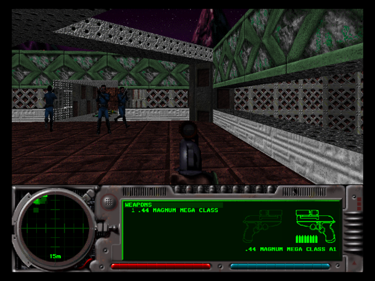
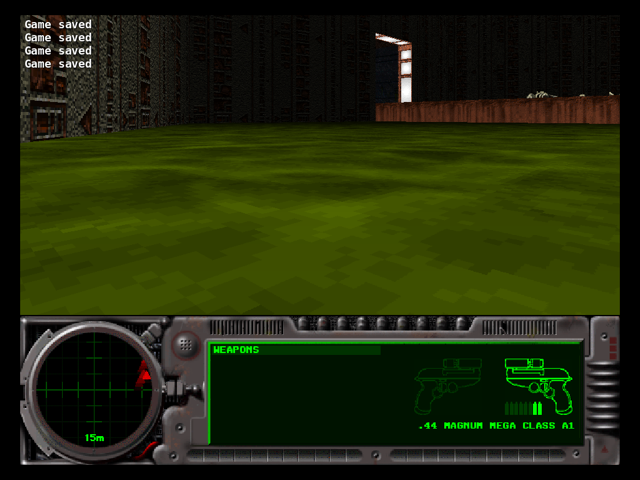
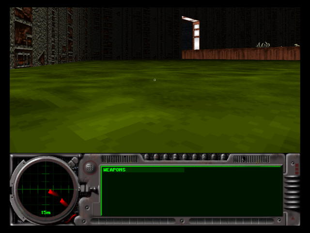

# Aleph One 3DS port: stage 2 — Linux build with the 3DS feature set

Recorded 2026-10-10 on branch `3ds-port`, on top of the stage 1 audit
(`docs/3ds/AUDIT.md`). Everything was built and run in the
`aleph-host-baseline` Docker image (Ubuntu 24.04, aarch64, gcc 13).

## Summary

| Step | Result |
| --- | --- |
| 1. Configure with the 3DS feature set | **OK.** All 14 optional features `Disabled`, `FILM_EXPORT` undefined, 0 warnings |
| 2. `--disable-network` (`A1_NO_NETWORK`) | **OK.** Builds and links with asio removed from the system; network UI hidden |
| 3. `AudioBackend` seam | **OK.** SDL legacy audio behind an interface; no behaviour change |
| 4. `A1_FS_STD` shim | **OK.** Builds and links with `libboost_filesystem` removed; runs |
| 5. Play levels 1–2, saves, prefs, music, SFX | **OK.** 42/42 replay films reproduce their seed on the stripped build; scripted play, quick save, reload, prefs and audio all work |

## Build configurations

`scripts/3ds/host-baseline/build-3ds-features.sh [extra configure args]`
runs `build.sh` (which now forwards its arguments to `./configure`) with:

```
--disable-opengl --without-sdl_image --without-curl --without-zzip --without-png
--without-miniupnpc --without-vpx --without-matroska --without-ebml --without-vorbis
--without-vorbisenc --without-libyuv --without-nfd
```

| Build | Extra args | Removed from the container before building | Binary |
| --- | --- | --- | --- |
| A | `--disable-network` | `/usr/include/asio*` | 75.8 MB |
| B | (none) | | 95.7 MB |
| C | `--disable-network --enable-std-filesystem --with-catch2` | asio headers, `libboost_filesystem*` | 75.9 MB |
| D | upstream defaults + `--with-catch2` (not the 3DS set) | | 104.4 MB |
| control | 3DS set, **original source** (stage 1 tree) | | 95.5 MB |

All builds: `make` exit 0, no errors. B and D show that the default
(network-on, boost) paths still compile with the changes.

Step 1 configure summary (identical for every 3DS-set build, plus the new
network line):

```
   Disabled: OpenGL rendering
   Disabled: network play, metaserver and HTTP support      (only with --disable-network)
   Disabled: SDL2_image support
   Disabled: cURL for HTTP communication
   Disabled: zziplib support
   Disabled: libpng PNG screenshot support
   Disabled: miniupnpc support
   Disabled: libvpx support for film export
   Disabled: libmatroska support for film export
   Disabled: libebml support for film export
   Disabled: vorbis support for film export
   Disabled: vorbisenc support for film export
   Disabled: libyuv support for film export and video playback
   Disabled: Catch2 replay and unit tests support
   Disabled: Native file dialog support
```

`config.h`: `/* #undef FILM_EXPORT */`. LIBS:
`-lopenal -lsndfile -lz -lSDL2_ttf -lSDL2 -lSDL2 -lboost_filesystem`
(no `-lboost_filesystem` with `--enable-std-filesystem`).

Incidental fix: `configure.ac` tested `"x{with_nfd}"` (missing `$`), so
`--without-nfd` was ignored whenever nfd was installed.

## 2. `A1_NO_NETWORK`

### Design

`--disable-network` defines `A1_NO_NETWORK` in `config.h` and sets the
automake conditional `MAKE_NETWORK` off:

- `Network/` builds only `network_games.cpp` and `network_dummy.cpp`.
  `Metaserver/`, `StandaloneHub/` and `TCPMess/` are not built or linked.
- The `asio.hpp` check is skipped. `--enable-standalone-hub` with
  `--disable-network` is a configure error.

It deliberately does **not** define the legacy `DISABLE_NETWORKING` macro.
Those 92 old fences are not maintained: their `network_dummy.cpp` returned
`false` from `NetAllowCrosshair/TunnelVision/Behindview` (breaking those in
single-player), and the fence in `player.cpp` changes kill accounting.
Instead, every engine call site outside the network code is unchanged. The
network entry points it calls are already guarded at run time by
`game_is_networked`, which is never true in this build, and they resolve to
stubs.

- `network_games.cpp` stays compiled: it holds game-type rules (rankings,
  compass, ball scoring, `team_netgame_parameters`) used by the HUD, Lua and
  `items.cpp` in single-player too. It has no network I/O.
- `network_dummy.cpp` was rewritten. Each stub returns what the real function
  returns when no network game is active: `NetAllow*` use the same
  `player_count == 1 || cheat_flags` rules (`NetAllowSavingLevel` is always
  true, because a local game counts as the server), `NetGetLatency` returns
  `NetworkStats::invalid`, the chat prompt is `"<name>:"`, `HTTPClient`
  methods return `false` (as `HTTP.cpp` does without curl).
- `match_starts_with_existing_players` moved verbatim from `network.cpp` to
  `Misc/interface.cpp`. Single-player saved-game restore calls it. This also
  fixes linking for the legacy `DISABLE_NETWORKING` mode.

### Fences (`#ifndef A1_NO_NETWORK`)

| File | What is fenced |
| --- | --- |
| `Network/network.h` | `CommunicationsChannel.h`/`Pinger.h` includes; forward declarations instead. This is what pulled asio into 43 objects |
| `Network/network_dialogs.h` | `network_private.h`, `network_metaserver.h`, `metaserver_dialogs.h` includes; `GatherDialog`/`JoinDialog`/`SetupNetgameDialog` |
| `Misc/sdl_widgets.h/.cpp` | `metaserver_messages.h` include; metaserver list widgets, `GameListWidget`/`PlayerListWidget`/`JoiningPlayerListWidget`/`PlayersInGameWidget` |
| `Misc/sdl_dialogs.cpp` | theme parsing and defaults for the metaserver games list |
| `Misc/interface.cpp` | `network_dialog_widgets_sdl.h` include; `should_restore_game_networked()` always returns 0 (resume as single-player) |
| `Misc/preferences.cpp` | `StarGameProtocol.h` include; `<star_protocol>` is kept and written back unchanged instead of parsed; **INTERNET** button (metaserver account/stats dialog) hidden |
| `shell.cpp` | `networking_available()` returns false (Gather/Join become non-selectable, non-clickable); `g`/`j` menu shortcuts removed |
| `main.cpp` | "Built with network play enabled" banner |
| `Misc/Statistics.cpp` | `StatsManager` upload thread creation and `Process()` body (stage 3 prerequisite, behaviour change 6) |

Also added: `#include "Scenario.h"` in `shell.cpp` and `preferences.cpp`
(they relied on it arriving through the network headers).

The Gather/Join buttons are still drawn, because they are part of the
scenario's menu background image (`Images.imgA`). They do nothing when
clicked, highlighted or pressed via shortcut.

### Behaviour changes with `A1_NO_NETWORK` (none in the default build)

1. Network game, metaserver, LAN/UPnP, account link/sign-up and stats upload
   are unavailable (intended).
2. **Replaying a multiplayer film** (or any non-"kill monsters" film) returns
   to the menu without the postgame carnage report: `display_net_game_stats()`
   is a stub, because its dialog widgets live in the asio-dependent
   `network_dialog_widgets_sdl.cpp`. Single-player films are unaffected.
3. Opening a saved game whose network status is unknown (from the command
   line or a file manager, rather than the in-game Continue Saved Game list)
   no longer shows the "RESUME GAME — Resume as Single-player/Network game"
   question: it always resumes single-player. Seen in the control run below.
4. Theme `<metaserver><games>` settings are ignored.
5. The `latency_tolerance` console command sets a value that has no effect
   and is not saved.
6. `StatsManager` starts no upload thread and queues nothing
   (`Misc/Statistics.cpp`, fenced in the constructor and `Process()`; added
   with the stage 3 prerequisites, see `STAGE3-PREREQS.md` item 7). Before
   that fence, the first `leaving_map()` started `StatsManager_uploadThread`,
   which polled every 200 ms and could only fail through the stub
   `HTTPClient`. Callers are unchanged: `Process()` is a no-op and `Finish()`
   finds nothing pending, so the "Uploading stats" dialog never appears.

## 3. `AudioBackend`

`Sound/AudioBackend.h` (header-only):

```cpp
class AudioBackend {
  struct Spec { int rate; SDL_AudioFormat format; int channels; uint16_t samples; };
  typedef void (*PullCallback)(void* userdata, uint8_t* stream, int len);
  virtual bool Open(const Spec& desired, Spec& obtained, PullCallback, void* userdata) = 0;
  virtual void Close() = 0;
  virtual void Pause(bool paused) = 0;
  virtual bool IsStopped() const = 0;
  virtual void Lock() = 0;  virtual void Unlock() = 0;
  static std::unique_ptr<AudioBackend> CreateDefault();
};
class SDLAudioBackend : public AudioBackend { /* SDL_OpenAudio & co, device 1 */ };
```

`OpenALManager` owns one (`audio_backend`). Every former `SDL_OpenAudio`,
`SDL_CloseAudio`, `SDL_PauseAudio`, `SDL_GetAudioStatus`,
`SDL_LockAudio`/`SDL_UnlockAudio` call goes through it, in the same order.
The backend calls `OpenALManager::MixerCallback` from its own thread, which
pulls samples with `alcRenderSamplesSOFT` as before. A port replaces
`CreateDefault()` (for example with an `ndsp` backend).

The backend is created as a default member initializer, not in the
constructor body: the constructor's first call (`UpdateParameters` →
`ResyncPlayers`) already locks it, and in the old code that
`SDL_LockAudio()` on an unopened device was a silent no-op.

## 4. `A1_FS_STD`

`CSeries/a1_filesystem.h` exposes the used subset as namespace `a1fs`:
`path`, `directory_iterator`, `create_directory`, `is_directory`,
`last_write_time`, `remove`, `rename`, `unique_path`, `file_type`,
`directory_file`, `regular_file`, `error_code`, `generic_category`.
Default: `using` declarations for boost (identical overloads as before).
With `A1_FS_STD` (`configure --enable-std-filesystem`):

- `last_write_time` returns `time_t` from `stat()` (what boost does on
  POSIX); C++17 has no exact `file_time_type` → `time_t` conversion.
  Returns `(time_t)-1` on error, like boost.
- `unique_path` replaces each `%` with a random hex digit (`mt19937` seeded
  from `random_device`). It is used only for temporary save-file names.

Users switched: `Files/FileHandler.cpp` (`namespace fs = a1fs`,
`sys::error_code` → `fs::error_code`), `XML/Plugins.{h,cpp}`,
`Misc/preferences.cpp`. The header includes `config.h` itself so every
translation unit sees the same `A1_FS_STD` (the `Plugins` API takes
`a1fs::path`).

## 5. Runtime verification

Two independent checks, both run in Docker with Xvfb.

### Deterministic replay of recorded games (Catch2 `alephone_tests`)

```sh
alephone_tests "/src/data/Scenarios/Marathon 2" \
    --replay-directory "/src/tests/replays/Marathon 2" "[Replay]"
```

The test replays every film under `tests/replays/Marathon 2` (42 films) at
maximum speed and checks that the final random seed equals the one encoded
in the file name. Any change to the simulation diverges the seed. The set
includes `Saved Games/M2 L01 - L03.60663.filA` (a playthrough of levels 1
to 3) and `Tooncinator Films/M2 L02 …filA`.

| Build | Result |
| --- | --- |
| C: 3DS set, `--disable-network`, `--enable-std-filesystem` (no asio, no `libboost_filesystem`) | **All tests passed (86 assertions in 1 test case)** = 42 × (open + seed) + 2 |
| D: upstream default features | **All tests passed (86 assertions in 1 test case)** |

### Interactive run (`scripts/3ds/host-baseline/play-verify.sh`)

The script plays Marathon 2 with the software renderer and SDL's disk audio
driver, which writes the mixed output to a file. Lua harness
(`harness/harness.lua`, loaded as a solo-Lua plugin, needs `-i`):

1. Main menu (music), then the Gather/Join probe: press `g`, `j`, click the
   Gather button.
2. New game, level 1 *Waterloo Waterpark*: hold fire, move, fire. At 20 s of
   game time `Game.save()` (quick save), at 22 s `teleport_to_level(1)`.
3. Level 2 *The Slings & Arrows of Outrageous Fortune*: quick save every 2 s
   from 8 s on, fire, quit (SIGTERM → menu → exit).
4. Edit two preferences in the file (`fps_target` 30→31,
   `crosshairs_active` false→true).
5. Start again with the newest quick save as a command-line argument, fire,
   quit.

| Check | A: `--disable-network` | C: + `--enable-std-filesystem` |
| --- | --- | --- |
| Gather/Join probe | nothing opens; stays on the main menu | same |
| Level 1 → level 2 | `init level=0 Waterloo Waterpark` → `teleport` → `init level=1 The Slings & Arrows…` | same |
| Quick saves (`Game.save`) | 1 on level 1 + 10 on level 2, then 5 more after the reload | 1 + 9, then 4 after the reload |
| Reload from command line | `init level=1 … restoring=true` at tick 1452 = tick and position of the last save | `restoring=true` at tick 1392 = last save |
| Music (menu) / SFX (firing) | 66 of 77 s non-silent in phase 1, RMS peaks up to ~3200 while firing; 20 of 24 s in phase 2 | 65 of 78 s; 21 of 25 s |
| Preferences round trip | both edited values kept after the reload run rewrote the file | same |
| Exit codes | 0, 0 | 0, 0 |

With the C build the quick saves go through `a1fs::unique_path` (temporary
name) and `a1fs::rename`, and the save list through `directory_iterator` +
`last_write_time` on `std::filesystem`.

**Control** (original stage 1 source, 3DS set, network on, run with
`NET_PROBE=0`):

- The Gather/Join probe in a first attempt opened the real **Join Network
  Game** dialog, which is the behaviour step 2 removes.
- Its startup was slower (still on the splash at 10 s), so the blind
  keypresses landed differently. The harness still saved on level 2.
  Loading that save from the command line stopped at the "RESUME GAME"
  question (behaviour change 3), which the harness does not answer.
- Its preferences file differs from A's and C's only by the
  `<star_protocol>` block. A fresh no-network prefs file has none to pass
  through. (A first comparison also showed landscape colour drift, e.g.
  `0.0627450943` → `0.0627298355`. That is an existing lossy round trip in
  `InfoTree::_get_color_part` (`value * 65535` truncated) and disappeared
  once the control went through the same number of read/write cycles.)

Screenshots (no-network build):

| Menu after Gather/Join probe | Level 1 | Level 2 after quick saves | Reloaded save |
| --- | --- | --- | --- |
|  |  |  |  |

### What was not verified

- Nobody played the levels by hand. Level completion is covered by the
  replay films; the interactive run moves between levels with Lua.
- Audio was checked as signal level, not by listening.
- The binaries contain no asio, `NetEnter`, `CommunicationsChannel`,
  metaserver or curl symbols (`nm`). This was checked on Linux only; nothing
  in this stage was built for the 3DS.
- The wall-clock gaps of ~15 min in some `events.txt` files are the Docker VM
  being suspended by the host (container uptime and the audio file stop
  advancing with it). Game time is unaffected.

## Review

The diff was reviewed by four independent reviewers (stub semantics,
default-build regression, audio equivalence, filesystem semantics), and each
finding was given to a separate reviewer to refute. Five findings, three
survived: the carnage-report change (documented above, behaviour change 2),
`<star_protocol>` being dropped from shared prefs (fixed: passed through),
and a nondeterministic `last_write_time` conversion (fixed: `stat()`).

## Reproducing

```sh
docker run --rm -v "$PWD":/src:ro -v aleph-a:/build aleph-host-baseline \
    bash /src/scripts/3ds/host-baseline/build-3ds-features.sh --disable-network
docker run --rm -v "$PWD":/src:ro -v aleph-a:/build -v "$PWD/build/play":/out \
    aleph-host-baseline bash /src/scripts/3ds/host-baseline/play-verify.sh \
    /build/src/Source_Files/alephone "/src/data/Scenarios/Marathon 2"
```
