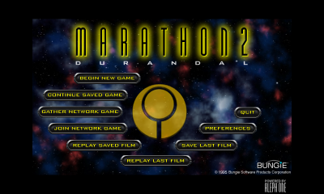
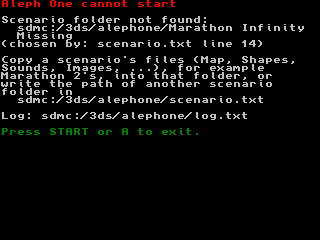
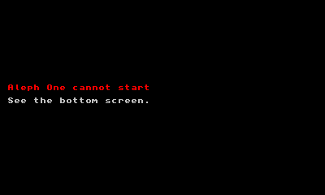

# Aleph One 3DS port: stage 4 — boot to the main menu

Recorded 2026-10-11 on branch `3ds-port`, on top of stage 3 (`0cec16a`).
Goal: Aleph One boots to the main menu on the 3DS top screen (400x240) with
the software renderer. Engine changes are fenced with `A1_PLATFORM_3DS` and
listed in [`PATCHES.md`](PATCHES.md) (entries 5-13).



*Top screen 8 s after the main menu appeared (Azahar, captured by the game
from the framebuffer the display is scanning out; see "debug-screens").*

## Summary

| # | Brief item | Result |
| --- | --- | --- |
| 1 | Paths: user data `sdmc:/3ds/alephone/`, scenario `sdmc:/3ds/alephone/Marathon2/` or `scenario.txt`, engine resources from romfs (`SDL_GetBasePath()`), folders created, no romfs writes | **Done.** Verified in Azahar, including `scenario.txt` |
| 2 | 400x240, software renderer, no OpenGL options in the prefs UI, prefs clamped | **Done.** Window 400x240, SDL `software` renderer; menus keep their 640x480 logical size, scaled to 320x240 (see Screen) |
| 3 | Early-boot diagnostics: error screen for a missing scenario, stdout/stderr to `log.txt` and to the 3dslink host | **Done.** Error screen verified in Azahar; 3dslink path **not run** (needs hardware) |
| 4 | `run-3dslink` target (`NETLOAD_IP`), `run-azahar` helper | **Done.** `run-azahar` verified; `run-3dslink` generates the expected command (not run) |
| 5 | Log free linear/heap memory after boot and time to menu | **Done.** Logged at every boot milestone (table below) |
| | Test in Azahar | **Main menu reached** (New and Old 3DS modes); also seen on the emulator window by the user (2026-10-11) |
| | Test on hardware | **Not done**: no 3DS connected in this session; checklist below |

Three bugs that stopped the engine before the menu were found and fixed
along the way (details under "Bugs found"):

1. the 32 KiB default main stack overflowed during `initialize_application()`;
2. Azahar starts a `.3dsx` with `argc == 0`, and the engine read `argv[0]`;
3. **every C++ `throw` ended in `std::terminate()`**: devkitARM's `3dsx.ld`
   puts `__exidx_start` 2 bytes before the unwind table.

## Reproducing

```sh
cmake -S ports/3ds -B build-3ds
cmake --build build-3ds                       # -> build-3ds/alephone.3dsx (8.9 MB, romfs inside)

# emulator: stages the SD card, runs, prints sdmc:/3ds/alephone/log.txt afterwards
AZAHAR=/path/to/Azahar.app scripts/3ds/run-azahar.sh [--screens] [--timeout 60] [--no-data]
cmake --build build-3ds --target run-azahar   # same, default options

# hardware: Homebrew Launcher, press Y, then
cmake --build build-3ds --target run-3dslink  # -DNETLOAD_IP=<3DS address> if the broadcast fails
```

## Paths

`get_data_path()` has a 3DS branch in `CSeries/cspaths_sdl.cpp`, backed by
`ports/3ds/source/a1_3ds_platform.cpp`:

| `CSPathType` | 3DS | Notes |
| --- | --- | --- |
| `kPathLocalData`, `kPathLogs`, `kPathPreferences` | `sdmc:/3ds/alephone` | cache variable `A1_3DS_USER_DIR` |
| `kPathSavedGames`, `kPathQuickSaves`, `kPathImageCache`, `kPathRecordings`, `kPathScreenshots` | `sdmc:/3ds/alephone/<Saved Games, ...>` | as on Linux, under the user dir |
| `kPathDefaultData` | the scenario folder (below) | |
| `kPathBundleData` | `SDL_GetBasePath()` = `romfs:/` | searched first, like the macOS app bundle; `shell.cpp` unchanged |
| `kPathLegacyData`, `kPathLegacyPreferences` | `""` | |

**Scenario folder.** `sdmc:/3ds/alephone/Marathon2` (cache variable
`A1_3DS_DEFAULT_SCENARIO`), unless `sdmc:/3ds/alephone/scenario.txt` has a
line that is not empty and does not start with `#`. That line is trimmed
(spaces, CR, trailing `/`) and then used as-is if it has a device prefix
(`sdmc:/games/Marathon`), relative to the card root if it starts with `/`,
and relative to `sdmc:/3ds/alephone/` otherwise. The first boot writes a
commented `scenario.txt` template. The log says where the choice came from:

```
[3ds] scenario: sdmc:/3ds/alephone/Marathon Infinity Missing (scenario.txt line 14)
```

**Folders.** `boot_begin()` creates `sdmc:/3ds` and `sdmc:/3ds/alephone`
before anything else (`mkdir` is not recursive); `shell.cpp` then creates
`Saved Games`, `Quick Saves/<scenario>`, `Image Cache`, `Recordings` and
`Screenshots` as on other platforms. After the first boot:

```
Aleph One Log.txt   Image Cache   Marathon 2 Preferences   Marathon2/   Quick Saves/
Recordings/   Saved Games/   Screenshots/   log.txt   log.prev.txt   scenario.txt
```

**romfs** (read-only, embedded in the `.3dsx`): what automake installs into
`$(pkgdatadir)`, read from the upstream `data/Makefile.am` (`mml_DATA` →
`MML/`, 3 files) and `data/default_theme/Makefile.am` (`theme_DATA` →
`Plugins/Default_Theme/`, 42 files). Unlike automake's flattening `DATA`
install, subdirectories are kept: `Plugin.xml` says `theme_dir="resources"`.
Nothing writes there; every write path above is on `sdmc:`.

## Screen

- `validate_graphics_preferences()` pins: 400x240, `auto_resolution` off,
  fullscreen on, high DPI off, software renderer, SDL driver "None" (SDL's
  `software` renderer), bit depth 8/16/32 (anything else becomes 32). It
  runs on every prefs read; `shell.cpp` writes the prefs back.
- `Screen::Initialize` keeps a single mode, 400x240 (otherwise the list
  would start with the 1600x900 fallback, because the desktop is smaller
  than 640x480).
- The graphics dialog hides Rendering System, Screen Size, Windowed Mode and
  the "built without OpenGL" note; the software options hide Acceleration
  (Default/None/Direct3D/OpenGL). RENDERING OPTIONS opens the software
  options directly.
- **Result** (logged at the menu):
  ```
  [3ds] video: SDL driver n3ds
  [3ds] video: window 400x240, SDL_PIXELFORMAT_RGBA8888, flags 0x00001605
  [3ds] video: renderer "software", output 400x240, logical 640x480
  ```
  The window has to be 400x240: SDL's N3DS framebuffer copies
  `min(window, screen)` pixels, so a 640x480 window would show only its top
  left corner. Fullscreen-desktop gives exactly the top screen.
- **Not solved in this stage:** menus are hard-coded to 640x480 and the game
  screen has a 640x480 floor (`AUDIT.md` e), so SDL scales the logical
  640x480 to 320x240 with 40-pixel bars on each side. Readable for the menu
  (screenshot above); using the full 400x240, and the game view, are the
  next screen tasks.

## Diagnostics

**Log.** `boot_begin()` replaces the `STD_OUT`/`STD_ERR` devoptabs with a
tee: every write goes to `sdmc:/3ds/alephone/log.txt` and, when the
netloader started the game, to the 3dslink host. stdout is line-buffered
and stderr unbuffered, so a crash loses at most a partial line. The previous
run's log is kept as `log.prev.txt`. The engine's own `Aleph One Log.txt`
still exists; everything it logs is also echoed to stderr, so it appears in
`log.txt` too.

**3dslink.** If `__3dslink_host` is set, the game calls `socInit` (1 MiB
buffer) and `link3dsConnectToHost(false, false)`. That is `link3dsStdio()`
without the `dup2()` redirect, which would leave the SD log empty; the tee
writes to both instead. If the host does not answer (3dslink started
without `-s`) the log says so; if the host goes away mid-run, mirroring
stops. `run-3dslink` always passes `-s`. **Not run**: needs a 3DS.

**Error screen** (`a1_3ds::error_screen`): bottom-screen console, word
wrapped to 39 columns (paths keep their indent), START or A to exit, HOME
closes as usual. Before SDL video is up it also puts a pointer on the top
screen; afterwards the top screen keeps the game's last frame. Used for:

| Situation | Message |
| --- | --- |
| Scenario folder missing / not a folder / empty (checked before `SDL_Init`) | "Aleph One cannot start" + path + where it was chosen + what to do |
| `sdmc:/3ds/alephone` cannot be created | "Cannot create the data folder" |
| Fatal `alert_user()` before the main window exists (SDL's N3DS driver has no message box) | the alert text |
| Uncaught exception in `main()` | "Aleph One stopped" + `what()` |
| `std::terminate()`, `abort()` (`halt()`, `vhalt()`) | "Aleph One stopped" + reason |

Since 2026-10-23 (`3ds-port`, CITRO3D_DESIGN.md 5.6.2 a) the screen is drawn through libctru's console device
(`console_write_on()`, `input_3ds.cpp`), not through `printf`: after boot stdout is the log
tee and `consoleInit()` reroutes it only on its first call, so an error screen after boot
used to write to the log and show nothing. It also holds its own HID reference, so it can
poll input after `SDL_Quit`. See `NEXT-SPRINT.md` backlog item 14.

 

The terminate/abort handlers matter on the 3DS: newlib's `abort()` exits
without flushing stdio, and the console simply returns to the Homebrew
Launcher (an emulator, to its game list) with no trace.

**debug-screens.** If `sdmc:/3ds/alephone/debug-screens` exists, the game
saves `screen-*.bmp` (both screens, from `GSPGPU_ImportDisplayCaptureInfo`,
i.e. what the display is showing) when the error screen is up, and 3 s and
8 s after the main menu appears. `run-azahar.sh --screens` sets the flag
and converts the captures to `build-3ds/azahar-screens/*.png`. This is how
the screenshots here were taken; this host's terminal has no screen-capture
permission.

## Measurements (Azahar 2126.2, macOS arm64)

From `log.txt` (`[3ds] +<ms>: <milestone>`; time from `main()`, via
`svcGetSystemTick()`). Azahar gives the same timings in New and Old 3DS
mode, so it does not model the clock difference: **treat these as relative
costs, not hardware times.**

| Milestone | New 3DS mode | Old 3DS mode | Step |
| --- | ---: | ---: | ---: |
| platform ready (log, folders, scenario check) | 363 ms | 347 ms | |
| `SDL_Init` done | 422 ms | 405 ms | |
| scenario chooser done | 1 736 ms | 1 702 ms | 1.3 s |
| base MML loaded | 2 454 ms | 2 432 ms | 0.7 s |
| fonts and plugins | 13 016 ms | 13 083 ms | **10.6 s** (`initialize_fonts(true)` 0.4 s, `Plugins::enumerate()` **10.2 s**) |
| preferences loaded | 13 503 ms | 13 570 ms | 0.5 s |
| sound initialized | 16 680 ms | 16 764 ms | 3.2 s |
| screen initialized | 16 824 ms | 16 907 ms | 0.1 s |
| `initialize_application()` done | 23 537 ms | 23 621 ms | 6.7 s |
| **main menu** (after the intro screens) | **32 143 ms** | **32 247 ms** | 8.6 s |

The fonts/plugins split comes from one Old 3DS run with a temporary
milestone (not committed).

Memory at the main menu (identical in both modes apart from the heap size):

| | New 3DS mode | Old 3DS mode |
| --- | ---: | ---: |
| App heap (`envGetHeapSize`) | 85 884 KiB | 57 212 KiB |
| of which main stack | 1 024 KiB | 1 024 KiB |
| malloc in use (`mallinfo().uordblks`) | 12 357 KiB | 12 357 KiB |
| heap free for malloc | 72 502 KiB | 43 830 KiB |
| Linear heap / free (`linearSpaceFree`) | 32 768 / 30 668 KiB | 32 768 / 30 668 KiB |
| Main stack deepest use | 68 KiB | 68 KiB |
| `osGetMemRegionFree(APPLICATION)` | not meaningful (Azahar reports 124 MiB used of 96 MiB) | 0 KiB |

Notes:

- libctru maps the whole APPLICATION region into the two heaps at startup,
  so `osGetMemRegionFree` is normally about 0; the log prints size and used
  as well and flags the emulator inconsistency instead of printing a
  wrapped `u32`.
- libctru sets up the linear allocator's pool on the first `linearAlloc()`;
  until then `linearSpaceFree()` returns 0, so the logger makes one 1-byte
  allocation first.
- Only 2 MiB of the 32 MiB linear heap is used at the menu (SDL
  framebuffers, audio buffers). A smaller linear heap would give malloc
  ~30 MiB more, which matters on a real Old 3DS; not changed yet.
- The Old 3DS numbers are Azahar's Old 3DS memory layout; a real Old 3DS
  through the Homebrew Launcher may have less. Hardware will tell.

## Bugs found

### 1. Main stack overflow (32 KiB default)

`initSystem()` carves the main stack from the start of the heap with
libctru's weak `__stacksize__` (32 KiB). Aleph One overflowed it inside
`initialize_application()`: SP `0x07FF7740` (heap starts at `0x08000000`),
Azahar "Undefined Instruction" at PC 0. Fixed with a strong
`__stacksize__ = 1 MiB` (`PATCHES.md` 13). The stack is painted at boot and
the deepest use is logged at every milestone (68 KiB at the menu).

### 2. `argc == 0` under Azahar

Azahar starts a `.3dsx` without arguments (`argc == 0`, `argv[0] == NULL`),
and `ShellOptions::parse` reads `argv[0]` unconditionally (null read at
`shell_options.cpp:109`). The Homebrew Launcher always passes the `.3dsx`
path. `boot_begin(int&, char**&)` now substitutes `{"alephone", NULL}` and
logs `started without argv (emulator?)`. romfs is unaffected (libctru opens
the emulator's self-NCCH romfs when not running as homebrew).

### 3. C++ exceptions never caught (`3dsx.ld`)

See `PATCHES.md` 12. Symptom: the game exited silently after `SDL_Init`;
with the new terminate handler, "std::terminate() was called again while
reporting an uncaught exception". `__exidx_start` was `0x0076293e`,
`.ARM.exidx` starts at `0x00762940`. Fixed by defining
`__gnu_Unwind_Find_exidx()`; `log.txt` now starts with
`[3ds] C++ exceptions: OK`.

## Azahar notes (for running the tests)

- **Update check.** With `check_for_update_on_start=true`, Azahar shows a
  modal "Update Available" dialog at startup when a newer release exists,
  and the game does not start until it is closed. The copy used here has it
  turned off (`user/config/qt-config.ini`); `run-azahar.sh` warns when it is
  on.
- **Launch detached.** Started as a plain child of a script
  (`azahar … & wait`), Azahar 2126.2 stops at a modal dialog during startup
  and never loads the game. The same command double-forked (`( azahar … & )`)
  boots normally (reproduced in isolation). The dialog was not identified:
  this host has no screen-capture or accessibility access. `run-azahar.sh`
  therefore double-forks and polls the PID.
- **SIGTERM is ignored** while a modal dialog is open; the script follows up
  with SIGKILL after 5 s.
- **Logs are buffered.** `azahar_log.txt` is written lazily
  (`instant_debug_log=false`); an empty file does not mean Azahar is stuck.
- **GDB stub.** `azahar -g <port>` listens only when Azahar runs outside the
  command sandbox, and on attach it reports the initial `_start` context
  rather than the live threads, so it was not useful here. The guest's
  faults are logged by Azahar ("Undefined Instruction", "unmapped Read32 …
  at PC") and resolve with `arm-none-eabi-addr2line -e build-3ds/alephone.elf`.

## Hardware checklist (not done)

1. Copy `build-3ds/alephone.3dsx` to `sdmc:/3ds/alephone.3dsx` and
   `data/Scenarios/Marathon 2/*` to `sdmc:/3ds/alephone/Marathon2/`
   (or run once via 3dslink, which sends the `.3dsx` only).
2. Optionally create an empty `sdmc:/3ds/alephone/debug-screens`.
3. Homebrew Launcher → Y, then `cmake --build build-3ds --target run-3dslink`
   (`-DNETLOAD_IP=…` if needed). Expect the `[3ds]` log on the terminal and
   in `sdmc:/3ds/alephone/log.txt`.
4. Check: `C++ exceptions: OK`, `launched via 3dslink from <host IP>`,
   argv[0] (expect `3dslink:/alephone.3dsx` or the SD path), `TIME TO MAIN
   MENU`, the memory lines (Old 3DS: is the heap enough?), and the menu on
   screen.
5. Rename `Marathon2` and launch again: the error screen should appear;
   START returns to the launcher.
6. Also run the stage 0 probe and the dependency tests still pending from
   `STAGE3-PREREQS.md` item 5 and `STAGE3.md` (OpenAL loopback, sndfile).

## Known limitations / next steps

- Menus and game screens: 640x480 logical, letterboxed to 320x240 (Screen).
- `Plugins::enumerate()` takes 10 s of the 32 s boot (the M2 scenario ships
  five plugins); the scenario chooser 1.3 s. First candidates for
  boot-time work.
- Input is not mapped yet; the menu has not been navigated. The main menu
  still shows the network buttons (`A1_NO_NETWORK` behaviour, `STAGE2.md`).
- Music (`Music.ogg`) is silent (no Ogg decoder, `STAGE3.md` stub 2).
- SDL's audio thread (OpenAL mixing, music decoding) keeps SDL's N3DS
  default 80 KiB stack; not measured.
- `A1_DISPLAY_PLATFORM` is still "Unknown" (`STAGE3.md` row 6).
- The error screen for early fatal `alert_user()` calls is wired up but was
  not triggered in a test; the scenario-missing and terminate paths were.

## Files

| Path | Purpose |
| --- | --- |
| `ports/3ds/include/a1_3ds_platform.h` | API used by the engine hooks (no `<3ds.h>`) |
| `ports/3ds/source/a1_3ds_platform.cpp` | paths, log tee + 3dslink, boot milestones, memory/stack/video logging, error screen, terminate/abort handlers, debug-screens, `__stacksize__` |
| `ports/3ds/source/exidx_fix.c` | `__gnu_Unwind_Find_exidx` (`3dsx.ld` workaround) |
| `ports/3ds/CMakeLists.txt` | the above, romfs from `data/**/Makefile.am`, `A1_3DS_USER_DIR`, `A1_3DS_DEFAULT_SCENARIO`, `NETLOAD_IP`, `run-3dslink`, `run-azahar` (replaces the provisional `A1_3DS_PKGDATADIR`) |
| `scripts/3ds/run-azahar.sh` | stage the emulated SD card, run Azahar, print the log, `--screens` |
| `Source_Files/…` (7 files) | hooks, `PATCHES.md` 5-11 |
| `docs/3ds/STAGE4.md`, `docs/3ds/PATCHES.md`, `docs/3ds/img/stage4-*.png` | this document, patch log, screenshots |
