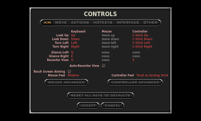
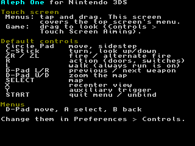
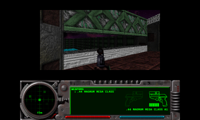
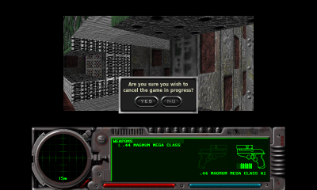

# Aleph One 3DS port: stage 5 — controls

Recorded 2026-10-11 on branch `3ds-port`, on top of the stage 5
prerequisites (`1dfa858`). Goal: full single-player control on a New 3DS.
Engine changes are fenced with `A1_PLATFORM_3DS` and listed in
[`PATCHES.md`](PATCHES.md) (entries 16-22); the rest is port code in
`ports/3ds/source/input_3ds.cpp`.

|  |  |
| --- | --- |
| Preferences > Controls with the 3DS defaults and button names | Bottom screen during play |
|  |  |
| Level 1 after walking (Circle Pad) and turning (C-Stick) | START in a game |

*All captured in Azahar by the game itself while a test script played (see "Testing").*

## Summary

| # | Brief item | Result |
| --- | --- | --- |
| 1 | How the engine maps SDL controller input; which indices SDL's 3DS backend reports; a raw-event debug overlay | **Done.** Table below, confirmed in Azahar. `debug-input` flag file: every input event in `log.txt` and on the bottom screen |
| 2 | 3DS default bindings when no prefs exist; remapping UI usable with D-Pad + A/B | **Done**, with two deviations from the brief (below). Remapping verified (bind, clear, cancel, accept, reset) with D-Pad/A/B/START only |
| 3 | Touch: relative mouse look (toggle in prefs), absolute pointer in menus | **Done.** Toggle = Controls > "Touch Screen Aiming" (the mouse-aiming switch, relabelled) |
| 4 | Text entry through libctru swkbd | **Done.** Tapping or pressing A on a text field opens the system keyboard with the field's text |
| 5 | HOME menu / sleep: pause game and audio, resume cleanly | **Done.** Plus HOME > Close: exits in 0.2 s from a game (was 4.6 s) |
| | Hardware (DoD: finish Marathon 2 level 1 with the built-in controls) | **Met** (2026-10-11, second console session, `PERF.md` "Hardware results"): level 1 played to the exit and on into level 2 on a New 3DS with the default controls, 30 min, HOME and lid used, no crash. First session: every control, touch, keyboard, HOME, lid and Close verified ("Hardware session") |

## Stage status (2026-10-11, after the second console session)

**Achieved.** Full single-player control works **on a New 3DS**: every
button, both sticks, ZL/ZR, touch pointer and drag-to-look, the map, the
system keyboard, HOME, sleep and HOME > Close, with the 3DS defaults and
the remapping dialog. The main menu and dialogs work with A from the start
(`PATCHES.md` 23-24). The stage 3-5 prerequisites have their hardware
answers: the four dependency tests pass, ps:ps entropy works, the audio
thread runs on core 1 with 9 of 80 KiB stack and no late callbacks
(dialogs included), and the linear heap is cut (`PATCHES.md` 25; on a New
3DS heap 98 304 KiB, linear 19 960 KiB, after a boot fix in the second
session). Details: "Hardware session" below. **Definition of done met**
in the second console session: level 1 played to the exit on a New 3DS.

**Open items:**

| # | Item | Kind | Blocks the next stage? |
| --- | --- | --- | --- |
| 1 | Level 1 played to the exit with the built-in controls (the definition of done) | **Done** (second console session): to the exit and into level 2, 30 min, no crash | |
| 2 | C-Stick and touch-look sensitivity tuning | **Open.** The player finds the C-Stick's vertical look too fast relative to the horizontal: it is easy to end up looking at the sky. Wanted: a lower vertical than horizontal sensitivity. No stick drift seen. Touch look: left for the touch-mapping redesign. *2026-10-12:* the pitch now turns at half the yaw's speed (`PATCHES.md` 19): full deflection crosses the ±30° range from level in 0.23 s instead of 0.12 s (logged in Azahar with `tests/input/16-cstick-pitch.txt`); to be judged by feel on the console, with the Controller Advanced vertical sensitivity and dead zone as the next knobs | no |
| 3 | Log lock and 8 MiB linear heap seen on hardware | **Log lock done** (0 non-printable bytes in `log.txt`). **The 8 MiB split did not boot** on the console (heap past the 96 MiB heap area); **fixed** (`PATCHES.md` 25): heap 98 304 KiB, linear 19 960 KiB | |
| 4 | HOME > Close during the menu demo takes 14.4 s (hardware only) | bug, open; from a game 0.34 s; not re-tested. *2026-10-12:* every step of `finish_game()` now logs its time (`PATCHES.md` 41, `PERF.md` "Load times") for the next console session | no: the HOME menu stays responsive |
| 5 | 2.8-3.9 s audio gaps at game/menu transitions | **Not reproduced**: in 30 min with game starts, a level change, a return to the menu, HOME and sleep, the longest gap between audio callbacks was 35.8 ms and none was heard (`STAGE6.md`) | |
| 6 | Player name from the console profile (CFGU) | cosmetic, deferred by the user | no |
| 7 | Short hitches when entering areas not seen before | **Open**, seen in the play-through; not measured (needs the console: `debug-perf` with `log 1`) | no |
| 8 | Level change and save terminals look frozen | **Open.** A level load takes 76-97 s (`PERF.md`); after level 1's exit the screen looks frozen and broken until level 2 has loaded, and saving at a pattern buffer takes long enough to look like a hang (not timed). *2026-10-12:* 90% of a load was reading the shapes a few bytes at a time; each collection is now read in one go (`PATCHES.md` 42): a level load is 3-4 s instead of ~31 s in Azahar (`PERF.md` "Load times"). Saves are marked step by step; each writes a 2.98 MB file, mostly a BMP preview. Console figures pending | no |

**Moving on:** the next stage can start with stage 5 in this state. What is
left is tuning (the vertical C-Stick look) and open issues found in play
(hitches, loads and saves that look like hangs); none of it is needed to
start other work. The
game is slow (software renderer, 640x480 logical size letterboxed, about
1.5 min to load a level from SD), which is the obvious candidate for the
next stage, and the level 1 play-through is more useful once that improves.
Sensitivity tuning stays valid across such work: the engine reads input
once per 30 Hz world tick whatever the frame rate. The first console
session of the next stage should run the "Next console session" list at the
end of this document first.

## How the engine reads controllers

`Input/joystick_sdl.cpp` opens every joystick SDL recognises as a
**game controller** (`SDL_GameController`). Controller buttons and stick
directions become pseudo key codes after SDL's keyboard scancodes
(`joystick.h`): button *b* is code 415 + *b*; axis *a* is 415 + 21 + *a*
when past +16384 and 415 + 21 + 6 + *a* when past −16384. Key bindings
(`preferences.cpp`) are sets of such codes per action, so a pad button is
bound exactly like a key. On top of that, when "Controller Feel" is "Treat as
Analog Stick", the axes bound to Turn Left/Right and Look Up/Down are read
as analog aim (`process_joystick_axes()`), once per game tick.

In menus, `shell.cpp` handles the D-Pad and A on the main menu;
`sdl_dialogs.cpp` maps D-Pad = previous/next widget, A = click the focused
widget, B = cancel. START is hard-wired as the pad's Escape (in a game: the
"cancel the game in progress?" dialog; while binding a key: clear it).

## SDL's view of the controls

SDL 2.32.10's N3DS joystick (`src/joystick/n3ds/SDL_sysjoystick.c`): one
joystick, "Nintendo 3DS", 23 buttons, 4 axes. Button *i* is libctru's
`KEY_*` bit *i*; the axes are the Circle Pad and the C-Stick, scaled from
the HID range ±160 to ±32767 with Y flipped (up is negative). SDL has a
built-in game controller mapping for it. Logged at boot:

```
[3ds] input: joystick 0 "Nintendo 3DS", GUID 000010324e696e74656e646f20334400, game controller: yes
[3ds] input:   23 buttons, 4 axes, 0 hats
[3ds] input:   mapping 000010324e696e74656e646f20334400,Nintendo 3DS,crc:3210,a:b0,b:b1,back:b2,dpdown:b7,dpleft:b5,dpright:b4,dpup:b6,leftshoulder:b9,lefttrigger:b14,leftx:a0,lefty:a1,rightshoulder:b8,righttrigger:b15,rightx:a2,righty:a3,start:b3,x:b10,y:b11,platform:Nintendo 3DS
[3ds] input: 1 touch device(s)
```

Confirmed event by event with `scripts/3ds/tests/input/01-raw-indices.txt`
(`--input-debug`):

| 3DS control | Joystick button / axis | Game controller | Engine code (bindings) |
| --- | --- | --- | --- |
| A, B, X, Y | 0, 1, 10, 11 | a, b, x, y | 415, 416, 417, 418 |
| SELECT, START | 2, 3 | back, start | 419, 421 |
| D-Pad right, left, up, down | 4, 5, 6, 7 | dpright, dpleft, dpup, dpdown | 429, 428, 426, 427 |
| R, L | 8, 9 | rightshoulder, leftshoulder | 425, 424 |
| ZL, ZR (New 3DS) | 14, 15 | lefttrigger, righttrigger (axis 0 / 32767) | axis 4 / 5 positive: 440, 441 |
| Circle Pad | axes 0 (x), 1 (y) | leftx, lefty | 436/442 (x), 437/443 (y) |
| C-Stick (New 3DS) | axes 2 (x), 3 (y) | rightx, righty | 438/444, 439/445 |
| Touch screen | button 20 (`KEY_TOUCH`) + an SDL touch device | none | none (see Touch screen) |
| HOME, power | not reported (the system handles them) | | |

ZL, ZR and the C-Stick come from the `ir:rst` service; libctru 2.7's
`hidInit()` starts it on a New 3DS (`hidShouldUseIrrst()`), so SDL needs
nothing extra. SDL has no L3/R3/Guide on the 3DS.

**SDL quirk fixed in the port:** SDL takes the first value it is given for
an axis as that axis's resting position and sends no event for it, and the
N3DS driver reports an axis only when its HID value changes. A stick that
rests at exactly 0 (every stick in Azahar) therefore lost its first push:
the deflection only arrived when the stick was let go, so the first walk
and the first turn of a session did nothing. `input_init()` makes the first
stick read report 1 HID unit, which SDL records as the resting position.
Whether real sticks rest at exactly 0 is untested; the fix is harmless
either way.

## Default controls

Used when there is no preferences file, and by "RESET ALL KEYS TO DEFAULTS"
(`preferences.cpp`, `PATCHES.md` 20):

| Control | In a game | In menus |
| --- | --- | --- |
| Circle Pad | move forward/back, sidestep | |
| C-Stick | turn, look up/down (analog, with acceleration) | |
| ZR / ZL | trigger / 2nd trigger | |
| R | action (doors, switches, terminals) | |
| L | Run/Swim, i.e. **walk**: "always run" is on by default | |
| D-Pad left / right | previous / next weapon | previous / next item |
| D-Pad up / down | zoom the map in / out | previous / next item |
| SELECT | map | |
| X | recenter view | |
| Y | auxiliary trigger | |
| A, B | (unbound) | select, back |
| START | "cancel the game in progress?" | clears a binding while binding |
| Touch screen | drag to look (if Touch Screen Aiming is on) | point and tap |

**Deviations from the brief** (decided here; easy to change in one table):

- **One button per action.** The brief has both L and SELECT for the map,
  and the D-Pad and L/R both for weapons. The Controls dialog shows one
  controller binding per action and keeps only that one when accepted
  (`preferences.cpp`, the widget loop and the save loop), so a second button
  would be dropped silently the first time someone presses ACCEPT. SELECT
  keeps the map and the D-Pad the weapons (unambiguous in the brief), R takes
  action, and L takes Run/Swim.
- **Always run** (`_inputmod_interchange_run_walk`) is on by default: with
  both thumbs on the sticks, holding a run button is impractical. L walks.

The keyboard and mouse defaults are upstream's (harmless without them).
**Existing preferences keep their bindings**: a prefs file written by an
earlier build (stage 4) still has upstream's controller defaults (L3, Guide,
...) until "RESET ALL KEYS TO DEFAULTS" is pressed or the file is deleted.

**C-Stick response** (`joystick_sdl.cpp`, `PATCHES.md` 19). Upstream turns
at a speed proportional to the deflection. On the New 3DS nub that is
twitchy near the centre and slow at the edge. The 3DS build rescales the
deflection past the dead zone so that 90% counts as full, squares it (half
deflection turns at a quarter of the speed, for fine aim), and when the stick
is held at full yaw deflection ramps the turn speed up to 2x over half a
second (15 ticks). The Controller Advanced sensitivity, dead zone and
invert settings apply as before.

**Button names** in the Controls dialog are the console's (`sdl_widgets.cpp`,
`PATCHES.md` 21): "ZR", "C-Stick Up", "Circle Down", "SELECT", "D-Pad Left",
instead of "RT", "RS Up", "LS Down", "Back", "Left".

## Touch screen

SDL's N3DS driver reports the bottom screen as an SDL touch device, but it
synthesises mouse events only for a window on the touched display, and the
game's window is on the top screen. So touches never reached the engine. The
port installs an SDL event filter (`input_3ds.cpp`) that turns finger events
into mouse events, in one of two modes:

- **Pointer** (menus, dialogs, a paused game): the bottom screen covers the
  part of the top screen the menus are drawn in. Menus have a 640x480 logical
  size that SDL letterboxes to 320x240 in the middle of the 400x240 top
  screen: the same size as the bottom screen, so the mapping is 1:1 with a
  40-pixel offset (bottom (2,2) → window (42,2); computed from the renderer
  with `SDL_RenderLogicalToWindow`, not hard-coded). Finger down = motion +
  left button down, drag = motion with the button held (sliders work),
  finger up = button up. A tap on a paused game resumes it (the engine
  already did that for mouse clicks).
- **Look** (gameplay input active and mouse aiming on): finger motion
  becomes relative mouse motion; taps do nothing. At the default mouse
  sensitivity (0.25) a drag across the whole bottom screen turns about
  220 degrees; the mouse sensitivity, acceleration and invert settings
  apply. The engine switches the mode where it turns mouse aiming on and off
  (`enter_mouse()` / `exit_mouse()`, `PATCHES.md` 18).

The toggle is the existing "Mouse Aiming" switch, labelled **"Touch Screen
Aiming"** on the 3DS (Controls > AIM). There is no mouse, so it can mean
nothing else, and it keeps the mouse sensitivity and feel settings.

A finger that is already down when the mode changes (the tap that resumed
the game), or when the game comes back from the HOME menu or the keyboard,
is ignored until it is lifted.

SDL's touch events are dropped after translation (the engine does not use
them). Pushed mouse events do not change SDL's own mouse state
(`SDL_GetMouseState()`), so a touch can never act as the mouse-button
"Trigger" binding.

## Text entry

`w_text_entry` (player name, save names, file names, number fields) on the
3DS opens the **system keyboard** when it is clicked: A on the focused
field, or a tap on it (`sdl_widgets.cpp`, `PATCHES.md` 21). The keyboard
shows the field's label as hint ("Name"), starts with the field's text, and
on OK replaces the text; the result goes through the field's filters (Mac
Roman, printable, digits only for number fields, length). Cancel leaves the
field alone. Password fields use the keyboard's password mode; number
fields the number pad.

SDL's own keyboard hook is bypassed: `SDL_StartTextInput()` on the N3DS
driver opens a blocking keyboard immediately, and the engine calls it
whenever a text field *gains focus* (walking past it with the D-Pad would
have opened a keyboard), with no initial text, and appends the result to the
field. The port wraps `SDL_StartTextInput` (`-Wl,--wrap`) to only enable
text events.

Buttons held when the keyboard closes (A, START) are masked until released,
and a touch held on return is ignored, so the key that confirmed the
keyboard does not also click the dialog.

## HOME menu, sleep, applets

An APT hook (`input_3ds.cpp`) runs inside `aptMainLoop()`, i.e. inside
`SDL_PumpEvents()` on the main thread:

- **Suspend** (HOME menu, a library applet such as the keyboard) and
  **sleep** (lid closed): pause SDL audio (the OpenAL mixer stops being
  called), and send the window a focus-lost event. The engine already
  handles that: a game in progress is paused (and its OpenAL sources), the
  main menu's demo timer stops.
- **Restore / wake-up**: resume SDL audio, send focus-gained and exposed
  (dialogs redraw), redraw the bottom screen. A paused game stays paused
  until a button or a tap, as when a desktop window loses focus. Nested
  HOME-then-sleep counts as one suspension.

```
[3ds] +91962.1 ms: suspended (HOME menu or applet); SDL audio paused
[3ds] +94977.4 ms: resumed (HOME menu or applet) after 3.0 s; SDL audio resumed
```

The audio probe confirms the mixer stopped: "longest gap 3040 ms" for a
3.0 s HOME visit.

**HOME > Close** (`aptMainLoop()` returns false; SDL then sends `SDL_QUIT`
on every poll). Upstream would open the "cancel the game in progress?"
dialog (which nobody can see), then on the next `SDL_QUIT` play the quit
screens, two cinematic fades and reload the scenario for the menu.
Measured 4.6 s from the request to `exit` (Azahar), while the system
waits. On the 3DS a system close quits without the dialog and skips the
quit screens, the fades and the reload (`PATCHES.md` 16 and 22): **0.2 s**.
From the main menu it was already immediate.

## Bottom screen

During play the bottom screen shows a legend of the default controls and
the touch modes (screenshot at the top). With the `debug-input` flag file it
shows the raw input events instead, as they arrive, the "debug overlay" of
the brief:

```
JOYBUTTONDOWN 15 (ZR)
CTRLAXIS righttrigger 32767
FINGERDOWN 2,2 (bottom px)
MOUSEMOTION 42,2 rel 42,2
MOUSEBUTTONDOWN 1 at 42,2
```

The same lines go to `log.txt` with timestamps
(`[3ds] input +47220.3 ms: FINGERDOWN 2,2 (bottom px)`).

## Testing

**Tool: input scripts.** Azahar here cannot be given key presses (no screen
or accessibility access for this shell). A test script at
`sdmc:/3ds/alephone/debug-input-script` is played from the moment the main
menu appears: `press`/`release`/`tap` buttons, `circle`/`cstick` positions,
`touch`/`drag`/`untouch`, `home MS`/`sleep MS` (the real APT hook runs and
the main thread blocks, as on a console), `swkbd TEXT`/`swkbd-cancel` (the
next keyboard's answer), `screens TAG`, `log`, `quit` (as HOME > Close).
The input is injected below SDL: the libctru functions SDL's joystick and
touch code call (`hidScanInput`, `hidKeysDown`, `hidKeysUp`,
`hidCircleRead`, `irrstCstickRead`, `hidTouchRead`) are wrapped with
`-Wl,--wrap`, so the whole path (SDL's N3DS driver, game controller
mapping, event filter, engine) is exercised. Without a script the wrappers
pass through (plus the post-keyboard debounce and stick priming). Checked
in the ELF: `N3DS_PumpEvents`, `N3DS_JoystickUpdate` and `N3DS_PollTouch`
call the wrappers, and all 3 engine calls of `SDL_StartTextInput` reach the
bypass.

`run-azahar.sh` gained `--script FILE`, `--input-debug` and
`--reset-prefs` (moves the prefs file aside to `*.bak`).

**Results** (Azahar 2126.2, New 3DS mode; scripts in
`scripts/3ds/tests/input/`):

| Script | Checks | Result |
| --- | --- | --- |
| `01-raw-indices.txt` (`--input-debug --reset-prefs`) | every button except A, both sticks, touch | indices as tabled above; touch (2,2) → window (42,2) |
| `02-prefs-explore.txt` | open Preferences by tap, D-Pad, A opens a section, B twice back to the menu | pass |
| `03-player-name.txt` | tap the Name field: keyboard hint "Name", initial "Bob User", answer "Durandal 3DS"; a cancelled second keyboard changes nothing; ACCEPT; reopen | pass; `name="Durandal 3DS"` in the prefs file |
| `04-controls-explore.txt` | Controls dialog with 3DS defaults and names | pass (screenshot above) |
| `05-remap-dpad.txt` | A starts binding ("waiting for button"), Y binds Y; START clears; B cancels the dialog (nothing saved); bind again + ACCEPT persists; RESET ALL KEYS restores | pass, every step captured |
| `06-gameplay.txt` | new game (A; D-Pad + A before `PATCHES.md` 23); Circle Pad walks, C-Stick turns, ZR fires, touch drag looks, SELECT map, HOME 3 s pauses (B resumes), START dialog (B = no), HOME > Close | pass; exit 0.2 s after the close request |
| `07-suspend-menus.txt` | HOME and sleep at the main menu; HOME with a dialog open and a finger held across it | pass: dialog redrawn, held touch ignored |

Non-3DS check (`ppcheck.sh`, both volumes, 8 TUs): `shell.cpp`,
`interface.cpp`, `mouse_sdl.cpp`, `joystick_sdl.cpp`, `sdl_widgets.cpp`,
`sdl_dialogs.cpp` (includes `sdl_widgets.h`) byte-identical; `main.cpp` and
`preferences.cpp` differ only in `__LINE__` values inside logging macros
(4 and 20 lines, inspected). All 0 diagnostics. 3DS build: 0 warnings.

**Problems found by the tests and fixed:**

1. The first push of each stick was lost (SDL's resting-value logic, above).
2. Touch look swallowed the first drag of a game: entering gameplay blocked
   touches "until the finger is lifted" even with no finger down.
3. HOME > Close from a game took 4.6 s; the reload of the scenario
   (`load_environment_from_preferences()`, 3.8 s) and the fades were the cost.

**Observations, not fixed:**

- The main menu had no highlighted item until the D-Pad picked one, so A
  alone did nothing there (upstream behaviour). **Changed** in the hardware
  session: it starts on BEGIN NEW GAME (`PATCHES.md` 23).
- Dialogs opened with nothing focused; the first D-Pad press focused the
  first item. **Changed** in the hardware session: the first selectable
  widget is focused unless the dialog chose one (`PATCHES.md` 24). The mouse
  column's look entries are not focusable, so D-Pad rows go keyboard →
  controller.
- One run of `05` (out of 4) stopped logging 6 s into the script with the
  emulator still running, and was killed by the timeout; three reruns of
  the same script and every later run (about 10) completed. Azahar's own log
  is buffered and was lost with the kill, so the cause is unknown (emulator
  or game). Watch for it on hardware.
- Level 1 takes about 35 s to load in Azahar (from A on the chapter screen to
  gameplay input).

## Hardware checklist (DoD: finish level 1 on a New 3DS)

1. Phase 0 (ftpd): `sdmc:/3ds/dspfirm.cdc` present (else run DSP1), and
   `Marathon2/` in `sdmc:/3ds/alephone/`. **Delete or rename
   `sdmc:/3ds/alephone/Marathon 2 Preferences`** if an earlier build wrote
   one, or use RESET ALL KEYS TO DEFAULTS, to get the 3DS bindings.
2. Optional: an empty `sdmc:/3ds/alephone/debug-input` to log every event
   (and see them on the bottom screen); remove it for the real play-through
   (the legend is more useful).
3. Run (`cmake --build build-3ds --target run-3dslink`, or the `.3dsx`
   from the Homebrew Launcher). In the log: the `[3ds] input:` controller
   lines as above.
4. Check against the table: every button, both sticks (C-Stick and ZL/ZR
   need a New 3DS), the touch pointer in Preferences, the keyboard on
   Preferences > Player > Name (real swkbd: hint, initial text, OK/Cancel),
   HOME during a game (paused, sound stops, resumes on a button), lid
   close/open, HOME > Close (time to exit in the log).
5. Play Marathon 2 level 1 to the exit with only the built-in controls.
   Note anything that is awkward (C-Stick speed: Controller Advanced
   sensitivity; touch look speed: Mouse Advanced sensitivity) and the
   values chosen.
6. Fetch `log.txt` (and `log.prev.txt`) through ftpd.

Still open from the prerequisites and due in the same session: the
hardware numbers of `STAGE5-PREREQS.md` items 1-5 (entropy source, audio
stack/timing, linear heap decision), and the player name from CFGU (item 7).

## Hardware session

Started 2026-10-11 on top of `015e63c` (stage 5 committed). New 3DS / New
2DS, Homebrew Launcher, ftpd, 3dslink; Mac on the same network. Figures
marked **(hardware)** are measured on the console; everything else is
Azahar.

### Housekeeping

- Stage 5 committed as `015e63c`; bundle
  `~/Documents/Aleph_3ds-backups/3ds-port-2026-10-11-015e63c.bundle`
  (`STAGE5-PREREQS.md` item 8).
- Emulated SD card: the test prefs file (name "Durandal 3DS") and the
  stage 4 `Marathon 2 Preferences.bak` deleted, so Azahar starts from the
  3DS defaults like a fresh card; the leftover `debug-input-script` removed.
- New tool `scripts/3ds/sd-ftp.sh IP ls|get|put|putdir|touch|rm|mv|size`:
  the console's SD card over ftpd with `curl` (macOS has no ftp client).
  Tested against a local FTP server (pyftpdlib, names with spaces).

### Decisions on the brief's deviations and upstream behaviours

| Question | Decision |
| --- | --- |
| One controller button per action (SELECT map, L walk, R action) | **Kept**: the Controls dialog holds one controller code per action |
| "Always run" on by default | **Kept**; to be confirmed in the level 1 play-through |
| Main menu: A does nothing until the D-Pad highlights an item | **Changed**: starts on BEGIN NEW GAME (`PATCHES.md` 23) |
| Dialogs open with nothing focused | **Changed**: first selectable widget focused unless the dialog chose one (`PATCHES.md` 24) |

Both changes: `ppcheck.sh` byte-identical in both volumes, 3DS build 0
warnings. Test scripts 01, 02, 04, 05 and 06 updated (they began with a
D-Pad press to focus the first item, which now moves to the second); all 7
pass in Azahar (details in `PATCHES.md` 23-24). HOME > Close from a game:
0.19 s. Level 1 load in Azahar: 42 s from A on the chapter screen to the
first gameplay capture.

### Setup and tools

- Console: New 3DS / New 2DS at `192.168.100.72`, Mac at `192.168.100.28`,
  same subnet. The console clock reads 16 Jan 2012 (file dates and the
  engine's `Aleph One Log.txt` header only; `log.txt` uses times from boot).
- **macOS Local Network privacy:** `curl` from Anaconda (first in `PATH`)
  failed to reach the console in 0 ms ("Couldn't connect"), while `nc` and
  `/usr/bin/curl` worked: only Apple's binaries (or ones granted access)
  may open LAN connections. `sd-ftp.sh` uses `/usr/bin/curl`. devkitPro's
  `3dslink` worked from the shell (outside Claude Code's sandbox).
- `3dslink` finds the console by broadcast; `NETLOAD_IP` was not needed.
  Sends were queued in a retry loop, so each program went across as soon as
  the Homebrew Launcher's NetLoader (Y) was listening.
- Logs and captures of every run: `build-3ds/hw/` (`phaseA/`, `phaseB/`,
  `run3/`, and the 3dslink streams `*-3dslink.txt`; not in git).

### Phase 0 (ftpd)

| Check | Result (hardware) |
| --- | --- |
| `sdmc:/3ds/dspfirm.cdc` | present, 49 756 bytes (a DSP1 dump, not Azahar's 4 KiB placeholder) |
| `sdmc:/3ds/alephone/` | did not exist: no old prefs to remove |
| Scenario upload | `sd-ftp.sh putdir "data/Scenarios/Marathon 2" /3ds/alephone/Marathon2.off`: 145 files, 51 441 934 bytes in 243 s (206 KiB/s); names and sizes verified against the local copy (145 match). Parked as `Marathon2.off` for Phase A's no-data run, renamed to `Marathon2` for Phase B. The submodule's `.git` pointer file (56 bytes) went along; harmless, and `putdir` now skips `.git` |

### Phase A (3dslink, no scenario data)

| Program | Result (hardware) |
| --- | --- |
| `aleph-probe.3dsx` (stage 0) | **RESULT: all passed** (8 PASS) |
| `openal-loopback-test.3dsx` | **RESULT: all passed (0 failures)**, 18 PASS, peak sample 16382 |
| `sndfile-vio-test.3dsx` | **RESULT: all passed (0 failures)**, 25 PASS |
| `boost-probe.3dsx` | 7 PASS, 1 FAIL = the expected `uuid random_generator` (`fb135fdb-2482-4d31-aa8c-351caf595b56` twice, `std::random_device` without entropy; the game avoids it, `PATCHES.md` 14) |
| the game, `cmake --build build-3ds --target run-3dslink` | `C++ exceptions: OK`; **`entropy: ps:ps (PS_GenerateRandomBytes)`**; `boot (New 3DS)`; `launched via 3dslink from 192.168.100.28`. "Aleph One cannot start / Scenario folder not found: sdmc:/3ds/alephone/Marathon2 (chosen by: default)" on the bottom screen; **A exits** (`STAGE5-PREREQS.md` item 6) |

The game writes a comment-only `scenario.txt` template on first boot.

### Phase B (data, `debug-audio`, `debug-entropy`, `debug-input`, `debug-screens`)

Boot milestones **(hardware)**, ms from `main()`:

| platform ready | `SDL_Init` | scenario chooser | base MML | fonts + plugins | preferences | sound | screen | `initialize_application()` | **main menu** |
| ---: | ---: | ---: | ---: | ---: | ---: | ---: | ---: | ---: | ---: |
| 217 | 446 | 944 | 1 195 | 4 067 | 4 253 | 21 469 | 21 618 | 41 099 | **49 391** |

Later runs reached the menu in 41.7 s. Azahar: 32.2 s, with a different
profile: fonts + plugins takes 2.9 s on hardware (10.6 s in Azahar), but
sound initialisation 17.2 s (3.2 s) and the step to
`initialize_application()` done 19.5 s (6.7 s), i.e. file reads from the
SD card. Level loading is slow for the same reason: about 1.5 min for
level 1 (Azahar ~40 s). Boot and load time are later-stage work.

Memory at the main menu **(hardware)**: heap 85 860 KiB (1 024 KiB main
stack), malloc 13 537 KiB used / 71 298 KiB free; linear 32 768 KiB, 30 656
KiB free (2 112 KiB used); APPLICATION region 126 976 KiB, all committed.
Identical to Azahar's New 3DS mode.

- `debug-entropy`: ps:ps, `unique_path` `a10fa4a2 856c9aad 3a595470`, image
  cache `08762a0b-…`, `7924f7ec-…`, `fa5f60c9-…`: **3 of 3 distinct**,
  cache empty afterwards.
- The 8-sound burst was heard; BEGIN NEW GAME highlighted at the menu
  (`PATCHES.md` 23 on hardware).
- **Sticks at rest (hardware):** C-Stick exactly 0; Circle Pad settles at
  (1433, 1638) of ±32767, about 5% off centre, inside the default 10% dead
  zone. No drift: all 36 stick events fell in the 13 s the console was
  being handled, none in the following 3 minutes.

Audio probe, see `STAGE5-PREREQS.md` items 3 and 5.

### Hardware checklist

| Item | Result (hardware) |
| --- | --- |
| Every button | A, B, X, Y, L, R, ZL, ZR, START, SELECT, D-Pad x4, touch: all reported with the indices of the table above |
| Circle Pad, C-Stick, ZL/ZR | walk, sidestep, turn, look, both triggers: pass |
| Touch | pointer in the menus (PREFERENCES and PLAYER tapped) and drag-to-look in a game: pass |
| Map | SELECT opens and closes it, D-Pad up/down zooms: "works perfectly" |
| System keyboard, Preferences > Player > Name | hint "Name", initial "Bob User", typed name confirmed and kept (`keyboard: confirmed`); the applet counts as a 13.8 s suspension with audio paused |
| START dialog | YES pre-focused, B = keep playing; open ~100 s with 0 late audio callbacks |
| HOME in a game | paused, audio paused, any button resumes (175.8 s in the HOME menu) |
| Lid | two 1.0 s sleeps: paused (grey), resumes on a button. **Decision:** stays paused after wake-up, as after HOME |
| HOME > Close from a game | **0.34 s** to `exit` (felt like "about a second") |
| Performance | playable but slow, as expected with the software renderer at the 640x480 logical size |

### Findings

1. **Log corruption (fixed, port only).** In the checklist run, 69 of
   3 679 lines of `log.txt` contained binary bytes (ARM code) or were cut
   mid-word (`CTRLAXI[3ds]  audio callback ...`). The `debug-audio` report
   thread and the main thread both called `tee_write()` without a lock;
   libctru's SD driver keeps one offset per descriptor, so two racing
   `write()`s wrote at the same offset (one overwrote the other) and the
   offset still advanced twice, leaving never-written gaps that showed
   stale card data (recently written `.3dsx` files). Azahar cannot show it
   (SD writes take microseconds there; about 40 ms on the card). Fix: a
   `LightLock` around `tee_write()` (`a1_3ds_platform.cpp`). Azahar: test 06
   with `--input-debug` and `debug-audio`, 78 input lines and 13 reports,
   0 non-text bytes. Hardware: **still to be checked** in the SD log of a
   run with the fix (the 3dslink stream was never affected: one socket,
   no file offset).
2. **HOME > Close during the main menu's demo took 14.4 s** (hardware):
   after the close request the main thread pumped events three times
   within 120 ms, then not at all for 14.3 s, then ended at once. From a
   game: 0.34 s. Azahar does not reproduce it (12 ms; new test
   `08-demo-close.txt`). The HOME menu stays responsive meanwhile, so it was
   not noticed. **Open**; next step is timestamps inside `finish_game()` on
   hardware.
3. **Audio gaps at game transitions:** 3.9 s when a game was cancelled with
   START > YES, and 2.8 s at a game start or end in the last run (no input
   log there). The mixer did not run while the main thread switched
   between game and menu. Short and during fades; recorded, not fixed.
4. The unexplained stall seen once in Azahar (above, Observations) **did
   not occur** on hardware: audio reports every 5 s were continuous through
   all runs (about 45 minutes in total).

### Decisions from the hardware numbers (`STAGE5-PREREQS.md`)

| Item | Decision |
| --- | --- |
| 2, entropy | ps:ps works under the Homebrew Launcher; the fallback stays as a safety net |
| 3, audio stack and core | keep SDL's 80 KiB (9 KiB used); core 1 is fine |
| 4, linear heap | **8 MiB** (`PATCHES.md` 25): +24 MiB for malloc; Azahar New and Old 3DS modes pass test 06 |
| 5, audio stalls / CPU | no change: 0 late callbacks outside suspensions; two 2.8-3.9 s gaps at game/menu transitions recorded |
| 7, CFGU player name | deferred to the next console session (user) |
| Lid wake-up | stays paused until a button, as after HOME (user) |

### Definition of done

**Met** in the second console session (2026-10-11, `PERF.md` "Hardware
results"): Marathon 2 level 1 played to the exit with the default
controls, then on into level 2 (30 min in all, HOME three times, the lid
closed twice, no crash). The C-Stick and touch-look sensitivity are still
the defaults (Controller Advanced: sensitivity 65536 = 1.0, dead zone 3276
= 10%; Mouse: 16384 = 0.25); the vertical C-Stick look is too fast (open
item 2).

### Next console session

Carried out 2026-10-11 (`PERF.md` "Hardware results"): 1 done (0 bytes);
2 failed, then fixed (`PATCHES.md` 25); 3 done, tuning still open (item
2 above); 4 not done.

1. ftpd: fetch `log.txt` (the run with the log lock) and check it has no
   binary bytes: `LC_ALL=C grep -c '[^[:print:][:space:]]' log.txt` → 0.
2. Boot with the 8 MiB linear heap (`PATCHES.md` 25): expect `heap 110428
   KiB` and `linear heap 8192 KiB` in the boot memory lines.
3. Play level 1 to the exit (the definition of done); tune the C-Stick
   (Controls > CONTROLLER ADVANCED) and touch look (MOUSE ADVANCED) if
   needed, and record the values from the prefs file.
4. Optional: HOME > Close during the demo with timestamps in
   `finish_game()` (finding 2); CFGU player name (prerequisite 7).

## Known limitations

- The game and menu screens still use a 640x480 logical size letterboxed
  to 320x240 (`STAGE4.md`); the game view is small.
- One controller binding per action (the Controls dialog's design).
- The Lua console / chat line has no keyboard (it is not bound by default).
- `debug-input-script` is a test tool; it is ignored unless the file exists.

## Files

| Path | Purpose |
| --- | --- |
| `ports/3ds/source/input_3ds.cpp` (new) | touch translation, APT hook, swkbd, bottom-screen legend / debug overlay, raw event log, test script player, HID and `SDL_StartTextInput` wrappers, stick priming |
| `ports/3ds/include/a1_3ds_platform.h` | `input_init`, `set_touch_look`, `exit_requested`, `text_input` |
| `ports/3ds/source/a1_3ds_platform.cpp` | `elapsed_ms`, `save_screens` for the input module; the script starts at the main menu |
| `ports/3ds/CMakeLists.txt` | `input_3ds.cpp`, `--wrap` for 7 functions |
| `Source_Files/…` (8 files) | `PATCHES.md` 16-22 |
| `scripts/3ds/run-azahar.sh` | `--script`, `--input-debug`, `--reset-prefs` |
| `scripts/3ds/tests/input/*.txt` | the 8 test scripts (`08-demo-close.txt` added in the hardware session) |
| `scripts/3ds/sd-ftp.sh` (hardware session) | the console's SD card over ftpd with `/usr/bin/curl` |
| `Source_Files/Misc/interface.cpp`, `sdl_dialogs.cpp` (hardware session) | default focus, `PATCHES.md` 23-24 |
| `ports/3ds/source/a1_3ds_platform.cpp` (hardware session) | log tee lock; 8 MiB linear heap (`PATCHES.md` 25) |
| `docs/3ds/STAGE5.md`, `docs/3ds/PATCHES.md`, `docs/3ds/img/stage5-*.png` | this document, patch log, screenshots |
