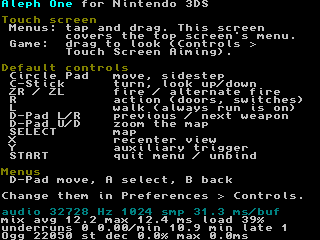
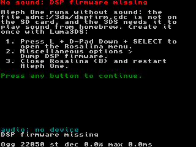

# Aleph One 3DS port: stage 6 — audio

Recorded 2026-10-11 on branch `3ds-port`, on top of stage 5's hardware
session (`babba68`). Goal: working, glitch-free audio on the 3DS. Engine
changes are fenced with `A1_PLATFORM_3DS` and listed in
[`PATCHES.md`](PATCHES.md) (entries 26-33); the rest is port code in
`ports/3ds/source/audio_3ds.cpp` and `ports/3ds/source/decoders_3ds.cpp`.

|  |  |
| --- | --- |
| `debug-audio`: statistics under the legend (menu music playing) | The one-time notice when `dspfirm.cdc` is missing |

## Summary

| # | Brief item | Result |
| --- | --- | --- |
| 0 | Every loop in the audio path sleeps or blocks (threads are cooperative) | **Done.** Audit below; four main-thread spins fixed (`PATCHES.md` 32-33; two missing from `AUDIT.md` b), one endless recursion on the audio thread fixed (31) |
| 1 | OpenAL Soft built → AudioBackend as a loopback device (stereo S16, rate configurable) pulled by an SDL callback; HRTF/3D prefs off | **Done.** `N3DSAudioBackend` (`PATCHES.md` 26); 32728 Hz default = the DSP's rate, played 1:1; HRTF, 3D sounds and surround forced off and hidden (28-29) |
| 2 | Otherwise `A1_AUDIO_SIMPLE` | Not applicable: OpenAL Soft is built (stage 3) |
| 3 | Music: Ogg via Tremor, MP3 via mpg123, bounded chunks, never a whole track in memory | **Done.** `decoders_3ds.cpp` (`PATCHES.md` 27); at most 8 KiB of PCM per request, and fewer buffers per mixer pass (30). Marathon 2's `Music.ogg` plays and loops |
| 4 | NDSP init fails → silent, one-time notice (Luma3DS Rosalina), never crash | **Done.** Verified in Azahar with the firmware hidden |
| 5 | Count underruns and callback time; show them in a debug overlay | **Done.** DSP underruns counted where SDL queues buffers; `debug-audio` shows them on the bottom screen and logs them every 5 s |
| | **DoD: 10 min of play on hardware, music + SFX, 0 crashes, underruns < 1/min** | **Met on a New 3DS** (2026-10-11, `PERF.md` "Hardware results"): **0 underruns in 28.6 min played**, Marathon 2 level 1 to the exit and into level 2 with the Level Music Test plugin (music + SFX), 0 callbacks over budget or late, no crash. Earlier Azahar stand-in: **0 underruns in 13.0 min** (9.3 min of scripted level 1 play with looping level music and SFX), 0 callbacks over budget, no crash. Hardware checklist at the end |

## Stage status (2026-10-11, after the console session)

**Achieved, on hardware.** Every brief item is implemented and tested in
the emulator, and the definition of done was met on a New 3DS in the
console session of 2026-10-11 (`PERF.md` "Hardware results"; the checklist
below). From that session's `log.txt` (30.4 min from boot to exit, 351
audio reports, 32728 Hz, 1024 samples, `debug-audio`):

| Figure | Hardware (New 3DS) |
| --- | --- |
| underruns | **0 in 28.6 min played** |
| callbacks over budget / late (> 1.5 buffers apart) | 0 / 0 in every report |
| longest gap between callbacks | 35.8 ms (one buffer is 31.3 ms) |
| callback time | mean of the reports' averages 28.5% of a buffer; longest 28.15 ms of 31.29 ms (in gameplay, at 379 s) |
| music decoding | 1 111.9 s of audio in 78.7 s (7.1% of real time) |
| audio thread | core 1, priority 0x19, stack 9 of 80 KiB |
| HOME / sleep | HOME 3 times, lid closed twice (0.7 s, 11.9 s): paused and resumed cleanly |

The player heard no audio problems in the 30 minutes, game starts, the
level change and the return to the menu included. (The main menu's
2-minute music-loop check, checklist step 3, was not done separately.)

| # | Open item | Kind | Blocks the next stage? |
| --- | --- | --- | --- |
| 1 | 10 min of play on hardware with music + SFX, underruns < 1/min | **Done** (above) | |
| 2 | Hardware timing of the audio thread on core 1 | **Done**: mean load 28.5%, longest callback 28.15 ms of 31.29 ms (Azahar: 47%, 28 ms) | |
| 3 | Whether stage 5's 2.8-3.9 s transition gaps were audible stalls or pauses | **Answered**: not reproduced (longest gap 35.8 ms), none heard | |
| 4 | Ogg Opus / FLAC decoders | not needed for Marathon 1-3 data | no |
| 5 | The console's `Marathon 2 Preferences` predates this stage and says `rate="44100"` | the session ran at 32728 with a temporary copy; the original file was put back. Change `rate` in the file to use the default. *2026-10-12:* the user chose 32728; applied at the next console session (`NEXT-SPRINT.md` item 8) | no |

**Moving on:** the next stage can start in this state. If a later change
brings underruns, the first levers are the rate (already the DSP's 32728
Hz) and `samples` (2048 doubles SDL's queue to 188 ms) in the preferences
file, without a rebuild.

## How audio works on the 3DS

```
main thread                       SDL audio thread (prio 0x19; core 1 on hardware)
-----------                       -------------------------------------------------
SoundManager / Music              N3DSAUDIO_WaitDevice: CondVar until the DSP frees a wavebuf
  -> OpenALManager::PlaySound       timed_callback (audio_3ds.cpp)
     PlayMusic (SPSC queue) ------>   OpenALManager::MixerCallback
                                        ProcessAudioQueue: AudioPlayer::FillBuffers
                                          MusicPlayer -> Tremor/mpg123 Decode (<= 8 KiB)
                                        alcRenderSamplesSOFT (loopback, S16 stereo)
                                    N3DSAUDIO_PlayDevice -> ndspChnWaveBufAdd (wrapped: underruns)
                                                              -> DSP (3 wavebufs of 1024 frames)
```

- **Backend** (`audio_3ds.cpp`). OpenAL Soft never opens an output: it mixes
  into a loopback device, and `N3DSAudioBackend` (the engine's
  `AudioBackend` on the 3DS) pulls the mix from SDL's legacy audio callback,
  as upstream's `SDLAudioBackend` does. Differences: the format is always
  stereo signed 16-bit (`ndsp` plays PCM8/PCM16), SDL is asked for exactly
  that (no format changes allowed), and the callback is timed. It stays on
  SDL's device 1, so the HOME/sleep hook keeps pausing it with
  `SDL_PauseAudio()`.
- **Rate.** The preferences' `rate` (`<sound rate="...">` in the prefs file)
  is used as is between 8000 and 48000 Hz. The 3DS default is **32728 Hz**,
  the DSP's own output rate (SYSCLOCK_ARM11 / 8192 = 32728.498 Hz). At that
  rate the backend sets the DSP channel to `NDSP_INTERP_NONE` at the exact
  rate, so the DSP plays SDL's buffers sample for sample and OpenAL's
  resampler is the only one (at 44100 Hz the DSP resamples again, with
  linear interpolation). It also mixes 26% fewer samples than 44100 Hz; the
  DSP outputs nothing above 16.4 kHz anyway. A buffer is 1024 frames =
  31.3 ms, and SDL keeps 3 queued (94 ms).
- **HRTF / 3D sounds** are forced off (`Verify()`, `PATCHES.md` 28) and
  their toggles hidden, as is Channels (always stereo). The engine's classic
  stereo panning (upstream's default) is used.

### Music decoding (`decoders_3ds.cpp`)

The 3DS libsndfile was built without codecs (no float libvorbis; stage 3),
so `Sound/Decoder.cpp` asks `a1_3ds::open_decoder()` after libsndfile fails.
It picks by content: `OggS` → Tremor (`ov_open_callbacks`; Ogg Opus is
rejected), an ID3 tag, an MPEG audio frame header, or a `.mp3`/`.mp2` name →
mpg123 (16-bit output locked to the stream's first format).

- **Bounded chunks.** Music is decoded on the audio thread by
  `MusicPlayer::GetNextData`, at most 8 KiB of PCM per request (one OpenAL
  buffer). Upstream filled every free buffer of a source in one pass: when a
  track started, four buffers (~370 ms of 22 kHz music) were decoded inside
  one 31 ms callback. `FillBuffers` now fills what playback uses before the
  next pass plus one (`PATCHES.md` 30): for Marathon 2's music, one buffer
  (93 ms) per pass at most.
- **No whole track in memory.** Decoded audio exists only in those buffers.
  The *compressed* file is read into memory when it is at most 4 MiB (12 MiB
  for all open decoders together); `Music.ogg` is 746 KiB. Then the audio
  thread never waits for the SD card, whose reads take milliseconds and queue
  behind the main thread's level loading. Bigger files stream from the file
  as libsndfile does.
- **Output** is native-endian 16-bit (`AL_FORMAT_*16`), half the data of
  libsndfile's float, with no conversion in OpenAL.
- **Start-up cost off the audio thread.** Tremor sets up its decoder on the
  first `ov_read`: in a game the first request of every track took 50-60 ms
  on the audio thread (one callback of 60 ms against 31.3; no underrun only
  because 94 ms were queued). The decoder now reads 4 KiB when the file is
  opened (main thread) and seeks back; the first in-game request then takes
  ~16 ms and the music-start callback 26 ms. `Rewind()` while nothing has
  been decoded is a no-op (`MusicPlayer` rewinds every track it starts).
- **Looping.** `Rewind()` is `ov_raw_seek(0)` for Tremor. For mpg123 it
  reopens the stream: `mpg123_seek(0)` left decoder state behind, and the
  second pass of a stereo MP3 differed from the first (`debug-decoders`).
- **Damaged files** end the track: Tremor's holes are skipped (8 errors in a
  row end it), mpg123 errors or 8 calls without progress end it. An empty
  segment no longer recurses without end (`PATCHES.md` 31).

### Instrumentation

| Measure | Definition |
| --- | --- |
| **underrun** | SDL queued a wavebuf (`ndspChnWaveBufAdd`, wrapped) while none of the previously queued ones was still waiting or playing: the DSP had run dry, an audible gap. Not counted while the HOME menu, sleep or an applet suspends the app, nor for the first buffer after a resume. An engine pause never underruns (SDL keeps queueing silence) |
| callback avg / max | time in the SDL callback (OpenAL mixing + music decoding) against the buffer's play time (31.3 ms) |
| over budget | callbacks longer than a buffer |
| late | callbacks that started more than 1.5 buffers after the previous one; gaps caused by a pause or suspension are not counted |
| min played | audio queued to the DSP while not suspended (the underrun rate's denominator) |
| music decoding | decode time against the audio produced; the longest single request |
| stack | the audio thread's deepest stack use (SDL gives it 80 KiB) |

With the `debug-audio` flag file (`run-azahar.sh --audio-debug`) the
bottom screen's rows 27-30 show, once a second:

```
audio 32728 Hz 1024 smp 31.3 ms/buf
mix avg 13.7 max 24.2 ms load 44%
underruns 0 0.00/min 2.7 min late 1
Ogg 22050 st dec 12.0% max 12.3ms
```

and `log.txt` gets a report every 5 s (stack, callback timing, underruns,
music decoding). Without the flag the same report is logged at every boot
milestone and at exit.

### No DSP firmware

`ndspInit()` needs `sdmc:/3ds/dspfirm.cdc`. Without it `SDL_OpenAudio`
fails ("DSP init failed: dspfirm.cdc missing!"); `OpenALManager` carries on
without a device (no sound, every sound and music call returns early), and
the game plays silently. The backend records the failure, and the bottom
screen shows, once per run, how to dump the firmware with Luma3DS
(Rosalina menu: L + D-Pad Down + SELECT > Miscellaneous options > Dump DSP
firmware), until a button is pressed or the screen tapped. That press is
not passed to the game. Other `ndspInit()` errors get a shorter notice with
SDL's error text. Log:

```
[3ds] audio: SDL_OpenAudio failed: DSP init failed: dspfirm.cdc missing!
[3ds] audio: continuing without sound (no sdmc:/3ds/dspfirm.cdc; dump it with Luma3DS: Rosalina menu > Miscellaneous options > Dump DSP firmware)
[3ds] +23920.2 ms: showing the no-sound (DSP) notice on the bottom screen
[3ds] +40251.4 ms: no-sound notice dismissed
```

## Loop audit (cooperative threads)

On the 3DS a thread runs until it blocks or a higher-priority thread on its
core becomes ready; a thread that spins starves everything below it.

| Thread / loop | Where | Waits by | Verdict |
| --- | --- | --- | --- |
| SDL audio thread | `SDL_n3dsaudio.c` `N3DSAUDIO_WaitDevice` | `CondVar_Wait` until the DSP frees a wavebuf | blocks |
| libctru ndsp thread | libctru | DSP interrupt event | blocks |
| OpenAL Soft event thread | `al/event.cpp` → `std::atomic::wait` | libstdc++ `__wait_impl`: 2 × `sched_yield` (our `svcSleepThread(1)` shim), then `pthread_cond_wait` (checked in the linked ELF) | blocks |
| OpenAL `StopEventThrd` (context destroy) | `al/event.cpp:238` | `std::this_thread::yield()` → `svcSleepThread(1)` | sleeps |
| Audio thread's own loops | `ProcessAudioQueue`, `FillBuffers`, decoder loops | bounded by the queue, 4 buffers, the request; decoders stop after 8 errors / stalls in a row | bounded |
| `MusicPlayer::GetNextData` | recursion over segments | **was unbounded** for a segment that yields no data | **fixed** (`PATCHES.md` 31) |
| `display_epilogue()` | `interface.cpp` | **spun** 10 ms calling `Music::Idle()` (`AUDIT.md` b) | **sleeps** (32) |
| `interface_fade_out()` | `interface.cpp` | **spun** until the audio thread retired the music player, no limit | **sleeps, ≤ 2 s** (32) |
| `ResetLevelScript()` (every level load) | `XML_LevelScript.cpp` | **spun** the same way | **sleeps, ≤ 2 s** (32) |
| In-game frame pacing | `shell.cpp` `main_event_loop` | **spun** through the last third of each frame | **sleeps** (33) |
| Menus, dialogs, `wait_for_click_or_keypress` | `shell.cpp`, `sdl_dialogs.cpp`, `csmisc_sdl.cpp` | `SDL_WaitEventTimeout` | blocks |
| `audio_report_thread`, `menu_capture_thread` | `a1_3ds_platform.cpp` | `svcSleepThread` | sleeps |
| Network/metaserver busy-waits | `metaserver_dialogs.cpp` | (spin) | not built (`A1_NO_NETWORK`) |

Unlimited frame rate (`fps_target` 0) still never sleeps in a game, as
upstream; the default is 30. Nothing in the audio path waits for a thread of
lower priority than the main thread: mixing runs on the audio thread
(0x19), and OpenAL's event thread (0x3F) is only a consumer of its events.

## Testing (Azahar 2126.2, New 3DS mode)

Emulated timing: Azahar runs the audio thread on core 0 and its CPU timing
is not the console's, so these numbers are relative. The definition of done
is measured on hardware.

| Run | Command | Result |
| --- | --- | --- |
| Menu music | `run-azahar.sh --audio-debug --screens --timeout 90` | `Music.ogg` through Tremor, compressed data in memory. Before `PATCHES.md` 30: **1 underrun** at music start (one 96 ms callback). After: 0 underruns, but one 60 ms callback per track start (Tremor's set-up); after priming at open: max 26 ms. Mixing + decoding 44% of the buffer time on average |
| Music loop | `--audio-debug --script tests/input/09-music-loop.txt --timeout 240` | 166 s of music decoded from the 93.8 s file (looped), 5 HOME visits, then the demo: **0 underruns in 3.7 min**, 0 late callbacks, stack 13 of 80 KiB |
| Decoders | `make-audio-test.sh`, then `--decoders --timeout 60` | 13 files: all 7 valid ones PASS (MP3 CBR/VBR+ID3/no-Xing at 44.1/22.05/48 kHz, Ogg 22/44 kHz, WAV through libsndfile, `Music.ogg`): same bytes after `Rewind`, `Frames()` exact. Opus, garbage and empty files are rejected; truncated and holed files end cleanly |
| No firmware | `--no-dspfirm --audio-debug --script …` | no crash; notice shown, dismissed by A without starting a game; the next A starts a silent game |
| Soak, SFX only | `--audio-debug --script tests/input/10-audio-soak.txt --timeout 800` | 9.3 min of level 1 (walk, turn, fire, map, START dialog, 3 s HOME); Marathon 2 has no level music, so SFX only: **0 underruns in 13.0 min**; gameplay callbacks avg 10.2 ms (33%), max 14.1 ms |
| **Soak, music + SFX** (final build) | `--level-music --audio-debug --script tests/input/10-audio-soak.txt --timeout 800` | `Music.ogg` as level music through the test plugin, looping 7 times under gameplay SFX: **0 underruns in 13.0 min, 0 callbacks over budget**; gameplay callbacks avg 14.8 ms (47%), max 28.4 ms; longest decode request 12 ms; stack 9 KiB; no errors |

`debug-decoders` timing (main thread, Azahar): Tremor 4.1% of real time for
22 kHz stereo, 6.8% for 44.1 kHz; mpg123 5.4-5.9% for 44.1/48 kHz stereo.
The longest single 8 KiB request: Tremor 5 ms (15 ms for a track's first
request before priming), mpg123 3.8 ms.

## Hardware checklist (DoD: 10 min, music + SFX, 0 crashes, underruns < 1/min)

1. ftpd (`scripts/3ds/sd-ftp.sh IP ...`): check `sdmc:/3ds/dspfirm.cdc` is
   the real dump (49 756 bytes on this console). Create an empty
   `sdmc:/3ds/alephone/debug-audio`. Marathon 2 has no level music, so for
   "music + SFX" upload the test plugin:
   `scripts/3ds/sd-ftp.sh IP putdir "scripts/3ds/tests/plugins/Level Music Test" "/3ds/alephone/Marathon2/Plugins/Level Music Test"`
   (remove it afterwards, or disable it in Preferences > Plugins).
2. A preferences file written before this stage says `rate="44100"` (the
   console had none in stage 5's session, so it may have the new default
   already: check `<sound ... rate=...>` in `Marathon 2 Preferences`). The
   DoD is for the default, 32728; if time allows, repeat step 4 at 44100.
   (`samples` stays 1024.)
3. Run the game (`cmake --build build-3ds --target run-3dslink`). At the main
   menu the music must play; the overlay's last row shows `Ogg 22050 st`.
   Leave it 2 minutes (the track loops at 93.8 s; HOME once to stop the
   demo timer), listen at the loop point.
4. Play level 1 for 10 minutes: fire, open doors, fight. HOME once, close
   the lid once; at the end START > YES back to the menu, and start a game
   again. Watch the overlay's `underruns` row: the DoD is < 1/min, no crash.
5. Note the overlay's `mix avg/max` and `dec` figures in gameplay.
6. Optional: rename `dspfirm.cdc` and boot: the notice must appear, A must
   dismiss it, the game must run silently. Rename it back.
7. Optional: `scripts/3ds/tests/make-audio-test.sh`, upload
   `build-3ds/audio-test` to `sdmc:/3ds/alephone/audio-test` and create
   `debug-decoders`: hardware decode speed in `log.txt`.
8. Fetch `log.txt`: the audio reports carry the same figures every 5 s.

Stage 5's "2.8-3.9 s audio gaps at game/menu transitions" were measured as
gaps between *callbacks*. A paused device also stops the callback (SDL then
queues silence itself; e.g. `pause_game()` → `OpenALManager::Pause` when
the START dialog opens), so such a gap is not necessarily audible. Whether
those gaps were real stalls is what the underrun counter now answers: a
stall of the audio thread empties the DSP queue and counts; a pause does
not. Step 4 includes game starts and a START > YES.

## Known limitations

- `debug-audio` plays 8 sounds at once when the main menu appears (its
  mixer load test, `[3ds] debug-audio: playing sounds ...` in the log). On
  the console this sounds like leftover test noise; delete the flag file
  for normal play.
- No Ogg Opus or FLAC decoder (portlibs have `opusfile` and `flac`; not
  needed for Marathon 1-3 data). Mono Ogg Vorbis was not in the test set
  (ffmpeg's built-in Vorbis encoder is stereo only); Tremor handles channels
  generically.
- A music file over 4 MiB (or past the 12 MiB total) streams from the SD
  card on the audio thread, as upstream does.
- The music-start callback is the longest one (26 ms of 31.3 in Azahar,
  after priming). Watch the overlay's `max` on hardware, especially at the
  stage 5 default of 44100 Hz (23.2 ms buffers).

## Files

| Path | Purpose |
| --- | --- |
| `ports/3ds/source/audio_3ds.cpp` (new; replaces `audio_probe.cpp`) | the 3DS AudioBackend, callback timing, stack probe, underrun counter (`--wrap=ndspChnWaveBufAdd`), DSP failure state, reports |
| `ports/3ds/source/decoders_3ds.cpp` (new) | Tremor and mpg123 `Decoder`s, compressed-data preloading, decode statistics |
| `ports/3ds/source/input_3ds.cpp` | the no-sound notice, the `debug-audio` overlay, suspend/resume notifications to the audio module |
| `ports/3ds/source/selftest.cpp`, `a1_3ds_platform.cpp` | `debug-decoders` self-test; report comments |
| `ports/3ds/include/a1_3ds_platform.h` | `dsp_problem`, `audio_set_suspended`, `audio_stats`, `open_decoder`, `decode_stats` |
| `ports/3ds/CMakeLists.txt` | Tremor, libogg, mpg123; the two new sources; `--wrap=ndspChnWaveBufAdd` instead of `--wrap=SDL_OpenAudio` |
| `Source_Files/…` (12 files) | `PATCHES.md` 26-33 |
| `scripts/3ds/run-azahar.sh` | `--audio-debug`, `--no-dspfirm`, `--decoders`, `--level-music` |
| `scripts/3ds/tests/make-audio-test.sh` (new) | the decoder test files |
| `scripts/3ds/tests/input/09-music-loop.txt`, `10-audio-soak.txt` (new) | music loop and 10-minute gameplay soak |
| `scripts/3ds/tests/plugins/Level Music Test/` (new) | `Music.ogg` as level music (Marathon 2 has none); `run-azahar.sh --level-music` |
