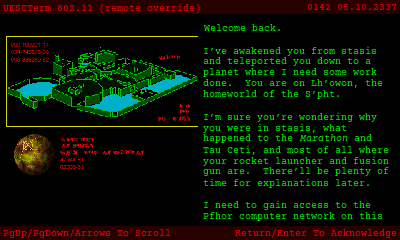

# Aleph One 3DS port: stage 7 — the bottom screen (HUD, map, touch buttons)

Recorded 2026-10-12 on branch `3ds-port`, on top of the performance stage
(`9a5c4a5`). Goal: put the HUD or the overhead map on the bottom screen, add
touch buttons, and keep terminals readable. Engine changes are fenced with
`A1_PLATFORM_3DS` and listed in [`PATCHES.md`](PATCHES.md) (entries 36-40);
the rest is port code (`ports/3ds/source/bottom_3ds.cpp`, `video_3ds.cpp`,
`input_3ds.cpp`).

|  |  |
| --- | --- |
| **HUD** (default): the view fills the top screen, 400x240 1:1 | the HUD (halved), the look area and the touch buttons |
|  |  |
| **Map**: a 320x160 view and the HUD on the top screen | the live overhead map and the touch buttons |

## Summary

| # | Brief item | Result |
| --- | --- | --- |
| 1 | Does SDL2's N3DS driver support a second window on the bottom screen? If yes use it, else a 320x240 buffer blitted to `gfxGetFramebuffer(GFX_BOTTOM)` | **Supported, not used** (below). The bottom screen is composed in a 320x240 buffer and written to the framebuffer directly, like the top screen since `PERF.md` experiment a |
| 2 | HUD draw refactored minimally (`A1_PLATFORM_3DS`) to target another surface; prefs [HUD on bottom \| Map on bottom \| Classic] | **Done.** Graphics > Heads-Up Display > **Bottom Screen**: HUD (default), Map, Classic (HUD on Top). The HUD is still drawn into its 640x480 buffer by the engine; only where that buffer goes changed (`PATCHES.md` 37) |
| 3 | Touch buttons (map, action, next weapon) injecting the same actions as the key bindings | **Done.** MAP, ACTION, NEXT WEAPON in a strip at the bottom of the bottom screen (HUD and Map modes); a tap is one input tick of the action flag, OR-ed in where the bindings are read (`PATCHES.md` 38) |
| 4 | Terminals readable at 400x240 (font scaling via SDL2_ttf) or terminals on the bottom screen | **Done, by font scaling** in all three modes: the terminal fonts are resized (SDL2_ttf) and the terminal rectangles fitted to the screen, and the engine reflows the text (`PATCHES.md` 36) |
| | **DoD: all three modes work on hardware; perf regression < 1 ms/frame (A1_PROFILE)** | **Azahar: met.** All three modes work (captures here and in "Testing"). Busy time (A1_PROFILE): Classic 0.0 to −0.1 ms vs before; HUD −5.5 ms; Map −7.4 to −8.5 ms ("Performance"). The budget was restated with the user as Classic within 1 ms of before and HUD/Map at or below Classic + 1 ms, since the chosen top screen changes what is rendered. **Hardware: not run yet**: checklist at the end |

## SDL2's N3DS driver and a second window

Read in SDL 2.32.10 (`build/3ds-deps/SDL2-release-2.32.10/src/video/n3ds/`):

- `N3DS_VideoInit` registers **two displays**, the top screen (400x240) and
  the bottom screen (320x240, `touch_display`). A window created on display 1
  (`SDL_WINDOWPOS_UNDEFINED_DISPLAY(1)`) gets `screen = GFX_BOTTOM` and its own
  window framebuffer (`SDL_n3dsframebuffer.c`). So it is **supported**.
- It was not used, for three reasons found in the same code:
  1. `N3DS_CreateWindow` calls `SDL_SetKeyboardFocus(window)`: the second
     window takes the keyboard focus from the game's window. `input_3ds.cpp`
     finds the game's window through that focus, and the engine pauses on
     focus loss.
  2. `N3DS_PollTouch` sends every touch to the bottom display's window, and
     SDL then also synthesises mouse events in that window. Today the touch
     screen is translated by our event filter (pointer for menus, mouse look
     in game); a window there would split that path.
  3. `SDL_N3DS_UpdateWindowFramebuffer` copies one pixel at a time with an
     index computation per pixel, then flushes and swaps; the top screen
     left that path in `PERF.md` experiment a for the same reason.
- Instead `bottom_3ds.cpp` composes a 320x240 XRGB8888 surface and
  `present_bottom()` (`video_3ds.cpp`) rotates and converts it into the
  bottom framebuffer (RGB565) in one pass, at the next VBlank, only when
  something on it changed.

## The modes

| Bottom Screen | Top screen in game | Bottom screen in game |
| --- | --- | --- |
| **HUD** (default) | the view, **400x240 1:1** (whole screen) | the HUD halved to 320x80 (2x2 average), a look area, the buttons |
| **Map** | 400x240 1:1: a 320x160 view, the HUD halved under it, 40-pixel bars | the overhead map at 320x188 (native resolution), the buttons |
| **Classic** | as before: 640x480 halved, the 75% view, the HUD | as before: the controls legend |

Menus, chapter screens and dialogs keep the 640x480 halved screen in every
mode, and the bottom screen shows the legend again (touch is the pointer).

**Why 400x240 1:1.** Today's in-game view is only 240x120 on the screen:
the port pins `screen_mode.height` to 240, and the engine reads that as the
legacy "75%" view size (`Screen::seventyfive_percent()`). Moving the HUD off
the top screen frees its lower third; the options weighed with the user
(estimates from `PERF.md`'s two hardware points, corrected for the real
480x240 render: about 2.0 ms + 4.05 ms per 100 000 rendered pixels):

| Top screen | rendered | on screen | busy vs today (est.) |
| --- | --- | --- | --- |
| same view, centred | 480x240 | 240x120 | ~0 |
| **400x240 1:1 (chosen)** | 400x240 | **400x240** | **about −7 ms** (no 2x2 averaging in the present) |
| 5:3, 2x2 averaged | 640x384 | 320x192 | about +7 ms |
| 400x240, 2x2 averaged | 800x480 | 400x240 | about +16 ms (~34 ms: below 30 fps) |

The 1:1 view has no 2x2 supersampling (`PERF.md` experiment c judged a
similar trade "visibly coarser"), and text drawn into the view (FPS,
messages) is twice as large on screen as before.

## How it works

- **Screen size** (`screen.cpp`, `PATCHES.md` 37). With HUD or Map,
  `change_screen_mode()` gives the game a 400x240 logical screen instead of
  the 640x480 floor; `Screen::window_width/height()` follow the surface, the
  75% view size is off, `Screen::hud()` is false in HUD mode (the top layout
  has no HUD), and `hud_rect()` is 320x80 in Map mode. The HUD buffer keeps
  being drawn whenever Show HUD is on (`game_window_is_full_screen()`).
  `need_mode_change()` already resizes the logical size, surface and texture
  without recreating the window.
- **Present** (`video_3ds.cpp`). A 400x240 surface goes to the top screen
  1:1 (rotated, XRGB8888 to RGBA8, 4 rows per pass as before). `half_blit()`
  is the 2x2 average (the same `UHADD8` arithmetic as the 640x480 path), used
  for the HUD on either screen.
- **Bottom screen** (`bottom_3ds.cpp`). `render_screen()` calls
  `bottom_frame()` at the end of each game frame. HUD mode redraws the HUD
  part only when the HUD buffer changed (motion sensor every 5 ticks, ammo,
  energy, ...); Map mode renders the map every 3rd frame (10 Hz) into its own 320x188
  surface with the engine's map renderer (`_set_port_to_custom()`,
  `_render_overhead_map()`, as terminal checkpoints do), north up, at the
  player's map scale (D-Pad up/down zooms it). Nothing is presented when
  nothing changed.
- **Who owns the bottom screen** (`input_3ds.cpp`). The legend is a libctru
  console, which keeps a pointer to the framebuffer it was set up with.
  `bottom_game(true)` stops all console output (legend, debug-input log,
  profiler rows, audio rows) and turns double buffering on;
  `bottom_game(false)` turns it off, attaches the console again and redraws
  the legend. Any present of a 640x480 surface (menus, chapters, dialogs)
  hands the screen back to the legend.
- **Dialogs in game** (`sdl_dialogs.cpp`, `PATCHES.md` 39). Dialogs are laid
  out for 640x480; a top-level dialog over the 400x240 game switches to the
  menu size, and the next `render_screen()` switches back (it compares the
  surface with the setting each frame, which also gives a Lua HUD, which
  needs 640x480, the Classic layout).
- **Touch buttons** (`input_3ds.cpp`, `bottom_3ds.cpp`, `vbl.cpp`,
  `PATCHES.md` 38). A finger that goes down in the button strip (y ≥ 188)
  is a button until it is lifted: it does not look or point. The press
  sets the button's action flag (`_toggle_map`, `_action_trigger_state`,
  `_cycle_weapons_forward`), which `parse_keymap()` ORs in right after the
  key bindings, before the latching: one tap is one press, as with a key,
  and it is recorded in films like one. Touches elsewhere behave as before.
- **Touch look speed.** At the 400x240 logical size SDL no longer doubles
  the relative motion, so `input_3ds.cpp` scales it by the renderer's scale:
  the same 2 logical pixels per bottom-screen pixel as before.
- **Terminals** (`screen.cpp` `scale_terminal_layout()`, `PATCHES.md` 36).
  Before `Term_Buffer` is allocated, the terminal rectangles are fitted to
  the space the terminal gets (x and y separately) and the two terminal
  fonts sized for about 11 screen pixels, smaller if a header or footer line
  (57 characters) would not fit across. `computer_interface.cpp` (unchanged)
  wraps the text and counts the lines per page from these when a terminal
  opens, so it reflows. The header and footer bars grow with the font.

| Mode | Terminal | Body font | On screen |
| --- | --- | --- | --- |
| Classic | 640x320 (halved) | 19 (was 12) | ~9.5 px (was 6) |
| HUD | 400x240 | 10 | 10 px |
| Map | 400x160 (above the HUD) | 10 | 10 px |

|  |  |  |
| --- | --- | --- |
| terminal, HUD mode | terminal, Classic | the legend during a dialog in game |

## Performance

Azahar 2126.2, profile build (`build-3ds-prof`), `perf-bench.sh` with
`RUNS=1` (Azahar's figures repeat to 0.01 ms between runs), no DSP, the same
three levels as `PERF.md`; ms per frame, **busy** = frame − idle. "Before"
is `exp-a3` (`PERF.md` experiment a', the code at `9a5c4a5`).

| Mode | Level | busy | vs before | render | hud | blit | present | **bottom** | fps |
| --- | --- | --- | --- | --- | --- | --- | --- | --- | --- |
| before | 0 / 6 / 20 | 21.52 / 19.48 / 19.27 | | 12.37 / 10.08 / 9.65 | 0.89 | 1.44 | 6.02-6.24 | — | 30.4 |
| **Classic** | 0 / 6 / 20 | 21.52 / 19.47 / 19.19 | **0.00 / −0.01 / −0.08** | 12.37 / 10.08 / 9.65 | 0.89 | 1.44 | 5.98-6.22 | 0.00 | 30.4 |
| **HUD** | 0 / 6 / 20 | 16.03 / 13.84 / 13.67 | **−5.5 / −5.6 / −5.6** | 11.20 / 8.98 / 8.63 | 0.14 | 1.20 | 1.41 | 1.08-1.09 | 30.3 |
| Map, map every frame | 0 / 6 / 20 | 17.10 / 15.67 / 16.29 | −4.4 / −3.8 / −3.0 | 7.38 / 6.28 / 5.81 | 0.41 | 0.65 | 1.41 | 5.96-6.89 | 30.3 |
| **Map** (map every 3rd frame) | 0 / 6 / 20 | 13.02 / 11.80 / 11.83 | **−8.5 / −7.7 / −7.4** | 7.38 / 6.28 / 5.80 | 0.41 | 0.65 | 1.41 | 1.98-2.29 | 30.3 |

- **Budget met in all three modes** in Azahar: Classic is within 0.1 ms of
  before (its code path only gained a few comparisons); HUD and Map are
  5.5-8.5 ms *below* Classic.
- The win is the **present**: 1.41 ms for the 1:1 400x240 copy against
  ~6 ms for averaging 640x480 (on the console the present was the largest
  zone, 8.7-8.8 ms, `PERF.md`).
- **HUD mode's `bottom`** (1.1 ms) is the HUD averaged to 320x80 plus the
  bottom present, both only when the HUD changed; **`hud`** fell to 0.14
  because the HUD is no longer blitted to the top screen.
- **A map render costs ~6 ms** in Azahar (every line and polygon of the
  level, at native resolution). Rendered every frame it was the largest
  zone after the rasteriser, so it is redrawn every 3rd frame (`kMapEvery`,
  10 Hz): `bottom` 2.0-2.3 ms on average, but the frame that renders the
  map is ~6 ms longer. Frame `max` (57-73 ms in every series, Classic
  included) did not change meaningfully. On the console the rasteriser ran
  ~40% faster than in Azahar, so expect less.
- `render` in HUD mode (400x240, 96 000 pixels) is 9-11% below Classic's
  480x240 (115 200); Map mode's 320x160 view is 40% below.
- **Not measured on hardware yet.** Azahar's ranking held on the console in
  `PERF.md`, where the present was underestimated, which favours the 1:1
  modes.

## Testing (Azahar 2126.2)

| Script / option | Checks |
| --- | --- |
| `run-azahar.sh --script scripts/3ds/tests/input/13-bottom-screen.txt --timeout 150` | per mode: start a game, walk, MAP button (held: highlighted; top map opens; again: closes), NEXT WEAPON (fists), ACTION, drag to look, START dialog (640x480, legend on the bottom screen), back to the game, HOME |
| `run-azahar.sh --terminal-test --script scripts/3ds/tests/input/14-terminal.txt --timeout 150` | per mode: the Terminal Test plugin (solo Lua) opens terminal 0 three seconds into level 1 |
| `PREFS="bottom_screen=N" RUNS=1 scripts/3ds/tests/perf-bench.sh LABEL` | the benchmark per mode; `perf-bench.sh` now adds a `<graphics>` attribute the prefs file does not have yet |

The mode is the `bottom_screen` attribute of `<graphics>` in the prefs file
(0 HUD, 1 Map, 2 Classic).

## Hardware checklist (New 3DS)

1. Build `build-3ds` and `build-3ds-prof`; copy `alephone.3dsx` as usual.
2. For each Bottom Screen setting (Preferences > Graphics):
   - start a game: the top and bottom screens look like the captures above;
   - tap MAP (top map opens; tap again closes), NEXT WEAPON, ACTION at a door;
   - drag above the buttons to look (Touch Screen Aiming on);
   - press START: the dialog shows, the legend comes back; B: the game and
     the HUD/map come back;
   - HOME and back, sleep and wake: the bottom screen comes back;
   - read a terminal (level 1 has several);
   - watch the bottom screen for tearing while the motion sensor moves.
3. With the profile build and `debug-perf`, one BENCH per mode on levels 0, 6
   and 20 (`PREFS` as above, or set the preference in the dialog); the
   `bottom` zone is new. Record them in "Performance".

## Known limitations

- The 1:1 top screen has no 2x2 supersampling, and the FPS counter and
  messages are twice as large on screen.
- With HUD or Map, the profiler's rows and the `debug-audio` rows are not
  shown in game (the bottom screen is the game's); the log still has them.
- Map mode redraws the map at 10 Hz (every 3rd frame); the level name is
  drawn at the top of the map as on the top screen's map.
- Networked games keep the scenario's terminal layout (their pages are
  counted before the game).
- The look area says "drag here to look" even when Touch Screen Aiming is
  off (then the touch is the pointer, as before).

## Files

| Path | Purpose |
| --- | --- |
| `ports/3ds/source/bottom_3ds.cpp` (new) | the bottom screen in game: HUD or map, buttons, action flags |
| `ports/3ds/source/video_3ds.cpp` | 400x240 1:1 top present, `present_bottom()`, `half_blit()` |
| `ports/3ds/source/input_3ds.cpp` | bottom screen owner (legend / game), button touches, touch look scale |
| `ports/3ds/include/a1_3ds_platform.h` | the declarations above |
| `ports/3ds/include/a1_3ds_profile.h`, `profile_3ds.cpp` | the `bottom` zone |
| `Source_Files/RenderOther/screen.cpp`, `screen_shared.h` | screen size, layout, HUD routing, terminals (`PATCHES.md` 36-37) |
| `Source_Files/Misc/vbl.cpp` | touch button flags (`PATCHES.md` 38) |
| `Source_Files/Misc/sdl_dialogs.cpp` | dialogs at 640x480 (`PATCHES.md` 39) |
| `Source_Files/Misc/preferences.cpp`, `preferences.h` | the Bottom Screen preference (`PATCHES.md` 40) |
| `scripts/3ds/tests/input/13-bottom-screen.txt`, `14-terminal.txt`, `plugins/Terminal Test/` | tests |
