# Aleph One 3DS port: stage 7 — the bottom screen (HUD + Map)

Recorded 2026-10-12 on branch `3ds-port`, on top of the performance stage
(`9a5c4a5`). Goal: put the HUD and the overhead map on the bottom screen and
keep terminals readable. Engine changes are fenced with `A1_PLATFORM_3DS`
and listed in [`PATCHES.md`](PATCHES.md) (entries 36-40); the rest is port
code (`ports/3ds/source/bottom_3ds.cpp`, `video_3ds.cpp`, `input_3ds.cpp`).

The stage went through two versions. The **first** (`f8328ab`) had three
settings, HUD, Map and Classic, plus touch buttons; it passed on a New 3DS
("History" at the end). After that session the user asked for the HUD
**and** a more zoomed-out map on the bottom screen, without touch buttons
(the console's buttons already do MAP, ACTION and NEXT WEAPON). The
**revision** (`490f9ca`) merged HUD and Map into one **HUD + Map** setting.
This document describes the revision. It passed in Azahar and, on
2026-10-13, on a New 3DS ("Hardware results (New 3DS)", stage 2 of
[`NEXT-SPRINT.md`](NEXT-SPRINT.md)).

| 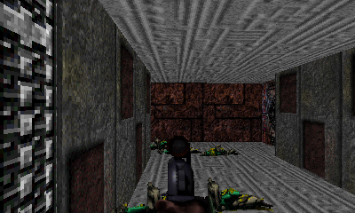 | 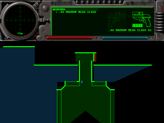 |
| --- | --- |
| **HUD + Map** (default): the view fills the top screen, 400x240 1:1 | the HUD halved to 320x80 over the overhead map, 320x160, at zoom 2 |
| 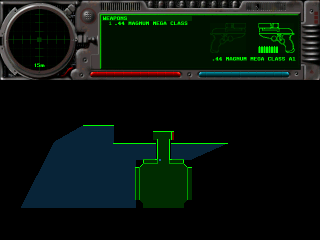 | 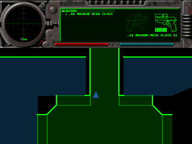 |
| a tap on the map zooms out one step: zoom 1 (the widest) | the next tap goes back to the closest, zoom 3; one more tap is 2 again |

Azahar captures from `13-bottom-screen.txt` (level 1, after a short walk).

## Summary

| # | Brief item | Result |
| --- | --- | --- |
| 1 | Does SDL2's N3DS driver support a second window on the bottom screen? If yes use it, else a 320x240 buffer blitted to `gfxGetFramebuffer(GFX_BOTTOM)` | **Supported, not used** (below). The bottom screen is composed in a 320x240 buffer and written to the framebuffer directly, like the top screen since `PERF.md` experiment a |
| 2 | HUD draw refactored minimally (`A1_PLATFORM_3DS`) to target another surface; prefs [HUD on bottom \| Map on bottom \| Classic] | **Done, revised.** Graphics > Heads-Up Display > **Bottom Screen**: HUD + Map (default) or Classic (HUD on Top). The HUD is still drawn into its 640x480 buffer by the engine; only where that buffer goes changed (`PATCHES.md` 37). The first version's separate HUD and Map settings became the one HUD + Map setting at the user's request |
| 3 | Touch buttons (map, action, next weapon) injecting the same actions as the key bindings | **Built, then removed at the user's request.** The first version had them and they passed on the console ("History"); the console's own buttons do the same actions, and the space went to the map. A tap on the map now zooms it (`PATCHES.md` 38 removed) |
| 4 | Terminals readable at 400x240 (font scaling via SDL2_ttf) or terminals on the bottom screen | **Done, by font scaling** in both settings: the terminal fonts are resized (SDL2_ttf) and the terminal rectangles fitted to the screen, and the engine reflows the text (`PATCHES.md` 36) |
| | **DoD: all modes work on hardware; perf regression < 1 ms/frame (A1_PROFILE)** | **Met on a New 3DS** (2026-10-13): HUD + Map busy 14.02 / 13.50 / 13.54 ms, **4.0-4.3 ms below Classic** (budget: at or below Classic + 1 ms), 30 fps, `gaps=0`; both settings work. In Azahar HUD + Map is 3.7-4.0 ms below Classic. The budget, restated with the user: Classic within 1 ms of before, HUD + Map at or below Classic + 1 ms. One finding: taps on the map and drags to look sometimes clashed, so the user moved the zoom to the D-Pad |

## The modes

| Bottom Screen | Top screen in game | Bottom screen in game |
| --- | --- | --- |
| **HUD + Map** (default, stored as 0) | the view, **400x240 1:1** (whole screen) | the HUD halved to 320x80 (2x2 average) over the overhead map, 320x160; a tap on the map zooms it out one step, a drag anywhere looks |
| **Classic** (stored as 2) | as before: 640x480 halved, the 75% view, the HUD | as before: the controls legend |

The setting is the `bottom_screen` attribute of `<graphics>` in the prefs
file. Any other value, such as the first version's 1 = Map, reads as 0, so
prefs files and scripts that say `bottom_screen="2"` keep Classic. Menus,
chapter screens and dialogs keep the 640x480 halved screen in both settings,
and the bottom screen shows the legend again (touch is the pointer).

**Why 400x240 1:1.** Before this stage the in-game view was only 240x120 on the screen:
the port pins `screen_mode.height` to 240, and the engine reads that as the
legacy "75%" view size (`Screen::seventyfive_percent()`). Moving the HUD off
the top screen frees its lower third; the options weighed with the user
(estimates from `PERF.md`'s two hardware points, corrected for the real
480x240 render: about 2.0 ms + 4.05 ms per 100 000 rendered pixels):

| Top screen | rendered | on screen | busy vs today (est.) |
| --- | --- | --- | --- |
| same view, centred | 480x240 | 240x120 | ~0 |
| **400x240 1:1 (chosen)** | 400x240 | **400x240** | **about −7 ms** (no 2x2 averaging in the present) |
| 5:3, 2x2 averaged | 640x384 | 320x192 | about +7 ms |
| 400x240, 2x2 averaged | 800x480 | 400x240 | about +16 ms (~34 ms: below 30 fps) |

The 1:1 view has no 2x2 supersampling (`PERF.md` experiment c judged a
similar trade "visibly coarser"), and text drawn into the view (FPS,
messages) is twice as large on screen as before.

## How it works

- **Screen size** (`screen.cpp`, `PATCHES.md` 37). With HUD + Map,
  `change_screen_mode()` gives the game a 400x240 logical screen instead of
  the 640x480 floor; `Screen::window_width/height()` follow the surface, the
  75% view size is off, and `Screen::hud()` is false (the top layout has no
  HUD). The HUD buffer is still drawn whenever Show HUD is on
  (`game_window_is_full_screen()`). `need_mode_change()` already resizes the
  logical size, surface and texture without recreating the window.
- **Present** (`video_3ds.cpp`). A 400x240 surface goes to the top screen
  1:1 (rotated, XRGB8888 to RGBA8, 4 rows per pass as before). `half_blit()`
  is the 2x2 average (the same `UHADD8` arithmetic as the 640x480 path) that
  halves the HUD for the bottom screen.
- **Bottom screen** (`bottom_3ds.cpp`). `render_screen()` calls
  `bottom_frame()` at the end of each game frame:
  - rows 0-79, the **HUD**, are redrawn only when the HUD buffer changed
    (motion sensor every 5 ticks, ammo, energy, ...);
  - rows 80-239, the **map**, are rendered every 3rd frame (`kMapEvery`,
    10 Hz), right away after a zoom change, and when the map becomes
    available or not (`View_MapActive()`; "Map unavailable" otherwise). The
    engine's map renderer draws into a separate 320x160 surface
    (`_set_port_to_custom()`, `_render_overhead_map()`, as terminal
    checkpoints do), north up, the player in the middle, at the map's own
    scale. The level name, which the renderer writes at the top of the game
    map, falls above the visible area (`kMapNameSkip`, 32 rows), so all 160
    rows are map. The main map (MAP key, top screen) is untouched and keeps
    its own scale (D-Pad up/down);
  - the 320x240 result is presented (`present_bottom()`, rotated and
    converted to RGB565) only when something on it changed.
- **Map zoom** (`input_3ds.cpp`, `bottom_3ds.cpp`). A **tap** is a touch that
  is lifted within 300 ms (`kTapMs`) and never moves more than 6 pixels
  (`kTapSlop`) from where it went down. A tap on rows 80-239 calls
  `bottom_tap()`, which zooms the map out one step
  (`overhead_map_data::scale`: each step doubles), from the widest back to
  the closest: **2 → 1 → 3 → 2**. It starts at 2 (`kMapScaleDefault`; the
  main map's default is 3) at each launch. A tap on the HUD does nothing.
  A tap's few pixels of motion still go to the look, like any touch.
- **Look**. With Touch Screen Aiming on (the default), a drag anywhere on
  the bottom screen turns and looks; with it off the touch is the pointer.
  At the 400x240 logical size SDL no longer doubles the relative motion, so
  `input_3ds.cpp` scales it by the renderer's scale: the same 2 logical
  pixels per bottom-screen pixel as in Classic.
- **Who owns the bottom screen** (`input_3ds.cpp`). The legend is a libctru
  console, which keeps a pointer to the framebuffer it was set up with.
  `bottom_game(true)` stops all console output (legend, debug-input log,
  profiler rows, audio rows) and turns double buffering on;
  `bottom_game(false)` turns it off, attaches the console again and redraws
  the legend. Any present of a 640x480 surface (menus, chapters, dialogs)
  hands the screen back to the legend.
- **Dialogs in game** (`sdl_dialogs.cpp`, `PATCHES.md` 39). Dialogs are laid
  out for 640x480; a top-level dialog over the 400x240 game switches to the
  menu size, and the next `render_screen()` switches back (it compares the
  surface with the setting each frame, which also gives a Lua HUD, which
  needs 640x480, the Classic layout).
- **Terminals** (`screen.cpp` `scale_terminal_layout()`, `PATCHES.md` 36).
  Before `Term_Buffer` is allocated, the terminal rectangles are fitted to
  the space the terminal gets (x and y separately) and the two terminal
  fonts sized for about 11 screen pixels, smaller if a header or footer line
  (57 characters) would not fit across. `computer_interface.cpp` (unchanged)
  wraps the text and counts the lines per page from these when a terminal
  opens, so it reflows. The header and footer bars grow with the font.
  Terminals read their own fixed keys (`computer_interface.cpp`): D-Pad
  up/down page, A goes on, B leaves.

| Setting | Terminal | Body / title font | On screen |
| --- | --- | --- | --- |
| Classic | 640x320 (halved) | 19 / 22 (was 12) | ~9.5 px (was 6) |
| HUD + Map | 400x240 | 10 / 12 | 10 px |

|  | 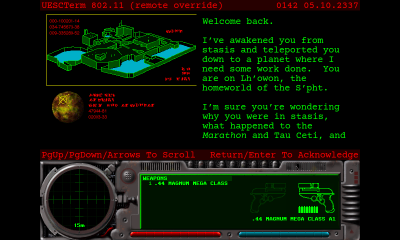 | 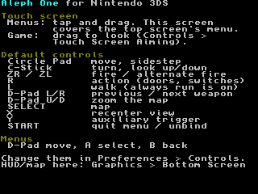 |
| --- | --- | --- |
| terminal, HUD + Map (the bottom screen keeps the HUD and map) | terminal, Classic | the legend during a dialog in game |

## SDL2's N3DS driver and a second window

Read in SDL 2.32.10 (`build/3ds-deps/SDL2-release-2.32.10/src/video/n3ds/`):

- `N3DS_VideoInit` registers **two displays**, the top screen (400x240) and
  the bottom screen (320x240, `touch_display`). A window created on display 1
  (`SDL_WINDOWPOS_UNDEFINED_DISPLAY(1)`) gets `screen = GFX_BOTTOM` and its own
  window framebuffer (`SDL_n3dsframebuffer.c`). So it is **supported**.
- It was not used, for three reasons found in the same code:
  1. `N3DS_CreateWindow` calls `SDL_SetKeyboardFocus(window)`: the second
     window takes the keyboard focus from the game's window. `input_3ds.cpp`
     finds the game's window through that focus, and the engine pauses on
     focus loss.
  2. `N3DS_PollTouch` sends every touch to the bottom display's window, and
     SDL then also synthesises mouse events in that window. Today the touch
     screen is translated by our event filter (pointer for menus, mouse look
     in game); a window there would split that path.
  3. `SDL_N3DS_UpdateWindowFramebuffer` copies one pixel at a time with an
     index computation per pixel, then flushes and swaps; the top screen
     left that path in `PERF.md` experiment a for the same reason.
- Instead `bottom_3ds.cpp` composes a 320x240 XRGB8888 surface and
  `present_bottom()` (`video_3ds.cpp`) rotates and converts it into the
  bottom framebuffer (RGB565) in one pass, at the next VBlank, only when
  something on it changed.

## Performance

Azahar 2126.2, profile build (`build-3ds-prof`), `perf-bench.sh` with
`RUNS=1` (Azahar's figures repeat to 0.01 ms between runs), no DSP, the same
three levels as `PERF.md`; ms per frame, **busy** = frame − idle. Results in
`build/perf/s7b-hudmap.txt` and `s8-classic.txt` (not in git; Classic was
measured again on the revision's code).

| Setting | Level | busy | vs Classic | render | hud | blit | present | **bottom** | idle | max | frames |
| --- | --- | --- | --- | --- | --- | --- | --- | --- | --- | --- | --- |
| **Classic** | 0 / 6 / 20 | 21.58 / 19.54 / 19.25 | | 12.37 / 10.08 / 9.65 | 0.89 | 1.44 | 6.06-6.29 | 0.00 | 11.35 / 13.40 / 13.71 | 67.5 / 58.8 / 57.1 | 618-619 |
| **HUD + Map** | 0 / 6 / 20 | **17.85 / 15.55 / 15.23** | **−3.73 / −3.99 / −4.02** | 11.20 / 8.98 / 8.63 | 0.14 | 1.20 | 1.41-1.42 | **2.96 / 2.85 / 2.68** | 15.14 / 17.44 / 17.75 | 74.5 / 66.2 / 60.9 | 620 |
| first version, HUD | 0 / 6 / 20 | 16.03 / 13.84 / 13.67 | −5.5 / −5.6 / −5.6 | 11.20 / 8.98 / 8.63 | 0.14 | 1.20 | 1.41 | 1.08-1.09 | | | 620 |

- **Budget met** in Azahar: HUD + Map is 3.7-4.0 ms *below* Classic.
  Classic is within 0.07 ms of the first version (21.52 / 19.47 / 19.19);
  every zone but `present` (+0.04 to +0.08) is identical.
- HUD + Map is the first version's HUD mode plus the map: the same top
  screen (`render`, `hud`, `blit` and `present` match to 0.01 ms), and
  `bottom` **1.6-1.9 ms** higher. That is the map at 320x160 every 3rd
  frame, about 5 ms per render in Azahar (the first version's 320x188 map
  cost ~6 ms per render).
- `max` is 5-7 ms above Classic's; the frame that renders the map is the
  long one. On the console the map cost less than in Azahar in the first
  version (`bottom` 1.61-1.84 ms in Map mode against 1.98-2.29).
- **Console estimate** from the first version's hardware results: HUD mode
  busy 12.79 / 11.90 / 11.76 ms, plus the map (Map mode's `bottom` minus
  HUD mode's, 0.8-1.0 ms), gives roughly **13.7 / 12.8 / 12.7 ms**, about
  5 ms below Classic's 18.24 / 17.84 / 17.55. To be measured.

## Hardware results (New 3DS)

**Setup** (2026-10-13). New 3DS, Luma3DS, Homebrew Launcher, 3dslink, as in
the first version's session ("History"). Builds of `b15ab17` (code as at
`3ba6e23`): `build-3ds-prof` for the benchmarks, `build-3ds` for the
functional run. Sound at **32728 Hz** from this session on: the prefs file
on the card had 44100 Hz, and was set to the DSP's native rate first
(`NEXT-SPRINT.md` item 8). Logs, transcripts and captures:
`build-3ds/hw/sprint8/` (not in git).

| 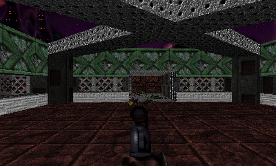 | 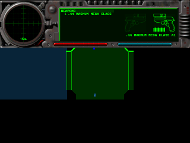 |
| --- | --- |
| level 0 at the end of the benchmark, captured on the console | the HUD over the map, zoom 2 |

**BENCH lines** (ms per frame; busy = frame − idle; one `debug-perf` run per
level with `log 1`; "Classic" is the first version's console run):

| Level | fps | frame | max | **busy** | vs Classic | world | render | hud | blit | present | **bottom** | idle | audio |
| --- | --- | --- | --- | --- | --- | --- | --- | --- | --- | --- | --- | --- | --- |
| 0 | 30.59 | 32.69 | 105.4 | **14.02** | **−4.22** | 0.44 | 5.78 | 0.11 | 0.96 | 4.33 | 1.93 | 18.67 | 7.81 |
| 6 | 30.62 | 32.66 | 40.4 | **13.50** | **−4.34** | 0.30 | 5.10 | 0.11 | 0.96 | 4.29 | 2.28 | 19.16 | 7.73 |
| 20 | 30.63 | 32.65 | 40.2 | **13.54** | **−4.01** | 0.41 | 4.87 | 0.11 | 0.95 | 4.23 | 2.43 | 19.11 | 7.78 |

620 frames in each 20 s window, `gaps=0`, overlay 0.00 (not drawn in game).

**Pass criteria: met.** Busy is **13.50-14.02 ms** against a budget of
19.24 / 18.84 / 18.55 (Classic + 1 ms): 4.0-4.3 ms *below* Classic. 30 fps
holds (frame + overlay 32.65-32.69 ms, the engine's 33 ms tick).

- **Against the estimate** (13.7 / 12.8 / 12.7, the first version's HUD mode
  plus its map cost): 0.3-0.8 ms above it. `render`, `hud`, `blit` and
  `present` match HUD mode's to 0.1 ms (5.71 / 5.02 / 4.78 render then,
  same 400x240 view); the difference is `bottom`, **1.93-2.43 ms** against
  HUD's 0.84-0.86 and Map's 1.61-1.84: the HUD and a map every 3rd frame.
- **Against Azahar** (17.85 / 15.55 / 15.23): −21% / −13% / −11%, as the
  first version (the rasteriser is faster on the console, copies slower).
- **`audio`** (core 1) is 7.73-7.81 ms at 32728 Hz, against 10.2-10.8 at
  44100 Hz in the first version's runs: the DSP no longer resamples.
- **`max`** on level 0 is still **105 ms** at 32728 Hz, so the sound rate was
  not the cause (`NEXT-SPRINT.md` B4). The per-window lines place it: every
  window with a long frame (72-314 ms on levels 0, 6 and 20) has `world`
  at 1.7-21.9 ms instead of ~0.3, and all fall in the first ~10 s of the
  level; afterwards `max` stays at 38-41 ms. Level 0 shows it in the result
  because its measured window starts 8 s in. The likely cause, sounds
  loaded on first use inside `update_world()`, is followed in
  `NEXT-SPRINT.md` B2.

**Memory** (`main loop ended`):

| Run | malloc in use | linear heap free |
| --- | --- | --- |
| benchmarks, levels 0 / 6 / 20 (profile build) | 24 663 / 23 311 / 23 215 KiB | 17 840 KiB of 19 952 |
| HUD + Map functional run: 4 dialog round trips, HOME, sleep, level change, save (normal build) | 30 386 KiB | **17 848 KiB** of 19 960 |
| Classic run, then the main menu's demo and HOME > Close | 25 956 KiB | 17 848 KiB |

The linear heap ends at the same free size as in every run since the
performance stage.

**Functional checks** (normal build, the user on the console; ✓ = as
expected):

| Check | HUD + Map |
| --- | --- |
| Start a game: top and bottom screens as in the captures | ✓ |
| Tap the map: zoom 1, 3, 2 | works, but **taps and drags to look sometimes clashed**; the user asked for the zoom on buttons (below) |
| Tap the HUD: nothing changes | ✓ |
| Drag anywhere to look (Touch Screen Aiming on) | ✓ (the clash above) |
| START: dialog, legend on the bottom screen; B: game, HUD and map back | ✓ (4 round trips: `terminals:` 640x320 ↔ 400x240 in the log) |
| Terminal in level 1: legible, page | ✓; A on the second page not tried (the terminal was one page, and it teleported the player on) |
| C-Stick vertical look at half the yaw's speed | ✓ "feels right now" (`NEXT-SPRINT.md` B7) |
| Level change, level 1 → 2 | ✓ 2.97 s, "fine as is" (no progress screen wanted) |
| HOME and back | ✓ (3.7 s) |
| Sleep (lid closed) and wake: the bottom screen comes back | ✓ (1.0 s) |
| Quit to the main menu: the legend is back | ✓ |

Classic, briefly: a game started and was quit to the main menu normally
(the log; no visual remarks recorded), then the main menu's demo and
HOME > Close (`NEXT-SPRINT.md` B6).

**The user's decisions** (2026-10-13): the map zoom is **not** remembered
across sessions and gets **no indicator**; the zoom moves from taps to
the D-Pad's map zoom keys, so a touch only ever looks (done after this
session, "Map zoom" above; console re-check pending).

Also found in this session, outside stage 7 (`NEXT-SPRINT.md`, `PERF.md`
"Load times"): a save took **69 s** in "save: file written" (an SD write
test writes the same 2.98 MB in 0.66 s, so not the card); every return to
the main menu spends **12 s** reloading the scenario files; hitches in the
first seconds of each level.

## Testing (Azahar 2126.2)

| Script / option | Checks | Revision result (2026-10-12) |
| --- | --- | --- |
| `run-azahar.sh --script scripts/3ds/tests/input/13-bottom-screen.txt --timeout 150` | per setting: start a game, walk, tap the map three times (zoom 1, 3, 2), tap the HUD (no change), drag to look (no zoom), START dialog (640x480, legend on the bottom screen), back to the game, HOME, HOME > Close | **HUD + Map: pass** (the captures above). **Classic: pass**: legend on the bottom screen throughout, taps do nothing on the map (there is none), the drag looks, the dialog and HOME come back |
| `run-azahar.sh --terminal-test --script scripts/3ds/tests/input/14-terminal.txt --timeout 150` | per setting: the Terminal Test plugin (solo Lua) opens terminal 0 three seconds into level 1; the script pages down (D-Pad), taps A, and leaves with B | **Both: pass** for the layout (log: `terminals: 400x240, font 10/12` and `640x320, font 19/22`), page down, and B back to the game with the bottom screen restored. A on the second page left it unchanged in both settings: not explained yet; to try on the console |
| `PREFS="bottom_screen=N" RUNS=1 scripts/3ds/tests/perf-bench.sh LABEL` | the benchmark per setting | "Performance" |

Script 14 used to tap R (the action key) to page; terminals do not read the
key bindings, so it never paged. It now uses the terminal's own keys.

The captures of a script are not comparable pixel for pixel across builds:
a new game's random seed is `machine_tick_count()` at BEGIN NEW GAME
(`interface.cpp`), and level 1 has several player starts chosen at random
(`placement.cpp`), so a change in load time can put the player elsewhere.
The benchmark's end-of-run captures are the ones to diff.

## Hardware checklist (New 3DS)

Carried out on 2026-10-13 (stage 2 of `NEXT-SPRINT.md`, "Hardware
results" above); the first version's list on 2026-10-12 ("History").

1. Build `build-3ds` and `build-3ds-prof`; copy or 3dslink `alephone.3dsx`.
2. With the profile build and `debug-perf`, one BENCH for HUD + Map on
   levels 0, 6 and 20.
3. HUD + Map, normal build:
   - start a game: the top and bottom screens look like the captures above;
   - tap the map: zoom 1, then 3, then 2; tap the HUD: nothing changes;
   - drag anywhere on the bottom screen to look (Touch Screen Aiming on);
   - START: the dialog shows, the legend comes back; B: the game, HUD and
     map come back (three round trips);
   - read a terminal (level 1): page with the D-Pad, A, leave with B;
   - HOME and back, lid closed and opened: the bottom screen comes back;
   - quit to the main menu: the legend is back. Note the memory line.
4. Classic, briefly: start a game, a dialog, quit.
5. Ask: should the map zoom be remembered across sessions? Is a small zoom
   indicator or hint wanted?

## Known limitations

- The 1:1 top screen has no 2x2 supersampling, and the FPS counter and
  messages are twice as large on screen.
- With HUD + Map, the profiler's rows and the `debug-audio` rows are not
  shown in game (the bottom screen is the game's); the log still has them.
- The map is redrawn at 10 Hz (every 3rd frame); that frame is about 5 ms
  longer in Azahar.
- The map's zoom starts at 2 at every launch, and nothing on screen shows
  the zoom level (both kept that way by the user, 2026-10-13).
- A tap's few pixels of motion (at most 6) also reach the look.
- Networked games keep the scenario's terminal layout (their pages are
  counted before the game).
- On the console, the first ~10 s of a level have one to four frames of
  72-314 ms, in `world` (level 0's longest was 107-120 ms in all three
  modes of the first version, Classic included, and 105 ms here at
  32728 Hz; `NEXT-SPRINT.md` B2, B4).
  Its other open point, HUD and Map counting fewer frames than Classic, is
  explained: it is the profiler leaving out the time of its overlay, which
  only Classic draws in game; the real rate is 30.30 fps in every mode
  (`PERF.md`, "The profiler").

## Files

| Path | Purpose |
| --- | --- |
| `ports/3ds/source/bottom_3ds.cpp` (new) | the bottom screen in game: the HUD halved, the map and its zoom |
| `ports/3ds/source/video_3ds.cpp` | 400x240 1:1 top present, `present_bottom()`, `half_blit()` |
| `ports/3ds/source/input_3ds.cpp` | bottom screen owner (legend / game), taps (map zoom), touch look scale |
| `ports/3ds/include/a1_3ds_platform.h` | the declarations above |
| `ports/3ds/include/a1_3ds_profile.h`, `profile_3ds.cpp` | the `bottom` zone |
| `Source_Files/RenderOther/screen.cpp`, `screen_shared.h` | screen size, layout, HUD routing, terminals (`PATCHES.md` 36-37) |
| `Source_Files/Misc/sdl_dialogs.cpp` | dialogs at 640x480 (`PATCHES.md` 39) |
| `Source_Files/Misc/preferences.cpp`, `preferences.h` | the Bottom Screen preference (`PATCHES.md` 40) |
| `scripts/3ds/tests/input/13-bottom-screen.txt`, `14-terminal.txt`, `plugins/Terminal Test/` | tests |

`Source_Files/Misc/vbl.cpp` (the first version's touch buttons,
`PATCHES.md` 38) is back to its stage 3 content.

## History: the first version (HUD, Map, touch buttons)

Built and measured on 2026-10-12 at `f8328ab`, replaced by the revision
above. Three settings, stored as 0, 1, 2:

| Bottom Screen | Top screen in game | Bottom screen in game |
| --- | --- | --- |
| **HUD** (default) | the view, **400x240 1:1** (whole screen) | the HUD halved to 320x80 (2x2 average), a look area, the buttons |
| **Map** | 400x240 1:1: a 320x160 view, the HUD halved under it, 40-pixel bars | the overhead map at 320x188 (native resolution), the buttons |
| **Classic** | as before: 640x480 halved, the 75% view, the HUD | as before: the controls legend |

Menus, chapter screens and dialogs keep the 640x480 halved screen in every
mode, and the bottom screen shows the legend again (touch is the pointer).

| 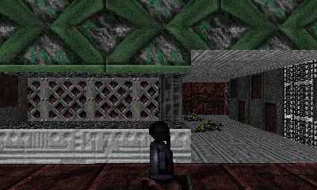 | 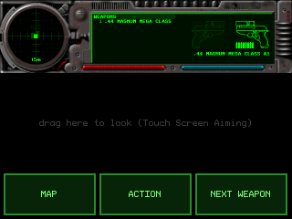 |
| --- | --- |
| **HUD** (default): the view fills the top screen, 400x240 1:1 | the HUD (halved), the look area and the touch buttons |
| 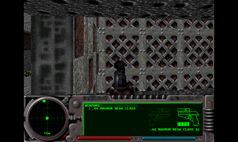 | 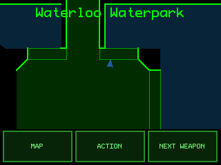 |
| **Map**: a 320x160 view and the HUD on the top screen | the live overhead map and the touch buttons |

- **Touch buttons** (`input_3ds.cpp`, `bottom_3ds.cpp`, `vbl.cpp`,
  `PATCHES.md` 38). A finger that goes down in the button strip (y ≥ 188)
  is a button until it is lifted: it does not look or point. The press
  sets the button's action flag (`_toggle_map`, `_action_trigger_state`,
  `_cycle_weapons_forward`), which `parse_keymap()` ORs in right after the
  key bindings, before the latching: one tap is one press, as with a key,
  and it is recorded in films like one. Touches elsewhere behave as before.

### Performance (Azahar), first version

Azahar 2126.2, profile build (`build-3ds-prof`), `perf-bench.sh` with
`RUNS=1` (Azahar's figures repeat to 0.01 ms between runs), no DSP, the same
three levels as `PERF.md`; ms per frame, **busy** = frame − idle. "Before"
is `exp-a3` (`PERF.md` experiment a', the code at `9a5c4a5`).

| Mode | Level | busy | vs before | render | hud | blit | present | **bottom** | fps |
| --- | --- | --- | --- | --- | --- | --- | --- | --- | --- |
| before | 0 / 6 / 20 | 21.52 / 19.48 / 19.27 | | 12.37 / 10.08 / 9.65 | 0.89 | 1.44 | 6.02-6.24 | — | 30.4 |
| **Classic** | 0 / 6 / 20 | 21.52 / 19.47 / 19.19 | **0.00 / −0.01 / −0.08** | 12.37 / 10.08 / 9.65 | 0.89 | 1.44 | 5.98-6.22 | 0.00 | 30.4 |
| **HUD** | 0 / 6 / 20 | 16.03 / 13.84 / 13.67 | **−5.5 / −5.6 / −5.6** | 11.20 / 8.98 / 8.63 | 0.14 | 1.20 | 1.41 | 1.08-1.09 | 30.3 |
| Map, map every frame | 0 / 6 / 20 | 17.10 / 15.67 / 16.29 | −4.4 / −3.8 / −3.0 | 7.38 / 6.28 / 5.81 | 0.41 | 0.65 | 1.41 | 5.96-6.89 | 30.3 |
| **Map** (map every 3rd frame) | 0 / 6 / 20 | 13.02 / 11.80 / 11.83 | **−8.5 / −7.7 / −7.4** | 7.38 / 6.28 / 5.80 | 0.41 | 0.65 | 1.41 | 1.98-2.29 | 30.3 |

- **Budget met in all three modes** in Azahar: Classic is within 0.1 ms of
  before (its code path only gained a few comparisons); HUD and Map are
  5.5-8.5 ms *below* Classic.
- The win is the **present**: 1.41 ms for the 1:1 400x240 copy against
  ~6 ms for averaging 640x480 (on the console the present was the largest
  zone, 8.7-8.8 ms, `PERF.md`).
- **HUD mode's `bottom`** (1.1 ms) is the HUD averaged to 320x80 plus the
  bottom present, both only when the HUD changed; **`hud`** fell to 0.14
  because the HUD is no longer blitted to the top screen.
- **A map render costs ~6 ms** in Azahar (every line and polygon of the
  level, at native resolution). Rendered every frame it was the largest
  zone after the rasteriser, so it is redrawn every 3rd frame (`kMapEvery`,
  10 Hz): `bottom` 2.0-2.3 ms on average, but the frame that renders the
  map is ~6 ms longer. Frame `max` (57-73 ms in every series, Classic
  included) did not change meaningfully. On the console the rasteriser ran
  ~40% faster than in Azahar, so expect less.
- `render` in HUD mode (400x240, 96 000 pixels) is 9-11% below Classic's
  480x240 (115 200); Map mode's 320x160 view is 40% below.
- **On a New 3DS** the ranking holds and the gap is about the same
  (HUD −5.4 to −5.9 ms, Map −6.1 to −6.5 ms against Classic): "Hardware
  results, first version" below.

### Hardware results (New 3DS, 2026-10-12), first version

**Setup.** New 3DS, Luma3DS, Homebrew Launcher, 3dslink, as in `PERF.md`
"Hardware results". The builds at `f8328ab`: `build-3ds` for the functional
checks, `build-3ds-prof` (`-DA1_PROFILE=ON`) for the benchmarks. Each
benchmark is one `debug-perf` run (`settle 8`, `measure 20`, `quit 1`)
started by pressing A twice; the mode was set by editing `bottom_screen`
in the prefs file over ftpd. Default preferences otherwise, except the sound
rate: the prefs file on the card had **44100 Hz** (the DSP resamples),
where the `PERF.md` session ran at the DSP's native 32728 Hz. Audio runs on
core 1, so busy time is comparable (Classic matches to 0.14 ms), but the
`audio` zone is higher (10.2-10.8 ms against 8.0-8.1). No `debug-audio`.
Logs, 3dslink transcripts and captures: `build-3ds/hw/stage7/` (not in git).

|  | 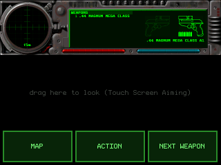 |
| --- | --- |
| 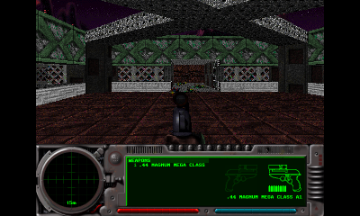 | 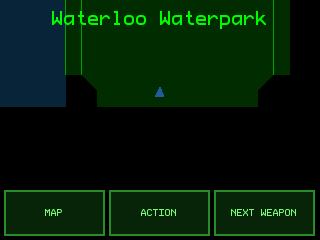 |

Level 0 at the end of the benchmark, HUD (above) and Map (below), captured
on the console (`screen-perf-L0-*.bmp`). The layout is the Azahar
captures' (the HUD bottom screen differs from Azahar's only in 79 radar
pixels); the 3D view and the map differ because the Azahar captures come
from the input script, which walks elsewhere.

**BENCH lines** (ms per frame; busy = frame − idle; "before" is `PERF.md`'s
hardware run at `2603d0d`):

| Mode | Level | fps | frame | max | **busy** | vs before | vs Classic | world | render | hud | blit | present | **bottom** | idle |
| --- | --- | --- | --- | --- | --- | --- | --- | --- | --- | --- | --- | --- | --- | --- |
| before | 0 / 6 / 20 | 30.52 / 30.53 / 30.52 | 32.77 / 32.76 / 32.76 | 57.7 / 58.0 / 58.8 | 18.25 / 17.70 / 17.57 | | | 0.34 / 0.32 / 0.43 | 6.67 / 6.32 / 5.98 | 0.55-0.57 | 1.36-1.39 | 8.68-8.82 | — | 14.52 / 15.06 / 15.19 |
| **Classic** | 0 / 6 / 20 | 30.42 / 30.52 / 30.52 | 32.87 / 32.76 / 32.77 | 119.8 / 58.0 / 57.6 | **18.24 / 17.84 / 17.55** | **−0.01 / +0.14 / −0.02** | | 0.46 / 0.32 / 0.43 | 6.65 / 6.34 / 6.00 | 0.54-0.57 | 1.41-1.45 | 8.67-8.78 | 0.00 | 14.63 / 14.92 / 15.22 |
| **HUD** | 0 / 6 / 20 | 30.27 / 30.32 / 30.32 | 33.03 / 32.98 / 32.99 | 107.3 / 39.1 / 39.2 | **12.79 / 11.90 / 11.76** | −5.46 / −5.80 / −5.81 | **−5.45 / −5.94 / −5.79** | 0.43 / 0.30 / 0.40 | 5.71 / 5.02 / 4.78 | 0.11 | 0.93-0.95 | 4.15-4.23 | **0.84-0.86** | 20.24 / 21.08 / 21.23 |
| **Map** | 0 / 6 / 20 | 30.27 / 30.32 / 30.31 | 33.03 / 32.99 / 32.99 | 115.9 / 42.3 / 41.4 | **11.90 / 11.39 / 11.44** | −6.35 / −6.31 / −6.13 | **−6.34 / −6.45 / −6.11** | 0.44 / 0.30 / 0.40 | 4.08 / 3.84 / 3.49 | 0.36-0.37 | 0.58-0.60 | 4.18-4.21 | **1.61-1.84** | 21.13 / 21.60 / 21.55 |

`gaps=0` in every run; 622-624 frames per 20 s window in Classic (as
before), 619-620 in HUD and Map.

**Pass criteria: all met.**

- **Classic** is within **0.14 ms** of before on all three levels (budget:
  1 ms); every zone is within 0.15 ms of before.
- **HUD and Map** are **5.4-6.5 ms below Classic** (budget: at or below
  Classic + 1 ms).
- **30 fps holds** in every run (30.27-30.52 fps, `gaps=0`).

**Console against Azahar** ("Performance (Azahar), first version" above):

| Mode | busy, Azahar L0 / L6 / L20 | busy, New 3DS | change |
| --- | --- | --- | --- |
| Classic | 21.52 / 19.47 / 19.19 | 18.24 / 17.84 / 17.55 | −15% / −8% / −9% |
| HUD | 16.03 / 13.84 / 13.67 | 12.79 / 11.90 / 11.76 | −20% / −14% / −14% |
| Map | 13.02 / 11.80 / 11.83 | 11.90 / 11.39 / 11.44 | −9% / −3% / −3% |

- **`render`** is 39-49% below Azahar, as in `PERF.md`. The rasteriser line
  `PERF.md` corrected in this stage (2.0 ms + 4.05 ms per 100 000 pixels,
  level 0) predicts **5.9 ms** for HUD's 400x240 and **4.1 ms** for Map's
  320x160; the console measured **5.71** and **4.08**.
- **`present`** (the 1:1 400x240 copy) is **4.15-4.23 ms**: 52% below
  Classic's averaging present (8.7-8.8), but three times Azahar's 1.41 ms.
  Copies cost more on the console (memory traffic, `PERF.md`), so the
  1:1 modes gain less there than in Azahar, Map the least.
- **`bottom`**: HUD **0.84-0.86 ms** (Azahar 1.08-1.09), Map
  **1.61-1.84 ms** (Azahar 1.98-2.29) with the map redrawn every 3rd frame.
  Below Azahar in both modes: `kMapEvery` stays 3.
- **fps**: HUD and Map count 619-620 frames per window against Classic's
  622-624 (30.27-30.32 fps against 30.42-30.52), with more idle time. Both
  are above the 30 fps cap's floor; not investigated (the bottom present
  can wait for a VBlank of its own, `present_bottom()`). *Explained later:
  the profiler leaves the overlay's time out of the wall clock, and only
  Classic draws the overlay in game; frame + overlay is 32.98-32.99 ms in
  all three modes (`PERF.md`, "The profiler").*
- **`max`** on **level 0** is **107-120 ms in all three modes**, Classic
  included, against 57.7 ms in `PERF.md`'s session; levels 6 and 20 stay
  at 39-58 ms. Classic shows it too, so it is not the HUD or Map path. The
  sound rate (44100 Hz here, 32728 Hz then) is the one setting known to
  differ; not checked. Open.

**Memory** (`main loop ended`):

| Run | malloc in use | malloc free | linear heap free |
| --- | --- | --- | --- |
| benchmarks, all modes and levels (profile build) | 22 609-27 409 KiB | 69 870-74 670 KiB | 17 840 KiB of 19 952 |
| HUD functional run: 5 dialog round trips, HOME, sleep (normal build) | 27 623 KiB | 69 656 KiB | **17 848 KiB** of 19 960 |
| Map functional run | 25 462 KiB | 71 817 KiB | 17 848 KiB |
| Classic functional run | 25 068 KiB | 72 211 KiB | 17 848 KiB |
| `PERF.md` session, level 0 (profile build at `2603d0d`) | | | 17 848 KiB of 19 960 |

The linear heap ends at the same free size in every run, with or without
dialogs, and as before stage 7. The HUD-mode surface reallocated on each
dialog round trip leaves nothing behind there. malloc use varies with how
much of the level was played.

**Functional checks** (normal build, the player on the console;
✓ = as expected):

| Check | HUD | Map | Classic |
| --- | --- | --- | --- |
| Start a game: top and bottom screens as in the captures | ✓ | ✓ | ✓ (as before, legend on the bottom) |
| MAP opens the top-screen map, MAP again closes it | ✓ | ✓ | ✓ (key binding; no buttons in Classic) |
| NEXT WEAPON changes the weapon; ACTION at a door or switch | ✓ | ✓ | n/a |
| Drag above the buttons to look (Touch Screen Aiming on); speed as in Classic | ✓ | ✓ | ✓ (reference) |
| START: dialog, legend on the bottom screen; B: game and HUD/map back | ✓ (5 round trips) | ✓ | ✓ |
| HOME and back | ✓ (5.2 s) | ✓ (3.4 s) | ✓ (3.8 s) |
| Sleep (lid closed) and wake: the bottom screen comes back | ✓ (0.9 s) | ✓ (0.9 s, a second run) | ✓ (1.0 s) |
| Terminal in level 1: legible, header and footer apart, paging | ✓ (400x240, font 10/12) | ✓ (400x160) | ✓ (640x320, font 19/22) |
| No tearing or flicker on the bottom screen while the radar or map moves | ✓ | ✓ | ✓ |
| Quit to the main menu: the legend is back | ✓ | ✓ | ✓ |

The player found no problem in any mode. The terminal sizes are from the
log (`[3ds] terminals:`); in HUD and Map the layout switches to 640x320
for each dialog and back, which is how the round trips were counted.
